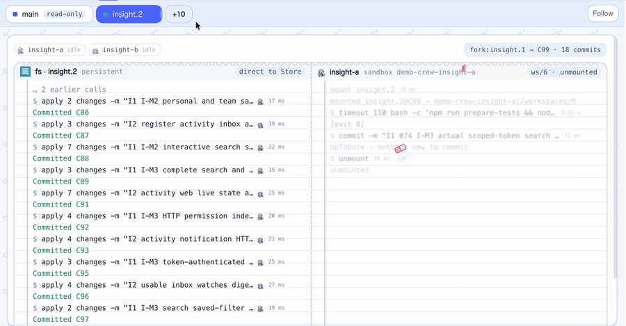
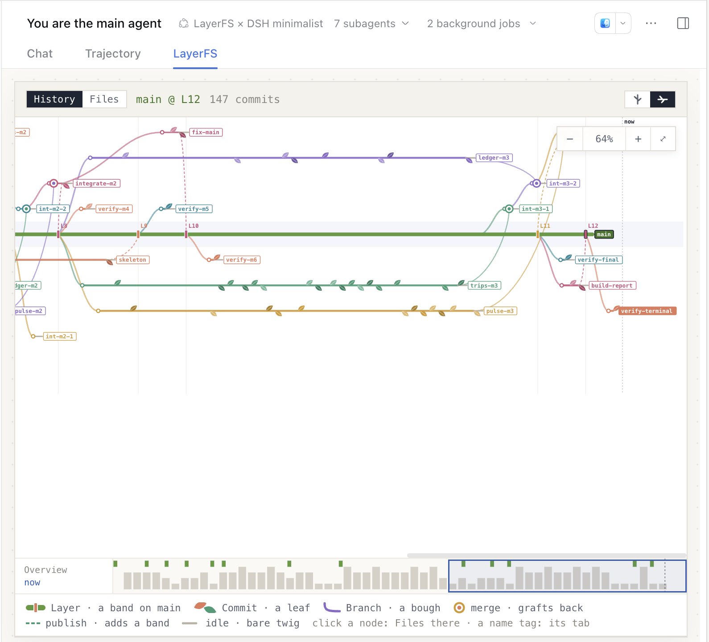
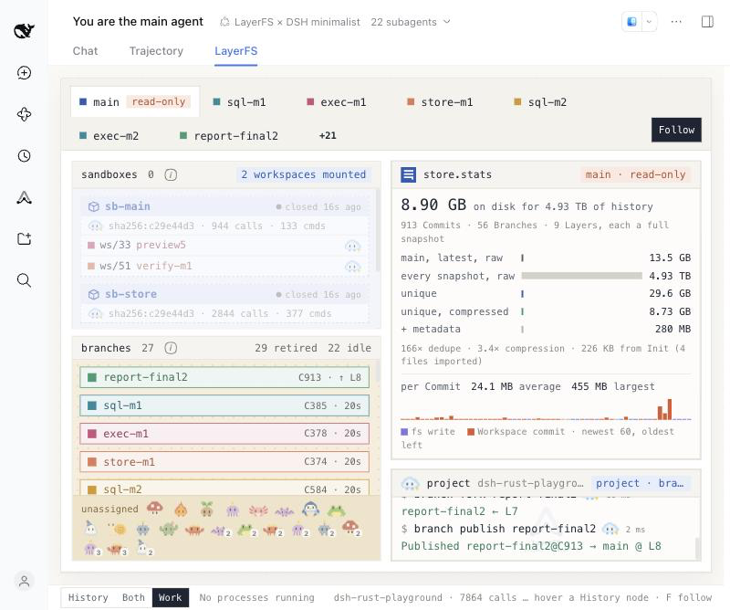
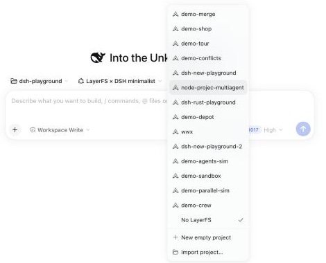
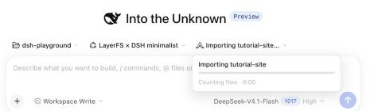
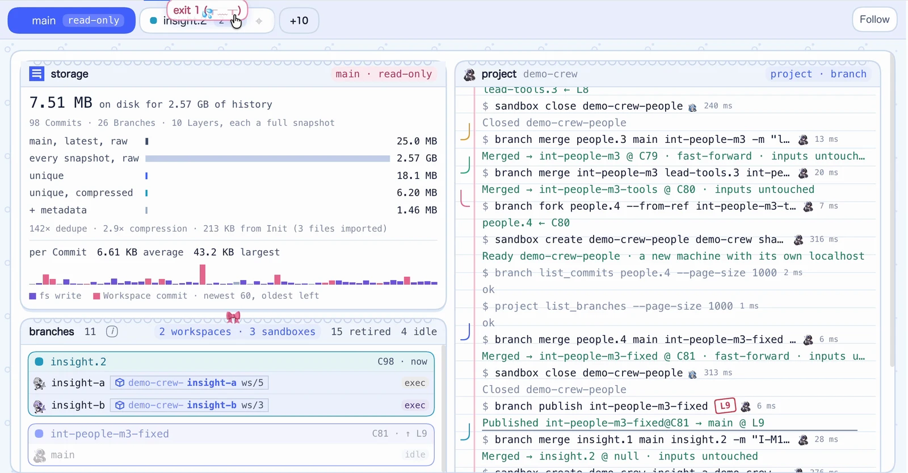
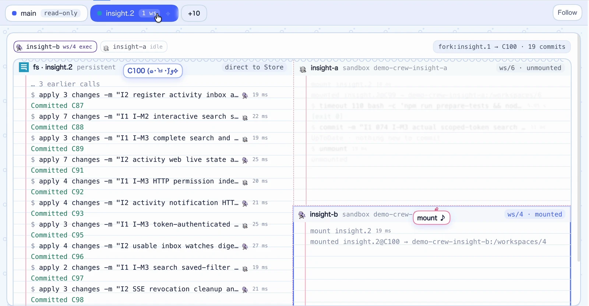
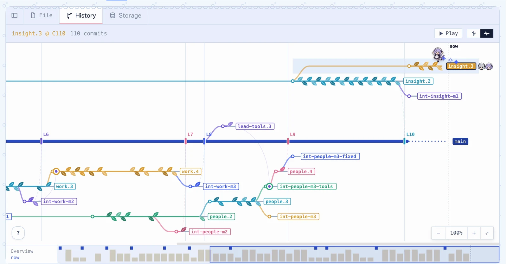
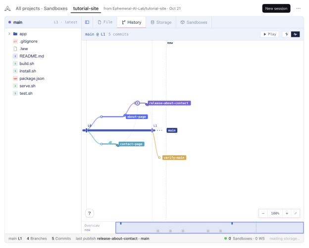
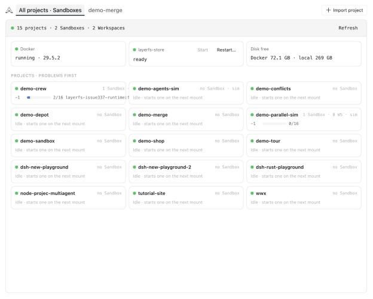

> **Status:** Current general guide. Windows WSL2 support describes current main, added after the v1.0.0 source release.

<h1 align="center"></h1>

<p align="center"><strong>Every agent gets its own Branch. You watch them all, live.</strong></p>

<p align="center">
  <a href="https://github.com/deepseek-ai/deepseek-harness"></a>
  <a href="https://github.com/Ephemeral-AI-Lab/layerfs"></a>
  
  <a href="https://github.com/Ephemeral-AI-Lab/layerfs/blob/main/LICENSE"></a>
</p>

<p align="center">
  <a href="https://layerfs.ai/docs/integrations/dsh/"></a>
  <br><sub>A recorded run: a lead and five agents build one application on Branches of their own (2× speed). <a href="https://layerfs.ai/docs/integrations/dsh/">Full video on layerfs.ai</a></sub>
</p>

<p align="center">
  <a href="#-install">Install</a> ·
  <a href="#-two-real-runs">Two real runs</a> ·
  <a href="#-your-first-session">Your first session</a> ·
  <a href="#-what-it-adds">What it adds</a> ·
  <a href="#-develop">Develop</a> ·
  <a href="https://github.com/Ephemeral-AI-Lab/layerfs">LayerFS</a>
</p>


`dsh-layerfs` is a plugin bundle for [DeepSeek Harness](https://github.com/deepseek-ai/deepseek-harness) (dsh). It changes no dsh code.

With the bundle, agents in a dsh session work on a LayerFS project from bash, with the `layerfs` command: one LayerFS SDK call per command (or a short Node script on the SDK for many calls). They fork Branches, test them in Sandboxes, and merge and publish, and you watch every agent's Branch grow, live. The conversation gets **Work** and **History** tabs that draw what each agent did, subagents included. The design is in [#346](https://github.com/Ephemeral-AI-Lab/layerfs/issues/346). This repository is the LayerFS UI: it moved here from the layerfs repository's `dsh/` folder at `cea713e767` ([#428](https://github.com/Ephemeral-AI-Lab/layerfs/issues/428)), and builds on a LayerFS checkout named by `LAYERFS_SOURCE` (see [Where LayerFS comes from](#where-layerfs-comes-from)).

## 📦 Install

The quickest way is to let a coding agent do it. Paste this into one running on the machine where dsh web will run, in a folder holding clones of this repository and of LayerFS side by side:

```text
Set up LayerFS × DSH for me: the dsh-layerfs plugin bundle in DeepSeek Harness (dsh) web, on
real LayerFS.

1. Read README.md in https://github.com/Ephemeral-AI-Lab/dsh-layerfs, the "Install" section
   and its "Install step by step" steps. It is the guide: follow its steps in order and for
   this machine's OS (macOS, Linux, or Windows; Windows uses the WSL2 setup below).
2. Check what it needs first: Node 22.19 or newer, pnpm, Docker (Docker Desktop on macOS),
   network access, a LayerFS checkout (https://github.com/Ephemeral-AI-Lab/layerfs) at the
   commit in layerfs.json, beside this repository as ../layerfs or named by LAYERFS_SOURCE,
   and a built deepseek-harness checkout (https://github.com/deepseek-ai/deepseek-harness)
   beside this repository; if there is none, clone it there and run
   pnpm install && pnpm run build in it. If something is missing that you cannot install,
   stop and tell me which.
3. Step 1, Install LayerFS: in the LayerFS checkout, build layerfs-daemon and the SDK's
   native addon in the rust:1.85.1-bookworm image, gather them into the bundle folder, build
   the runtime image and note its image ID.
4. Step 2: in this repository, run pnpm install and pnpm run build, with LAYERFS_SOURCE set
   to the LayerFS checkout and DSH_SOURCE to the deepseek-harness checkout (absolute paths).
5. Step 3: make a fresh profile with its own DSH_HOME (not ~/.dsh) and add only dsh-layerfs
   with dsh's plugin command. Do not add dsh-layerfs-demo.
6. Step 4: write layerfs-host's settings into the profile's cordis.patch.yml: the image ID,
   plus the bundle folder on macOS or the daemon path on Linux.
7. Step 5: start dsh web with that DSH_HOME and give me the printed
   http://127.0.0.1:…/?token=… link.
8. Step 6: run pnpm test in this repository, and check that GET /layerfs/status reports no missing
   settings.

Report what you ran and what each step returned. A long cargo build may be run again until
it prints Finished, as the guide says; if anything else fails, stop and give me the exact
error, and don't retry it on your own.
```

It follows the six steps below and asks before anything it cannot do. Expect a few minutes for the first LayerFS build.

<a id="-install-into-a-dsh-profile"></a>
<details>
<summary><b>Install step by step: six steps, without an agent</b></summary>

These steps take a fresh clone of this repository to LayerFS × DSH in dsh web: first LayerFS itself, then the dsh bundle. Only dsh web is supported. dsh desktop serves the same web client but was not tested. The headless profile composes no preset registry, so it offers no preset; the Host and the bash environment still load there.

### You need

| What | For | Notes |
|---|---|---|
| Node 22.19 or newer, and pnpm | everything | |
| A LayerFS checkout at the pinned commit | the SDK, the agent skill, the Linux build | `../layerfs` beside this repository, or `LAYERFS_SOURCE=<path>`; the commit is in [`layerfs.json`](layerfs.json) |
| A built deepseek-harness checkout | the client build and dsh itself | `../deepseek-harness` beside this repository, or `DSH_SOURCE=<path>` for the build. In it, `pnpm install && pnpm run build` (its README) |
| Docker | Live | Docker Desktop on macOS. It builds LayerFS and runs its Sandboxes |
| Network access | step 1 | crates and the base images |

Below, `$DSH_LAYERFS` is this repository's absolute path, `$LAYERFS_SOURCE` the LayerFS checkout's and `$DSH` the deepseek-harness checkout's.

### 1. Install LayerFS

Live needs three things from the LayerFS checkout: the JavaScript SDK, a Linux build of the daemon and the SDK's native addon, and a runtime image. Nothing is published, so you build them there.

**The SDK** is LayerFS #428's three packages in `sdk/js/packages`: `@layerfs/agent` (what agents' scripts call), `@layerfs/backend` (background processes, a Workspace's status, storage) and `@layerfs/runtime` (what the Host runs on a LayerFS home: the worker, Init, removal, status). They are plain JavaScript with no dependencies. Run `npm install` once in `$LAYERFS_SOURCE/sdk/js` (it only links the three to each other); the Host links each as `link:../../.layerfs/sdk/js/packages/<name>`, and step 2's `pnpm install` first points `.layerfs` at `$LAYERFS_SOURCE`, then makes those links. Only the native addon is built, and a fresh clone has none (`sdk/js/native/layerfs.node`). On macOS and Windows the Host never loads an addon itself: the home's worker runs the Linux build below. On Linux, see step 4.

**The `layerfs` command** agents run (`DSH_LAYERFS_CLI`) is the checkout's `cli/` folder: one `@layerfs/agent` call per command, JSON on stdout ([cli/sdk-to-cli.md](https://github.com/Ephemeral-AI-Lab/layerfs/blob/main/cli/sdk-to-cli.md) on the #428 branch). Run `npm --prefix "$LAYERFS_SOURCE/cli" install` once: it only links `cli/node_modules/@layerfs/agent` to `sdk/js/packages/agent` and downloads nothing. `pnpm install` and `pnpm test` stop with that command when it is missing.

**The Linux build.** Build `layerfs-daemon` and the addon in the Rust 1.85.1 image, from the LayerFS checkout's root so Cargo picks up its [`.cargo/config.toml`](https://github.com/Ephemeral-AI-Lab/layerfs/blob/main/.cargo/config.toml) (the ARM64 profile). This is the recipe of LayerFS's [benchmark/AGENTS.md](https://github.com/Ephemeral-AI-Lab/layerfs/blob/main/benchmark/AGENTS.md#environment), with the crates fetched into a Docker volume instead of the host's `~/.cargo/registry`:

```sh
cd "$LAYERFS_SOURCE"
docker pull rust:1.85.1-bookworm
docker volume create layerfs-cargo && docker volume create layerfs-target
mkdir -p core/target/cluster2-linux
docker run --rm -v "$LAYERFS_SOURCE":/work:ro -v layerfs-cargo:/usr/local/cargo/registry -w /work \
  rust:1.85.1-bookworm cargo fetch --manifest-path core/Cargo.toml --locked
docker run --rm -v "$LAYERFS_SOURCE":/work:ro -v layerfs-target:/work/core/target/cluster2-linux \
  -v layerfs-cargo:/usr/local/cargo/registry:ro -e CARGO_TARGET_DIR=/work/core/target/cluster2-linux -w /work \
  rust:1.85.1-bookworm cargo build --manifest-path core/Cargo.toml --offline --locked --release -j 6 \
  -p layerfs-node --lib -p layerfs-daemon --bins
```

The fetch takes about 30 seconds; on an arm64 Mac with Docker limited to 8 CPUs a cold release build took about 2.5 minutes at `-j 2` and 65 seconds at `-j 6`. Agents keep every command under 2 minutes: put `timeout 110` before `cargo` inside the container (`… rust:1.85.1-bookworm timeout 110 cargo build …`; macOS has no `timeout` command) and run the same command again until it prints `Finished`, since Cargo keeps what it compiled.

Then, still in `$LAYERFS_SOURCE`, gather the build into one folder, the `bundle` (any folder Docker Desktop shares, such as one under your home):

```sh
BUNDLE=$HOME/layerfs-linux-build
mkdir -p "$BUNDLE/sdk/js"
docker run --rm -v layerfs-target:/t:ro -v "$BUNDLE":/out rust:1.85.1-bookworm sh -c \
  "cp /t/release/layerfs-daemon /out/ && cp /t/release/liblayerfs_node.so /out/layerfs.node && chown $(id -u):$(id -g) /out/layerfs-daemon /out/layerfs.node"
cp -R sdk/js/packages sdk/js/package.json "$BUNDLE/sdk/js/"
```

That folder serves Linux (`daemon` and `LAYERFS_NATIVE`). **macOS and Windows need a sealed bundle**: the home's worker runs the bundle's `sdk/js/packages/runtime/src/worker/server.js` and checks every file against its `manifest.json` before it listens, which only the tool below writes.

Instead, LayerFS's [`tools/worktree.py`](https://github.com/Ephemeral-AI-Lab/layerfs/blob/main/tools/worktree.py) ([parallel worktrees](https://github.com/Ephemeral-AI-Lab/layerfs/blob/main/docs/general/parallel-worktrees.md)), run in `$LAYERFS_SOURCE`, does the same with per-checkout caches, and seals the folder with a `manifest.json`. It needs the runtime image below to exist first, and was not tried for this guide:

```sh
python3 tools/worktree.py register --worktree "$LAYERFS_SOURCE" --owner dsh \
  --build-image rust:1.85.1-bookworm --runtime-image layerfs-352-runtime:node24 --sandbox-image layerfs-352-runtime:node24
python3 tools/worktree.py prepare --resources <printed resources.json> --platform linux
python3 tools/worktree.py build --resources <printed resources.json> --platform linux --profile release --jobs 6
```

`build` prints the sealed folder, `~/.cache/layerfs-worktrees/<id>/artifacts/build-linux-<hash>`, which serves as `bundle`.

**The runtime image** is the Linux image Sandboxes and the macOS worker run. The worker runs `node` from it, so it must carry Node, plus whatever your agents' commands run in Workspaces. The one in use is built from [`tools/runtime/Dockerfile`](tools/runtime/Dockerfile): Node 24.21 on Debian bookworm (the daemon's own base), with corepack's pnpm and yarn prepared offline, and the base's git, python3, gcc and make.

```sh
docker build -t layerfs-352-runtime:node24 "$DSH_LAYERFS/tools/runtime"
docker image inspect --format '{{.Id}}' layerfs-352-runtime:node24     # the image setting
```

Use the ID your machine prints: the same build can get a different ID in another image store. Images are never pulled for LayerFS (the worker starts with `--pull never`).

### 2. Build the dsh bundle

```sh
cd "$DSH_LAYERFS"
LAYERFS_SOURCE="$LAYERFS_SOURCE" pnpm install
pnpm run build
```

`pnpm install` first runs [`tools/layerfs-source.mjs`](tools/layerfs-source.mjs), which points the `.layerfs` link at `LAYERFS_SOURCE` (default `../layerfs`) and prints whether that checkout is at the pinned commit; see [Where LayerFS comes from](#where-layerfs-comes-from).

`pnpm run build` bundles the client into `packages/client/lib/` with the checkout's `tsdown`: `$DSH_SOURCE/node_modules/.bin/tsdown`, else `../deepseek-harness` beside the repository. Prefer an absolute `DSH_SOURCE` path (`DSH_SOURCE="$DSH" pnpm run build`). Relative paths resolve from `packages/client/`, matching the original build command; an empty value uses the default checkout. The launcher passes the resolved absolute path to the client config. If the checkout or its tsdown CLI is missing, the build stops with `tsdown: No such file or directory`. Run it again after changing the client.

### 3. Make a profile

Choose a `DSH_HOME` of your own, so your usual `~/.dsh` is not touched, and use its `web` profile. dsh's `plugin` command makes the profile from the shipped `web` template on first use, installs the packages there with pnpm, and adds each one that is a bundle to the profile's `dsh.profile.bundles`:

```sh
export DSH_HOME=$HOME/dsh-layerfs        # any empty folder
pnpm --dir "$DSH" dsh plugin --profile web add "link:$DSH_LAYERFS/packages/dsh-layerfs"
```

Install `dsh-layerfs` only. The demo bundle `dsh-layerfs-demo` is disabled permanently and is not in this repository. The bundle includes the LayerFS scripted model, switched off; see [Scripted runs](#scripted-runs).

The profile is `$DSH_HOME/profiles/web/`. Its `package.json` should now read:

```json
"dependencies": {
  "dsh-layerfs": "link:…/dsh-layerfs/packages/dsh-layerfs"
},
"dsh": { "profile": { "bundles": ["@deepseek-ai/dsh-base", "@deepseek-ai/dsh-web-app", "dsh-layerfs"] } }
```

Making the profile by hand is the same: that `package.json`, then `pnpm install` in the profile folder. Keep the `pnpm-workspace.yaml` dsh writes there (`nodeLinker: hoisted`), so the bundle shares dsh's own packages.

### 4. Configure Live

The Host reads its deployment settings from `layerfs-host` in the profile's `cordis.patch.yml` ([`config.js`](packages/host/src/config.js)). dsh writes that file as `[]`; replace the `[]` with the entry list below.

| Setting | Linux | macOS |
|---|---|---|
| `image` | required | required |
| `daemon` | required | defaults to `<bundle>/layerfs-daemon` |
| `bundle` | not used | required |
| `docker` | `/var/run/docker.sock` by default | the same |
| `volumes` | `/var/lib/docker/volumes` by default (Docker's data-root); the Host's user must write it | not used |
| `home`, `traceDir` | `<OS temp>/dsh-layerfs/{home,traces}` by default | the same |
| `containerPrefix` | `layerfs-` by default: Sandboxes `<prefix><project>-<n>` | the same, and the worker `<prefix>worker` |
| `stateDir` | `<profile>/dsh-layerfs` by default (bindings, agent names, journals) | the same |

An Init without the required settings is refused with "LayerFS is not configured: set … for layerfs-host in the profile patch"; `GET /layerfs/status` lists what is `missing`.

```yaml
# $DSH_HOME/profiles/web/cordis.patch.yml
- id: layerfs-host
  config:
    image: "sha256:<64 hex>"                   # step 1's image ID
    bundle: /Users/<you>/layerfs-build          # macOS: step 1's sealed bundle (manifest.json)
    # daemon: /path/to/layerfs-daemon           # Linux
```

**On macOS** the Mac runs no Store call itself. `@layerfs/runtime` runs one long-lived Linux container per LayerFS home, the worker (`<containerPrefix>worker`, `layerfs-worker` by default, labelled `layerfs.role=worker`), and every Store call of the Host and of agents' scripts runs there with the sealed bundle's `layerfs.node`; its endpoint is `<home>/worker/endpoint.json`, and agents get it as `DSH_LAYERFS_WORKER_ENDPOINT` (the route is open to the dsh adapter only). The Host starts it when it starts; a worker of another build is replaced, so load a new `bundle` only while no dsh run is live. It runs with `--restart unless-stopped`. A call of the Host or an agent that finds it down keeps its own error, and the Host asks the runtime to start it again. The Store container of dsh before #428 (`<containerPrefix>store`) keeps the worker from starting while it runs: the LayerFS page's All projects tab then shows one banner, "Store calls wait for an upgrade", whose **Switch…** action (confirmed: any run still on it is cut off) stops and removes it, then starts the worker.

**On Linux** the Host and agents' scripts load `@layerfs/agent` in their own process, from `sdk/js/packages` in the LayerFS checkout (through `.layerfs`). It loads the addon from `LAYERFS_NATIVE`, or else `sdk/js/native/layerfs.node`: build it on that machine with `npm --prefix "$LAYERFS_SOURCE/sdk/js" run build:native` ([SDK README](https://github.com/Ephemeral-AI-Lab/layerfs/blob/main/sdk/js/README.md#builds-and-compatibility); it needs Cargo 1.85.1 on the host), or set `LAYERFS_NATIVE` in dsh web's environment to a Linux build's `layerfs.node`. `daemon` is that build's `layerfs-daemon`. The Store must be on a local Linux filesystem (ext4, xfs or btrfs). Init installs the Store straight into the new project's volume directory under Docker's volumes directory (`volumes`, `/var/lib/docker/volumes` by default), which Docker keeps root-only, so run dsh web as a user that can write it, such as root, and give it a `home` that user owns; otherwise the runtime fails the Init (`Unsupported`) before it makes a volume.

<a id="windows-live"></a>

**On Windows** dsh web and the default profile remain on Windows. `@layerfs/runtime`
starts one long-lived Node worker in a selected WSL2 distribution, owned by the
Host through its stdin. That distribution needs its own running
Docker Engine, `/dev/fuse`, Node 22.19 or newer, and a **sealed Linux bundle** from
`tools/worktree.py build` (run the build inside WSL, using the private resources
described above). Docker Desktop's Windows named pipe is not used by this adapter.

Install and build the plugin on Windows with steps 2–3. You can add it to your
existing default `web` profile; omit the example's `DSH_HOME` override to do so.
Keep that profile's existing patch entries and add:

```yaml
- id: layerfs-host
  config:
    image: "sha256:<exact image ID from the WSL Docker Engine>"
    bundle: /home/<linux-user>/layerfs-build   # sealed Linux bundle, including manifest.json
    wslDistribution: Ubuntu
    # wslUser: root                          # default; must access Docker and its Store volumes
    # wslNode: /usr/local/bin/node             # default; absolute Linux executable path
    # wslHome: /var/lib/dsh-layerfs-windows/my-profile
    containerPrefix: layerfs-windows-
```

`daemon` defaults to `<bundle>/layerfs-daemon`. `bundle`, `daemon`, `wslNode`, and
`wslHome` are Linux paths in that distribution. `home`, `traceDir`, and `stateDir`
remain Windows paths. The default Linux home is a persistent directory under
`/var/lib/dsh-layerfs-windows`, derived from the Windows home. Stores live in the
WSL Docker Engine's named volumes on its local Linux filesystem. Never put the
Store or Linux discovery home on `/mnt/c` or another Windows-backed mount.

The Windows SDK entry preserves the regular SDK API for Host clients and agents.
It forwards native calls to the worker; the product SDK and daemon are unchanged.
Imports translate drive paths with that distribution's `wslpath`; WSL UNC paths
must name the selected distribution. Init reads everything through the Linux
filesystem view, including `.git` and ignored files. Windows ACLs are not converted
to POSIX metadata; imported metadata is what WSL exposes.

The worker validates the sealed bundle's file hashes, listens only on Linux
loopback, and requires a random secret delivered over its startup pipe. Its
Windows endpoint file is ACL-restricted to the current Windows user and SYSTEM.
The Windows SDK source must match the sealed Linux SDK (allowing Git line-ending
normalization). Windows binding-file readers share the writers' short admission
lock so reads cannot overlap atomic file replacement; failed writes are not retried.
Each project's native Store stays open while used and closes after a quiet minute.
Project removal explicitly releases its cached Store before deleting the volume.
Disposal drains admitted calls without killing mounted commands. Runtime Start
and confirmed Restart act on this worker; a silent or busy worker is retained.
Changing WSL deployment settings requires restarting dsh.

A request lost before it is sent is `Failed`; a sent request whose reply is lost
is `Unknown` and is never replayed. Failed Windows Init attempts retain their
volume and Linux discovery state, with the original failure and volume recorded
in `windows-init-failures.jsonl` under `stateDir`. Inspect that evidence before
deciding how to recover. The macOS container adapter and Windows WSL adapter
share the worker codec, but keep separate deployment and lifecycle code.

The codec is versioned JSON with explicit binary values, independent of V8
serialization versions. Upgrade the Host and worker together, with no active
calls; old V8 workers are incompatible and must be restarted. A protocol
failure is reported explicitly and never replays a call. An uncertain Init reply
also retains the macOS home and volume, recorded in `init-failures.jsonl` under
`stateDir`, so protocol errors cannot trigger deletion of a completed Init.

This setup uses the repository pnpm workspace and a dsh source checkout. Packaged
dsh desktop and npm/plugin-market installation are not qualified
([#406](https://github.com/Ephemeral-AI-Lab/layerfs/issues/406)). Docker Desktop
volume visibility from a WSL Linux host is a separate unsupported topology;
see [#380](https://github.com/Ephemeral-AI-Lab/layerfs/issues/380).

From the dsh checkout, restart your normal Windows `dsh web` server, keeping its
usual port (for example `--port 3080`). `GET /layerfs/status` should report an empty
`missing` list. The LayerFS runtime page reports both the WSL worker and its Docker
Engine. This does not require running a second dsh server in WSL.
The [verification record](docs/windows-live-verification-20261022.md) pins the
tested source, native bundle, outcomes and platform gaps.

**Running two dsh webs on one machine.** The default `home` and `traceDir` are the same for every profile, so two dsh webs would share projects and the worker. Give each its own pair under the OS temp area, and its own `containerPrefix`, since container names are per Docker engine (the Store container of another home is refused, never taken over):

```yaml
    home: /private/var/folders/…/T/dsh-layerfs-<name>/home        # node -p "require('fs').realpathSync(require('os').tmpdir())"
    traceDir: /private/var/folders/…/T/dsh-layerfs-<name>/traces
    containerPrefix: <name>-
```

Keep both in the OS temp area. Bash calls in Workspace Write mode run in dsh's sandbox, which lets them write only there, and a LayerFS call writes both (a mount elsewhere fails `PermissionDenied`).

### 5. Start dsh web

```sh
DSH_HOME=$HOME/dsh-layerfs pnpm --dir "$DSH" dsh web --no-open --port 3090
```

Open the printed `http://127.0.0.1:3090/?token=…` link. Run the preset's sessions in Workspace Write mode; subagents inherit it. Agents use dsh's own model, which needs dsh's sign-in or keys, as usual. A fresh `DSH_HOME` has neither: sign in from the page's account menu.

What you see ([TUTORIAL.md](TUTORIAL.md) walks through a first run with pictures):
- A fresh `DSH_HOME` has no workspace. **Add workspace** (the sidebar's folder button, or the new session's workspace chip) picks one; the preset and project chips appear once a workspace is chosen. On macOS, dsh web's folder picker is the system's folder panel, which opens in front of the browser, not in the page.
- **LayerFS × DSH minimalist** is the default preset of a new session. A preset picked in dsh's settings still wins.
- The New Session row has a **project chip** beside the preset chip. Its menu lists every project (the workspace folder's first) and "No LayerFS", with **New empty project** (a random name, such as calm-otter) and **Import project…** below. Import opens the same folder picker and imports the folder as a new project, which becomes the workspace folder's default; importing the same folder again gives `name-1`, `name-2`, …. Both make Live projects. Picking a project switches a blank session to the minimalist preset.
- A session on a project has two more tabs beside Chat and Trajectory: **Work** (the agents' terminals, Branches and Sandboxes) and **History** (File, History, Storage and Sandboxes: the project's Sandboxes tab, as on the LayerFS page).
- The sidebar's **LayerFS** page shows one project at a time: its Files, History, Storage and Sandboxes, a New session action, and Refresh and Remove. Its **All projects · Sandboxes** tab is the switcher. Under a health strip (Docker, Store calls, free disk on the host and in Docker, the last sweep of stopped Sandboxes) it has a card per project with a running Sandbox or a problem, each Sandbox with its scratch (what it wrote outside its Workspaces), a list of the idle projects with their Store volume's size, and leftovers: stopped containers and Store volumes no project uses. Every figure comes from `@layerfs/runtime` (`status`, `sandbox.list`, `volume.list`); the Host runs no Docker command itself.

### 6. Check

```sh
cd "$DSH_LAYERFS" && pnpm test
node tools/check-session.mjs 'http://127.0.0.1:3090/?token=…' <session id>
```

`pnpm test` runs the Host, scripted model, model and playback tests, with LayerFS stubbed; it starts no Docker container or daemon. `check-session.mjs` checks that a finished session's tabs draw what LayerFS reports. The page's URL does not carry the session id: a session is the folder `$DSH_HOME/sessions/<workspace>/session-<uuid>`, whose name is the id.

</details>

## 🏁 Two real runs

On 2026-10-20, one dsh main agent and seven worker subagents on `deepseek-flash` took an empty LayerFS project to a published, verified `main`, twice: a small app in under an hour and a hard one in an afternoon. Every change went through the SDK as Branches, Commits, merges and publishes.

<table>
  <tr>
    <td width="50%" valign="top"><a href="demo/wayfare/README.md"></a></td>
    <td width="50%" valign="top"><a href="demo/quarry/README.md"></a></td>
  </tr>
  <tr>
    <td valign="top"><b><a href="demo/wayfare/README.md">Wayfare</a></b>: a collaborative trip planner in Node 24, with no third-party dependencies.</td>
    <td valign="top"><b><a href="demo/quarry/README.md">Quarry</a></b>: a SQL database in Rust, checked row by row against SQLite, with every build's <code>target/</code> committed.</td>
  </tr>
</table>

| | Wayfare | Quarry |
|---|---|---|
| Time | 56 min, 8 agents | 4 h 16 min, 8 agents |
| History | 147 Commits, 31 Branches, 13 Layers | 913 Commits, 56 Branches, 9 Layers |
| Checks | 334/334 tests, A01–A12 pass | 891 tests, 800/800 sqllogictest, Q01–Q12 pass |
| Store | 1.21 MB on disk for 91.5 MB of snapshots, 27× dedupe | 8.90 GB on disk for 4.93 TB of snapshots, 166× dedupe: less than one copy of `main` (13.5 GB) |

Each record has the task, the spec, the system prompt, the progress ledger, the published build report and every number above. The screenshots are from the end of each run, taken with an earlier version of the tab, before it split into Work and History.

## 🚀 Your first session

[TUTORIAL.md](TUTORIAL.md) walks through a first run step by step, with 19 screenshots: an import, two subagents on Branches of their own, a merge and a publish.

**1. Start a session on a project.** In dsh web, start a new session. Its row has the preset chip, which reads **LayerFS × DSH minimalist**, and beside it the **project chip**. Open the project chip and pick **New empty project**, or **Import project…** to choose a folder and import it as a new project; a card under the chip shows the import's progress. The session's project is fixed at its first bash call that uses it.

<table>
  <tr>
    <td width="50%" valign="top"><br><sub>The project chip's menu.</sub></td>
    <td width="50%" valign="top"><br><sub>An import in progress.</sub></td>
  </tr>
</table>

**2. Switch to Workspace Write.** Set the session's mode to **Workspace Write**. Bash calls then run in dsh's sandbox, which lets LayerFS write its home and traces; subagents inherit the mode.

**3. Give it a task.** The preset already knows the SDK and its rules, so ask for work as you would any agent. Work that splits across subagents shows the most. For example:

```text
Build a small two-page website in this project: a home page and an about page that link to
each other, plus a check script (node check.mjs) that fails if either page is missing or a
link is broken.

Give each page to its own subagent, each on its own Branch forked from main. Each subagent
runs node check.mjs in a Workspace before it commits. When both are done, merge their
Branches into one, fix any Conflict, run the check once more, and publish to main.
```

**4. Watch the Work tab.** **Work** sits beside Chat and Trajectory. Its chips are `main` and the Branches. On `main` you see the Store's size and the project terminal, which prints every Branch call (fork, merge, publish) with the agent that made it. A Branch's chip shows its `fs` terminal, the Store reads and writes on that Branch, and one pane per Workspace mounted on it, with the commands run there. Calls appear in step with the run, and **Follow** keeps up with the newest.

<table>
  <tr>
    <td width="50%" valign="top"><br><sub><code>main</code>: the Store's size and the project terminal.</sub></td>
    <td width="50%" valign="top"><br><sub>A Branch: its <code>fs</code> terminal and each agent's Workspace.</sub></td>
  </tr>
</table>

**5. Watch History grow.** **History** draws every Branch and Commit, which agent made it, and the Layers on `main`, one per publish. It grows as the agents work; **Play** replays it from the start. **File** shows the files at any point and **Storage** what the Store holds.

<p align="center"><br><sub>History: 110 Commits on a dozen Branches, <code>main</code> at L10.</sub></p>

**6. Come back to it later.** The sidebar's **LayerFS** page shows one project at a time: where `main` is and what was published last, Files beside File, History, Storage and Sandboxes (click a History node to see the files at that point), **New session** to start another session on the project, and, in its ⋯ menu, **Remove project…**, which asks for the project's name first. Its **All projects · Sandboxes** tab is the switcher: the health strip, a card per project that runs a Sandbox, the idle projects, and leftovers.

<table>
  <tr>
    <td width="50%" valign="top"><br><sub>A project: <code>main</code>'s files and its History.</sub></td>
    <td width="50%" valign="top"><br><sub>All projects · Sandboxes.</sub></td>
  </tr>
</table>

## ✨ What it adds

| Piece | Package | Where it shows |
|---|---|---|
| Host plugin `layerfs-host` | `@dsh-layerfs/host` | bash environment, session records, the `/layerfs` web route |
| Client plugin `layerfs-client` | `@dsh-layerfs/client` | Work and History tabs, project chip, LayerFS page (dsh web) |
| Agent preset `layerfs-dsh-minimalist` | `dsh-layerfs` (`presets/`) | "LayerFS × DSH minimalist" in the preset menu |
| LayerFS scripted model `layerfs-mock` (on by default) | `@dsh-layerfs/mock` | "LayerFS scripted model · …" models, the LayerFS page's Tests tab, the Run bar |
| View model | `@dsh-layerfs/model` | used by the client and the Host |
| Renderer | `@dsh-layerfs/view` | used by the client |

### Scripted runs

The LayerFS scripted model plays scripted agent runs through the real dsh agent loop and tools, without a language model, to test and show the LayerFS UI ([dsh-layerfs#1](https://github.com/Ephemeral-AI-Lab/dsh-layerfs/issues/1)). It ships in the bundle switched on, with this checkout's `scenarios/`; turn `@dsh-layerfs/mock` off on dsh's Plugins page to hide it. Off, nothing of it shows. A run picks its scenario's model on its own Session; dsh would save that pick as the default model for new Sessions, so the plugin keeps scripted models off the default and every other folder keeps your own.

- **Scenarios** live in [`scenarios/`](scenarios/), one folder each with a `scenario.json` (loader and full format: [`packages/mock/src/scenario.js`](packages/mock/src/scenario.js)). Every step is one tool call of the minimalist preset (bash, subagent, send_message, the job tools) or a reply, written as an agent would type it. A scenario has one form, its first tag: in a `cli` scenario every bash step is plain `layerfs …` lines; in an `sdk` one every bash step is one inline Node script on the SDK. Half the scenarios are each: `cli` for shop, crew, parallel, checkpoints and conflicts; `sdk` for depot, tour, sandbox, agents and merge. A step that runs commands creates its own Sandbox, mounts one Workspace, runs, commits, unmounts and closes the Sandbox.
- **Placeholders.** `{{scenario}}` (the folder's absolute path, written in double quotes) and `{{image}}` (the scenario's runtime image) are filled when it loads. `{{sandbox}}` and `{{commit:<ref>}}` are filled when the scripted model sends the step, from what that agent has seen: the last Sandbox number, and the Commit id a step with `commits: [<ref>]` printed or a received message carried. A Commit id reaches another agent in a `send_message`.
- **Checked while it runs.** A bash step's `expect` lists the LayerFS outcome codes its trace lines must show (`workspace.exec:exit:0`, `workspace.commit:Committed|UpToDate`, `workspace.commit:Conflict`), and `exit` its exit status (default 0). Before the agent's next step the scripted model reads the call's trace lines from the Host (its `layerfsTraces` service) and stops the run at the first mismatch. Commands carry no assertions of their own.
- **Tags** (`cli`/`sdk`; `node`/`rust` where real builds run; one to three of `conflicts`, `merge`, `publish`, `multi-agent`, `background`, `sandbox`) show as chips on the Tests tab, which filters by them; the loader refuses an unknown tag and also counts each scenario's agents, steps and the LayerFS calls its `expect` checks.
- **Replays** (`shop`, `depot`, `crew`) are recorded runs of real agents (layerfs #334, #337, #340) in this format: recorded writes are applied from `changes/` and recorded commands run again in Workspaces. [`tools/replay/convert.mjs`](tools/replay/convert.mjs) generates each folder from the recording at layerfs `0c7d9c47c1^`; rerun it rather than editing by hand, and see each folder's `CONVERSION.md` for what it kept and dropped. Their fixture is the recorded `seed.json` (it holds a `.git/HEAD`, which cannot live here as a file); the plugin writes it out to `<profile>/dsh-layerfs-mock/seeds/<scenario>/` when it loads.
- **Checking a folder**: `node tools/replay/check.mjs <scenario>` loads it and parses every command (`bash -n`, or `node --check` for an SDK script) without running it.
- **Checking a finished run**: `node tools/checks/run.mjs <profile dir> <root session id>` (the profile is `<dsh home>/profiles/web`) loads the scenario the run played, reads the Host's trace lines for the root and its subagents, and checks the run's state and every `expect`. A recorded `final.json` beside the scenario is reported as not checked: the order and final-tree checks ([`tools/checks/`](tools/checks/)) need a LayerFS client on the project.
- **The Tests tab** on the LayerFS page lists every scenario with its latest run. Run all queues every scenario and runs up to 2 at once; each row has Run or Stop. A failed run shows why and keeps its project; Clean up removes the scenario projects no run is using.
- **The Run bar** sits above a run's composer: Stop or Run again, and "Step n of m · phase" with a thin bar.
- **Each run** gets a new Session in the Scenarios workspace (`<profile>/dsh-layerfs-mock/Scenarios`) and its own project, `mock-<scenario>`, removed and Inited again from the scenario's fixture. A run fails on a failed step (a bash exit other than the step's, or trace lines without its `expect`), a Stop, or after 15 minutes; nothing is retried. The latest run per scenario is kept in `<profile>/dsh-layerfs-mock/runs.json`.

The Work and History tabs and the LayerFS page are the only LayerFS UI. The standalone HTML pages that used to live in the root `sdk_sim/` (the terminal UI page and its design preview) and their live server are removed; do not build or revive a standalone HTML or TUI page. The simulator (Mocked LayerFS) is removed too. What remains of [`sim/`](sim/) is drawing code: `simulation_engine/model.js` (the views' state shape and `lineDiff`) and `files.js` (the Files tab's helpers), which the client imports, and the avatars (`avatars/`).

## ⚙️ How it works

dsh session (agents, subagents, bash) → `layerfs-host` (bash environment, records) → `layerfs` command or LayerFS JS SDK scripts → Store and Sandboxes.

A bash call in a session bound to a project gets the project, the SDK and a trace file per agent (`DSH_LAYERFS_*`). Each finished SDK call becomes a `plugin:layerfs/call` record in the calling agent's own session, and the client plugin reads those records back to draw the tabs. On Linux, the Host and the agents' scripts open the Store in their own process. On Windows, Store calls run in the authenticated WSL worker, whose Docker Engine owns the Sandbox volumes. On macOS the Mac runs no Store call itself: `@layerfs/runtime` runs one long-lived Linux container, `layerfs-worker`, and every Store call runs there. An agent creates a Sandbox (`layerfs sandbox create`) and names it in every mount; a Sandbox holds up to 16 Workspaces and closes itself two minutes after its last Workspace is unmounted.

## 📖 Reference

<details>
<summary><b>🔌 Host plugin: bash environment, records, projects, the /layerfs route</b></summary>

- **Bash environment.** A bash call in a session bound to a project gets:
  - `DSH_LAYERFS_PROJECT` and the deployment settings;
  - `DSH_LAYERFS_SDK` and `DSH_LAYERFS_BACKEND` (file URLs of `@layerfs/agent` and `@layerfs/backend`), `DSH_LAYERFS_CLI` (the checkout's `cli/src/layerfs.js`, which the `layerfs` shim on PATH, `packages/host/src/bin/layerfs`, runs) and `DSH_LAYERFS_SKILL`;
  - on macOS and Windows, `DSH_LAYERFS_WORKER_ENDPOINT` and `DSH_LAYERFS_WORKER_ADAPTER=dsh`;
  - a trace file per agent (`DSH_LAYERFS_TRACE`) and the bash call id as the trace step.

  The SDK reads the `DSH_LAYERFS_*` names as fallbacks for its own `LAYERFS_*` settings.
- **Records.** Each finished SDK call becomes a `plugin:layerfs/call` record in the calling agent's own session. The root session gets one `plugin:layerfs/project` record.
- **Journal.** Finished lines are also journaled per root session under the state folder, because trace files live in temporary storage.
- **Projects.** Each project is attached to at most one workspace folder, or detached; a folder can have several. Init imports a source folder (the workspace folder unless another is chosen) and attaches the new project to the workspace folder. A session uses the folder's only (or last used) project unless it picks another or none. The choice is fixed at the first bash call that uses it.
- **Agent names.** Subagents are named by the label their parent gave them.
- **Web route.** `/layerfs` sits behind dsh's own connection checks:

  | Request | Answer |
  |---|---|
  | `GET /layerfs/status` | configuration |
  | `GET /layerfs/workspace?folder=` | a folder's projects |
  | `POST /layerfs/init {folder, source?, name?, timeout?}` | check the request and start Init; answers its job at once. `timeout`: the Init's limit in ms (a positive whole number; omitted, LayerFS's 300 s); refused `invalid-timeout` (400) otherwise |
  | `GET /layerfs/init/<job>` | the Init's step (`scan`, `volume`, `import`, `done` or `failed`), the source's file and byte counts, then its project or error |
  | `GET /layerfs/session/<id>` | project, agents and trace lines of the session's root |
  | `POST /layerfs/session/<id>/project {project}` | choose a project, or `null` for none |
  | `GET /layerfs/session/<id>/state` | the project as `runtime.project.get_state` reports it |
  | `GET /layerfs/session/<id>/tree?ref=<saved id>` | a Commit's or Layer's files |
  | `GET /layerfs/projects` | every project and the workspace folder it is attached to |
  | `GET /layerfs/project/<name>/state` | the project as `runtime.project.get_state` reports it, plus who made each node and when Layers and forks happened, from the journals |
  | `GET /layerfs/project/<name>/tree?ref=<saved id>` | as the session's tree route |
  | `POST /layerfs/project/<name>/attach {folder}` | attach to a workspace folder, or `null` to detach |
  | `POST /layerfs/project/<name>/remove {confirm}` | remove the project; `confirm` must repeat its name |

  Init is the runtime's (`runtime.project.start_init`): it counts the source (every entry, links not followed, as LayerFS reads it), then makes the volume, then runs LayerFS Init (in the WSL worker on Windows, or a container of its own on macOS), which scans, imports and installs the Store into the volume in one process; it starts no Sandbox. The Host reads the runtime's job every 250 ms (`get_init`: step, counts, and LayerFS's own counts while it imports as `imported`), then binds the project to the folder. The page reads the job every 300 ms and fills the bar from those counts over the Host's totals: scan 0–15%, files 15–95% (bytes plus 4 KB per file), then tree, publish and seal.

  Removal (`runtime.project.remove`) deletes the project's Sandbox containers, Docker volume and LayerFS home entry, and the Host drops it from the bindings; sessions on it become unbound. It is refused while any container still uses the volume. Workspace files and transcripts stay. A LayerFS project is its home entry, so a removed name can be initialized again at once.

  The Host reads each project (state and trees) through one shared client (`LayerFS.open`, with `LayerFSBackend` beside it), released after a quiet minute. Reading starts no Sandbox: history comes from the project's Store (in the home's worker on macOS and Windows), and Workspaces only from Sandboxes already running, so a project nobody works on shows its history with no container. The Host keeps each project's last History with its Store version (the eight most recently read): the next read asks the Store whether it changed (`get_history(since)`) and, if not, answers the kept one without listing a Commit; a changed History lists only the Commits it has not seen. The page keeps the History it read too, so the Work and History tabs, and switching between them, draw it at once and replace it only when the Host's `?since=` check says it changed. LayerFS places agents' Workspaces in the project's numbered Sandboxes, `layerfs-<project>-<n>`, 16 to a Sandbox; each Sandbox closes itself two minutes after its last Workspace is unmounted, and the tab then draws it closed.

  The Files pane reads only what is on screen, one SDK call each ([`reads.js`](packages/host/src/reads.js)): a folder a page of up to 1,000 names at a time, a file a window of at most 2,000 lines or 48 KiB. A read costs the same in a small project and a huge one. `node_modules`, `.git` and `.next` start collapsed.

</details>

<details>
<summary><b>🖥️ Client plugin: Work and History tabs, project chip, LayerFS page</b></summary>

- **The Work and History tabs** (beside Chat and Trajectory) replay the root session's lines while one is shown:
  - Work: the project terminal with agent tags, the Branches and Sandboxes, and the agents' avatars;
  - History: File, History, Storage and the project's Sandboxes.

  An unbound session shows Setup: pick one of the folder's projects, or Init.

  **Playback.** The tab plays calls in step with the run, for real and scripted agents alike ([`playback.ts`](packages/client/src/client/playback.ts)):
  - each call shows 2 s after it ended, so the gaps on screen are the run's own gaps and the tab never falls behind. The 2 s are longer than the Host poll (1.5 s), so a call is usually here before its time;
  - calls whose time has passed (the tab opened, a rebuild when an agent is named, a late poll) appear at once, drawn once. Nothing plays twice;
  - a bash call that mounts, runs, commits and unmounts a Workspace within a second shows each step at its time, and the Workspace's pane then fades out over 1.2 s ("unmounted"), a trail kept by the view only ([`view.js`](packages/view/src/view.js)).

  **Terminals and their command lines.** Every SDK call an agent makes prints one command line in one terminal. The single table for both is [`packages/model/src/cli.js`](packages/model/src/cli.js); `node packages/model/tests/cli.mjs` fails when an SDK or operator method has no row there.

  | Terminal | Prints | Calls |
  | --- | --- | --- |
  | project (one per project) | the project and its Branches | `project.*`, `branch.*`, and a mount that failed (it has no pane); an older trace's `sandbox.create` and `sandbox.close` |
  | fs (one per Branch) | Store reads and writes on that Branch | `fs.*` |
  | workspace (one pane per mounted Workspace) | the Workspace's life and the commands run in it | `workspace.mount`, `workspace.exec`, `workspace.commit`, `workspace.unmount`, the backend's `daemon.workspace.status` and `daemon.process.start` and `.cancel` (an older trace's `sandbox.*` and `operator.process.*` forms too) |
  | none | the client's own calls and reads | `project.list_sandboxes`, `sandbox.list_workspaces`, the backend's other calls, an older trace's operator reads |

  A command line is `<group> <method> <required args> [--optional value] [-m "message"]`, using the SDK's own group and method names: `branch merge feature try-ui release -m "join"`, `fs read /app/page.tsx --start-line 5`, `workspace commit -m "add hero" --force`.
  - Required arguments are positional, in SDK order. Optional ones are `--kebab-case` flags shown only when they differ from the SDK default; a true boolean is a bare flag (`--force`, `--discard`).
  - An image is shortened to `sha256:` and 12 hex digits. File content is never printed, and `fs apply` shows its change count.
  - A line does not repeat what its terminal names. The fs terminal hides the `fs` group and the Branch (`read /app/page.tsx`); a workspace pane hides the `workspace` group, the Sandbox and the path (`commit -m "add hero"`, `unmount --discard`), but keeps the operator's `process cancel`. The project terminal prints every group. `fs diff_files` prints both of its refs.
  - A command run in a Workspace prints as the shell command itself, and a background start ends with ` &`.
  - Reads (`list_*`, `diff_*`, `fs read/list/stat/grep/glob/blame/diff_files`, `workspace status`) and `workspace mount` are dimmed.
  - A call with no row prints its own name, dimmed, in the project terminal.

  The composer is hidden while the tab shows; switch to Chat to send a message.
- **The project chip** sits in the New Session row beside the preset chip, drawn like dsh's own chips. Its menu lists the folder's projects and "No LayerFS", with "Import project…" pinned below. Like "Add workspace…", Import opens the directory picker (Finder in dsh web on a Mac); the chosen folder becomes a new project attached to the workspace folder and is chosen for the session. While it imports, a card under the chip shows the percentage, the step with its counts ("Importing 12,000 of 30,000 files · 40 MB of 90 MB") and the elapsed time over a bar. The bar moves without a fraction while the Host counts the source; the Init dialog shows the same.
- **The LayerFS page** (sidebar) has one tab per project. Each shows:
  - ellen_joe, with a line on where `main` is and what was published last;
  - the workspace the project is attached to, which you can change or detach (a session already on the project keeps it);
  - History and Files side by side, where clicking a History node shows Files at that point;
  - "New LayerFS session" in the attached workspace, on the preset;
  - "Remove project…", which asks for the project's name before removing it.

  Workspaces without a project offer Init.
- **The Init dialog** (Setup and the page) imports the workspace folder by default. "Choose folder…" browses for another source: in the page where dsh offers it, otherwise with the native picker. The project is attached to the workspace folder either way. The name is optional and defaults to the source folder's.

</details>

<details>
<summary><b>🎛️ Preset</b></summary>

The preset has bash with background jobs, subagents (spawn) with their control tools, and compaction. It has no read, write or edit tools. Its persona carries:
- an SDK cheat-sheet with a stdin script template;
- the working rules: one Workspace per agent, merge conflicts belong to whoever merged, only the main agent publishes, run again on `Busy`, unmount every Workspace.

Run the preset's sessions in Workspace Write mode; subagents inherit it.

</details>

<details>
<summary><b>🧪 Known limits</b></summary>

- `demo-workspace` is inside this repository. A turn's "Edited" card lists every change made in the repository during the turn, including other work in the checkout.

</details>

## ⚠️ Limits

- Only dsh web is checked. dsh desktop serves the same web client but was not tested; the headless profile has no preset registry, so the preset is not offered there.
- A session's project is fixed at its first bash call that uses it.
- Sessions run in Workspace Write mode. Windows defaults agent traces to
  `<workspace>/.dsh-layerfs-traces`, because its restricted shell can write
  the workspace and its private temp directory, but not the server’s temp
  directory. The Host retains each trace path across restarts. An explicit
  `traceDir` must be writable by the agents. Other platforms keep the default
  traces in the OS temp area.
- Everything else follows LayerFS's platform limits: Store calls need Linux and a local ext4, xfs or btrfs filesystem, which on macOS the worker's container provides.
- Windows Live uses WSL2 and its Linux Docker Engine through the Windows adapter;
  native Windows Store execution remains unsupported. Sim's local `/bin/sh`
  executor is not ported to Windows. macOS execution was not rerun for this change.

## 🧰 Develop

| Command | Does |
|---|---|
| `pnpm test` | Host, scripted model, model, playback and checks tests, with LayerFS stubbed; under 10 seconds |
| `pnpm run link:layerfs` | points `.layerfs` at `LAYERFS_SOURCE` (default `../layerfs`) |
| `pnpm run check:layerfs` | fails unless `LAYERFS_SOURCE` (default `../layerfs`) is a LayerFS checkout at the commit in `layerfs.json` |
| `pnpm run build` | the client bundle, with deepseek-harness's tsdown (`DSH_SOURCE`) |
| `node tools/check-session.mjs '<dsh web URL with ?token=…>' <session id>` | checks that a session's tab draws what LayerFS reports: Branches, heads, `main`, Sandboxes, which agent made each Commit and Layer, and bash-call groups |

`assets/` holds unlicensed character art and is never committed. `lib/` is build output.

### Where LayerFS comes from

Nothing of LayerFS is published yet, so this repository builds on a LayerFS checkout ([#428 §8](https://github.com/Ephemeral-AI-Lab/layerfs/blob/main/core/docs/issues/428/README.md#8-versions-and-distribution)):

- **`LAYERFS_SOURCE`** names it: a path, relative to this repository's root or absolute. Unset, it is `../layerfs` beside this repository.
- **[`layerfs.json`](layerfs.json)** pins it: the default path and the LayerFS commit this repository was moved and tested at.
- **`.layerfs`** (git-ignored) is a link to it. `pnpm install` and `pnpm test` make the link first ([`tools/layerfs-source.mjs`](tools/layerfs-source.mjs)); after changing `LAYERFS_SOURCE`, run `pnpm run link:layerfs` (pnpm skips its install step when nothing else changed). Everything reads LayerFS through the link: the Host's `@layerfs/agent`, `@layerfs/backend` and `@layerfs/runtime` are `.layerfs/sdk/js/packages/*`, the agent skill is `.layerfs/.agents/skills/layerfs-js-sdk/`, and the model's CLI test loads the agent and backend from there.
- **The Linux build and the runtime image** (step 1) are built from the same checkout, so the SDK, `layerfs.node` and `layerfs-daemon` match.

The pin is LayerFS's #428 SDK branch (`claude/issue428-sdk-packages-cd9412`, in its worktree `.claude/worktrees/issue428-sdk-packages-cd9412`), not yet merged into LayerFS `main`; it moves to `main` when that lands.

### What stayed in the layerfs repository

The demo bundle (disabled permanently, owner 2026-10-21), the demo tools (`demo.mjs`, `check-demo.mjs`, `check-scenario.mjs`), `init-project.mjs`, and the #352 history replay harness (`tools/history/`, `run-scenario`, `restore-store`, `import-run`) stayed in the layerfs repository; it measures LayerFS builds, not the plugin. They are in its history at `cea713e767`, under `dsh/`.
