# LayerFS × DSH tutorial

> **Status:** Current general guide.

A first run of LayerFS × DSH in dsh web: import a folder as a LayerFS project, let agents work on it, then read what they did on the LayerFS page and in the conversation's Work and History tabs. It assumes the bundle is installed and Live is configured ([Install into a dsh profile](README.md#-install-into-a-dsh-profile)).

The pictures come from one run on 2026-10-21: the demo website (a copy of [`demo-workspace/`](demo-workspace/) named `tutorial-site`), two subagents and the DeepSeek-V4.1-Flash model. The whole run took about 1.5 minutes.

- [1. Import a project](#1-import-a-project)
- [2. Run agents on it](#2-run-agents-on-it)
- [3. The LayerFS page](#3-the-layerfs-page)
- [4. Work vs History in the conversation](#4-work-vs-history-in-the-conversation)

## 1. Import a project

Start a **New Session** in a workspace. The row above the message box has three chips: the workspace, the preset (**LayerFS × DSH minimalist** is the default for a new session) and the LayerFS project, **No LayerFS** at first. Keep **Workspace Write** mode; subagents inherit it.

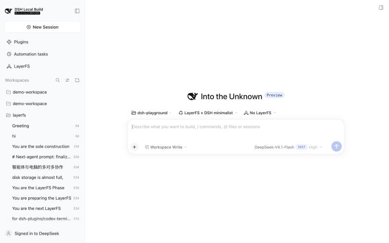

Open the project chip. It lists every project, then **No LayerFS**, **New empty project** (a random name such as calm-otter) and **Import project…**.

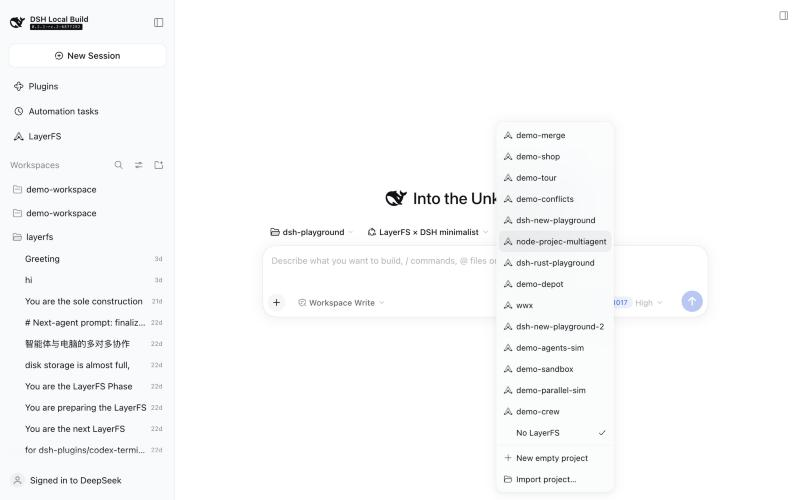

**Import project…** opens a folder picker. In dsh web on macOS this is the system's folder panel, which appears in front of the browser. Pick the folder to import. The chip shows the import's progress.

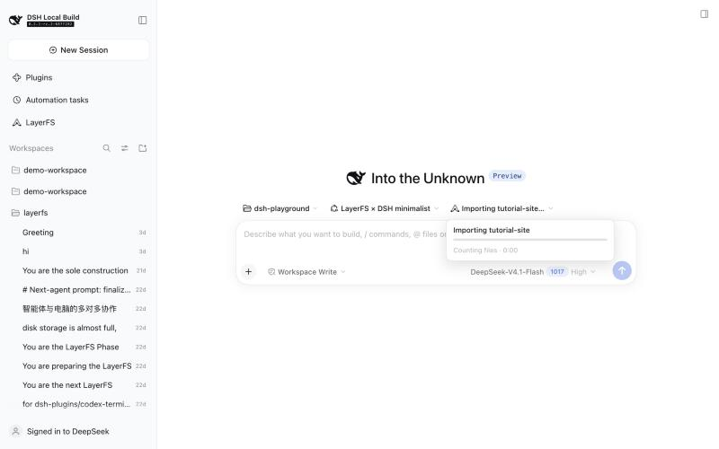

A small folder takes a few seconds. The chip then names the new project, and the session is bound to it. The project also becomes the workspace folder's default, so new sessions in that workspace start on it. Importing the same folder again gives `tutorial-site-1`, `tutorial-site-2`, ….

## 2. Run agents on it

Describe the work as you would to any agent. This run asked for two subagents, each on a Branch of its own, a test in a Sandbox before each commit, then a merge and a publish:

> Use two subagents, each on a Branch of its own: one adds an About page (app/about/page.tsx with an \<h1\>), the other adds a Contact page (app/contact/page.tsx with an \<h1\>). Each runs \`sh test.sh\` in a Sandbox before it commits. When both are done, merge both Branches into main, run the test on main, and publish.

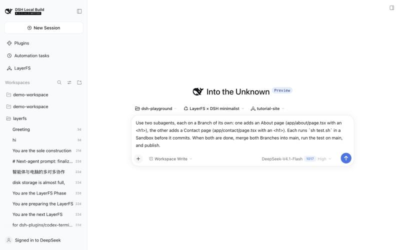

The agents use only bash: each call is a short Node script on the LayerFS SDK. The lead reads the project and the SDK guide first, then forks the Branches and starts the subagents.

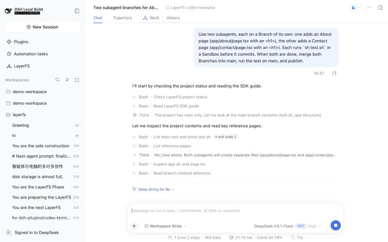

When it is done, the lead reports what it did. In this run each subagent wrote its page on its own Branch and ran `sh test.sh` in a Sandbox. The lead merged both Branches into a new Branch, `release-about-contact`, tested it, published it to `main` and tested `main` again on a fresh fork, `verify-main`. No Workspace was left mounted.

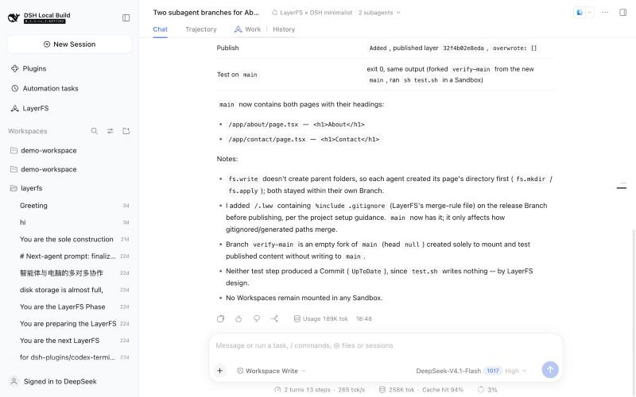

## 3. The LayerFS page

**LayerFS** in the sidebar opens one project at a time. **All projects · Sandboxes** is the switcher: a card per project, problems first, with its Sandboxes, below the Docker engine, the Store container (`layerfs-store`) and free disk. **Import project** is here too. A card opens its project.

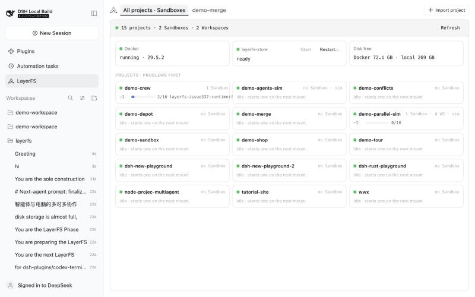

A project has its file tree on `main` and four views: **File**, **History**, **Storage** and **Sandboxes**. The status bar sums it up: `main L1 · 4 Branches · 5 Commits · last publish release-about-contact · main`. **New session** starts a session on this project.

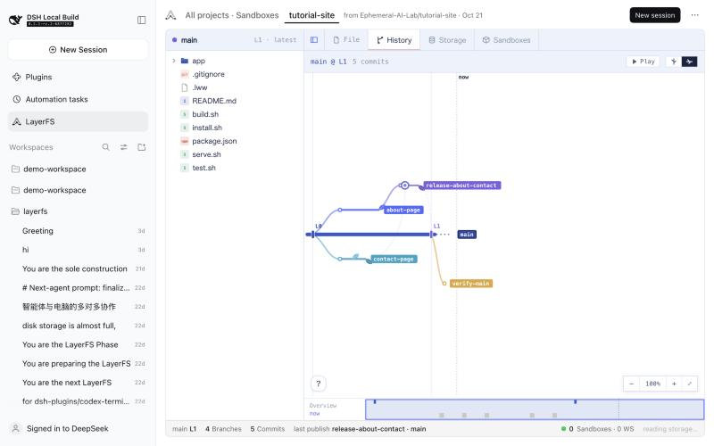

The ⋯ menu has **Refresh** and **Remove project…**.

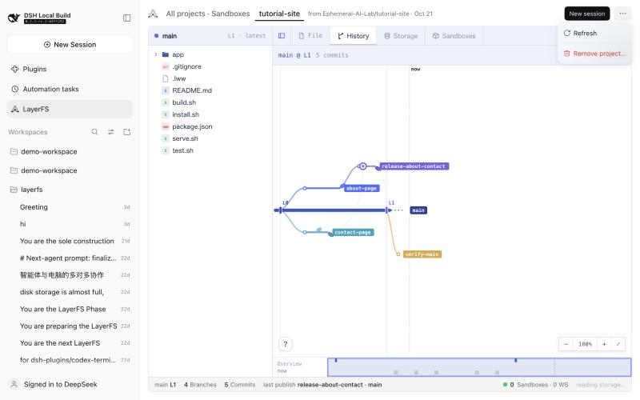

## 4. Work vs History in the conversation

A session on a project has two tabs beside Chat and Trajectory:
- **Work** shows what the agents are doing now.
- **History** shows what is in the project.

### Work: now

Work has a lane per Branch. A Branch's page holds its `fs` terminal (calls that go straight to the Store) and one terminal per mounted Workspace, which splits the page while it is mounted and leaves it when it is unmounted. With **Follow** on, the view moves to the lane of the latest call.

Early in the run, on `about-page`: the first write failed with `NoSuchPath`, because `fs.write` does not create a missing folder. The agent made the folder and wrote again.

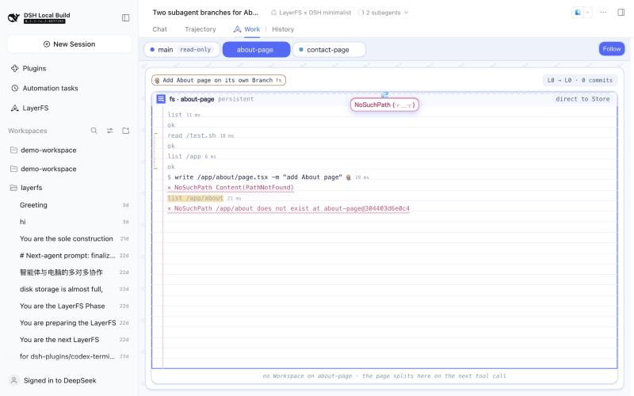

The `main` lane carries the project's Storage card, the Branch list, and the lead's `project` and `branch` calls (forks, diffs, merges and publishes).

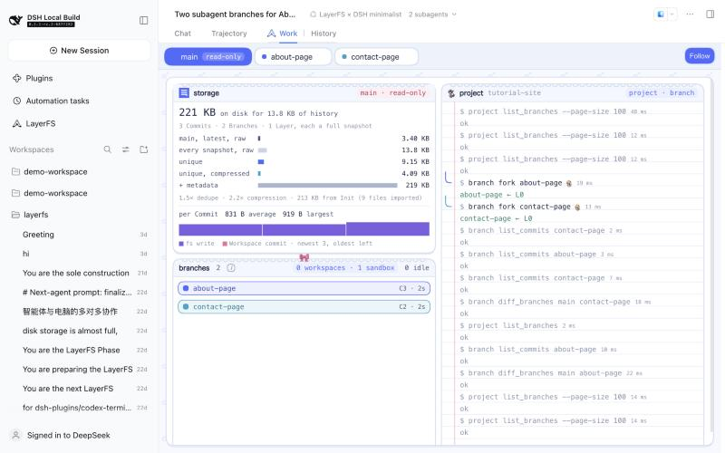

After the run, the lead's terminal ends with the merge (`→ release-about-contact @ C4 · fast-forward`), the publish (`Published release-about-contact@C5 → main @ L1`) and the `verify-main` fork.

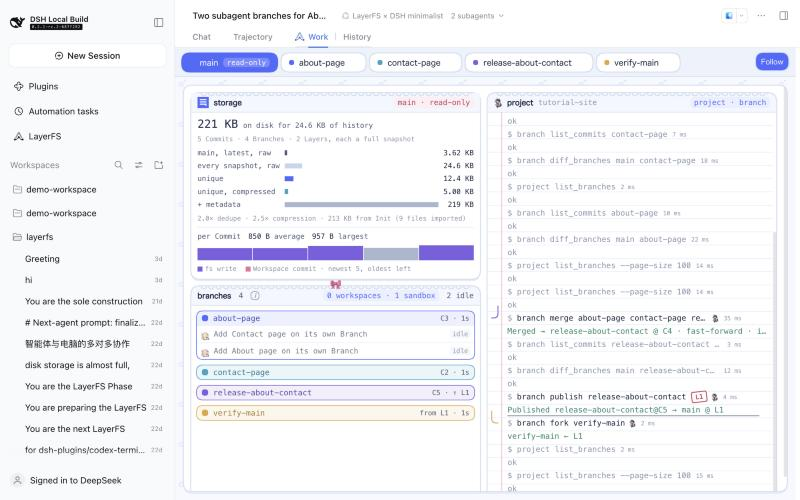

A Branch's lane after the run keeps its `fs` log: `Committed C3`. Its Sandbox terminal is gone, because the Workspace was unmounted; History keeps the result.

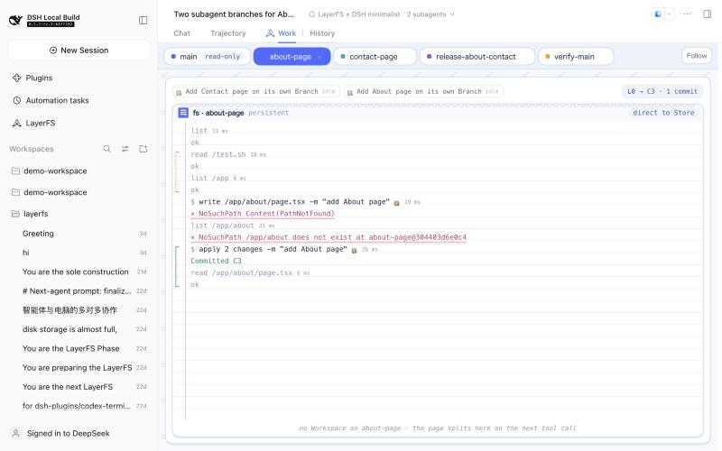

### History: what landed

History has the project's views (the same four as on the LayerFS page) beside the file tree. The graph has every Branch: `about-page` and `contact-page` fork from `L0`, `release-about-contact` merges them, `main` moves to `L1`, and `verify-main` forks from it. **Play** replays the history from the start.

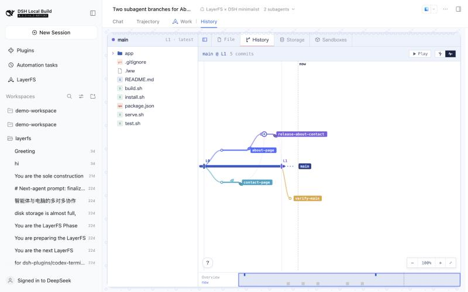

**File** shows a file at `main`. **Blame** names the Commit behind each line: here `C3`, the About agent's Commit.

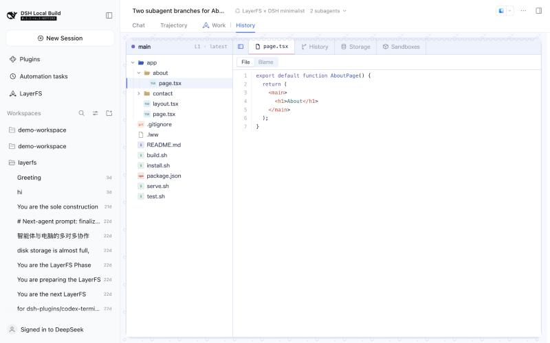

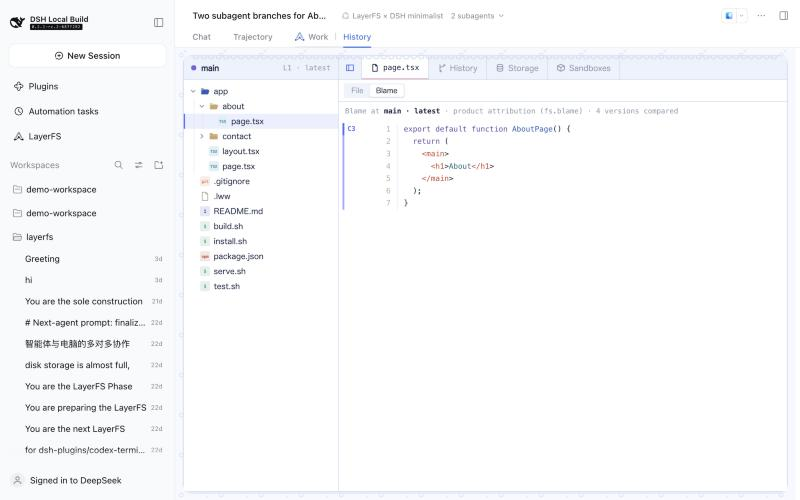

**Storage** has the project's size on disk and where the bytes go, with what each Commit added.

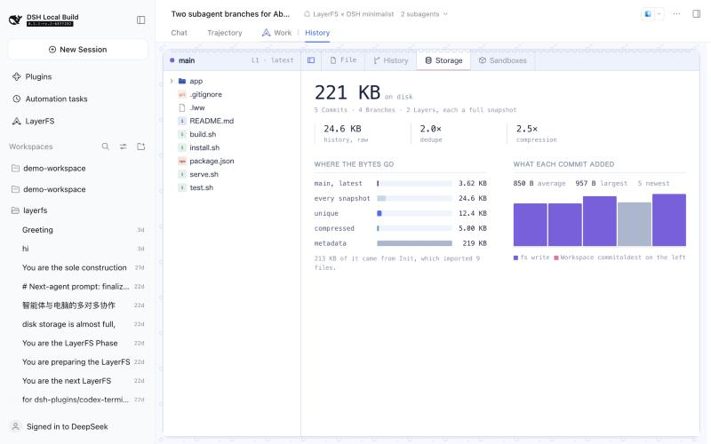

**Sandboxes** lists the project's Sandboxes. Right after the run, `layerfs-tutorial-site-1` was idle with no Workspace; LayerFS closes an idle Sandbox by itself, and a minute later the list was empty.

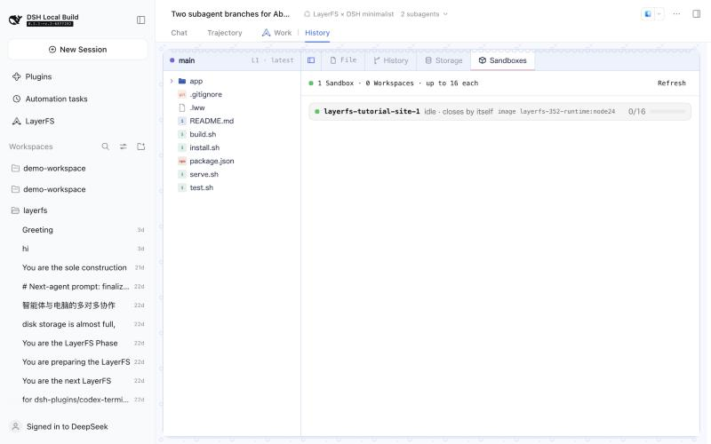
