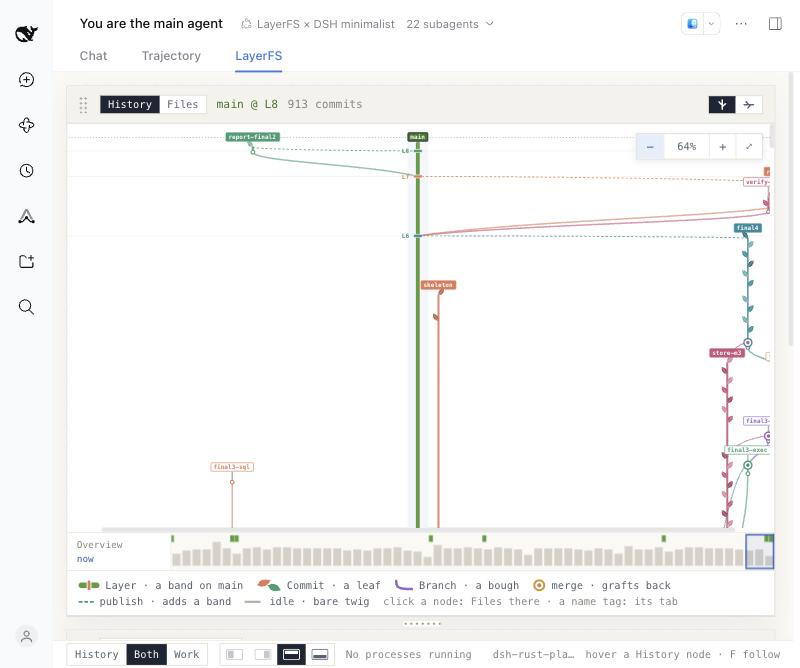
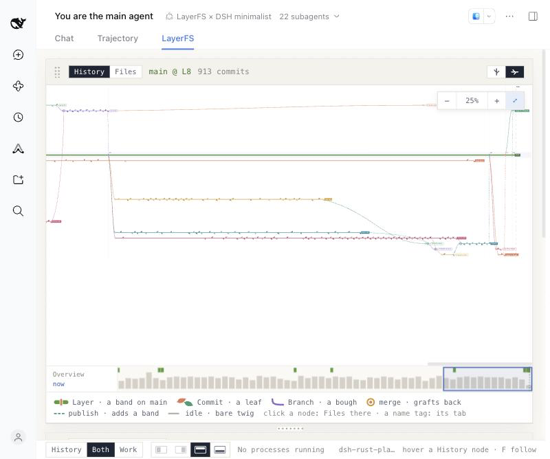
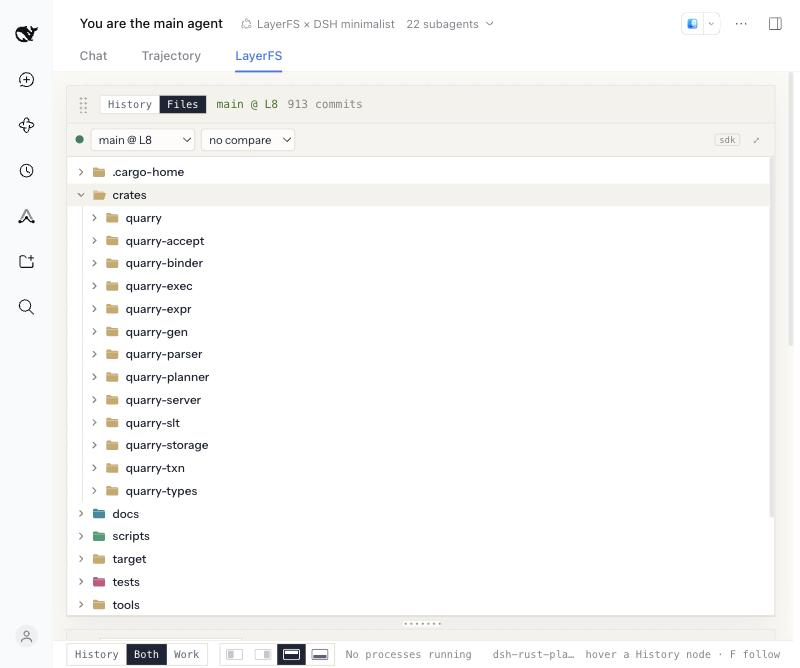

# Quarry: eight agents build a SQL database in Rust on LayerFS

Status: Archived; retained for historical evidence only.

On 2026-10-20, one dsh main agent and seven worker subagents built **Quarry**, a
SQL database in Rust, starting from an empty LayerFS project. They worked in three
lanes (`sql`, `exec`, `store`) over three rounds, and every build's `target/` was
committed on every Branch. Every change went through the LayerFS SDK as Branches,
Commits, merges and publishes. Results were checked row by row against SQLite. The
run ended in terminal success:

- on a fresh fork of the final `main`: `cargo fmt` and `cargo clippy -D warnings`
  clean, **891 tests passed, 0 failed, 2 ignored**, the sqllogictest corpus
  **800/800**, acceptance checks **Q01–Q12 PASS**;
- `/docs/BUILD-REPORT.md` was published;
- every Sandbox was closed.

Quarry is the second dsh demo after [Wayfare](../wayfare/README.md). It was meant
to be very hard for the agents, and to show LayerFS keeping parallel Branches'
multi-GB build output once: the final Store is **8.90 GB on disk for 4.93 TB of
snapshots**, smaller than one plain copy of the final `main` (13.5 GB).

## What is here

| File | What it is |
| --- | --- |
| [HANDOFF.md](HANDOFF.md) | The task given to the main agent, exactly as sent |
| [SPEC.md](SPEC.md) | What to build: lanes, milestones, the supported SQL, the build settings, acceptance checks Q01–Q12, the storage evidence to record |
| [SYSTEM-PROMPT.md](SYSTEM-PROMPT.md) | The main agent's system prompt as sent: dsh's harness text plus the `layerfs-dsh-minimalist` persona |
| [PROGRESS.md](PROGRESS.md) | The main agent's own progress ledger, written during the run |
| [BUILD-REPORT.md](BUILD-REPORT.md) | The report the agents published to `main` at `/docs/BUILD-REPORT.md` |
| [rust-image/Dockerfile](rust-image/Dockerfile) | The Sandbox image: the LayerFS node24 runtime plus Rust 1.85.1, Clippy and rustfmt |
| README.md | This page: setup and the measured results |
| [raw/sessions/](raw/sessions) | The 23 dsh session logs (`<agent>-r<round>.session.v4.jsonl.zstd`, as dsh stores them) |
| [raw/traces/](raw/traces) | The 23 LayerFS SDK trace files (`<agent>-r<round>.trace.jsonl.zst`, one JSON line per call) |
| [assets/](assets) | Screenshots of the dsh LayerFS tab after the run (see [Evidence](#evidence)) |

The other Markdown files are verbatim copies. Since the run, the persona and the
LayerFS skill have gained a "never close the service Sandbox" rule (see
[Incidents](#incidents)); the copies here are the versions the agents used.

## Setup

| | |
| --- | --- |
| Harness | DeepSeek Harness (dsh) web, LayerFS × DSH plugin bundle, preset `layerfs-dsh-minimalist` (bash, background jobs, subagents) |
| Model | `deepseek-flash` (shown in dsh as DeepSeek-V4.1-Flash), every agent, reasoning effort high |
| Host | macOS, through the dsh Live ported SDK: one Linux box container runs the real SDK and the daemons |
| Project | `dsh-rust-playground`; its Init Layer L0 held 4 planning files (32 KB), which the skeleton removed; Store profile Disposable |
| Local folder | `dsh-new-playground`, scratch only; SPEC.md copied there as `quarry/SPEC.md`, where the agents read it |
| Sandbox image | `layerfs-rust-demo:1.85.1` (`sha256:c29e44d36de5…`): Rust 1.85.1, SQLite 3.40.1, lld |
| Team | main agent + P1, P2, P3 (`sql`), X1, X2 (`exec`), S1, S2 (`store`), plus one subagent that generated the slt corpus |
| Branch model | one Branch per lane per round (`sql-mN`, `exec-mN`, `store-mN`) shared by that lane's workers, one Sandbox per lane for the whole run (`sb-sql`, `sb-exec`, `sb-store`), plus the main agent's `sb-main` |
| Workers | a fresh subagent session per worker per round: 7 × 3 = 21 sessions |
| Build settings | `target/` and `.cargo-home/` committed (in `/.lww`), `--remap-path-prefix=$PWD=/w`, lld, `debug = "full"`, 2 build jobs (SPEC.md) |

## Results

Times are from the session logs and SDK traces, in UTC. Byte sizes use 1 KB = 1,000 B,
1 MB = 1,000,000 B and so on.

### Run

| | |
| --- | --- |
| Wall time | **4 h 16 min**: handoff received 15:56, last SDK call 20:12 |
| Agents | **8** plus the corpus generator, in **23 sessions**: 1 main, 1 corpus, 21 worker rounds. The main agent briefed each round with `subagent` and talked to workers with `send_message` |
| Model steps | **2,825** |
| Tool calls | **3,053**: 2,895 `bash`, 70 `send_message`, 60 `job_output`, 22 `subagent`, 4 `list_agents`, 2 `job_list` |
| Tokens | 578.2 M in total: 571.5 M cache reads, 2.75 M uncached input, 3.88 M output (cache hit 99.5%) |
| App on `main` | 13 crates (see [BUILD-REPORT.md](BUILD-REPORT.md)), 891 tests, an 800-record sqllogictest corpus in 10 files, the Q01–Q12 acceptance harness |

### Rounds

| Round | Workers active | Published |
| --- | --- | --- |
| 0, skeleton | main agent 15:56–16:21, corpus subagent 16:01–16:15 | `skeleton` → L1 (16:19), L2 (16:21) |
| 1 | 16:22–16:57 | `integrate-m1-full` → L3 (17:08), `verify-m1` → L4 (17:22) |
| 2 | 17:09–18:29 | `prev12` → L5 (18:55) |
| 3 | 18:56–19:26 | `final4` → L6 (19:52), `report-final` → L7 (20:11), `report-final2` → L8 (20:12) |

Acceptance grew from corpus 604/604 of the round-1 scope, to 777/800 and nine of the
twelve checks after round 2, to 800/800 and Q01–Q12 after round 3
([PROGRESS.md](PROGRESS.md)). L7 and L8 change only the build report.

### Per agent

The three rounds of each worker added together.

| Agent | Lane, job | Sessions | Steps | Tool calls | `bash` | SDK calls | Output tokens |
| --- | --- | ---: | ---: | ---: | ---: | ---: | ---: |
| main | orchestration, skeleton, integration, publishing | 1 | 355 | 388 | 321 | 1,551 | 474,520 |
| corpus | the slt corpus and its SQLite expected results | 1 | 44 | 46 | 45 | 114 | 148,575 |
| P1 | sql: lexer and parser | 3 | 274 | 293 | 289 | 435 | 341,325 |
| P2 | sql: binder, catalog, subqueries, recursive CTEs | 3 | 393 | 425 | 418 | 576 | 522,976 |
| P3 | sql: planner and cost-based optimizer | 3 | 275 | 297 | 293 | 517 | 373,545 |
| X1 | exec: vectorized operators, spilling, recursive CTE execution | 3 | 390 | 425 | 418 | 671 | 514,716 |
| X2 | exec: expressions, the PostgreSQL wire server, metrics | 3 | 326 | 371 | 363 | 619 | 416,700 |
| S1 | store: pages, buffer pool, heap, B+tree, VACUUM | 3 | 472 | 493 | 444 | 2,943 | 691,781 |
| S2 | store: WAL, MVCC, recovery, checkpoints | 3 | 296 | 315 | 304 | 438 | 399,583 |
| **Total** | | **23** | **2,825** | **3,053** | **2,895** | **7,864** | **3,883,721** |

S1's count is high because one round-3 script polled `sandbox.status` 2,128 times
(see [LayerFS calls](#layerfs-calls)).

### LayerFS calls

**7,864 SDK calls** from the 23 sessions. 3,081 were refused. 2,956 of those are
`NotMounted` answers to `sandbox.status` from scripts polling Workspaces that were
already unmounted: 2,128 from one S1 round-3 loop, 590 from the main agent, 94 from P3,
45 from the corpus subagent. The other 125 are:

- 33 `NoSuchBranch`, 25 `NoSuchPath`, 22 `InvalidInput`, 7 `Binary` (reading a
  binary file as text), 3 `NoMatch`, 6 more `NotMounted`: agent mistakes;
- 10 `Conflict`: 8 Workspace Commits whose Branch head moved under a lane-mate's
  change (markers written, nothing committed), 2 merge conflicts;
- 10 `Failed` with "invalid record" (see [Incidents](#incidents));
- 3 `Dirty`, 2 `Busy` (the kernel reported a mount busy at unmount), and one each of
  `NameTaken`, `HeadMoved`, `Exists`, `AmbiguousMatch`.

There were no `Unknown` outcomes.

| Call | Count | Median | p90 | Max |
| --- | ---: | ---: | ---: | ---: |
| `sandbox.status` | 3,021 | 2.8 ms | 6.0 ms | 1.41 s |
| `sandbox.exec` | 1,372 | 0.42 s | 28.8 s | 655 s |
| `fs.read` | 812 | 7.5 ms | 15 ms | 29.0 s |
| `sandbox.commit` | 755 | 99 ms | 3.78 s | 61.4 s |
| `branch.list_commits` | 302 | 6.4 ms | 12 ms | 130 ms |
| `fs.apply` | 219 | 21 ms | 39 ms | 31.3 s |
| `fs.list` | 189 | 9.4 ms | 16 ms | 29 ms |
| `fs.grep` | 188 | 12 ms | 657 ms | 10.2 s |
| `fs.write` | 168 | 21 ms | 42 ms | 333 ms |
| `sandbox.unmount` | 163 | 63 ms | 197 ms | 7.34 s |
| `sandbox.mount` | 157 | 26 ms | 46 ms | 944 ms |
| `fs.diff_files` | 134 | 12 ms | 22 ms | 62 ms |
| `fs.stat` | 100 | 2.5 ms | 6.6 ms | 21 ms |
| `fs.mkdir` | 49 | 7.1 ms | 21 ms | 31 ms |
| `branch.merge` | 45 | 268 ms | 503 ms | 879 ms |
| `project.list_branches` | 43 | 7.9 ms | 13 ms | 25 ms |
| `branch.diff_branches` | 38 | 133 ms | 499 ms | 852 ms |
| `fs.edit` | 25 | 14 ms | 22 ms | 28 ms |
| `branch.fork` | 22 | 3.6 ms | 10 ms | 20 ms |
| others (`fs.glob`, `branch.diff_commits`, `operator.store.stats`, `branch.publish`, `fs.rm`, `sandbox.create`, `sandbox.close`, `fs.blame`, `fs.mv`, `sandbox.service`) | 62 | | | |

Workspace Commit time follows how many new bytes the Commit writes:

| `sandbox.commit` | Count | Median | p90 | Max |
| --- | ---: | ---: | ---: | ---: |
| `UpToDate` (nothing changed) | 302 | 24 ms | 60 ms | |
| new content under 1 MB | 126 | 75 ms | 911 ms | 5.81 s |
| 1–10 MB | 45 | 521 ms | 3.06 s | 5.43 s |
| 10–100 MB | 184 | 927 ms | 3.54 s | 9.37 s |
| 100 MB–1 GB | 82 | 3.84 s | 8.97 s | 61.4 s |
| over 1 GB | 3 | 24.5 s | | 54.1 s |

Two single calls stand out and are not explained: one `fs.apply` of 156 KB took
31.3 s (P2, 16:47), and two `fs.read` calls took 29 s each (S1, 18:07).

Outcomes:

- **Commits:** 913 in all, `C1`–`C913` in the History tab: 440 from Workspaces
  (`sandbox.commit`), 207 `fs.apply`, 161 `fs.write`, 47 `fs.mkdir`, 29 merge
  Commits, 22 `fs.edit`, 6 `fs.rm`, 1 `fs.mv`. Another 302 Workspace Commits and 7
  `fs.write` calls changed nothing and returned `UpToDate`.
- **Exec:** 1,372 commands, 16,945 s in total (they ran in parallel across lanes).
  1,256 exited 0; 36 exited 101 (Cargo errors), 23 exited 1, 25 exited 143 and 21
  exited 137 (ended by a signal), 5 exited 124 (`timeout`). 87
  commands ran over a minute, 11,586 s between them; the longest took 10.9 min.
- **Merges:** 45 calls, 34 merged, each into a new Branch name (29 distinct merge
  Commits). `target/` and `.cargo-home/` resolved newest-wins through `/.lww`.
- **Branches:** 56: 22 forked, 34 made by merges.
- **Sandboxes:** the 4 above, created once each and all closed at 20:12, plus the
  project's service Sandbox.
- **Layers:** 9 on `main`: L0 (the 4 imported files) plus the 8 publishes above.

### Store

From the project's Store at the end of the run (the host's `storage` route).

| | |
| --- | --- |
| Store file on disk | **8.90 GB** |
| `main`'s head as one plain copy | 13.5 GB (the Store file is 0.66× one copy) |
| All history as full copies | 4.93 TB: every Commit and Layer is a complete snapshot, `target/` included |
| After dedupe (identical files and chunks stored once) | 29.6 GB, **166×** smaller |
| After compression | 8.73 GB, **3.39×** smaller again |
| Metadata | 280 MB, of which 211 KB is the empty Store's baseline |
| Cost per Commit (60 newest, 19:05–20:12) | 24.1 MB new on average, 455 MB at most (stored bytes plus metadata) |

The whole history (913 Commits, 56 Branches, 9 Layers) takes less disk than one plain
copy of the final `main`. The build report's own Store table stops at 8.78 GB: it was
read at 19:52, before the fresh-fork verification Commits added 123 MB.

Only the first build of a round that compiles dependencies costs real space; the
other lanes' builds add megabytes. [BUILD-REPORT.md](BUILD-REPORT.md) has the per-lane
and per-worker Commit sizes the agents recorded.

## Incidents

- **The shared service Sandbox was closed mid-run (16:31).** One of S2's round-1
  cleanup scripts called `lf.service()` and then closed the Sandbox it got back: the
  project's service Sandbox `_service.dsh-rust-playground`, shared by every agent's
  Store calls and by the dsh view. The dsh host's store.stats panel
  went blank until the host learned to drop a closed service Sandbox and start a new
  one. Follow-ups: the persona and the LayerFS skill now say never to close it, and
  the host no longer closes it when it goes idle.
- **Two dsh web restarts stopped the agents' turns (16:38 and 17:09).** Host fixes
  were loaded by restarting `dsh web` while the agents ran. The first restart ended
  the main agent's turn and the four round-1 worker turns still running (P2, X1, X2,
  S1) as interrupted; the second ended the main agent's and all seven round-2
  workers'. The user resumed the main agent with "continue" each time, and it
  briefed the workers again. Two Workspaces of `sb-main` that the cut-off
  scripts had just mounted (`/workspaces/33`, `/workspaces/51`) were never unmounted
  by them; see [Evidence](#evidence). Rule adopted: never restart dsh web while a run
  is live.
- **Merges and Workspace Commits failed with "invalid record" (10 calls).** Five
  `branch.merge` calls of the main agent at 17:25–17:26, merging `sql-m2` with
  `main`, `m2-base` or `verify-m1`, failed with `Failed: invalid record: binding
  kind`. The agent merged from a committed Branch of identical content instead
  (`prev12`), which worked. Five of S2's `sandbox.commit` calls (17:21, and
  19:21–19:22) failed the same way (`captured inode creation binding`, `binding
  kind`); remounting a fresh Workspace worked. These are LayerFS defects, not yet
  diagnosed.
- **Problems the agents reported and this page did not reproduce.** From
  [BUILD-REPORT.md](BUILD-REPORT.md): an `fs.read` of a 51,161-byte file returned a
  49,135-byte prefix without saying it was truncated; a merge left `Cargo.lock`
  truncated mid-checksum; macOS AppleDouble `._*` files appeared in trees written
  through `fs.*`.
- **Disk use outside the Workspaces.** A buffer-pool spill bug in Quarry's own
  storage engine grew a spill file to 80 GB before S1 fixed it, and killed
  acceptance runs left `/tmp/.tmp*` directories in the Sandboxes (one of 55 GB).
  Docker's disk had 68 GB free at the end.

## Evidence

Screenshots of the dsh LayerFS tab after the run, from the main agent's session. They
were taken in the Claude desktop app's browser pane, so they are 800 pixels wide.

**Work view and store.stats.** Every Sandbox is closed. store.stats shows the Store
above: 8.90 GB on disk for 4.93 TB of history. The view still lists two Workspaces of
`sb-main` as mounted (`ws/33` on `preview5`, `ws/51` on `verify-m1`). They were mounted
at 16:38:33 and 17:09:53, the moments the two restarts cut their scripts off, and the
traces hold no successful unmount for them. A later unmount of `/workspaces/51` was
answered `NotMounted`, and `sb-main`'s close at 20:12 succeeded, so neither was still
mounted at the end.

**History.** The end of the run at 64%: `main` with L6–L8 published from `final4`,
`report-final` and `report-final2`, and round 3's `store-m3`, `final3-exec`,
`final3-sql` and `final4` Branches.

Lying on its side (time runs right) at 25%: round 3, the lane Branches stringing their
Commits as leaves and merging back toward the final publishes at the right.

**Files on `main` @ L8.** The 13 crates, with `target/` and `.cargo-home/` committed
beside the source.

## How the numbers were taken

- **Sessions, steps, tool calls and tokens:** the 23 dsh session logs
  (`session.v4.jsonl.zstd`, decompressed): the main session and every session whose
  `parentSession` is it. The counts are `step/end`, `tool/call` and the `usage` on
  each `assistant/message`.
- **SDK calls:** the per-session LayerFS trace files the dsh host writes
  (`DSH_LAYERFS_TRACE`, one JSON line per call), counting the `phase: "end"` lines.
  Timings are each call's `ms`; Commit sizes are each line's `sizes`.
- **Store:** the dsh host's `/layerfs/project/dsh-rust-playground/storage` and
  `/state` routes after the run.
- **Tests and acceptance:** the agents' own final check on `verify-final`, recorded in
  PROGRESS.md and BUILD-REPORT.md.
- **BUILD-REPORT.md:** read from `main` with `fs.read`, 15,672 bytes.

Every count above except the Store numbers can be recomputed from `raw/`. Read a file
with `zstd -dc raw/traces/S1-r3.trace.jsonl.zst | head`. Trace commands are cut at
about 200 characters. The session logs hold every prompt, model message, tool call
and tool output. They also contain local paths of the machine the run used; no
credentials were found in them.

## Before the run

The checklist the run started from, and the probe its estimates came from.

1. The image `layerfs-rust-demo:1.85.1` (`sha256:c29e44d36de5…`) must be in the local
   Docker. If it's gone, rebuild it from `rust-image/Dockerfile`; its new digest then
   goes in HANDOFF.md.
2. The LayerFS project is `dsh-rust-playground` (created 2026-10-20 from the
   `dsh-rust-playground` folder, so its first Layer holds that folder's planning
   files; the skeleton removes them). The session's local folder is
   `dsh-new-playground`, scratch only; SPEC.md is copied there as `quarry/SPEC.md`,
   where the agents read it.
3. Start a session with the "LayerFS × DSH minimalist" preset and paste HANDOFF.md.
4. Keep at least 30 GB free on Docker's disk: each mounted Workspace holds its own
   copy of what it builds.

### Probe (2026-10-20)

Measured in the `dsh-new-playground` project before writing the spec. One sample each;
diagnostics, not benchmarks.

| Check | Result |
| --- | --- |
| FUSE Workspace: 8 MiB write and copy, 4 MiB mmap write, `posix_fallocate`, crates.io | All pass |
| Quarry's dependency list on Rust 1.85 (`resolver = "3"`) | 152 crates; `cargo fetch` committed 32.9 MB new, 7.6 MB stored |
| Cold `cargo test --no-run` with full debuginfo, lld, 24 test binaries, 4 jobs | 27.4 s; `target/` 1.1 GB; each test binary 28.7 MB; linked by LLD 19.1.7 |
| Commit of that tree (1.39 GB) | 9.2 s with the unmount; 542 MB new unique content, 175 MB stored |
| The same 1.2 GB build on a parallel Branch (earlier probe, `debug = "full"`) | 1.3 MB new content, **97 KB stored**, Commit 5.0 s |
| The same build without `--remap-path-prefix` (small probe) | A third of a full copy is new again: the remap is required |
| A kept Workspace after a lane-mate's `fs.write` | `sandbox.commit` returns `UpToDate` and the Workspace then shows the file |

The estimate was 3–5 GB of `target/` per Branch head. The run measured 8.7–11.0 GB
per head at the end ([BUILD-REPORT.md](BUILD-REPORT.md)).
