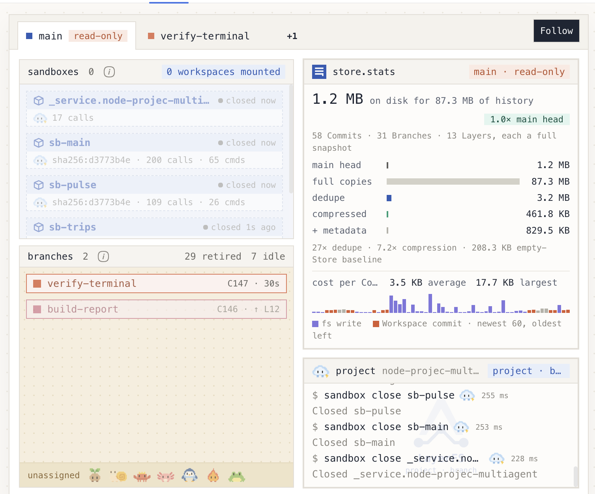
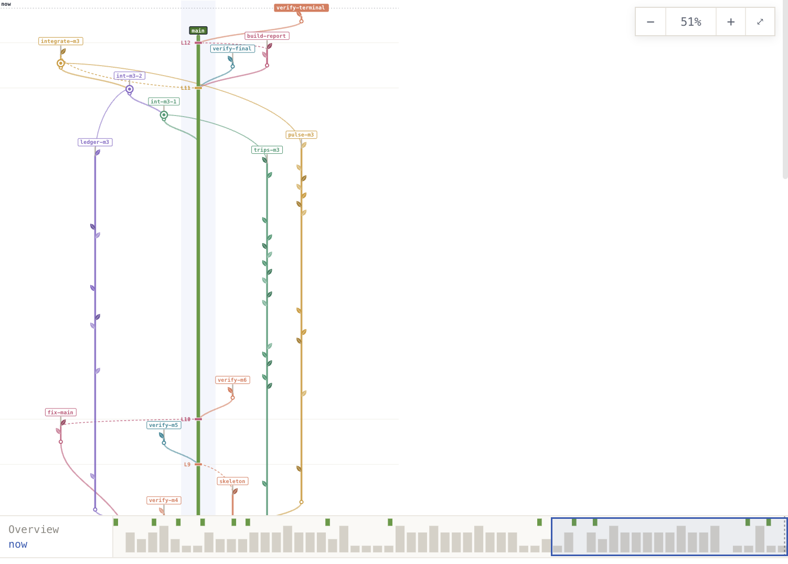
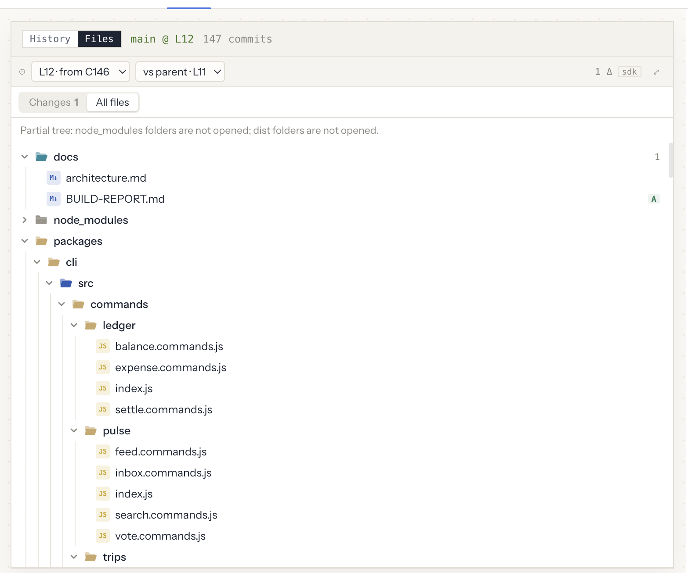
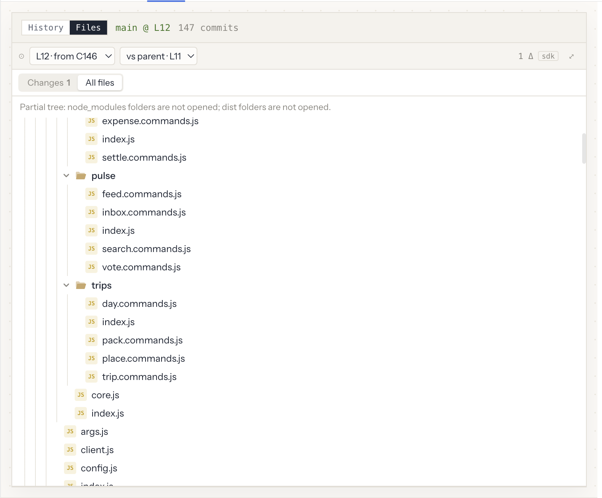

# Wayfare: eight agents build an app on LayerFS

Status: Archived; retained for historical evidence only.

On 2026-10-20, one dsh main agent and seven worker subagents built **Wayfare**, a
collaborative trip planner, starting from an empty LayerFS project. They worked in
three feature lanes over three rounds. Every change went through the LayerFS SDK as
Branches, Commits, merges and publishes. The run ended in terminal success:

- on a fresh fork of the final `main`, `npm ci && npm run build && npm test && npm run accept`
  ran cleanly: **334/334 tests**, acceptance checks **A01–A12 PASS**;
- `/docs/BUILD-REPORT.md` was published;
- every Workspace was unmounted and every Sandbox closed.

## What is here

| File | What it is |
| --- | --- |
| [HANDOFF.md](HANDOFF.md) | The task given to the main agent, exactly as sent |
| [SPEC.md](SPEC.md) | What to build: lanes, milestones, Branch model, acceptance checks A01–A12 |
| [SYSTEM-PROMPT.md](SYSTEM-PROMPT.md) | The main agent's system prompt as sent: dsh's harness text plus the `layerfs-dsh-minimalist` persona |
| [PROGRESS.md](PROGRESS.md) | The main agent's own progress ledger, written during the run |
| [BUILD-REPORT.md](BUILD-REPORT.md) | The report the agents published to `main` at `/docs/BUILD-REPORT.md` |
| README.md | This page: setup and the measured results |
| [raw/sessions/](raw/sessions) | The eight dsh session logs (`<agent>.session.v4.jsonl.zstd`, as dsh stores them) |
| [assets/](assets) | Screenshots of the dsh LayerFS tab at the end of the run (see [Evidence](#evidence)) |
| [raw/traces/](raw/traces) | The eight LayerFS SDK trace files (`<agent>.trace.jsonl.zst`, one JSON line per call) |

The other files are verbatim copies. Since the run, the persona and the playground
HANDOFF.md have gained a "never forget the unmount" rule (see
[Incidents](#incidents)); the copies here are the versions the agents used.

## Setup

| | |
| --- | --- |
| Harness | DeepSeek Harness (dsh) web, LayerFS × DSH plugin bundle, preset `layerfs-dsh-minimalist` (bash, background jobs, subagents) |
| Model | `deepseek-flash` (shown in dsh as DeepSeek-V4.1-Flash), every agent |
| Host | macOS, through the dsh Live ported SDK: one Linux box container runs the real SDK and the daemons |
| Project | `node-projec-multiagent`, empty `main` at the start; Store profile Disposable |
| Team | main agent + T1, T2, T3 (`trips`), L1, L2 (`ledger`), P1, P2 (`pulse`) |
| Branch model | one Branch per lane per round (`<lane>-mN`), one Sandbox per lane for the whole run (`sb-trips`, `sb-ledger`, `sb-pulse`), plus the main agent's `sb-main` |
| App stack | Node 24 standard library only (`node:http`, `node:sqlite`, `node:test`), no third-party dependencies |

## Results

Times are from the session logs and SDK traces, in UTC. Byte sizes use 1 KB = 1,000 B
and 1 MB = 1,000,000 B.

### Run

| | |
| --- | --- |
| Wall time | **56 min**: handoff received 13:48, last SDK call 14:44 |
| Agents | **8**: 1 main agent, 7 workers. Each worker kept one session across all three rounds; the main agent sent the next round's brief with `send_message` |
| Model steps | **764** |
| Tool calls | **905**: 844 `bash`, 43 `send_message`, 7 `subagent`, 6 `job_output`, 4 `list_agents`, 1 `job_kill` |
| Tokens | 119.1 M in total: 116.9 M cache reads, 0.77 M uncached input, 1.38 M output (cache hit 99.3%) |
| App on `main` | 238 files outside `node_modules` (101 in `packages/server`, 71 `packages/web`, 29 `packages/cli`, 13 `packages/shared`, 17 `scripts`), 55 test files, 334 tests |

### Per agent

| Agent | Lane, job | Active | Steps | Tool calls | `bash` | Output tokens |
| --- | --- | --- | ---: | ---: | ---: | ---: |
| main | orchestration, integration, publishing | 13:48–14:44 | 131 | 157 | 125 | 226,522 |
| T1 | trips: trips, members, invitations, dashboard, duplicate; A01/A12 | 13:58–14:34 | 83 | 101 | 97 | 150,632 |
| T2 | trips: itinerary, drag-and-drop, ICS and print; A02/A03/A11 | 13:58–14:34 | 107 | 133 | 129 | 169,774 |
| T3 | trips: places, packing, documents, SVG map; A04 | 13:58–14:38 | 111 | 123 | 115 | 168,610 |
| L1 | ledger: expenses, currencies, splits, recurring costs, statements; A05 | 13:58–14:28 | 70 | 78 | 75 | 178,801 |
| L2 | ledger: balances, settle-up, spending reports; A06/A07 | 13:58–14:28 | 95 | 111 | 108 | 163,913 |
| P1 | pulse: activity feed, inbox, live updates, digests; A08 | 13:58–14:25 | 67 | 90 | 87 | 140,647 |
| P2 | pulse: comments, polls, search; A09/A10 | 13:58–14:34 | 100 | 112 | 108 | 176,953 |
| **Total** | | | **764** | **905** | **844** | **1,375,852** |

### Timeline (publishes to `main`)

| Time | Published Branch | `main` Layer | What it was |
| --- | --- | --- | --- |
| 13:54–14:02 | `skeleton` (6 times) | L1–L6 | Foundation: workspace packages, lane wiring, harness, `.lww` |
| 14:05 | `integrate-m1` | L7 | Round 1: three lanes merged |
| 14:17 | `integrate-m2` | L8 | Round 2: 238 tests, 82-check live smoke |
| 14:18 | `skeleton` | L9 | A harness patch that replaced `main` with skeleton-only content (see [Incidents](#incidents)) |
| 14:20 | `fix-main` | L10 | The fix: integrate-m2 plus the patch |
| 14:41 | `integrate-m3` | L11 | Round 3: 334 tests, A01–A12 PASS |
| 14:43 | `build-report` | L12 | `/docs/BUILD-REPORT.md` |

### LayerFS calls

**1,936 SDK calls** from the eight agents. 62 were refused: 42 mount refusals from
the capacity incident below, and 20 agent mistakes (bad paths, a flag passed as a
Branch name, reading a folder as a file). There were no `Busy` refusals and no
`Unknown` outcomes.

| Call | Count | Median | p90 | Max |
| --- | ---: | ---: | ---: | ---: |
| `fs.read` | 551 | 10 ms | 14 ms | 30 ms |
| `sandbox.mount` | 204 | 22 ms | 30 ms | 42 ms |
| `fs.list` | 199 | 10 ms | 14 ms | 78 ms |
| `sandbox.exec` | 184 | 0.93 s | 4.96 s | 11.3 s |
| `sandbox.unmount` | 162 | 9 ms | 24 ms | 123 ms |
| `sandbox.commit` | 141 | 5 ms | 17 ms | 43 ms |
| `fs.grep` | 102 | 9 ms | 15 ms | 21 ms |
| `branch.list_commits` | 95 | 9 ms | 12 ms | 16 ms |
| `fs.apply` | 74 | 23 ms | 30 ms | 48 ms |
| `project.list_branches` | 40 | 10 ms | 16 ms | 68 ms |
| `sandbox.close` | 32 | 220 ms | 255 ms | 281 ms |
| `fs.write` | 29 | 18 ms | 27 ms | 30 ms |
| `fs.edit` | 23 | 20 ms | 25 ms | 28 ms |
| `branch.fork` | 22 | 8 ms | 12 ms | 14 ms |
| `sandbox.service` | 17 | 288 ms | 319 ms | 326 ms |
| `sandbox.create` | 15 | 295 ms | 325 ms | 330 ms |
| `branch.publish` | 12 | 10 ms | 20 ms | 21 ms |
| `branch.merge` | 9 | 12 ms | 31 ms | 31 ms |
| others (`fs.stat`, `fs.diff_files`, `branch.diff_branches`, `fs.rm`, `branch.diff_commits`, `fs.glob`, `sandbox.status`) | 26 | | | |

Outcomes:

- **Commits:** 147 in all, `C1`–`C147` in the History tab.
  - 113 from `fs.*` writes; another 14 changed nothing and returned `UpToDate`.
  - 26 from Workspaces (`sandbox.commit`); another 115 returned `UpToDate`, mostly test and build runs that changed no files.
  - 8 from `branch.merge`. All 9 merges succeeded with no source Conflict; `int-m2-1` was a fast-forward to `trips-m2`'s head and made no new Commit. Generated `dist/` files resolved newest-wins through `/.lww`.
- **Exec:** 184 commands, 375 s in total, 10 exited non-zero.
- **Branches:** 31. 22 were forked: lane rounds, `skeleton`, `fix-main`, `build-report` and ten `verify-*`. 9 came from merges: `int-mN-1`, `int-mN-2` and `integrate-mN` for each round.
- **Sandboxes:** 15. The 4 named ones above, plus 11 short-lived ones made by the CLI's `lfs run`.
- **Layers:** 13 on `main`: L0 (empty) plus the 12 publishes above.

### Store

From the project's Store at the end of the run.

| | |
| --- | --- |
| Store file on disk | **1.21 MB** |
| `main`'s head as one plain copy | 1.25 MB (the Store file is 0.97× one copy) |
| All history as full copies | 91.5 MB: every Commit and Layer is a complete snapshot |
| After dedupe (identical files and chunks stored once) | 3.38 MB, **27×** smaller |
| After compression | 473 KB, **7.2×** smaller again |
| Metadata | 849 KB, of which 213 KB is the empty Store's baseline |
| Cost per Commit (60 newest) | 3.6 KB new on average, 18.1 KB at most |

The whole history (147 Commits, 31 Branches, 13 Layers) takes less disk than one
uncompressed copy of the final app.

## Incidents

Both are in [PROGRESS.md](PROGRESS.md) as the main agent recorded them.

- **A publish replaced `main` with skeleton-only content (14:18).** After round 2, the
  main agent published a harness patch from `skeleton`, which was forked from the empty
  `main` and had never had the lanes merged in. LayerFS did exactly what was asked: the
  publish replaced `main`'s view, and `main` showed 38 tests instead of 238. The agent
  noticed, rebuilt the patch on `fix-main` forked from `integrate-m2`, published it
  (`branch.publish` reported `overwrote` the bad Layer), and verified 238/238 on a fresh
  fork. Rule it adopted: fixes go on a Branch forked from the current `main`.
- **`sb-trips` hit the daemon's Workspace capacity (round 3).** One trips worker's
  scripts ran `mount → exec → commit` and never called `unmount`. After 16 leftover
  Workspaces, the daemon's limit, every mount in `sb-trips` was refused
  `MountFailure` (`Capacity`, "daemon Workspace capacity"): 42 refusals in all. T1
  reported it, and the user told the main agent too. It unmounted all 16 without discard (all `Unmounted`,
  nothing lost) and told every worker to unmount in `finally`. Follow-ups: the persona
  now says so with an example, and
  [#370](https://github.com/Ephemeral-AI-Lab/layerfs/issues/370) proposes unmounting
  idle, clean Workspaces automatically.

## Evidence

Screenshots of the dsh LayerFS tab after the agents finished, from the main agent's session.

**Work view and store.stats.** Every Sandbox is closed and no Workspace is mounted. Of the
31 Branches, 29 are retired; `verify-terminal` and `build-report` remain. The fs terminal
ends with the four Sandboxes and the service Sandbox closing.

The store.stats panel uses 1,024-based units, so its 1.2 MB and 87.3 MB are the 1.21 MB
and 91.5 MB above. Its "58 Commits" counts only the Commits in the project state's
recent window; the full count is 147, as the History header shows.

**History.** Round 3 at the top: the three lane Branches grow on their own boughs and
merge through `int-m3-1` and `int-m3-2` into `integrate-m3`. That publishes L11, and
`build-report` publishes L12. Lower down: `skeleton` publishes L9, and `fix-main`
publishes L10, which replaces it.

Lying on its side (time runs right), the same history reads left to right from round 2
to the end. `integrate-m2` publishes L8. The `skeleton` publish (L9) is replaced by
`fix-main` (L10). Each lane Branch of round 3 strings its Commits as leaves before
`int-m3-1`, `int-m3-2` and `integrate-m3` merge them (L11). `build-report` adds L12, and
`verify-terminal` forks from it for the final check.

**Files on `main` @ L12.** L12, from C146, against its parent L11: the one change is
`/docs/BUILD-REPORT.md`, added. The tree shows each lane's CLI commands in its own folder
(`ledger`, `pulse`, `trips`), the wiring that let the lanes merge without source conflicts.

## How the numbers were taken

- **Agents, steps, tool calls and tokens:** the eight dsh session logs
  (`session.v4.jsonl.zstd`, decompressed). The counts are `step/end`, `tool/call` and
  the `usage` on each `assistant/message`.
- **SDK calls:** the per-agent LayerFS trace files the dsh host writes
  (`DSH_LAYERFS_TRACE`, one JSON line per call), counting the `phase: "end"` lines.
  Timings are each call's `ms`.
- **Store:** the dsh host's `/layerfs/project/node-projec-multiagent/storage` and
  `/state` routes at the end of the run.
- **App files:** listing `main` with `fs.list`.
- **Tests and acceptance:** the agents' own final check on `verify-terminal`, recorded
  in PROGRESS.md and BUILD-REPORT.md.

Every count above except the Store and app-file numbers can be recomputed from `raw/`.
Read a file with `zstd -dc raw/traces/T3.trace.jsonl.zst | head`. The session logs hold
every prompt, model message, tool call and tool output. They also contain local paths of
the machine the run used, and the app's test-fixture passwords and tokens; no real
credentials.

An earlier attempt the same evening stopped at 13:35, when the LayerFS box went down.
It is not counted here.
