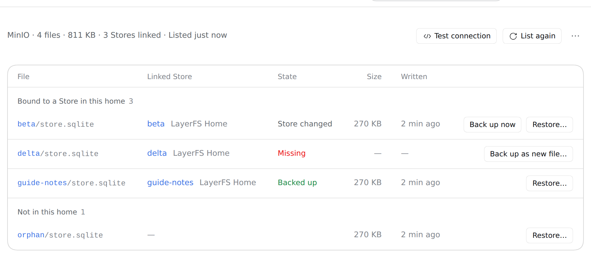
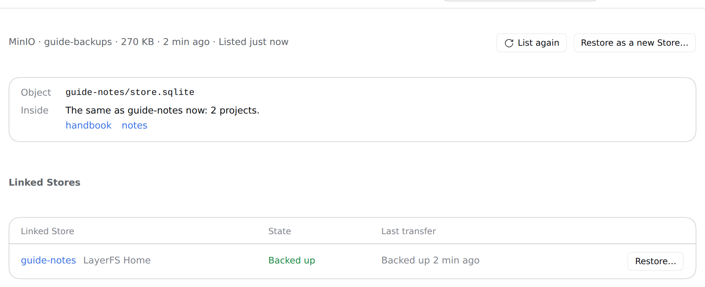
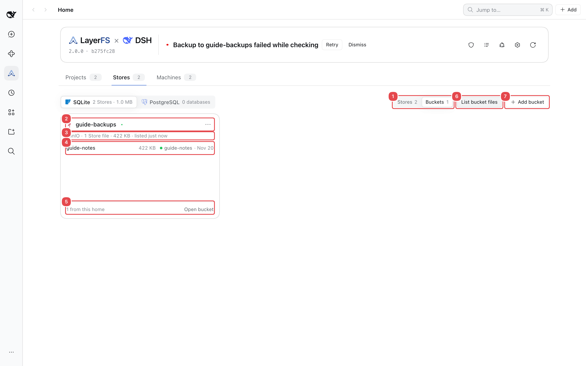
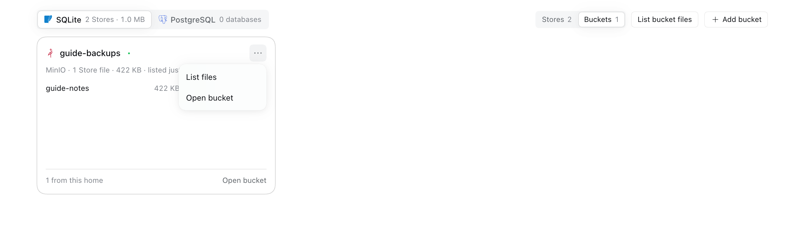

# Bucket

> **Where:** `LayerFS › Home › Buckets › <bucket>` (and `… › <bucket> › <file>` for one backup file) · **Opens from:** a bucket card on Home › Buckets, Jump to, a Store's Backups tab · **Source:** see the end

A bucket is an S3-compatible place (MinIO or Cloudflare R2) where SQLite Stores are backed
up, one `store.sqlite` object per backup file. Its page lists every Store file in it, which
Store of this home each one backs up, how current it is, and the button each one needs.
A backup file's page says where the object is and what is inside it.

| # | Component | What it is |
|---|---|---|
| 1 | Nav bar | [Components › Nav bar](components.md#nav-bar): `Home › Buckets › guide-backups`; the crumb switches between buckets |
| 2 | Facts | Provider · files and their size · Stores linked · when listed |
| 3 | **Test connection** | Runs the bucket's doctor and opens the Doctor page |
| 4 | **List** / **List again** | Asks the bucket for its files now |
| 5 | ⋯ | **Disconnect** |
| 6 | Group row | **Bound to a Store in this home** or **Not in this home**, with a count |
| 7 | File row | File, linked Store, state, size, written, and its buttons |

## Layout

The page has no title of its own (the crumb names it): a bar of facts and buttons, a red
status line when the bucket could not be listed, then one table of Store files. The page
lists the bucket once when it opens (unless it was already listed or refused); after that it
is listed again only on **List again**, after a backup or restore into it, or after
**Connect again…**.

## Body

Which Stores are backed up here, and is each copy current.

| Component | What it shows | Interaction → result | LayerFS call | States |
|---|---|---|---|---|
| Facts | **MinIO** / **Cloudflare R2** · **n files · size** · **n Stores linked** · **Listed** *ago* | — | `home get` (read), the last `backup list` | **Not listed**, **Listing…** (failed listings keep the last successful listed time instead of stamping a new one) |
| **Test connection** | | Press → a doctor run starts; the Doctor page opens | `backup doctor` | |
| **List** / **List again** | | Press → lists the bucket now | `backup list --bucket` (read) | spinner and off while listing |
| ⋯ › **Disconnect** ([menu](img/bucket-menu.png)) | | [Confirm](#modals-opened-here) → the bucket and every Store's link to it go; the files stay | `backup disconnect` ↻ | |
| Status line | **Not listed · key refused**, **· no answer in time**, **· busy**, **· answer lost**, or **Broken**, with LayerFS's detail beside it (full sentence on hover) | **Connect again…** (when the key was refused or the record has none) → [Connect *bucket* again](#modals-opened-here) | `backup connect`, then `backup list` | hidden while the bucket lists |
| Group rows | **Bound to a Store in this home** first, then **Not in this home** | — | — | a group shows only when it has rows |
| File | `<file>/store.sqlite` | The file name → its [Backup file page](#backup-file) | — | |
| Linked Store | The Store and where it is (its machine, `macos-host` included, or **PostgreSQL**) | The Store name → its Store page | — | **Not linked**; `—` for files not in this home |
| State | **Backed up**, **Store changed**, **Bucket changed**, **Both changed**, **Missing**, **Not checked**, **Not listed**; LayerFS's reason on hover | — | `backup list` (read: `behind`, `changed`, `missing`) | dashed chip until listed |
| Size, Written | Bytes, and when the object was written | Hover → the exact time | `backup list` (read) | |
| **Back up now** / **Back up as new file…** | | Press → **Back up now** starts a backup job over that file (its card shows on the Store); for **Missing**, **Back up as new file…** opens [Back up](store.md#modals-opened-here) with a fresh file name | `backup create <store> <bucket> --file`, then `backup list` | **Back up now** for **Store changed** or a link not listed yet; **Back up as new file…** for **Missing** (LayerFS refuses reusing a missing file name); disabled with an explanation tip when the Store is stopped, busy, blocked, or broken |
| **Restore…** | | Press → [Restore](#modals-opened-here) | `backup restore`, then `backup list` | not for **Missing** or unlisted rows |
| Empty | **No Store files here** / **Not listed** / **Files unknown** / **Listing…** | — | — | |

## Backup file

`LayerFS › Home › Buckets › <bucket> › <file>`: one backup file. A file holds one whole
SQLite Store; LayerFS reads its projects only by restoring it.

| # | Component | What it shows | Interaction → result | LayerFS call | States |
|---|---|---|---|---|---|
| 1 | Facts | Provider · bucket · size · written · **Listed** *ago* | — | the last `backup list` | |
| 2 | **List** / **List again** | | Press → lists the bucket now | `backup list --bucket` (read) | |
| 3 | **Restore as a new Store…** | | Press → [Restore](#modals-opened-here), new Store only | `backup restore`, then `backup list` | disabled with an explanation tip when the object is **Missing** or the bucket is **Not listed** |
| 4 | **Object** · **Inside** | The object path; what is inside: **The same as** *store* **now: n projects.**, **… has changed since this backup …** with the Store's projects (each opens its project page), **This object is missing from the bucket …**, **Another Store or home rewrote this file …**, or **LayerFS reads a backup only by restoring it …** | A project name → its project page | — (from the Store's links and the bucket's listing) | |
| 5 | Linked Stores | One row per Store of this home linked to the file: Store and place, state, **Last transfer** (**Backed up** / **Restored** *ago* or **Never moved by this home**), **Back up now** / **Back up as new file…**, **Restore…** | As on the bucket page | `backup create` / `backup restore` | **No Store of this home links this file. …** |
| | Missing file | **No file** *file* **in** *bucket*, with **List** / **List again** and **Open bucket** | **List** → lists the bucket; **Open bucket** → the bucket page | `backup list --bucket` (read) | after a listing no longer has it |

## Bucket cards on Home › Buckets

`LayerFS › Home › Buckets`: the home's own Buckets tab, one card per
bucket. Home's page is described in [home.md](home.md); the cards are described here.

| # | Component | What it shows | Interaction → result | LayerFS call | States |
|---|---|---|---|---|---|
| 1 | View switch | **Stores** *n* · **Buckets** *n* | Click → that view | — (remembered in the browser) | only on the SQLite side |
| 2 | Card head | The provider's mark, the name, a red dot when the bucket could not be listed or its record is broken, ⋯ | Name → the bucket page; ⋯ → **List files** / **List again**, **Open bucket** | `backup list` (read) on **List files** / **List again** | menu list action disabled while listing |
| 3 | Line | Provider · **n Store files · size · Listed** *ago* | Hover a failure → LayerFS's sentence | the last `backup list` | **Not listed**, **Listing…**; a failure word in red |
| 4 | File rows | Up to five: file, size, then the Store it backs up (name, date or state) or **Restore…** for a file not in this home; a running backup or restore into the bucket on top | File name → [Backup file page](#backup-file); Store name → Store page; **Restore…** → [Restore](#modals-opened-here) as a new Store | `backup restore` | **No Store files yet**; **Files unknown · Connect again…** / **List again**; **List to see Store files · List files**; **Listing…** |
| 5 | Foot | **n from this home** (or **Connect again…** when a previously listed bucket's key was refused), **+n files · Open bucket** | **Open bucket** → the bucket page | — | |
| 6 | **List bucket files** | | Press → lists every bucket again | `backup list` once per bucket (read) | spinner dot and off while listing; only with a bucket |
| 7 | **Add bucket** | | Press → [Add bucket](store.md#modals-opened-here) | `backup connect` ↻ | |
| | Provider switch | **All** and one tab per provider | Click → only that provider's cards | — | only with two or more providers |
| | Empty card | **No bucket connected.** **Connect an S3-compatible bucket to back up your SQLite Stores.** | **Add bucket** | `backup connect` ↻ | |

## Variants

- **MinIO vs Cloudflare R2.** Only the mark and the provider's name change; an R2 bucket is
  connected with an account ID and jurisdiction instead of an endpoint.
- **Listed or not.** Before LayerFS lists a bucket, its rows come from the Stores' links
  alone (no state, no size); listing fills them in.
- **Bound or not.** A file no Store of this home links (written by another home, or after a
  disconnect) sits under **Not in this home** with only **Restore…**.

## Modals opened here

| Modal | Opened by | What it does | LayerFS call | Undo |
|---|---|---|---|---|
| [Disconnect the bucket *bucket*?](img/bucket-disconnect.png) | ⋯ › **Disconnect** | [Confirm](components.md#confirm-dialog) (no typed name): **Every Store's link to this bucket goes too. The files stay in the bucket.** | `backup disconnect` ↻ | Add bucket again (links do not come back) |
| [Restore *bucket*/*file*](img/bucket-restore.png) | **Restore…**, **Restore as a new Store…**, a card's **Restore…** | A new Store in the home (**New Store's name**); from a linked row also **Replace** *store*, described on [Store › Modals](store.md#modals-opened-here) | `backup restore <bucket> <file> <store>`, then `backup list` | remove the new Store |
| Connect *bucket* again | **Connect again…** | The Add bucket form with its name locked and URL filled; the same URL replaces the key, keeps links (**Key replaced; links kept**), and switches to a close-only confirmation | `backup connect` (secret on stdin), then `backup list` | — |

## States and signals

- **Store changed** (neutral): the Store changed since this copy; **Back up now** updates it.
- **Bucket changed** (neutral): someone else rewrote the copy; **Restore…** can bring it in.
- **Both changed** (red): both sides moved; restore as a new Store, or back up under a new name.
- **Missing** (red): the object is gone; back up again under a new file name (LayerFS will
  not reuse the name).
- **Not listed · key refused**: the saved key no longer works; **Connect again…**.
- The Store page's Backups tab uses the same words for the same states.

## Where next

- [Store](store.md): a Linked Store, and the Back up and Backups dialogs.
- [Project](project.md): a project listed under **Inside**.
- [Home](home.md): Home › Buckets.

## Source

`src/client/storage/BucketPage.tsx` (`BucketPage`, `BackupFilePage`), `BucketCards.tsx`,
`MachineStores.tsx` (the view switch), `HomeOverview.tsx` (`storesAlt`), `dialogs.tsx`
(`RestoreDialog`, `BucketDialog`, `ConfirmDialog`), `model.ts` (`bucketFiles`, `backupChip`,
`listStatusWords`, `autoList`), `StoragePage.tsx`; host: `src/host/routes/storage.ts`
(`listBucket`, `connectBucket`, `disconnectBucket`, `restore`, `backup`).
