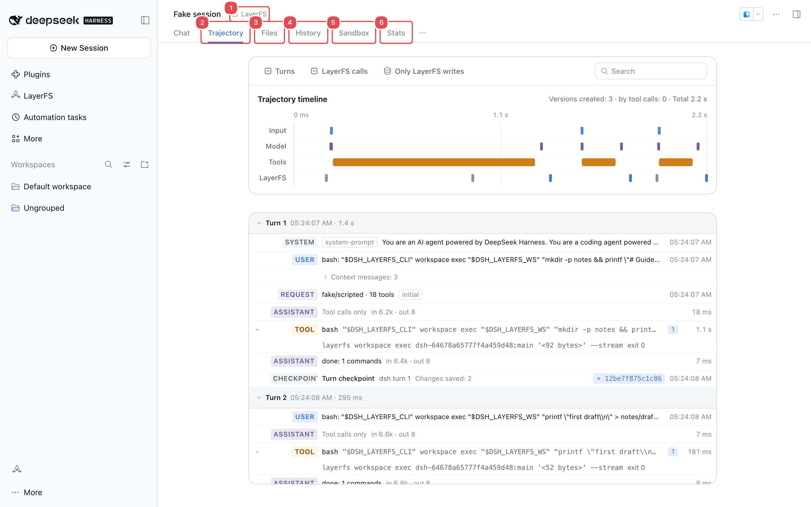
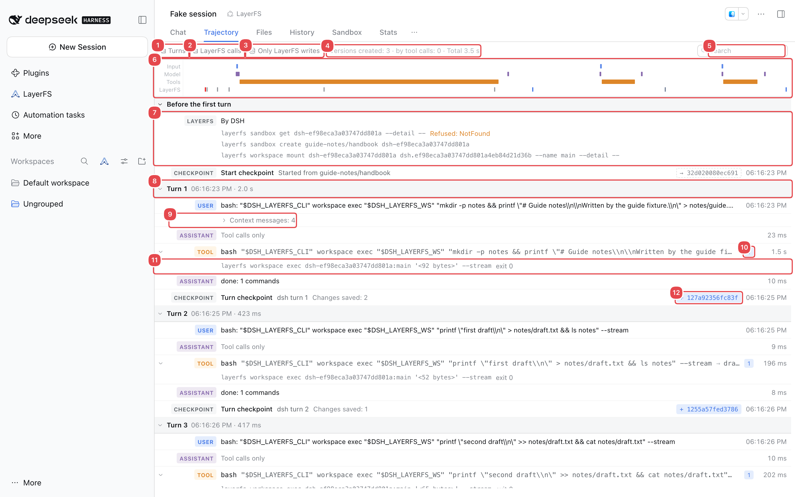
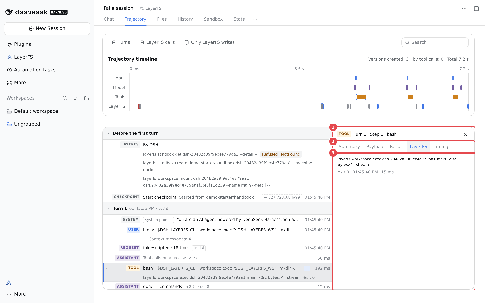
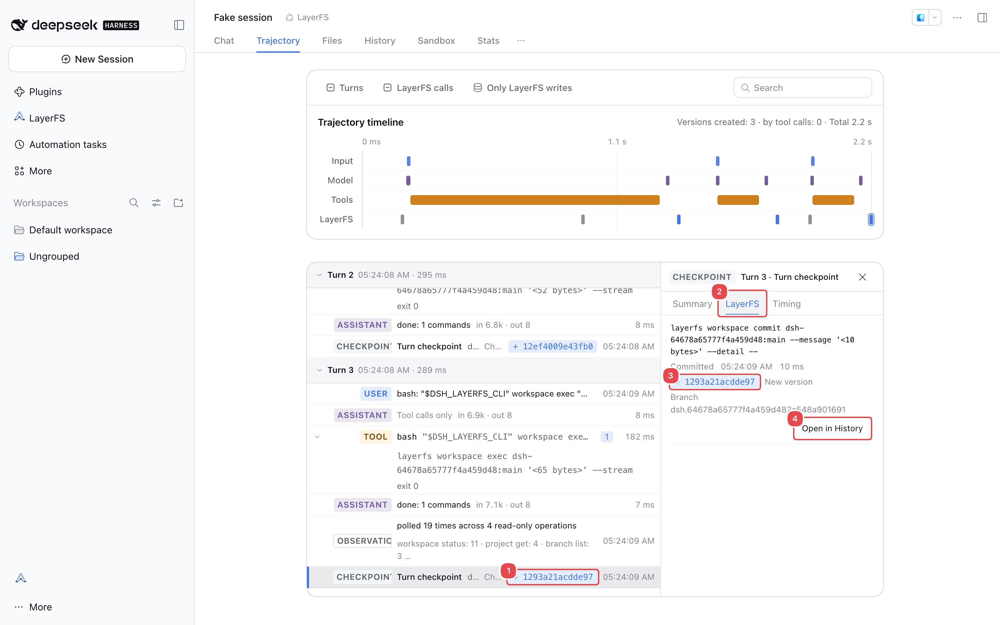
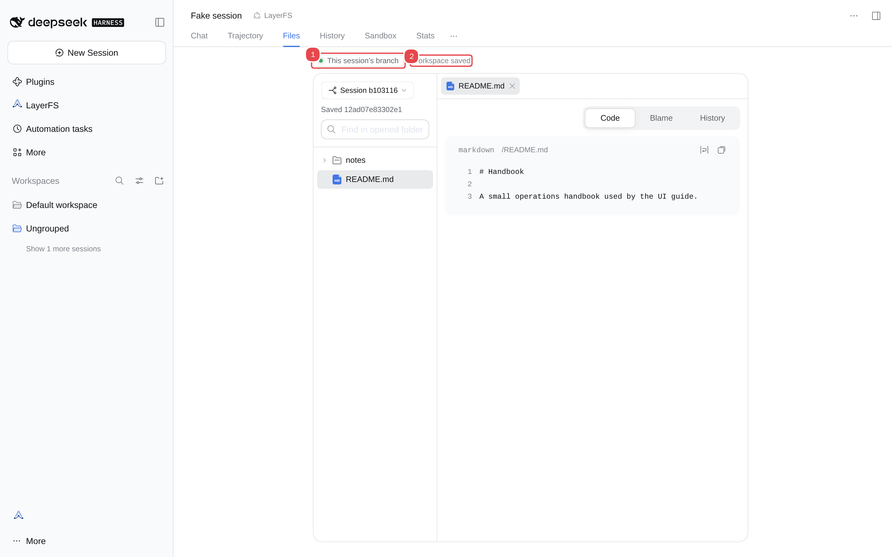
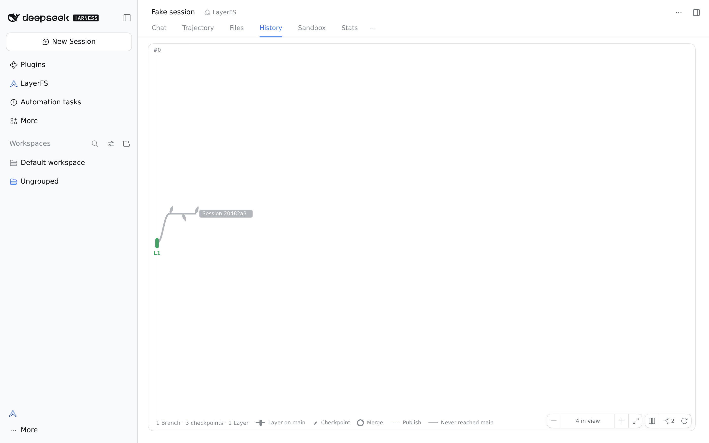
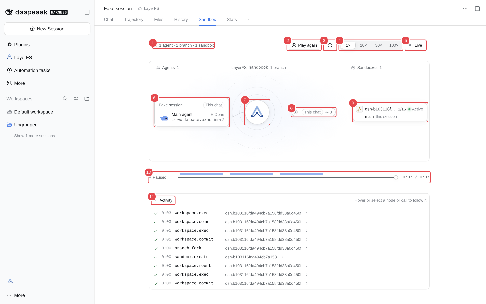
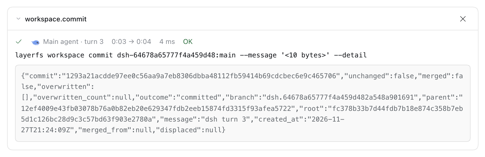
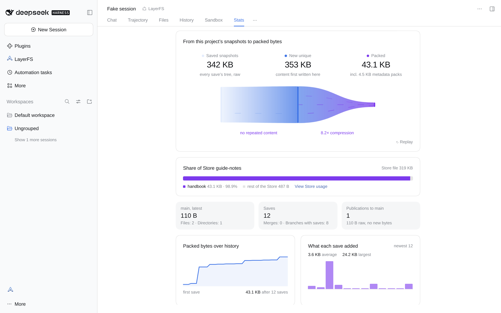
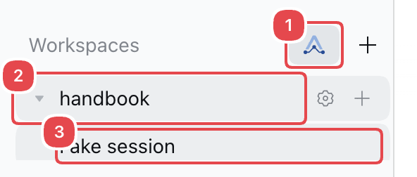

# Conversation

> **Where:** a project session's conversation, e.g. **Fake session** in `handbook` · **Opens from:** the sidebar's LayerFS projects list (`Workspaces ›` LayerFS view `› handbook › Fake session`), Home's project rows, a Logs row's session name, **Open session** on a call · **Source:** see the end

A project session is a DSH conversation whose files live in a LayerFS project. While one is
on screen, its tab row gains LayerFS's tabs: a Trajectory that shows what every tool call did
in LayerFS, the project's Files and History on the session's Branch, a live map of the
Sandbox it runs in, and the project's storage numbers. Come here to follow or audit what an
agent did to the project.

| # | Component | What it is |
|---|---|---|
| 1 | **LayerFS** label | The session's agent preset (DSH's own header label). Its tip: *LayerFS project sessions: everything through bash and the LayerFS CLI ($DSH_LAYERFS_CLI)…* |
| 2 | Trajectory | Each turn's messages and tool calls, the LayerFS calls each made and the versions they saved. Takes the place of DSH's own Trajectory tab |
| 3 | Files | The project's files on this session's Branch ([File views](components.md#file-views)) |
| 4 | History | The project's Branches and Commits, opened on this session's Branch ([History views](components.md#history-views)) |
| 5 | Sandbox | A map of the agents, the Branches and the Sandbox, replaying every LayerFS call |
| 6 | Stats | The project's storage: snapshots to packed bytes, its share of the Store, saves |

**Chat** stays DSH's own; the **⋯** at the end of the row holds DSH's other views.

## Layout

The conversation header (title, the **LayerFS** preset label, and, for a scripted session,
**View script**), then the tab row, then the tab's body. On a project session's LayerFS tabs
the message box steps aside: the composer is hidden while Trajectory, Files, History, Sandbox
or Stats is on screen, and comes back on **Chat** with your draft intact. Approvals and questions still show.

**When the tabs appear.** The tabs are added only while a project session (or one of its
subagents) is on screen, and removed when you switch to a DSH session, which gets DSH's
Chat and stock Trajectory back. Each conversation header asks the host whether its session
has a LayerFS project (`session.place`, no LayerFS call), and the tabs follow a moment later,
so switching conversations does not flicker the Trajectory tab. In a split view with one
project session and one DSH session, the tabs show for both; the DSH one's LayerFS tabs say
**Not in a LayerFS project**; its Trajectory is the LayerFS audit view (DSH's
token usage, prompt diffs and live tool output are not shown), and the DSH pane keeps
its composer while one of those tabs is open. The five tabs and the audit Trajectory are
the known deviation from a plain DSH session; close the project conversation to get
stock DSH back.

DSH also hides the Trajectory tab entirely while its **Show coding view** setting
(Developer tools) is off: stock DSH and LayerFS alike. Chat and the other LayerFS
tabs stay, and turning the setting back on brings the Trajectory back.

## Trajectory

The Trajectory answers "what did each step do in LayerFS". It is DSH's Trajectory (turns,
records, a four-lane timeline, an inspector) with LayerFS added: under each tool call, the
LayerFS calls it made, in CLI words, with their outcome and the versions they saved. The tab
reads the conversation's own log and its LayerFS annotations, so it makes no LayerFS call;
it reads again on the session's LayerFS events (at most once a second) and every 3 s while
the session runs.

| Component | What it shows | Interaction → result | LayerFS call | States |
|---|---|---|---|---|
| ⊟ **Turns** (1) | Folds every turn, or unfolds them (⊞). By default the last 3 turns are open | Press → all turns fold / unfold | — (view state) | |
| ⊟ **LayerFS calls** (2) | Folds the LayerFS call lines under every tool call (⊞ unfolds) | Press → **Collapse LayerFS calls** / **Expand LayerFS calls** for all | — | Only for project sessions |
| **Only LayerFS writes** (3) | A filter | On → only tool calls whose LayerFS calls wrote something (or saved a version) stay | — | Only for project sessions. **Nothing matches the filter** when none did |
| Counts (4) | **Versions created: *n* · by tool calls: *m* · Total *duration*** | — | `session.trajectory` (no LayerFS call: the session log and its annotations) | In the fixture every version came from a turn checkpoint, so **by tool calls: 0** |
| **Search** (5) | Filters records by their text | Type → matching records, with their turns open and context messages shown in place | — | |
| Timeline (6) | Four lanes: **Input**, **Model**, **Tools**, **LayerFS**, over the conversation's time | Click a mark → that record is selected, its turn opens, filters that hide it are lifted, and the table scrolls to it | — | **No timing data**; *label* **(and *n* more nearby)** on crowded marks |
| **By DSH** (7) | A **LAYERFS** row per turn for the calls DSH itself made (the Sandbox create, the Workspace mount, a save). Writes and refusals are listed; reads are counted | Click → the inspector lists them | — | **Reads not shown: *n***. A refusal here (`sandbox get … Refused: NotFound` before the first create) is normal |
| Turn header (8) | **Turn *n*** · start time · duration; **Before the first turn** for what came before | Click → fold / unfold that turn | — | |
| **Context messages: *n*** (9) | Messages DSH added to the turn (instructions, reminders) | Click → show them (**Hide context messages** folds them again) | — | |
| Record rows | A kind pill (**USER**, **ASSISTANT**, **TOOL**, **CHECKPOINT**, **LAYERFS**), the text, a time or duration. A tool call reads `name summary → result`; an assistant step that only called tools reads **Tool calls only**, with **Thought** or **Interrupted** badges | Click → the inspector opens on it | — | **Running…** while a tool runs |
| LayerFS call count (10) | The number of LayerFS calls the tool call made, tinted when one wrote | — | — | |
| LayerFS call line (11) | `layerfs workspace exec dsh-…:main '<92 bytes>' --stream` · **exit 0**, and its versions. Arguments that carry content show as their size | Chevron at the row's left → fold / unfold. Click the line → the inspector's LayerFS tab | — | **Refused: *code***, **Outcome unknown**, **exit *n*** in red when it failed |
| Version chip (12) | `+ 127a92356fc83f`: **+** a new version, **=** saved unchanged, **→** points to an existing one (dashed) | Click → the **History** tab at that Commit on its Branch | — (opens History, which reads) | Disabled when its Branch is not known |
| Checkpoint rows | **Turn checkpoint** / **Start checkpoint** / **Manual** / **Restore** / **Close**, its message (`dsh turn 1`), **Changes saved: *n*** or **Unchanged** | Click → the inspector | — | **Not saved: *code*** when the save was refused |
| **Show more rows (*n* hidden)** | After 400 rows | Press → 400 more | — | |
| Orphan rows | **Call outside the loaded log** and the call id: receipts whose tool call is not in the loaded log | Click → the inspector | — | |

DSH's **Inspect** on a tool call in Chat opens this tab on that call (the row is selected,
its turn opened and filters lifted). **The conversation log is not loaded: only LayerFS calls
from saved receipts are shown.** appears for a session stored in LayerFS but not loaded here.

### Inspector

| Component | What it shows | Interaction → result | LayerFS call | States |
|---|---|---|---|---|
| Header (1) | Kind pill, **Turn *n* · Step *n* · *tool***; **×** (**Close details**) | × → closes | — | |
| Tabs (2) | Tool calls: **Summary** · **Payload** · **Result** · **LayerFS** · **Timing**. Messages: **Summary** · **Timing**. A checkpoint with a save: **Summary** · **LayerFS** · **Timing** | Click, or ←/→ | — | |
| Body (3) | **Summary**: **Status**, **Call ID**, payload and result lines, **LayerFS calls** (count), **Versions**. **Payload**: the arguments. **Result**: the output. **LayerFS**: each call's CLI words, outcome, time, duration and versions. **Timing**: **Started**, **Ended**, **Duration** | — | `session.trajectory.record` for Payload and Result (no LayerFS call: the session log) | **Cut at 64 KiB.**, **No arguments**, **No output**, **This call made no LayerFS calls.**, **Could not read this record** with **Retry** |
| **Open in Logs** | A refused or failed LayerFS call in the **LayerFS** tab: beside its **Refused: *code*** or non-zero **exit *n*** outcome | Press → the [Logs](logs.md) page, filtered to that call | — (opens Logs, which reads) | Only for a refused call or a failed exit |

A checkpoint row (1) opens its save on the **LayerFS** tab (2): the `workspace commit` the
host ran at the end of the turn, **Committed**, and the version (3) with its Branch.
**Open in History** (4), or the version chip, opens the History tab at that Commit.

## Files

The same [file views](components.md#file-views) as the project page, opened on this session's
Branch (the Branch picker reads **Session ef98eca**). Only what differs here:

| Component | What it shows | Interaction → result | LayerFS call | States |
|---|---|---|---|---|
| Branch chip (1) | **This session’s branch** with a dot (green while the session's Workspace is mounted); **This session’s branch · restore *n*** after a restore; **This session’s branch · resumed** when an archived conversation continues on its saved branch; **Session branch *name*** for another Branch | — | `session.state` (read): `workspace status --detail` while mounted, plus `project get`, `machine get`, `store get` to see that the project can run | |
| Unsaved line (2) | **Workspace saved**, or ***n* unsaved in the workspace**: changes in the Workspace that no checkpoint has saved yet | — | same read (the Workspace's overlay count); reread on session events and every 10 s while visible | Hidden while the Workspace is not mounted |
| File views | Files as saved on the Branch: unsaved Workspace changes do not show until the next checkpoint | See [File views](components.md#file-views) | `file list`, `file read`, … (read) | |

A changed file clicked in a History Commit's file list opens here, at that Commit.

## History

The same [history views](components.md#history-views) as the project page, opened on this
session's Branch. Differences: a version chip in the Trajectory opens this tab with that
Commit selected, and a changed file clicked in a selected Commit's file list opens in the
**Files** tab at that Commit.
LayerFS calls are those of the history views (`branch list`, `commit list`, `commit diff`,
read).

## Sandbox

The Sandbox tab answers "who called LayerFS, on which Branch and in which Sandbox, and what
came back". Agents are on the left, the LayerFS hub with the project's Branches in the middle,
Sandboxes and their Workspaces on the right. Every call travels agent → hub → Branch (→
Workspace), lands with a ripple and returns green (**Result**) or red (**Refused**). The map
replays the conversation's calls from the call log.

| Component | What it shows | Interaction → result | LayerFS call | States |
|---|---|---|---|---|
| Facts (1) | ***n* agent · *n* branch · *n* sandbox** | — | — | **active in the 5 min before the playhead, of *n*** when Branches are hidden |
| **This chat** filter | Only with subagents: keep this conversation's own agent | Toggle | — | |
| **Play** / **Pause** / **Play again** (2) | Replays the calls in time | Press → plays or pauses | — | Disabled when there are no calls |
| Replay (3) | ↻ | Press → back to the start and play | — | |
| Speed (4) | **1×** · **10×** · **30×** · **100×** | Pick | — | |
| **Live** (5) | Follows new calls as they happen | Press → jumps to now and plays live | — | The dot pulses while live |
| Agents (6) | Each agent (a whale, one colour each) with its state (**Idle**, **Working**, **Calling**, **Done**…), its last call and turn; grouped under its conversation, **This chat** marks this one | Hover or click → follow it: other nodes dim and Activity lists its calls | `logs.list` per agent (read: `home log --tag dsh:<session>:`, 1000 lines a page, older pages in the background) | ***n* more subagents without LayerFS calls** |
| LayerFS hub (7) | **LayerFS**, the project and its Branch count | Click → all calls | — | Busy ring while a call runs |
| Branch pill (8) | A Branch (`dsh.ef…`), **This chat** for the session's own, and its save count | Hover or click → follow it | — | Dashed while not created yet |
| Sandbox card (9) | Machine mark, name, Workspaces used (**1/16**), state (**Active**, **Stopped**…), its Workspaces; the session's own Workspace reads ***name* this session** | Click → follow it. Click an agent-mounted Workspace → **Workspace terminal**: what ran there, with output | `GET /api/machines` (read: `home get`, `machine list`, `machine get`, `sandbox list`, `store list`) for the machine marks; the terminal: `session.trajectory`, `logs.output` (no LayerFS call) | **Not created yet**, **Not mounted**, ***name* closed · History kept** |
| Playback (10) | **Live** / **Playing** / **Paused**, a strip of each agent's calls, the scrub bar, `0:08 / 0:08` | Drag → that moment | — | |
| **Activity** (11) | The newest 50 calls (method, target, agent and turn) | Click the header → fold / unfold (remembered). Click a call → its detail (below). Hover → highlights it on the map | — | **Hover or select a node or call to follow it**, **Following *name***, **No LayerFS calls from this conversation yet** |

A call's detail shows the agent and turn, start → end in replay time, duration, outcome and
the CLI words, then what it printed: `logs.output` (no LayerFS call: the outputs DSH keeps
for calls it made). **No output was kept for this call.** when none is kept; **×** clears
the selection.

## Stats

The project's storage, the same panel as the [project page's Stats tab](project.md#stats),
without its header: **From this project’s snapshots to packed bytes** (saved snapshots → new
unique → packed, with dedupe and compression ratios, **Replay**), **Share of Store
*store*** (with **View Store usage**, which opens the Store page), **main, latest**,
**Saves**, **Publications to main**, **Packed bytes over history** and **What each save
added**. It reads again when the session saves a checkpoint.

| Component | What it shows | Interaction → result | LayerFS call | States |
|---|---|---|---|---|
| Storage panel | See [Project › Stats](project.md#stats) | **View Store usage** → the Store page | `GET /api/projects/:id/storage` (read: `project get`, `project stats`, `store get`) | |

## Variants

- **DSH sessions** have none of these tabs: DSH's own Trajectory is back and the composer
  stays.
- **A subagent** of a project session shows the root session's project, Branch and
  Sandbox; its Trajectory is its own.
- **A session stored in LayerFS but not loaded** (opened by id, or imported) has no live
  log: the Trajectory lists the LayerFS calls from its saved receipts, with the note above.
- **A scripted session** (started with `/simulation`) gets **View script** in the header once
  its script has finished; a running script shows nothing extra.
- **The project-session mark.** In DSH's Workspaces list, a project session's row is taken
  out (the plugin marks it as project-owned, `session.place`, no LayerFS call); the session
  is listed instead under its project in the sidebar's LayerFS projects view:

  

  1 the view toggle (**Show LayerFS projects** / **Show DSH workspaces**), 2 the project
  (**Toggle conversations in handbook**), 3 the session.

## Modals opened here

| Modal | Opened by | What it does | LayerFS call | Undo |
|---|---|---|---|---|
| ***script name*** (script inspection) | Header › **View script** (scripted sessions, after the script ends) | Shows **The instructions used by this session’s model.**, the **Content hash** and the script's source, read again on each press. **Close** | `simulation.script` (no LayerFS call: the run's saved script); `simulation.status` polls every 4 s while it runs | Nothing to undo: read only |

No fixture session is scripted, so this modal has no screenshot. When the source cannot be
read the button shows **The script source is unavailable. The conversation can still be
read.** in red beside it.

## States and signals

- **Not in a LayerFS project** · *This conversation works in a local folder…*: the tab is
  shown for a DSH session (split view). Nothing to do.
- **Could not read this session’s project** with **Retry**: `session.state` failed (the host
  or LayerFS did not answer).
- ***n* unsaved in the workspace** (amber): the agent changed files that the next checkpoint
  will save; Files and History do not show them yet.
- **Refused: *code*** on a LayerFS call line: LayerFS refused it; the line's chevron and the
  inspector's LayerFS tab show the call. **Open in Logs** there opens the [Logs](logs.md) page
  filtered to that call; a call that ended with a non-zero `exit *n*` gets the same button.
- **Not saved: *code*** on a checkpoint: the save was refused; the files stay in the
  Workspace.

## Where next

- [Logs](logs.md): every call this session made, tagged with its turn and checkpoint (a
  Logs row's session name opens this conversation).
- [Project](project.md): the same files, history and storage outside the conversation.
- [Sandbox](sandbox.md): the Sandbox page of the session's `dsh-…` Sandbox.
- [Components](components.md): [file views](components.md#file-views),
  [history views](components.md#history-views).

## Source

`src/client/views/`: `index.tsx` (when the tabs show, the hidden composer), `TrajectoryView.tsx`,
`TrajectoryInspector.tsx`, `TrajectoryParts.tsx`, `TrajectoryTimeline.tsx`,
`trajectory-model.ts`, `stock-trajectory.ts`, `FileViews.tsx` (Files, History, the session
line), `SandboxView.tsx`, `WorkspaceTerminal.tsx`, `model.ts`, `StatsView.tsx`, `hooks.ts`,
`locale.ts`. `src/client/simulation/index.tsx` (View script), `src/client/session/index.tsx`
(the row mark). Host: `src/host/sessions/index.ts` (`session.place`, `session.state`,
`session.trajectory`, `session.trajectory.record`, `session.annotations`),
`src/host/sessions/service.ts` (`view`), `src/host/logs/index.ts` (`logs.list`,
`logs.output`), `src/host/simulations/index.ts` (`simulation.script`, `simulation.status`).
