# Home

> Images marked “isolated fixture data” show the current components rendered in a private browser with sample data. Other images come from the earlier demo setup.

> **Where:** `LayerFS › Home` · **Opens from:** the sidebar's **LayerFS** row, the first crumb of any Center page, Jump to's Pages · **Source:** see the end

Home is Center's first page: everything this LayerFS home holds, at once. Come here to see
what needs you, to find a project, Store or machine, and to add a new one.

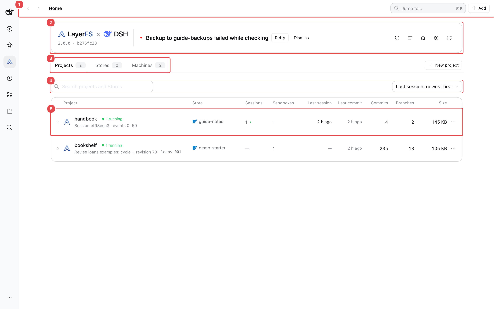

*Isolated fixture data.*

| # | Component | What it is |
|---|---|---|
| 1 | Nav bar | [Components › Nav bar](components.md#nav-bar): Back, Forward, the crumbs (just **Home** here), **Jump to…**, **Add** |
| 2 | Overview head | [Components › Overview head](components.md#overview-head): the title, the pinned runtime, what needs your attention, and the preset and Refresh buttons |
| 3 | Tabs | **Projects** *n* · **Stores** *n* · **Machines** *n*, each with a count; a count that needs you turns amber or red |
| 4 | Search and sort | Filters the projects table and orders it |
| 5 | Project row | One project: its Store, sessions, Sandboxes, last session and commit, size |

## Layout

The [nav bar](components.md#nav-bar) runs across the top of every Center page. Under it,
the [Overview head](components.md#overview-head) says whether anything needs you, then
three tabs: Projects, Stores and Machines. Each tab's action (**New project**, **New
Store**, **Connect a database**, **New machine**, **Diagnose this host**) sits at the right
end of the tab bar. Home remembers nothing between visits except the Stores tab's kind and
view and which rows are open.

Home reads the Storage view (`GET /api/storage`: `home get`, `project list`, `store list`,
`store get` per PostgreSQL Store) and the project catalog (`GET /api/projects`: `project list`) when it opens,
again every 15 s while it is visible, and after changes. Storage and project notifications are coalesced over 500 ms. Project changes refresh the catalog as well as storage. A failed action shows a red bar under the Overview head with **Dismiss**.

## Overview head and notices

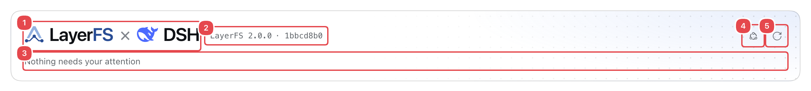

*Isolated fixture data.*

The Overview head is a shared component; its full table is in
[Components › Overview head](components.md#overview-head), and the notices it lists are in
[Components › Needs-you notices](components.md#needs-you-notices).

| Component | What it shows | Interaction → result | LayerFS call | States |
|---|---|---|---|---|
| 1 Overview | The page's title | — | — (static) | — |
| 2 Runtime | `LayerFS 2.0.0 · 12345678`, the pinned build and its commit | Press → opens [Set up LayerFS](entry-points.md#set-up-layerfs) | `--version --json` (read, runtime discovery) | **LayerFS unavailable**, **Reading LayerFS…** |
| 3 Status line | The most urgent need with its fix, or **Nothing needs your attention** | Each need's own button (see [Needs-you notices](components.md#needs-you-notices)) | the button's own call | a dot before a need (red problem, amber warning); **+{n} more** expands or collapses the remaining needs and their actions |
| 4 Try a preset | The agent-preset icon | Press → the Presets dialog ([Presets](presets.md)) | — (opens a dialog) | — |
| 5 Refresh | A circular arrow; its tip says when the checks last ran | Press → reads Stores, projects and machines again and re-runs the home checks | `home get`, `project list`, `store list`, `project list` (read), then `home doctor` | a dot while the checks run |

A **Docker unavailable** chip sits beside the title while Docker cannot run here; press it
for the reason and for the docker machines it names. Doctor findings are counted on the
Doctor button in the nav bar, and a Store that was never backed up is not a need.

## Nav bar

On the current Home navigation bar, 1 opens Doctor, 2 opens Logs and 3 opens Settings.

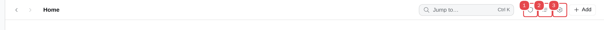

*Isolated fixture data.*

The earlier multi-Store example below shows the breadcrumb switcher.

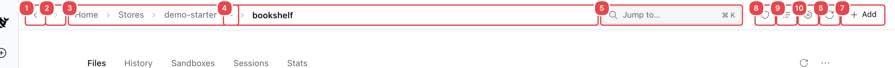

Shown here on `Home › Stores › demo-starter › bookshelf`, where it has every part. Full
table: [Components › Nav bar](components.md#nav-bar).

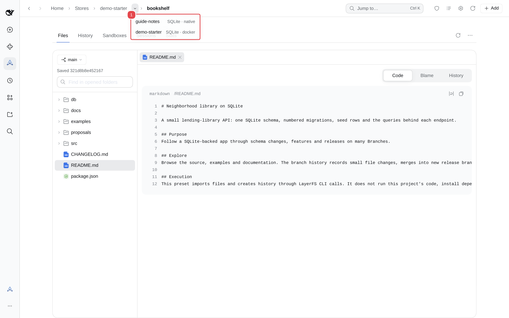
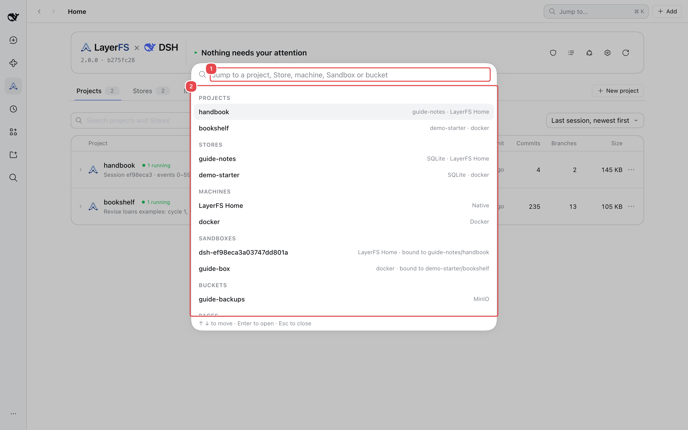

*Isolated fixture data.*

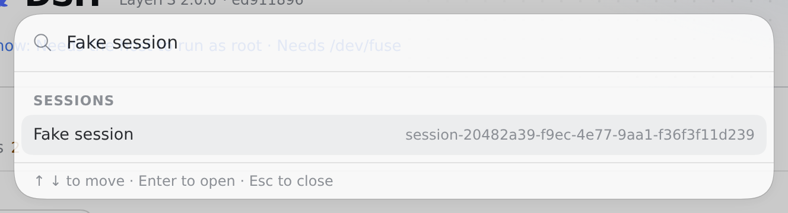

*Isolated fixture data.*
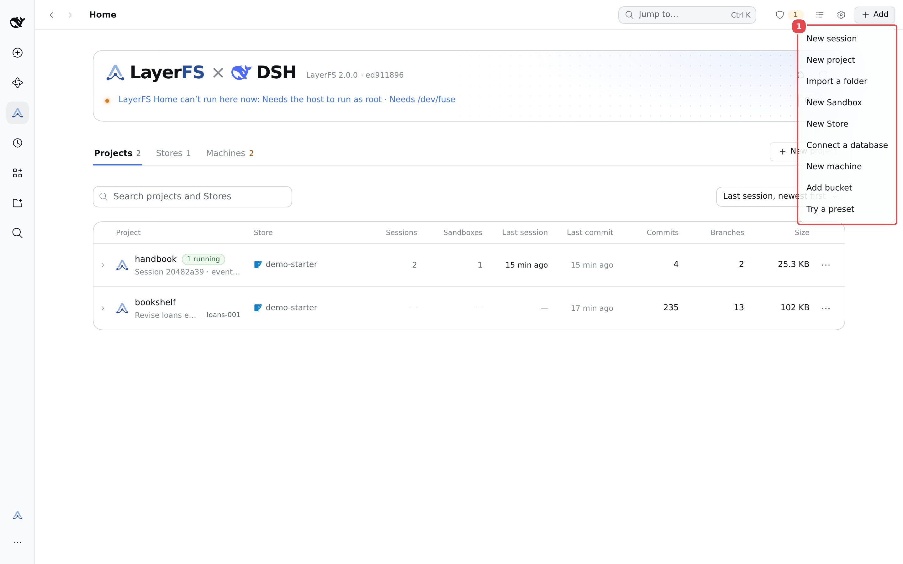

*Isolated fixture data.*

| Component | What it shows | Interaction → result | LayerFS call | States |
|---|---|---|---|---|
| 1 Back · 2 Forward | Arrows | Press → the previous or next Center page (up to 50 kept) | — (local history) | disabled at either end |
| 3 Crumbs | `Home › Stores › demo-starter › bookshelf` | Press a crumb → that page | — (navigation) | the last crumb is the page you are on |
| 4 Crumb switcher | A chevron after an ancestor crumb, a caret on the current one, when it has siblings | Press → a menu of its siblings (every Store, every project in the Store, …) → open one | — (from the Storage view already read) | only when there is more than one sibling |
| — Transfers | **{n} transfers** with a monotonic percentage and progress bar (matching the Store page and Store cards), while moves, backups or restores run | Press → that Store's page (one), or a menu of them (several) | — (the jobs in the Storage view already read) | hidden when nothing runs |
| 5 Jump to… | A search field with **⌘K** | Press or **⌘K** → the Jump to dialog: type, **↑ ↓** to move, **Enter** to open, **Esc** to close | — (searches what Home already read) | **Nothing matches “{q}”**; not while another dialog is open |
| 6 Refresh | A circular arrow, on every page but Home | Press → the page reads again | the page's own reads | a dot while reading |
| 7 Add | **+ Add** | Press → **New session**, **New project**, **Import a folder**, **New Sandbox**, **New Store**, **Connect a database**, **New machine**, **Add bucket**, **Try a preset** | each item's dialog (see [Modals opened here](#modals-opened-here)) | New machine and New Sandbox stay visible with the reason when unavailable |
| Doctor | A shield; a red or orange count when the home checks found something | Press → `LayerFS › Doctor` ([Doctor](health.md)) | `GET /api/doctor/results` (read, host memory) | count red for an error, orange for a warning |
| Logs | A list icon | Press → `LayerFS › Logs` ([Logs](logs.md)) | — (navigation) | — |
| Settings | A gear | Press → [Set up LayerFS](entry-points.md#set-up-layerfs) | `home get` (read, through `setup.status`) | — |

## Projects

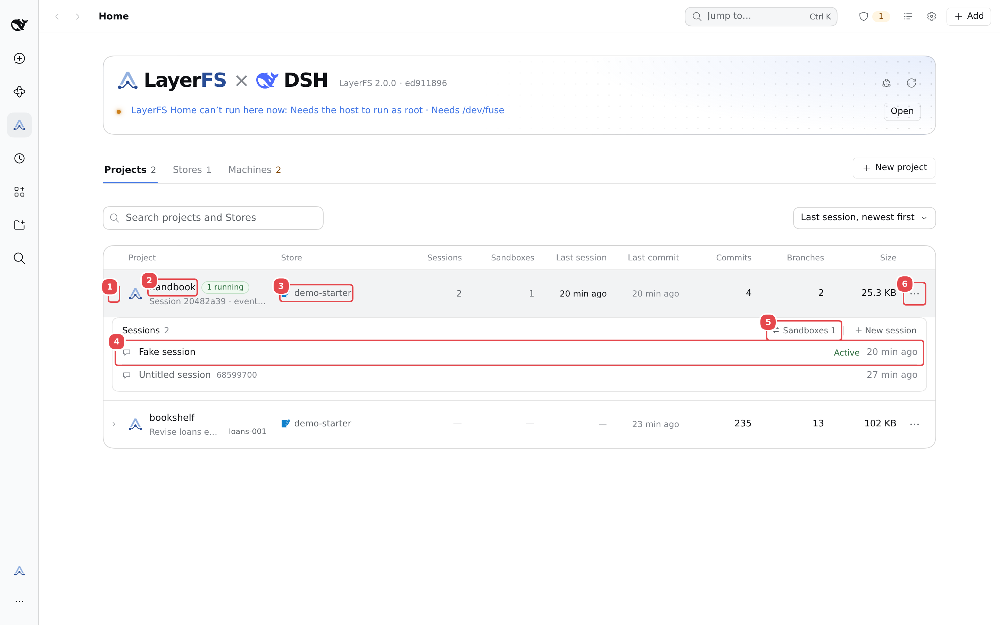

Every project in every Store of this home. Answers "where is it, who works in it, how big is
it, when did it last change".

| Component | What it shows | Interaction → result | LayerFS call | States |
|---|---|---|---|---|
| Search | **Search projects and Stores** | Type → rows whose project or Store name match; **/** focuses, **Esc** clears; the tab count reads **{n} of {total}** | — (filters rows already read) | **No project matches “{query}”** with **Clear search** |
| Sort | **Last session, newest first** | Choose **Default order**, **Size, largest first** or **Name, A to Z** | — (local order) | — |
| 1 Row toggle | A chevron | Press → the row opens on its sessions (or Sandboxes) | sessions: `sessions.list` (local only, no call); Sandboxes: `sandbox list` (read, in `GET /api/machines`) | rows that are open stay open |
| 2 Project name | **handbook**, a green **{n} running** pill, and the newest commit's line (`Session ef98eca3 · events 0–59`, or a message and Branch) | Press → the [Project](project.md) page | `project list` (read); commit line `branch get`, `project stats` (read, `GET /api/stores/:id/projects`) | — |
| 3 Store | The Store's glyph and name | Press → the [Store](store.md) page | — (navigation) | — |
| Sessions · Sandboxes | Counts only (the project name carries the green **{n} running** pill); the sessions count has a tip only when one is active, and the Sandboxes count's tip lists every Sandbox's name and place (with how many run when any do) | Press a count → the row opens on that list | as the row toggle | `—` for none |
| Last session · Last commit | Relative times | — | `branch get` (read) | `—` for none |
| Commits · Branches · Size | Numbers | — | `project stats` (read); size `GET /api/projects/:key/size`: `project get`, `project stats`, `store get` (read) | — |
| 4 Session line | **Fake session**, its state word — **Active**, **Interrupted** or **In Store**; an idle session shows none — and when | Press → the conversation opens in DSH | `sessions.open`: none when its log is here; else `branch list`, `project export` (imports it from the Store) | — |
| | **+ New session** in the list head | Press → a new project conversation (see [Entry points › New session in a project](entry-points.md#new-session-in-a-project)) | `sessions.choose`: `project get` (+ `branch list`, `branch fork` the first time) | — |
| 5 List switch | **Sandboxes {n}** / **Sessions {n}** | Press → the other list | as the row toggle | — |
| | A Sandbox line, **Running** / **Stopped** | Press → the [Sandbox](sandbox.md) page | — (navigation) | — |
| 6 ⋯ | **{name} actions** | Press → **Open**, **New session**, **Delete project…** | see below | — |

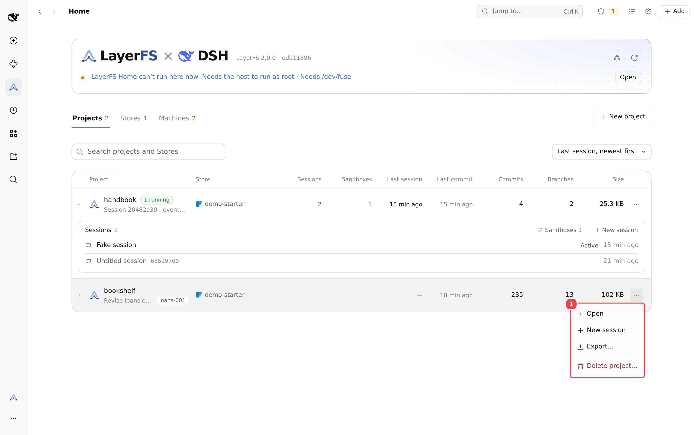

| Menu item | Result | LayerFS call |
|---|---|---|
| **Open** | The Project page | — |
| **New session** | A new project conversation | `sessions.choose`: `project get` |
| **Delete project…** | [Confirm dialog](components.md#confirm-dialog) **Delete {name}?**: "The project and all its history are deleted from its Store. This cannot be undone." Type the name to enable **Delete**. | `project delete` |

Empty: **No projects yet** — "A project is a folder of files kept in a LayerFS Store." with
**New project** and **Try a preset**.

## Stores

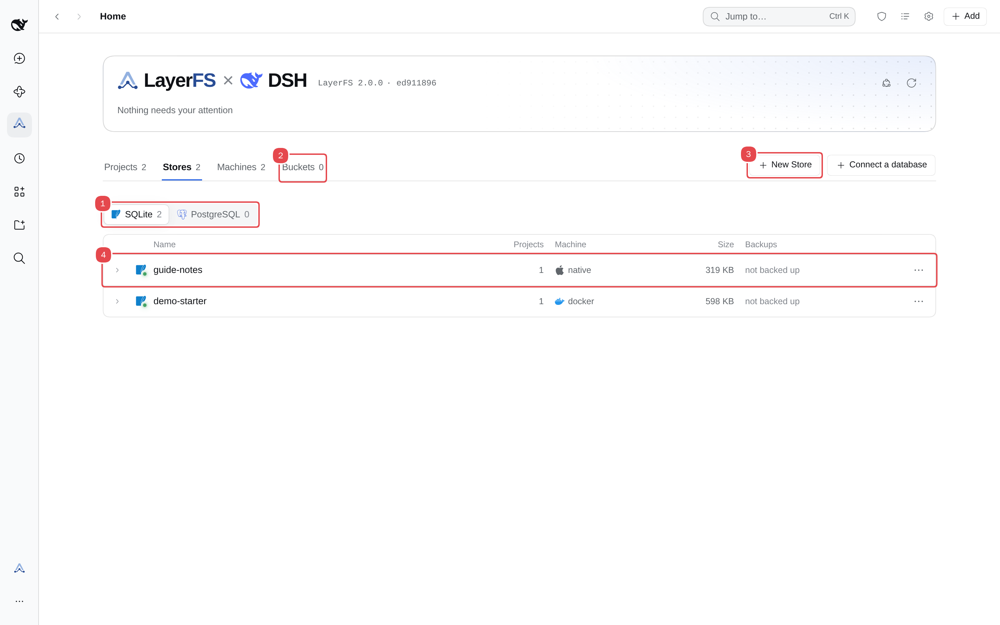

The Stores this home holds, by kind. Answers "where does each Store live, what is in it, is it
backed up".

| Component | What it shows | Interaction → result | LayerFS call | States |
|---|---|---|---|---|
| 1 Kind | Two tiles: **SQLite** *{n}* and **PostgreSQL** *{n}* | Press → that kind's rows; remembered | — (local view state) | — |
| 2 Show | **Stores {n}** / **Buckets {n}** (SQLite only) | Press → Store cards or bucket cards; remembered | — (local view state) | — |
| 3 New Store | **New Store** (SQLite) or **Check all** and **Connect a database** (PostgreSQL), at the right end of the tab bar | Press → the New Store / Connect a database dialog; **Check all** checks every PostgreSQL Store and opens the rows whose check failed | `store create` / `store connect` / `store doctor` | — |
| 4 Store row | Folded: name, the machine it lives on, size, projects, last backup, a status dot. Unfolded: **Projects** (5, then **+n projects →**), **Lives on** with **Move…**, **Backups** with **Back up** / **Restore…** | Press the row → unfold (remembered per viewer); the name → the Store page; [Store menu](components.md#store-menu) in ⋯ | `GET /api/storage` (read); projects `GET /api/stores/:id/projects` (read, on unfold); **Move…** `store move` | a job line while a move or backup runs; **machine stopped** with **Start** |

Empty: **No SQLite Store yet.** / **No PostgreSQL database connected yet.** With neither a
Store nor a bucket in the home, the tab reads **No Stores yet** — "Create a Store in the home,
restore one from a backup, or connect a PostgreSQL database." — with **New Store** and
**Connect a database**.

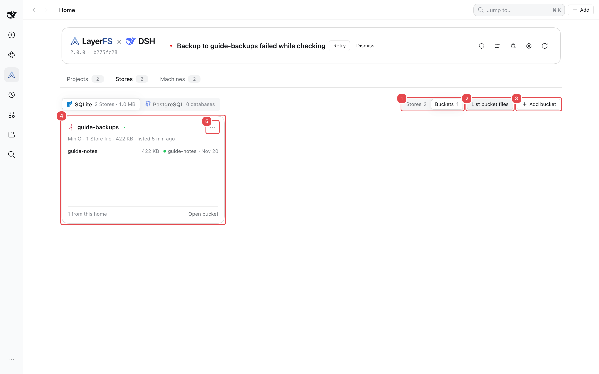

| Component | What it shows | Interaction → result | LayerFS call | States |
|---|---|---|---|---|
| 1 Show | **Buckets** selected | — | — | — |
| 2 List bucket files | **List bucket files**, at the right end of the tab bar | Press → every bucket is listed again | `backup list` (one per bucket), then the Storage view | a dot while listing |
| 3 Add bucket | **Add bucket**, beside it | Press → the Add bucket dialog ([Bucket](bucket.md)) | `backup connect` (keys on stdin) | — |
| 4 Bucket card | Provider, name, `MinIO · 1 Store file · 385 KB · Listed {ago}`, its files with their Store and date, **{n} from this home** | Press the name or **Open bucket** → the [Bucket](bucket.md) page; press a file name → its [Backup file](bucket.md#backup-file) page; **Restore…** on a file not from this home → the restore dialog | `backup list` (read); **Restore…** `backup restore` | **Files unknown** with **Connect again…** / **List again**; **Not listed** with **List files**; **Listing…** while listing |
| 5 ⋯ | **More actions for {bucket}** | **List files** / **List again**, **Open bucket** | `backup list` | disabled while listing |

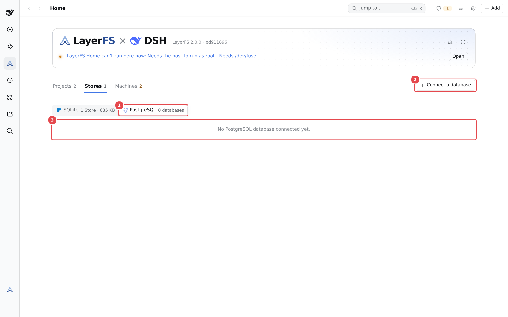

| Component | What it shows | Interaction → result | LayerFS call | States |
|---|---|---|---|---|
| 1 PostgreSQL | The tile, selected | — | — | — |
| 2 Connect a database | The kind's add button, at the right end of the tab bar, beside **Check all** | Press → Connect a database | `store connect` (password on stdin) | — |
| 3 Rows | One row per database. Folded: the dot of **Checked from this computer**, name, `user@host:port/database` with **Copy**, projects, the machines (one by name with its status dot, several as **+n** and **n machines**, none as **no machines** and **Attach…**), and one word: **n failed**, **n stopped** or **local address**. Unfolded: **Projects**, **Runs on** (each machine's status and its one action, **×**, **+ Attach machine**) | Press the row → unfold; the name → the Store page | `GET /api/storage` (read: `store get` per Store); projects `GET /api/stores/:id/projects` (read); **×** `store detach`; **+ Attach machine** `store attach` | **No PostgreSQL database connected yet.** (shown: the fixture has none); a machine attached but not checked reads **not checked** |

## Machines

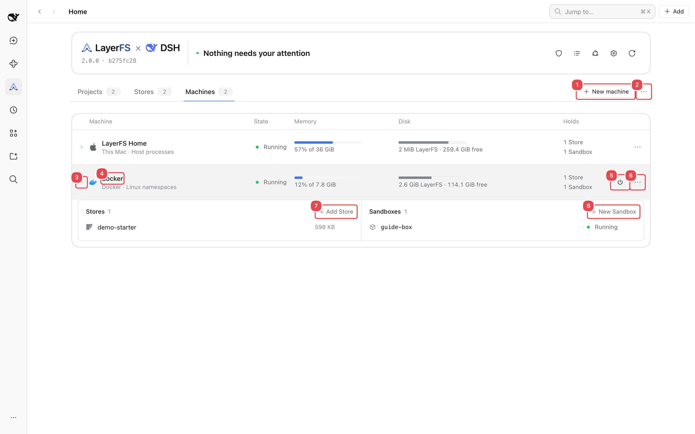

Every machine of this home in one table. Answers "is it running, how full is it, what does it
hold".

| Component | What it shows | Interaction → result | LayerFS call | States |
|---|---|---|---|---|
| 1 New machine | **+ New machine**, at the right end of the tab bar | Press → the New machine dialog ([Machine](machine.md)) | `home get`, `machine create` | always there; off with the reason as its tip when no platform can create one |
| 2 Diagnose this host | The **</>** button beside it | Press → the home checks run and the [Doctor](health.md) page opens on them | `home doctor` | — |
| 3 Row toggle | A chevron | Press → what it holds; remembered | — | open by default when it needs you, is starting, or is the only machine |
| 4 Name | **docker**, `Docker · Linux namespaces` (or `This Mac · Host processes`) | Press → the [Machine](machine.md) page | `home get`, `machine get`, `machine list`, `sandbox list`, `store list` (read) | — |
| State | A chip: **Running**, **Stopped**, **Starting**, … | — | as above | **Blocked** rows say why, with a fix |
| Memory · Disk | Bars | — | memory: `GET /api/metrics` (read, host memory); disk: `machine stats` (read) | `—` while stopped |
| Holds | **1 Store**, **1 Sandbox** | — | as above | — |
| 5 Power | **Stop** / **Start** (not on This Mac) | **Start** → the machine starts. **Stop** asks a second press: the button becomes **Confirm: Stop** (**Confirm: Stop worker** for docker) for a few seconds | `machine stop` / `machine start` | disabled while it settles |
| 6 ⋯ | **More for {name}** | [Components › Machine menu](components.md#machine-menu) | see there | — |
| 7 Add Store | **Add Store** | Press → a dialog to move a SQLite Store onto this machine (shows size, target free disk, **Held now** and **Start** *m* checks; on LayerFS Home also **Or create an empty Store here: New Store**) | `store move` (a job) | — |
| 8 New Sandbox | **New Sandbox** | Press → the New Sandbox dialog ([Sandbox](sandbox.md)) | `sandbox create` | — |

## Variants

- **SQLite vs PostgreSQL.** The Stores tab's kind tiles switch between them. Buckets belong to
  SQLite (a backup is a copy of a Store file), so the **Show** switch and bucket cards appear
  only under SQLite. A PostgreSQL row lists the machines attached to it.
- **No setup yet.** Before LayerFS is set up, Home shows the [Set up card](entry-points.md#set-up-card)
  in place of the tabs.
- **No storage view yet.** **Reading the Stores…** while loading; **Could not read the storage**
  with **Retry** when the read failed.
- **The Refresh button** in the nav bar shows on every Center page but Home, where the
  Overview head's Refresh does the same and also reruns the checks.

## Modals opened here

| Modal | Opened by | What it does | LayerFS call | Undo |
|---|---|---|---|---|
| New project | **New project** (tab, Add, empty state) | [Entry points › Project dialog](entry-points.md#project-dialog) | `store create`, `project init`, `store move` | delete the project |
| New session | Add › **New session** | Pick a project for the conversation | — (opens the picker) | Cancel |
| Import a folder | Add › **Import a folder** | Open the project dialog with a source folder | `project init` on confirmation | Cancel before creation |
| New Sandbox | Add › **New Sandbox** | Choose an eligible machine, then configure the Sandbox | `sandbox create` on confirmation | Cancel before creation |
| New Store | **New Store**, Add › **New Store** | Makes a SQLite Store on a machine | `store create` | **Remove…** on the Store |
| Connect a database | **Connect a database** | Connects a PostgreSQL database with its address, user and password, checked from this computer | `store connect` | **Disconnect…** |
| New machine | **New machine** | Creates a Docker, Lima or Apple Container machine | `machine create` | **Remove** in the machine menu |
| Add bucket | **Add bucket** | Connects an S3 bucket for backups | `backup connect` | **Disconnect** on the bucket |
| Presets | **Try a preset**, Add › **Try a preset** | [Presets](presets.md) | the preset's script | — |
| Set up LayerFS | Runtime, **Settings** | [Entry points › Set up LayerFS](entry-points.md#set-up-layerfs) | `home get` | — |
| Jump to | **Jump to…**, **⌘K** | Opens a project, Store, machine, Sandbox, bucket, Center page or available DSH session | — | Esc |
| Delete {name}? | Project ⋯ › **Delete project…** | [Confirm dialog](components.md#confirm-dialog) | `project delete` | none |

## States and signals

- **Tab counts.** A tab's count takes the colour of the worst thing in it: red for a failed job
  or a broken Store, amber for a stopped machine holding Stores. The tabs carry no dot of their
  own.
- **Nothing needs your attention**, with no dot, means no job failed, no machine or Store is
  broken. A dot appears only beside a need (red for a problem, amber for a warning). Doctor
  findings are counted on the Doctor button only, and a Store never backed up is not a need.
- **A disabled power button** is settling after a press; wait for its state to change.
- **{n} running** on a project is the Sandboxes running for it now.

## Where next

[Project](project.md) · [Store](store.md) · [Bucket](bucket.md) · [Machine](machine.md) ·
[Sandbox](sandbox.md) · [Doctor](health.md) · [Logs](logs.md) · [Presets](presets.md) ·
[Entry points](entry-points.md)

## Source

`src/client/storage/StoragePage.tsx` (Center, routing, Jump items, Add menu, polling) ·
`src/client/storage/Nav.tsx` · `src/client/storage/HomeOverview.tsx`, `HomeHero.tsx`
(Overview head, needs) · `src/client/storage/ProjectTable.tsx`, `ProjectFinder.tsx` ·
`src/client/storage/MachineStores.tsx`, `BucketCards.tsx` · `src/client/machines/Board.tsx` ·
`src/client/doctor/use-doctor-count.ts` · shots: `tools/guide/shots/home.mjs`
