# Machine

> **Where:** `LayerFS › Home › Machines › <machine>` · **Opens from:** a machine's name on Home › Machines, the nav bar's crumb switcher, Jump to (**Machines** group), a Store's place link, a Sandbox's **Machine** fact · **Source:** see the end

A machine is where Sandboxes run and where SQLite Stores live: **LayerFS Home** (this
computer, the `native` machine), the built-in **docker** machine (a LayerFS worker in a Docker
container) or a VM you create (Lima, Apple Container). Its page answers "is it running, how
full is it, what is on it", and holds every machine action: start, stop, restart the worker,
force stop, settings and remove.

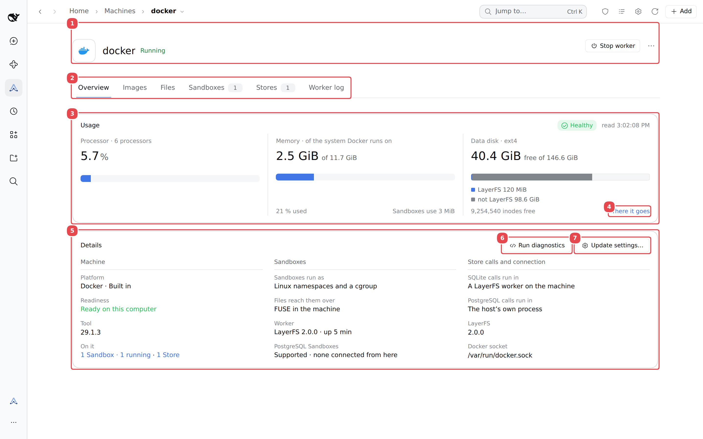

| # | Component | What it is |
|---|---|---|
| 1 | Head | The machine's glyph, name (**LayerFS Home** for `native`), state chip, kind line (**Docker · Linux namespaces**), its power button and its ⋯ menu. Above every tab, the same on every kind of machine |
| 2 | Tab bar | **Overview** · **Images** · **Files** · **Sandboxes** *n* · **Stores** *n* · **Worker log**. Images, Files and the Worker log only show when offered (see [Variants](#variants)) |
| 3 | Usage card | Processor, memory and data disk now, with **Healthy** and the time they were read |
| 4 | **Where it goes** | Opens the [Disk space dialog](#disk-space-dialog) |
| 5 | Details card | The machine's facts in three groups: Machine, Sandboxes, Store calls and connection |
| 6 | **Run diagnostics** | Runs the machine's checks on the Doctor page |
| 7 | **Update settings…** | docker only: the [Settings dialog](#settings-dialog) |

Above the head is the [nav bar](components.md#nav-bar): `Home › Machines › docker`, whose last
crumb switches to another machine.

## Layout

The head comes first, then the tab bar. The head stays on every tab, so the machine's state,
its power button and its ⋯ menu are in reach while you read its Sandboxes, Stores, images
or log. Notices about the machine (a start in progress, a platform that is not ready, a
refused action, why it is down) show on every tab, under the bar. The page remembers the tab
per machine; a link elsewhere (a Sandbox card's **Terminals**, **Open worker log**) can
switch it.

### Notices (every tab)

| Component | What it shows | Interaction → result | LayerFS call | States |
|---|---|---|---|---|
| Startup progress | **Starting worker** / **Starting machine** / **Creating machine**, the stage now, the elapsed time, and **n steps** done (unfolds) | **n steps** → the completed stages with their times | — (`machine-progress` events of the running `machine start` / `machine create`) | **Startup completed**, **Startup needs attention** (with LayerFS's refusal and **Open worker log**), **Outcome needs inspection** |
| Not ready here | **docker can’t run here now:** *reason*, and **Start opens Docker and waits for its Engine before starting the worker.** when only the Engine is off | The fix steps with commands to **Copy**, **Fix in setup** (a missing Linux bundle), **Choose another socket…** (docker's socket does not answer), **Check again** | **Check again**: `home get`, `machine list`, `machine get`, `sandbox list`, `store list` (read, platforms read fresh) | The power button becomes **Start Docker and worker**, or is hidden |
| Down notice | The state's word (LayerFS's message on hover) and, off the Overview, the fix button | Fix → as the power button | as the power button | **LayerFS can’t read this machine’s record. Run diagnostics to see what is wrong.** for an unreadable record |
| In use | **Close its Sandbox first** / **Close its *n* Sandboxes first** and their names, after a stop LayerFS refused | **Open Sandboxes** → the Sandboxes tab | — | Goes away once those Sandboxes are gone |
| Refusal | LayerFS's code and words for the last action | — | — | |
| **Open worker log** | Under a failed start or a down machine with no fix the page runs | → the Worker log tab | — | Only with a Worker log tab |

## Overview

What the machine is using now and what it is.

| Component | What it shows | Interaction → result | LayerFS call | States |
|---|---|---|---|---|
| Head | Glyph, name, state chip, kind · runtime, above the tab bar | — | `home get`, `machine list`, `machine get --with live`, `sandbox list`, `store list` (read: the machines view, polled while the page shows) | **Running**, **Stopped**, **Starting…**, **Starting worker…**, **Stopping… *n*s**, **Needs repair**, **Docker not running**, **Unavailable** |
| Power button | See the key table (1) | **Stop worker** / **Stop** → stops it | `machine stop` | Off while another power action runs; a press right after the button changed does nothing |
| | | **Start worker** / **Start** → starts it, with startup progress | `machine start` | |
| | | **Start Docker and worker** → opens Docker Desktop, waits for its Engine, then starts | `machine start` (Docker Desktop is launched by the host first) | macOS docker with the Engine down |
| | | **Restart worker** (the fix for an outdated worker) | `machine get`, then `machine stop` then `machine start` | Refused (InUse) while Sandboxes are on it: off with **copy the fix to stop it anyway** |
| | | **Check** (an unknown or unresolved state) → reads the machines again | `machine list`, `machine get` (read) | |
| ⋯ | [Machine menu](components.md#machine-menu) | | | |
| Needs-you notices | The disk getting full (with **Where it goes**), **n gone Sandboxes still hold *size* on this machine's disk until they are closed.**, **1 Sandbox needs you.** | **Show Sandboxes** → the Sandboxes tab; **Where it goes** → Disk space dialog | — (from the reads below) | Only while something needs you |
| Usage card | **Processor** · *n* **processors** (a share in %), **Memory** · *of whose* (used **of** total, **% used**, **Sandboxes use** *size*), **Data disk** · *filesystem* (free **free of** total, a bar split into **LayerFS** and **not LayerFS**, **inodes free**) | **Where it goes** → Disk space dialog | — (the host's metrics sampler: it reads `machine stats` once per machine every 15 s; the page asks the sampler's memory) and `machine stats --with space` for the disk split (read, kept a minute) | **Healthy** while nothing needs you; a value LayerFS did not read says **Not read** and why; **Needs a second sample** for the processor at first; no Processor column on macOS (LayerFS cannot read it) |
| Fact row | Without `machine stats`: **Free disk**, **CPU and memory** as the record was created (**allocated**), the tool version and the worker | — | the machines view (read) | Older CLIs only |
| Details card · Machine | **Platform** (**Docker · Built in**), **Readiness** (**Ready on this computer**, missing pieces, **Its VM is gone from this computer**), **Tool** (Docker's version), **On it** (**1 Sandbox · 1 running · 1 Store**), **Down because**, **Operation**, **Fix** (a line to copy) | **On it** links → Sandboxes or Stores tab | the machines view (read) | |
| Details card · Sandboxes | **Sandboxes run as**, **Files reach them over** (FUSE, loopback NFS), **Worker** (**LayerFS 2.0.0 · up 20 min**), **PostgreSQL Sandboxes** | — | the machines view; the worker line from the sampler | |
| Details card · Store calls and connection | **SQLite calls run in**, **PostgreSQL calls run in**, **LayerFS** version, **Docker socket** (docker) or WSL distribution | — | the machines view (read) | |
| **Run diagnostics** | | Press → the Doctor page runs this machine's checks | `machine doctor` (on the Doctor page) | Off while it starts |
| **Update settings…** | docker only | Press → [Settings dialog](#settings-dialog) | — | |
| Danger zone | A created VM only: **Remove *name*…** | Press → [Remove dialog](#remove-dialog) | — | Off with why while it holds Stores or Sandboxes, or while its record is unreadable |

### Disk space dialog

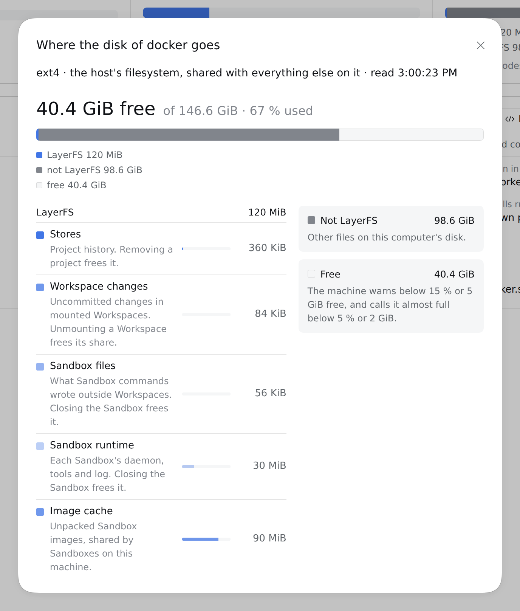

**Where the disk of *machine* goes**: free of total, one bar split by part, LayerFS's parts
(**Stores**, **Workspace changes**, **Sandbox files**, **Sandbox runtime**, **Image cache**,
**Logs and records**), each with what frees it; **Not LayerFS** with the command that shows it
(`docker system df`, with **Copy**); **Free** with when the warning starts (**The machine warns
below 15 % or 5 GiB free, and calls it almost full below 5 % or 2 GiB.**); then **Largest
Stores** and **Largest Sandboxes**, linking to their tabs (a gone Sandbox's folder is marked).
Nothing here removes anything.

| Component | Interaction → result | LayerFS call |
|---|---|---|
| The dialog | Opens → reads where the disk goes; again every minute while open | `machine stats --with space` (read, the host keeps an answer a minute) |
| **Refresh** | Reads now, past the host's minute | `machine stats --with space` (read, `?fresh=1`) |
| **Stores tab** / **Sandboxes tab** | Closes the dialog on that tab | — |
| A Sandbox row | Opens that Sandbox's page | — |

A stopped machine is not asked (**Not read: the machine is not running.**); a refused read keeps the last
answer with its time and LayerFS's code.

## Sandboxes

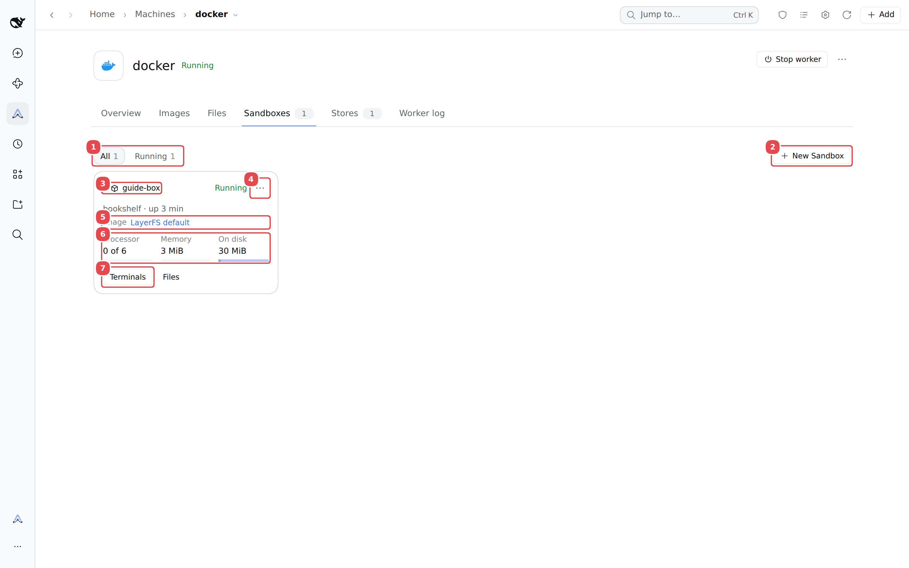

Every Sandbox on the machine, as a card, with how much processor, memory and disk it uses now.

| # | Component | What it shows | Interaction → result | LayerFS call | States |
|---|---|---|---|---|---|
| 1 | Filter chips | **All** *n*, **Running** *n*, **Needs you** *n*, **Closed** *n* (closed within the sampler's hour) | Click → only those | — (view state) | A chip with 0 hides, except **All** |
| | **Order** | **As listed**, **Name**, **Most disk**, **Most memory** | Pick → reorders; those that need you stay first | — | Shows with two cards or more |
| 2 | **New Sandbox** | | Press → [New Sandbox dialog](#new-sandbox-dialog) | — | Off with **Wait until the machine finishes starting or stopping** |
| 3–7 | Sandbox card | [Components › Sandbox card](components.md#sandbox-card): name, state, ⋯, project and up time, **Image**, Processor / Memory / On disk, **Terminals** and **Files** | | `sandbox list` (read), the sampler, `machine stats --with space` | |
| | Creating row | A Sandbox being created: its phase in words and a bar while the image copies | Failed: **Retry**, **Free space** (no room), LayerFS's fix, or dismiss | **Retry**: `sandbox create`; dismiss: — (host only) | |
| | Empty line | **No Sandboxes** on the machine, or **No Sandbox here matches this filter.** | | | |

### New Sandbox dialog

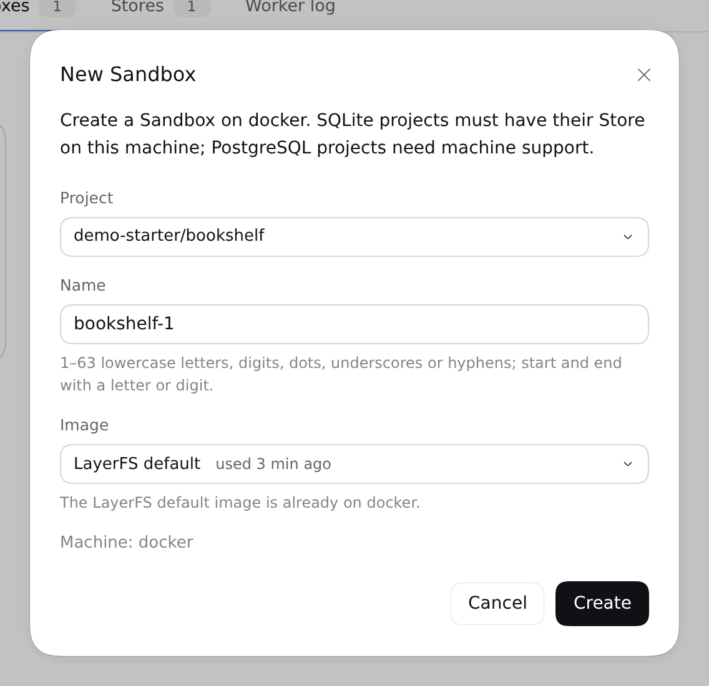

**Create a Sandbox on *machine*.** Only projects that can run here are offered: SQLite projects
whose Store is on this machine, PostgreSQL projects when the machine supports them.

| Component | Interaction → result | LayerFS call | States |
|---|---|---|---|
| **Project** | Pick → suggests a free name (*project*-1) | `project list` (read) | **No eligible projects…** with **Open Storage** |
| **Name** | 1–63 lowercase letters, digits, dots, underscores or hyphens | — | A taken name is refused |
| **Image** | The images a Sandbox here starts from at once, and this computer's Docker images LayerFS can copy (**From Docker on this Mac**); greyed rows say why | `machine get`, `machine images --with docker`, `sandbox list` (read) | On a macOS LayerFS Home (host processes, `backend: native`): **Sandboxes on this Mac use its own system.** instead; a Linux LayerFS Home uses images |
| **Create** / **Start and create** / **Free space** | Creates in the background: the dialog closes and the card shows a creating row | `sandbox create` (`machine start` first for **Start and create**) | **Free space** when the chosen Docker image does not fit: opens [Free space](#free-space-dialog) over the dialog |
| **Read Sandbox** | After an uncertain create: reads the Sandbox before creating another | `sandbox get` (read) | |
| **Cancel** | Closes | — | |

## Stores

The Stores board for this one machine: its SQLite Stores and the PostgreSQL databases
connected from it, with **Push a Store here** / **Connect a database**. It is the same board
as Home › Stores and is described in
[Store › Machine › Stores tab](store.md#machine--stores-tab) (screenshot
`store-machine-board.png`).

## Images

Only on a machine that starts its Sandboxes from an image it keeps a copy of: docker, created
VMs, and a LayerFS Home whose Sandboxes run in Linux namespaces. A macOS LayerFS Home has no
**Images** tab, because its Sandboxes use the Mac's own system.

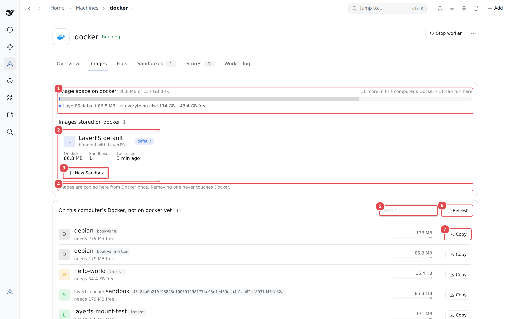

| # | Component | What it shows | Interaction → result | LayerFS call | States |
|---|---|---|---|---|---|
| 1 | Image space | **Image space on *machine***: the images' size of the disk, a bar per image, **everything else**, free, and how many more images this Mac's Docker has | — | `machine stats` (the sampler) and the images read below | |
| 2 | Image card | Badge, name and tags, where it came from (**bundled with LayerFS**, **copied from Docker**, **built into this machine**), **default**, **On disk**, **Sandboxes**, **Last used** | — | `machine get`, `machine images --with docker`, `sandbox list` (read; again after a create, a start, a copy and on window focus) | **Copying** / **Partly copied** with LayerFS's fix on hover |
| 3 | **New Sandbox** | On a usable image | Press → New Sandbox with that image chosen | — | |
| | **Remove** | On a copied image no Sandbox uses | Press → removes it from the machine (Docker keeps its copy) | `machine prune <machine> <image>` | Refused images say **Not removed**, with **Open Sandboxes** when a Sandbox holds one |
| | **Free space…** | Shows when an image can be removed | Press → [Free space dialog](#free-space-dialog) | — | |
| 4 | Note | **Images are copied here from Docker once. Removing one never touches Docker.** or **Start *machine* to remove images.** | — | — | |
| | **Restart worker** | **docker’s worker is from an older LayerFS build. Restart it to use images.** | Press → stops and starts the machine, then reads the images again | `machine stop`, then `machine start` | |
| 5 | Search | **Search Docker images** (more than six) | Type → filters the list | — | |
| 6 | **Refresh** | | Reads the images again | `machine images --with docker` (read) | |
| 7 | **Copy** | Per Docker image: its size and **needs *size* free** (**not enough** in amber) | Press → copies it to the machine in the background: a bar and a percentage | `machine load-image` | A failed copy shows its reason and **Dismiss** (host only); **Start *machine* to copy images to it.** while stopped; images that cannot run here are dimmed with why |
| | Build hint | **Build your own with `docker build -t my-image .` then press Refresh…** | **Copy command** | — | |

### Free space dialog

**Free space on *machine***: **Remove images no Sandbox uses. Docker keeps its copies.** One
checkbox per removable image, the unused ones ticked, those in use off (**In use by *n***), and
what the choice frees (against what a create needs, when opened from one).

| Component | Interaction → result | LayerFS call |
|---|---|---|
| Image checkboxes | Tick or untick | — |
| **Remove 1 image** / **Remove *n* images** | Removes the ticked images; refused ones stay with **Not removed** | `machine prune <machine> <image>` per image |
| **Cancel** | Closes | — |

## Files

Only when the pinned CLI can list a machine's files. Read-only: nothing here changes a file.

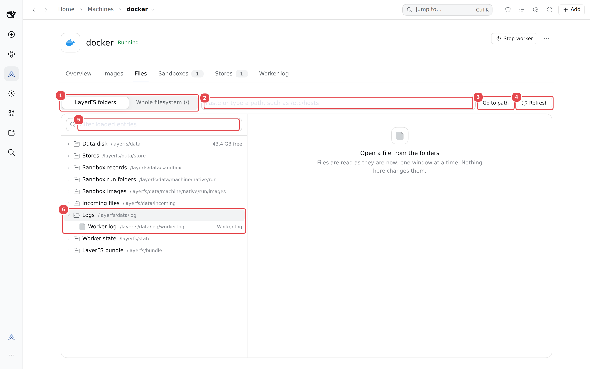

| # | Component | What it shows | Interaction → result | LayerFS call | States |
|---|---|---|---|---|---|
| 1 | View | **LayerFS folders** (LayerFS's own folders by role: **Data disk** with free space, **Stores**, **Sandbox records**, **Sandbox run folders**, **Sandbox images**, **Logs**, **Worker state**, **LayerFS bundle**) and **Whole filesystem (/)** when offered | Click → that view; each keeps its own place | `machine files <machine>` (read: its roots) | |
| 2 | Path | The path shown, editable (**Paste or type a path, such as /etc/hosts**) | Type a path | — | **A path here starts with /.**; a path that cannot be opened falls back to the root: ***path* could not be opened (…). Showing *root* instead.** |
| 3 | **Go to path** | | Opens that folder as the tree's top (a breadcrumb leads back) or that file | `machine files <machine> <path>` (read) | |
| 4 | **Refresh** | | Reads the open folders again; nothing polls | `machine files` (read) | |
| 5 | **Filter loaded entries** | | Type → filters what was read | — | |
| 6 | Folder row | A folder, its size or free space | Click → opens it, one page at a time (**More entries**) | `machine files <machine> <path> --depth --limit --cursor` (read) | A read longer than 1 s shows its seconds and **Cancel** (host only); restricted, unreadable, system, mount and link rows cannot be opened; a Workspace mount is listed, never entered |
| | File view | The file's text, a window at a time | Scroll → the next window | `machine files <machine> <path> --byte-offset --byte-length` (read) | Binary and empty files say so; a log file offers **Read in the Worker log tab** |

## Worker log

Only when the pinned CLI has the call and LayerFS says this machine has a worker log (docker
and created VMs; not LayerFS Home).

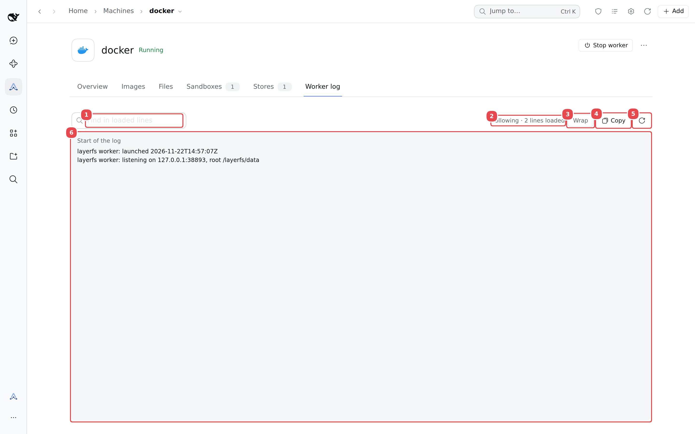

The worker's log, followed live. Every part is the [log pane](components.md#log-pane).

| # | Component | Interaction → result | LayerFS call |
|---|---|---|---|
| 1 | **Find in loaded lines** | Type → matches highlighted, **n of m**, ↑/↓ or Enter/Shift+Enter | — |
| 2 | Status | **Following · *n* lines loaded**, **Not reading** (machine stopped), **Stopped reading** | — |
| 3 | **Wrap** | Toggles line wrap (remembered) | — |
| 4 | **Copy** | Copies the selection, or every loaded line | — |
| 5 | **Read again** | Reads now | `machine log` (read) |
| 6 | Lines | Follows while at the bottom; **↓ *n* new lines** otherwise; **Earlier lines** at the top | `machine log --cursor --limit` (read, every 2–10 s while the tab shows) |

A stopped machine shows **Unavailable · The machine is stopped, so its worker log cannot be
read. Lines read earlier stay below.** with the Start button.

## Machine menu

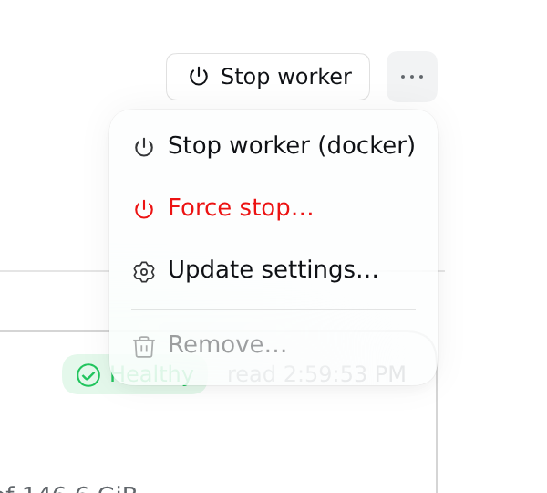

See [Components › Machine menu](components.md#machine-menu). On this page it has no **Open**.

### Force stop dialog

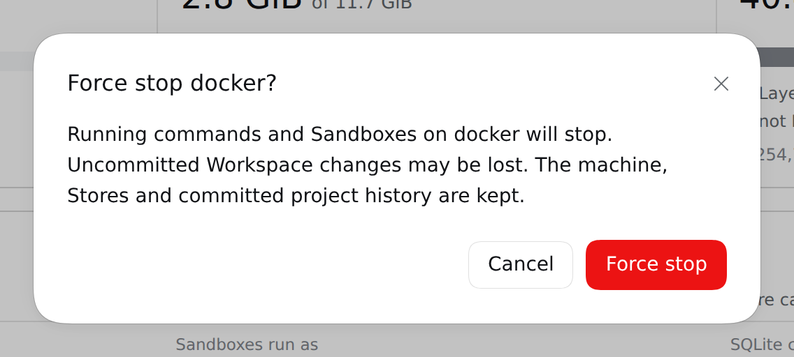

**Force stop *machine*?** **Running commands and Sandboxes on *machine* will stop. Uncommitted
Workspace changes may be lost. The machine, Stores and committed project history are kept.**
(LayerFS Home: **Stop LayerFS-managed Sandboxes and running commands on this computer. The
computer itself stays running…**). **Force stop** runs `machine stop --force`; **Cancel**
closes.

### Settings dialog

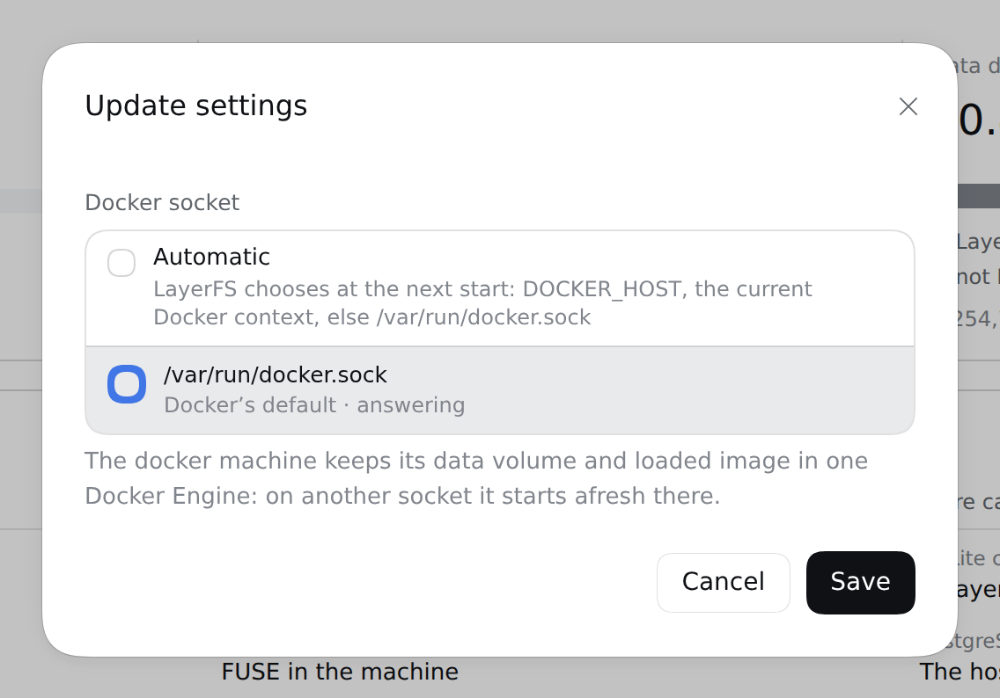

**Update settings** for docker: the **Docker socket** LayerFS uses. **Automatic** (LayerFS
chooses at the next start: `DOCKER_HOST`, the current Docker context, else
`/var/run/docker.sock`) or one of the sockets LayerFS found, each with its source and
whether it answers; one this user may not open gets the docker-group fix to copy. A note says
the docker machine starts afresh on another socket. **Save** runs `machine update docker
--docker <socket>` (an empty value clears it back to Automatic); the WSL distribution field
shows on Windows hosts only.

### Remove dialog

For a created VM (or a built-in whose record LayerFS says to remove).
**Remove *name* and its disk?** When the machine still holds Sandboxes or Stores, the dialog
lists them (**Sandboxes to close (*n*)**, **Stores to delete (*n*)**), asks **Type *name* to
confirm**, and **Remove everything** runs, in order: `sandbox remove --force` per Sandbox,
`store remove` per Store, then `machine remove`. A failure says **Stopped at:** *step*.
Otherwise **Remove** runs `machine remove` alone. It cannot be undone.

## Machines board

`LayerFS › Home › Machines`: every machine in one table, those that need you first. A row
opens (▸) to show what the machine holds; its name opens the machine page.

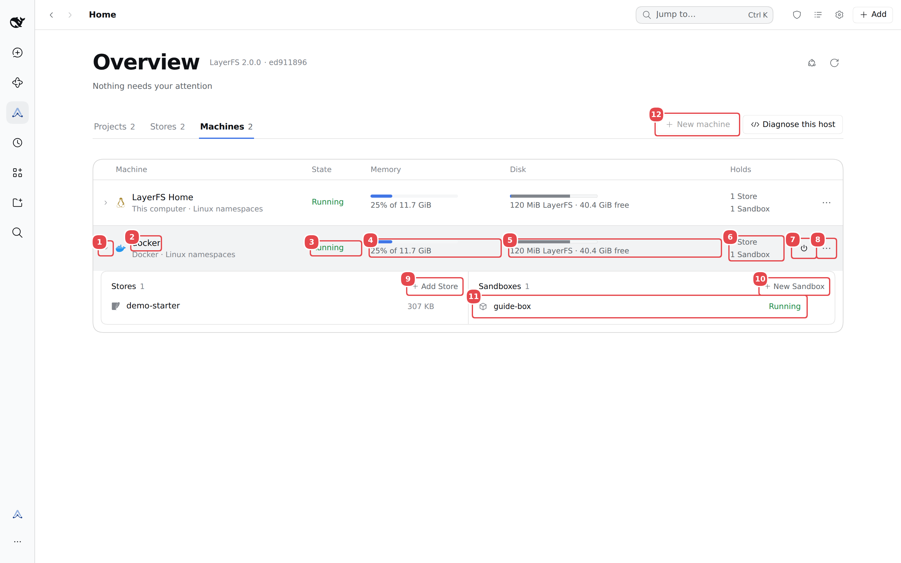

| # | Component | What it shows | Interaction → result | LayerFS call | States |
|---|---|---|---|---|---|
| 1 | ▸ / ▾ | | Click (or click the row) → shows or hides what it holds; remembered in this browser | — | Open by default when the machine needs you, is starting, or is the only one |
| 2 | Name | Glyph, name (**LayerFS Home** for `native`) and **kind · runtime** (**This Mac · Host processes**) | Click → the machine page | `home get`, `machine list`, `machine get --with live`, `sandbox list`, `store list` (read) | |
| 3 | **State** | The state chip | — | as above | **Running**, **Stopped**, **Needs repair**, **Docker not running**, **Unavailable**, … |
| 4 | **Memory** | A bar and **% of total** (used of total on hover) | — | — (the sampler's `machine stats`) | Amber past 75 %, red past 90 %; the allocated memory, muted, when not read |
| 5 | **Disk** | A bar and **LayerFS *size* · *size* free** | — | `machine stats --with space` (read, kept a minute) | A blocked machine shows why here instead |
| 6 | **Holds** | ***n* Stores** / ***n* Sandboxes** (those being created count) | — | — | **No Stores**, **No Sandboxes** |
| 7 | Power | An icon button: **Stop worker** / **Start worker** / **Start** / **Stop** | Press → as on the machine page | `machine stop` / `machine start` | Not on LayerFS Home |
| 8 | ⋯ | [Machine menu](components.md#machine-menu) with **Open** first | | | |
| 9 | **Add Store** | In the open row's Stores column | Press → Storage's Add a Store to *machine* | see [store.md](store.md#machine--stores-tab) | Hidden on a blocked machine |
| 10 | **New Sandbox** | In the Sandboxes column | Press → [New Sandbox dialog](#new-sandbox-dialog) | — | Off while a start or stop runs |
| 11 | Sandbox row | Name, **n/16 Workspaces**, state | Click → the Sandbox page; its ⋯ → **Open**, **Delete Sandbox…**, **Force delete Sandbox…** | `sandbox remove` (`--force`) | Those that need you first, red |
| | Store row | Name, size or **PostgreSQL** | Click → the Store page; its ⋯ → the [Store menu](components.md#store-menu) | | |
| 12 | **New machine** | On the tab bar, always; off with the reason as its tip while no platform can create one | Press → [Add machine dialog](#add-machine-dialog) | — | |
| | **Diagnose this host** | The **</>** button at the right end of the tab bar, beside **New machine** | → the Doctor page runs the host's checks | `home doctor` (on the Doctor page) | |

An open row also shows why a machine is blocked (with its fix steps), why it is down with
**Run diagnostics**, a refused action, and a start in progress.

### Add machine dialog

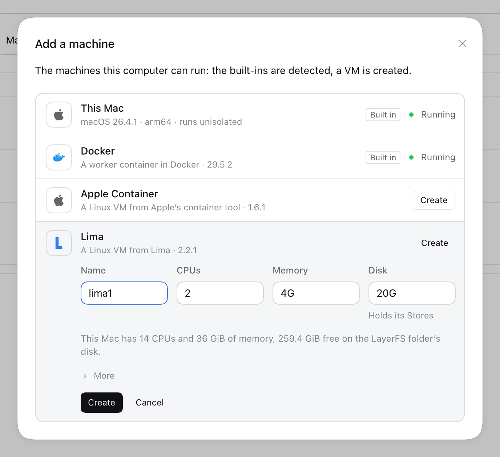

**Add a machine** — **The machines this computer can run: the built-ins are detected, a VM is
created.** One row per platform at its step of readiness.

| Component | What it shows | Interaction → result | LayerFS call | States |
|---|---|---|---|---|
| Built-in row | **This Mac** (OS, arch, **runs unisolated**), **Docker** (version): **Built in** and the machine's state | — | `home get --with platforms` (read, with the machines view) | |
| VM row | **Apple Container**, **Lima** with what it is and its version | **Create** → opens its form in the row | — | |
| Not-ready row | A tag (**Needs install**, **Needs setup**, **Not running**, **Needs runtime**) and one button (**Install**, **Set up**, **Start**, **Fix in setup**) | The button → what to do, commands to copy, **Check again** (or the Set up LayerFS dialog) | **Check again**: the machines view read with fresh platforms | |
| **Not available on this computer (*n*)** | Platforms this computer can never run, with why | Click → unfolds | — | |
| VM form | **Name** (a free one suggested), **CPUs**, **Memory**, **Disk** (**Holds its Stores**), from LayerFS's defaults; a line with this computer's room and what other VMs use (a warning, never a refusal, when it asks for more) | **More** › **Use stock image** | the sampler's `machine stats native` for the room line | |
| **Create** | | Creates the VM, with startup progress; the dialog stays open (**Keep this dialog open while the machine is being created.**), then the new machine's page opens | `home get` (its declared options), then `machine create <name> <platform> --cpus --memory --disk [--os-image stock]` | A failure offers **Inspect current state** (`machine get`) and **View machine and removal options** |
| **Cancel** | | Closes the form | — | Off while creating |

## Variants

- **LayerFS Home (`native`)** ([screenshot](img/machine-native.png)): no power button (it is
  this computer), no Processor column on macOS, no **Worker log** (no worker), no **Update
  settings…**, and **Remove…** off with **Built in · can’t be removed**. Its **Images** tab
  depends on how its Sandboxes run: a macOS LayerFS Home runs them on the Mac's own system and
  has none, a Linux one runs them in namespaces and has it. **Force stop…** shows while it has
  Sandboxes, with the native wording.
- **docker**: power words name the worker (**Start worker**, **Stop worker**, **Restart
  worker**); **Update settings…** for the socket; with the Docker Engine down on macOS the
  state is **Docker not running** and Start becomes **Start Docker and worker**. Remove is off
  unless LayerFS's own fix removes its record.
- **Created VMs** (Lima, Apple Container): **Start** / **Stop** (**Stop (shut down the VM)**
  when its worker does not answer), a Danger zone with **Remove *name*…**, **Remove…** in the
  menu, no settings.
- **Tabs that only show sometimes**: **Images** needs a CLI with Sandbox image copies (image
  stage 1) and a machine whose Sandboxes start from an image (not a macOS LayerFS Home, which
  runs them on the Mac's own system); **Files** needs the CLI's
  `machine files`; **Worker log** needs the CLI's `machine log` and a machine LayerFS says has
  a worker log (`supports: log`). Nothing is decided by the platform's name.
- **Older CLIs** without `machine stats`: the Usage card becomes a fact row of recorded
  sizes; without `machine stats --with space` there is no disk split, **Where it goes** or
  **On disk**.

## Modals opened here

| Modal | Opened by | What it does | LayerFS call | Undo |
|---|---|---|---|---|
| [Disk space](#disk-space-dialog) | **Where it goes** | Shows where the data disk goes | `machine stats --with space` (read) | — |
| [New Sandbox](#new-sandbox-dialog) | **New Sandbox** (tab, board, image card) | Creates a Sandbox | `sandbox create` (`machine start` first) | Delete the Sandbox |
| [Free space](#free-space-dialog) | **Free space…**, New Sandbox, a create that ran out of room | Removes unused image copies | `machine prune` | Copy the image again |
| [Force stop](#force-stop-dialog) | ⋯ › **Force stop…** | Stops the machine and everything on it | `machine stop --force` | Start it; uncommitted changes are lost |
| [Settings](#settings-dialog) | ⋯ / Details › **Update settings…** | Changes docker's socket | `machine update` | Save the old value |
| [Remove](#remove-dialog) | ⋯ › **Remove…**, Danger zone | Deletes the VM (and what it holds) | `sandbox remove --force`, `store remove`, `machine remove` | None |
| [Add machine](#add-machine-dialog) | Home › Machines › **New machine**, **Add** › **New machine** | Creates a VM | `machine create` | Remove it |

## States and signals

- **Healthy** in the Usage card: nothing on this machine needs you. A disk getting full
  colours the card amber or red and adds a notice; **Where it goes** says what to free.
- **Not read** with a reason: LayerFS did not read that value (a stopped machine, an older
  worker, a value macOS does not report). It is never shown as 0.
- **Close its *n* Sandboxes first**: LayerFS refused a stop while Sandboxes run. Close them
  (or **Force stop…**) and try again.
- A power button that does nothing for a moment after it changed is the press guard: a press
  that lands on a button that just moved under the pointer is ignored.
- **Docker not running** (dashed chip): Docker Desktop is closed; Start opens it first.
- **Unavailable** with a reason: the platform is not ready on this computer; follow the fix
  steps and **Check again**.

## Where next

- [Sandbox](sandbox.md): a Sandbox on this machine.
- [Store](store.md): a Store on it, and its [Stores tab](store.md#machine--stores-tab).
- [Components](components.md): [machine menu](components.md#machine-menu),
  [Sandbox card](components.md#sandbox-card), [log pane](components.md#log-pane).

## Source

`src/client/machines/`: `MachineDetail.tsx`, `MachineTabs.tsx`, `machine-tabs.ts`,
`Overview.tsx`, `Spec.tsx`, `Readiness.tsx`, `needs.ts`, `MachineStats.tsx`,
`MetricsViews.tsx`, `SpaceDialog.tsx`, `SpaceViews.tsx`, `SandboxCards.tsx`, `Sandboxes.tsx`,
`MachineImages.tsx`, `ImageMenu.tsx`, `images.ts`, `InspectFiles.tsx`, `inspect-files.ts`,
`LogPane.tsx`, `log-model.ts`, `parts.tsx`, `Board.tsx`, `Inventory.tsx`,
`AddMachineDialog.tsx`, `controller.ts`, `locale.ts`. Host: `src/host/routes/machines.ts`,
`metrics.ts`, `image-loads.ts`, `projects.ts` (`createSandbox`).
