# Project

> **Where:** `LayerFS › Home › Stores › <store> › <project>` · **Opens from:** a project's name on Home › Projects or on a Store's Projects tab, Jump to, a Store card · **Source:** see the end

One LayerFS project: its saved files on every Branch, the history of every Branch as one
tree, the Sandboxes and calls working on it, the DSH sessions that belong to it and how
many bytes it takes in its Store. Come here to read what a project holds, follow how it
changed, or start a session in it.

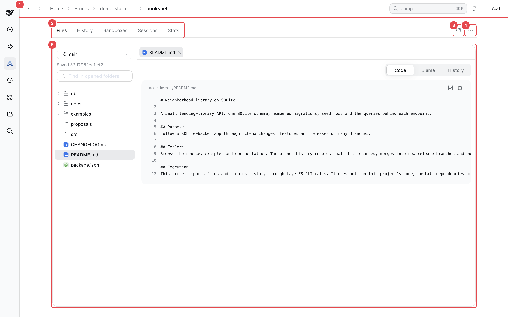

| # | Component | What it is |
|---|---|---|
| 1 | Nav bar | [Components › Nav bar](components.md#nav-bar): the path `Home › Stores › <store> › <project>`, Jump to, Refresh, Add |
| 2 | Tab bar | **Files** · **History** · **Sandboxes** · **Sessions** · **Stats**; the page opens on Files |
| 3 | **Refresh project** | reads the shown tab again in the background, keeping what is on screen |
| 4 | **⋯** (`<project> actions`) | the project's menu: **Delete project…** ([menu](img/project-menu.png)) |
| 5 | Tab body | the chosen tab; Files and History fill the page |

## Layout

No header card: the project's name is the last crumb of the nav bar. Under it one tab bar
carries the five tabs on the left and the page's two actions (**Refresh project**, **⋯**)
on the right; on a phone the tabs scroll sideways and the actions take the next line. The
body is the chosen tab. Files and History are the shared file views, the same views a
project session shows as its conversation tabs (see [Components › File
views](components.md#file-views) and [History views](components.md#history-views)); this
page explains them in full.

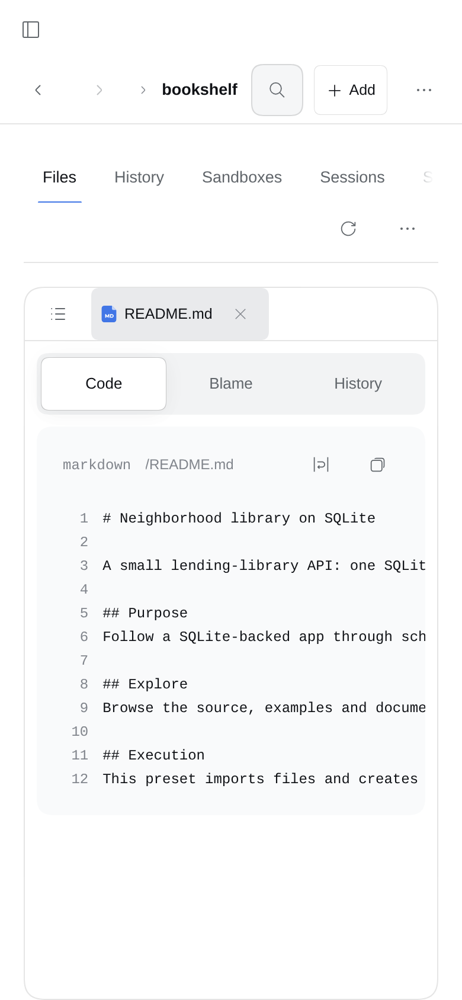

The tab is not remembered: opening the page again starts on Files. The History tab keeps
its zoom, selection and last read per project while DSH stays open, so coming back draws
the last tree at once and rereads behind it.

## Files

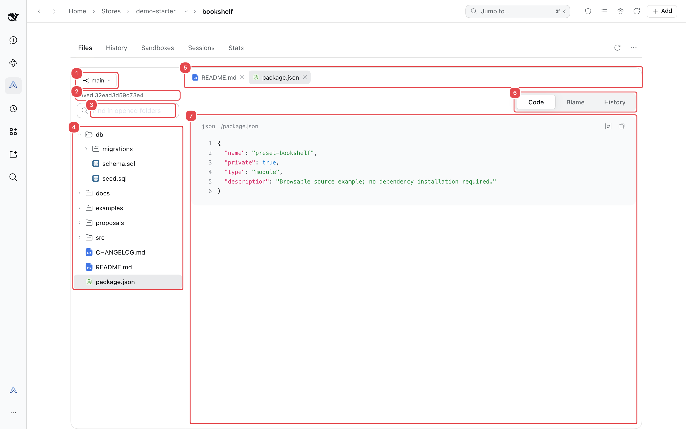

The project's saved files, read-only, at the newest save of one Branch (or at a saved id
you opened from History). Files are read from LayerFS, never from a Sandbox: what an
agent has not committed yet is not here.

| # | Component | What it shows | Interaction → result | LayerFS call | States |
|---|---|---|---|---|---|
| 1 | Branch picker ([open](img/project-branch-picker.png)) | the Branch shown; `main` under **Published**, the rest under **Branches**, each with its head's short id | pick a Branch → the tree starts over at that Branch's head, the open files close their reads and reopen there | `branch list`, `branch get main` (read; the Branch list is kept a few seconds on the host) | session Branches read **Session `<id>`**; the plugin's own bookkeeping Branches (`dsh.project.*`, `dsh.session.*`) are never listed |
| | | | **Load more branches** (under the picker, past 100 Branches) → the next page joins the picker | `branch list` (read) | |
| 2 | Saved line | **Saved `<id>`**: the exact saved version the tree and files are read at | **Show latest** (after **Open at this commit**) → back to the Branch's head | — (view state) | |
| 3 | **Find in opened folders** | a filter over the entries already read | type → rows that match stay; **Escape** clears it | — (filters what is on screen; folders are not read for it) | **No file in the opened folders matches.** |
| 4 | Folder tree | folders first, then files, by name; folders are read as you open them | click a folder → it opens (read once, then kept); click a file → it opens as a tab | `file list` at the saved id (read; 1000 entries a page) | **Reading…**, **Empty folder**, **This folder could not be read**; **Show more entries** reads the next page. Keyboard: arrows, Home/End, type-ahead, Enter |
| 5 | Open files | one tab per open file; README opens by itself on a first visit | click a tab → shows it; **×** (`Close <path>`) → closes it | — | **Read-only files** while none is open |
| 6 | **Code · Blame · History** | the file view; the choice stays as you switch files | switch → the same file in that view (below) | see each view | |
| 7 | Code | the file, line-numbered and highlighted (DSH's code block: **Wrap lines**, **Copy**) | **Show more lines** → the next 1000 lines | `file stat`, `file read` (read; 1000 lines a window) | **Showing lines 1–N.**, **Binary file · `<size>`**, **This path is absent at the selected saved version.**, **A long line was clipped.** |

**Blame** shows who last wrote each line:

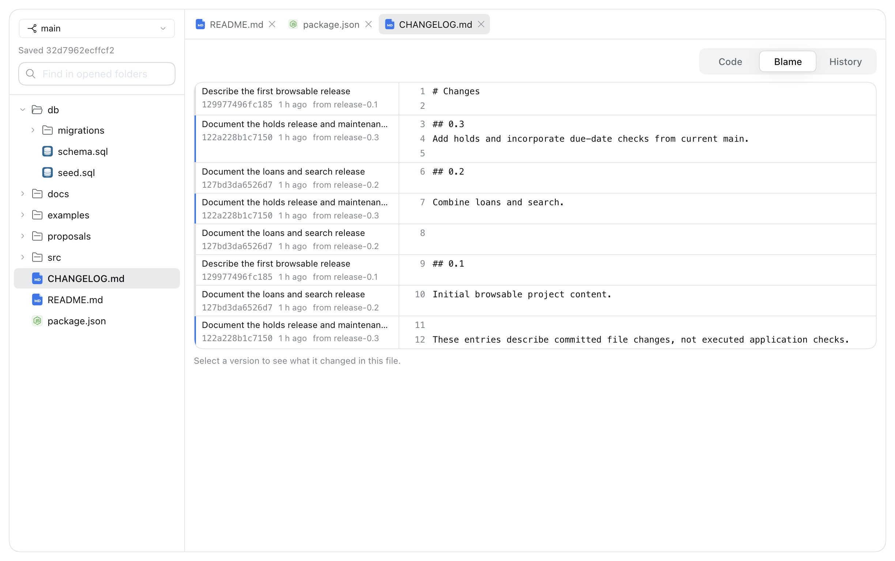

Lines that one saved version wrote form a group, labelled once with that version's
message, short id and age; the newest version on screen has a coloured edge, and a
version saved on another Branch says **from `<branch>`**. Selecting a group switches to
**History** with that version selected (`See what <id> changed in this file`).
**Show more lines** reads the next 1000. A blame LayerFS could only partly work out says
**Part of this answer is approximate**. Calls: `file read` and `file blame` for the same
window, `file history` for the versions' times, and `commit get` once per owner to name the Branch it was saved on (**from** *branch* when not this one) (all reads).

**History** (the file's) lists the saved versions that changed this file:

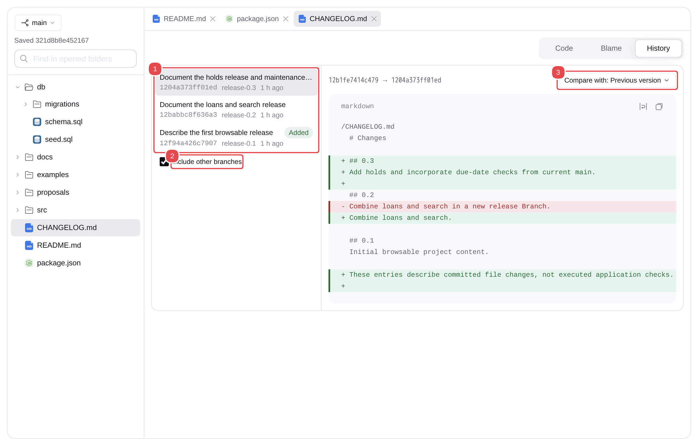

| # | Component | What it shows | Interaction → result | LayerFS call | States |
|---|---|---|---|---|---|
| 1 | Version list | newest first: message, short id, the Branch the version was saved on (when not this one), age; **Added** / **Removed** tags | click → its change on the right: removed lines `-`, added `+`, kept lines plain | `file history` (read; 50 a page), and with **Include other branches** `file history --traversal branch` plus `commit get` once per version saved elsewhere, to name its Branch (read) | **Load earlier versions**; **The search stopped early, so earlier versions may be missing.** |
| 2 | **Include other branches** | on: versions saved before a fork or merged in from other Branches too | toggle → the list is read again | `file history` with or without provenance (read) | **No saved versions of this file** |
| 3 | **Compare with: …** | the left side of the diff, **Previous version** by default | pick another listed version → the diff is between those two | `commit diff --path --with patch` (read) | **This version added the file.**, **No content changes**, **Only metadata changed**, **Binary comparison · …** |

## History

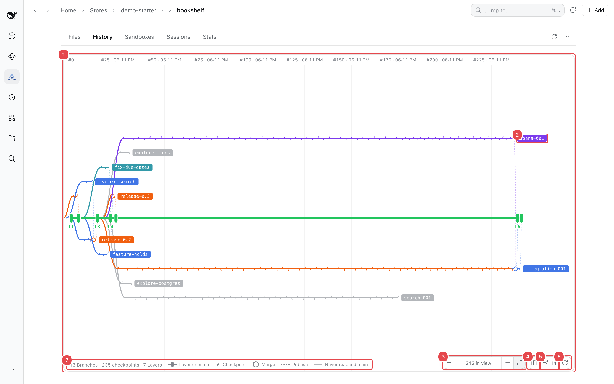

The whole saved history of the project as one tree: main's Layers along the middle,
every other Branch on its own lane above or below, one leaf per checkpoint in the order
it was saved. It answers "what happened on this project, on which Branch, and what
reached main".

| # | Component | What it shows | Interaction → result | LayerFS call | States |
|---|---|---|---|---|---|
| 1 | History tree | the time axis (`#n · time`), main's Layers (`L1`, `L3`…), Branch lanes in one colour per family, leaves (checkpoints), rings (merges), dashed lines (publishes to main), grey lanes (never reached main) | hover → a tip (Branch, `#n`, time, id, message); click a leaf or Layer → selects it and opens its details; drag → pan; scroll → zoom; arrow keys walk the selected Branch, **+** **−** **0** zoom | `branch list`, then `commit list` per Branch (read, below) | a selected Branch and its ancestry stay lit, the rest dims |
| 2 | Branch name tag | the Branch's name at its newest save | click → opens that Branch: its newest save selected (an empty Branch through its fork point); while **Compare with…** waits, it completes the pick at that Branch's newest save | `commit list` if not read yet (read) | |
| 3 | Zoom controls | **Zoom out**, `<n> in view`, **Zoom in**, **Whole run** | zoom the axis only (lanes keep their height); **Whole run** fits everything | — (view state) | |
| 4 | **Compare** | compares two versions | → [Compare versions](#modals-opened-here) with main on the left and the selected version (or another Branch) on the right | `commit diff` (read) | disabled with no Branches |
| 5 | Branches (`<n> Branches, main included`) | the Branch count | → the Branch finder (below) | — | `<n>+` while more pages are unread |
| 6 | **Refresh** | | reads the Branch list and every Branch whose head moved again | `branch list`, `commit list` (read) | a spinner while a read runs |
| 7 | Legend | **`<b>` Branches · `<c>` checkpoints · `<l>` Layers** (singular for one), then **Layer on main**, **Checkpoint**, **Merge**, **Publish**, **Never reached main** | — | — | while loading: **Loading checkpoints… `<n>` so far** or **`<n>` of `<total>`** |

**How it loads.** The tree is drawn progressively, most useful first, and never empties
on a refresh:

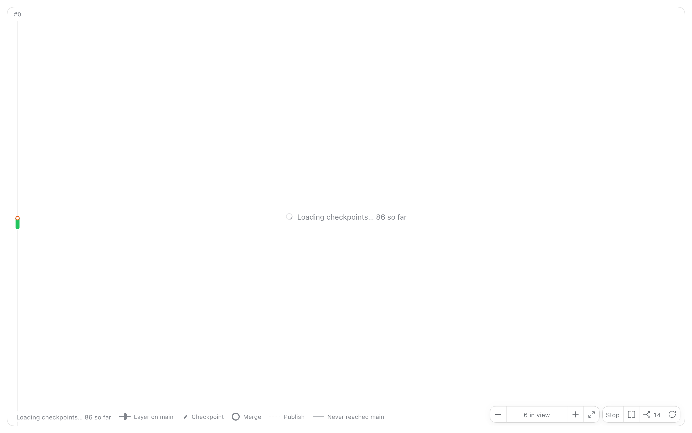

1. **Reading history…** while the Branch list is read (`branch list`, 100 a page).
2. The lanes come from the Branch list at once; main's and the opened Branch's first
   pages of Commits are read first, the other Branches four at a time (`commit list`,
   20 a page). A Branch whose head has not moved keeps the pages it already has.
3. Every Branch is then read to its fork point in the background, one Branch at a time
   and only while the page is visible (`commit list`, wide pages). The tree waits until
   that is done (or at most 8 seconds), then grows in whole from left to right; the
   count reads **Loading checkpoints… `<n>` so far** meanwhile, and **Stop** holds the
   read where it is.
4. Past 20,000 checkpoints the background read stops by itself; **Load all** (tip:
   *Checkpoints load in the background, newest first. Load all reads the rest of every
   Branch.*) reads the rest. When the read is held, each side Branch's whole count is
   read so the legend can say **`<n>` of `<total>` checkpoints loaded**.

The host keeps every page read at a named Commit (it never changes) and each Branch's
count per head, so a refresh reads only what is new.

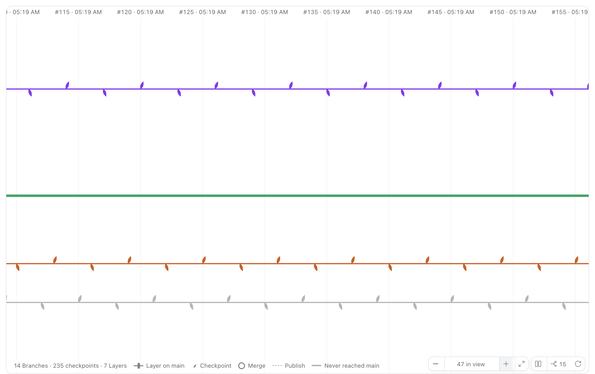

Zoomed in, each checkpoint is a leaf on its Branch's line; the axis labels every step.

**Commit details.** Selecting a leaf, a Layer or a Branch tag opens a floating card:

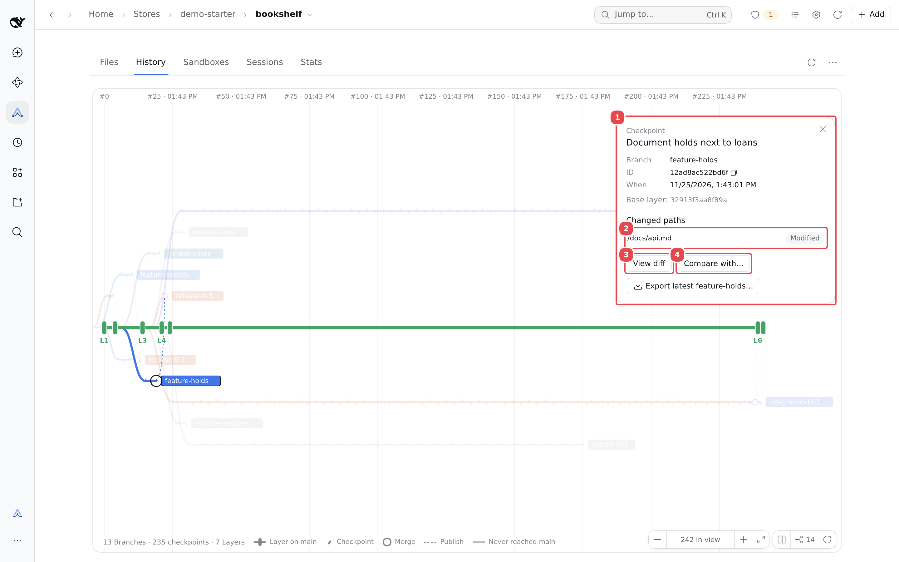

| # | Component | What it shows | Interaction → result | LayerFS call | States |
|---|---|---|---|---|---|
| 1 | Details card | **Checkpoint**, **Layer on main**, **Merge** or **Branch head**; the message; **Branch**, **ID** (with copy), **When**; **Base layer**, **Source branch**, **Source commit**, **Merge parent** when they apply; **Never reached main** | **×** (**Close commit details**) → closes it | `commit get` (read) | **Earlier parent is not loaded: `<id>`** |
| 2 | **Changed paths** | each path with **Added**, **Removed** or **Modified** | click a path → the Files tab opens that file at this commit | `commit diff` against its parent, paths only (read; 100 a page) | **Reading changed paths…**, **This commit changed no paths.**, **Initial import.**, **Load more changes** |
| 3 | **View diff** | | → [Changes in `<id>`](#modals-opened-here) | `commit diff --path --with patch` per path (read) | |
| 4 | **Compare with…** | | a bar asks **Select another version or a Branch in the graph to compare with `<id>`.**; click a leaf or Layer in the tree, or a Branch name tag (its newest save) → [Compare versions](#modals-opened-here); **Cancel** ends it | — until the second side is picked | |

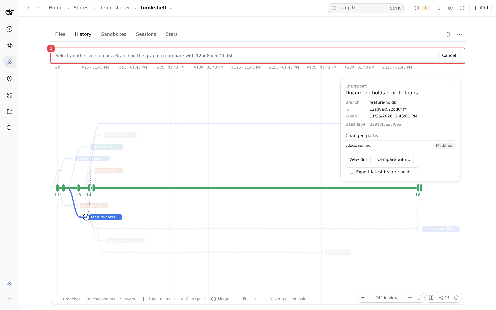

**Branch finder.** The Branches button opens a search over every Branch:

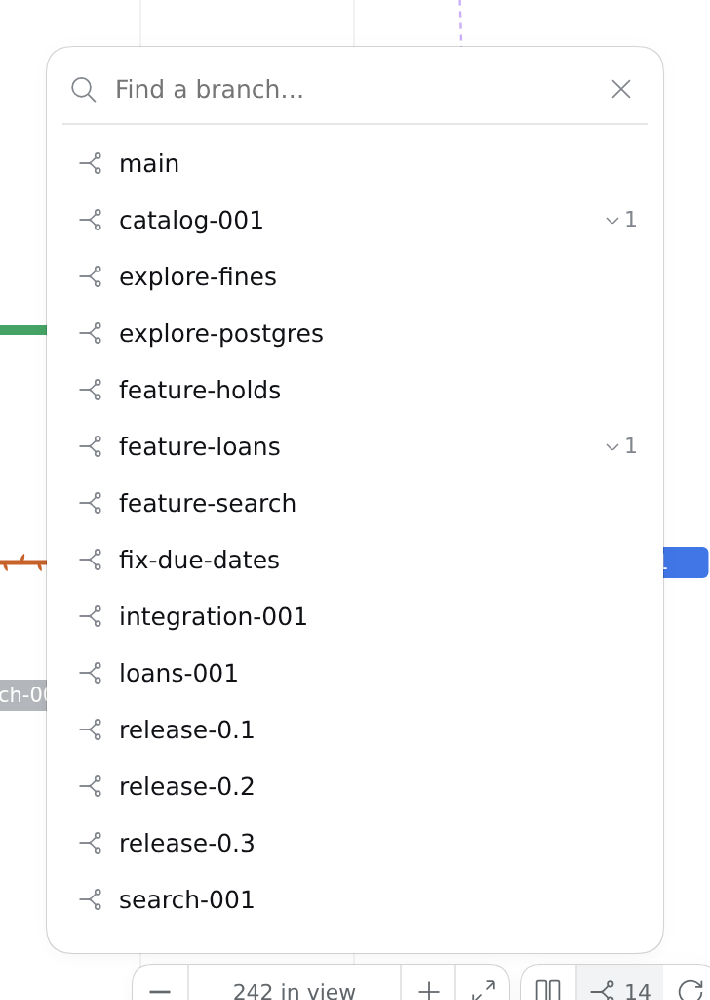

Type in **Find a branch…** to filter; click a Branch to open it in the tree (its newest
save selected). A Branch that others were forked from shows a chevron and its number of
children: click it to fold that **Branch family** (its descendants leave the tree, except
the selected Branch's own line) or to unfold it again. **Load more branches** reads the
next 100. Folding is view state (no call); opening an unread Branch reads its first page
(`commit list`).

## Sandboxes

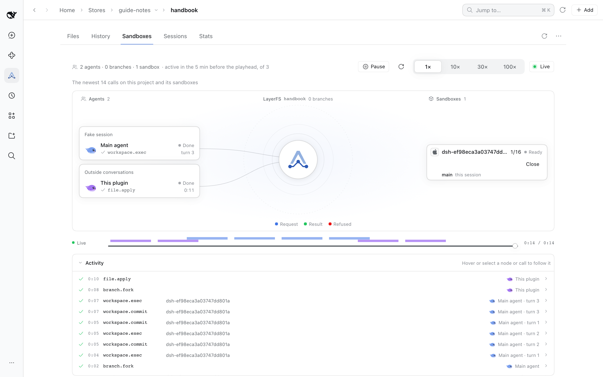

Who is working on this project right now and where. It is the conversation Sandbox map
drawn for the whole project: every conversation (and its subagents) that called LayerFS
on this project or its Sandboxes, plus the calls made outside conversations (**This
plugin** for this host's own calls, **Other clients**), wired through the LayerFS hub to
the Branches they touched and the Sandboxes on the right. The play bar replays the calls
(**Pause**/**Play**, **1×**…**100×**, **Live**) and **Activity** lists them. A Sandbox
that belongs to one conversation carries a small quiet **Session** tag (hover: *This
Sandbox belongs to one conversation and is removed when it closes.*). See
[Components › Sandbox card](components.md#sandbox-card) and [Terminal
pane](components.md#terminal-pane) for the parts it shares with machine pages.

| Component | What it shows | Interaction → result | LayerFS call | States |
|---|---|---|---|---|
| Note line | **The newest `<n>` calls on this project and its sandboxes** (older ones: **…; older ones are on the Logs page**) | — | — (the plugin's call log, host only) | **Restart DeepSeek Harness to see this project's calls here.** on an older host |
| Agents | one card per conversation (its title, **Main agent**, subagents) and **Outside conversations** | hover or select → follows its calls on the map | — (call log) | **Done**, working, **turn `<n>`** |
| Sandbox card | each open Sandbox of the project: name, `<n>/<max>` workspaces, state word, its Workspaces and their Branches | **Close** → the [Confirm dialog](components.md#confirm-dialog) **Close Sandbox `<name>`?** (with **Force close**) → closed, list reread | list: `sandbox list` (read), each Sandbox's Workspaces: `sandbox get` (read, kept by the host); Close: `sandbox remove` | **Close** disabled while closing or gone; **No workspaces mounted** |
| Activity | the calls, newest first: time, call, Sandbox or Workspace, who made it | select → highlights it on the map | — (call log) | **No LayerFS calls on this project yet** |

The list is read again on **Refresh project**, after a Close, and when a new call
creates, removes, mounts or unmounts something. The calls are reread at most every
3 seconds while new log lines arrive and the page is visible.

## Sessions

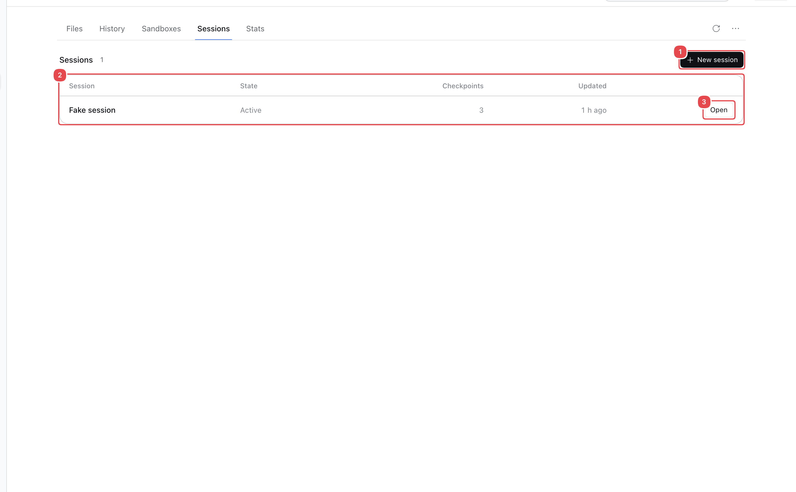

The DSH sessions that belong to this project: conversations whose files live in this
project's Branches. A session belongs to the project it was started in; it is not tied to
a Sandbox.

| # | Component | What it shows | Interaction → result | LayerFS call | States |
|---|---|---|---|---|---|
| 1 | **New session** | | starts a DSH session placed in this project (in the selected local folder, else the managed Scratch folder) and opens it; its Workspace is mounted on its first step | `project get` (read) at press; the session store is synced in the background | disabled while another press runs; absent while the Store is broken |
| 2 | Sessions table | **Session** (title or **Untitled session**), **State** (**Not started**, **Active**, or the host's word such as `stored`; the sidebar's session rows also use **Starting**, **Interrupted**, **Stored elsewhere** and **Unavailable**), **Checkpoints** (one per turn that changed files), **Updated** | — | `branch list` of the stored-session Branches, and `project export` of an archive whose head moved (read) | **No sessions on this project yet** with **New session**; **Could not read the sessions** with **Retry** |
| 3 | **Open** | | opens the conversation; a session stored only in LayerFS (another machine's, or after a reset) is imported first | none for a local session; `project export` of its archive (read) to import one | spinner while it opens |

The table is local first: it lists this DSH's sessions and adds the ones found in the
project's session store. A session archived in DSH leaves the list until it is
unarchived.

A session row's state word says whether it can run right now. **Stored elsewhere** means
the conversation is only in the project's Store: **Open** imports it. **Unavailable** means
the project cannot run: the reason under the row says why, and **Open** is refused (start
the machine from the sidebar's project row, which carries **Start {machine}**).
**Starting**, **Active** and **Not started** are the host's own states; a state with no word
stays hidden. Conversations that never started — opened but never given a message — are not
listed; the [sidebar](entry-points.md#workspaces-switch) explains how the host prunes them.

## Stats

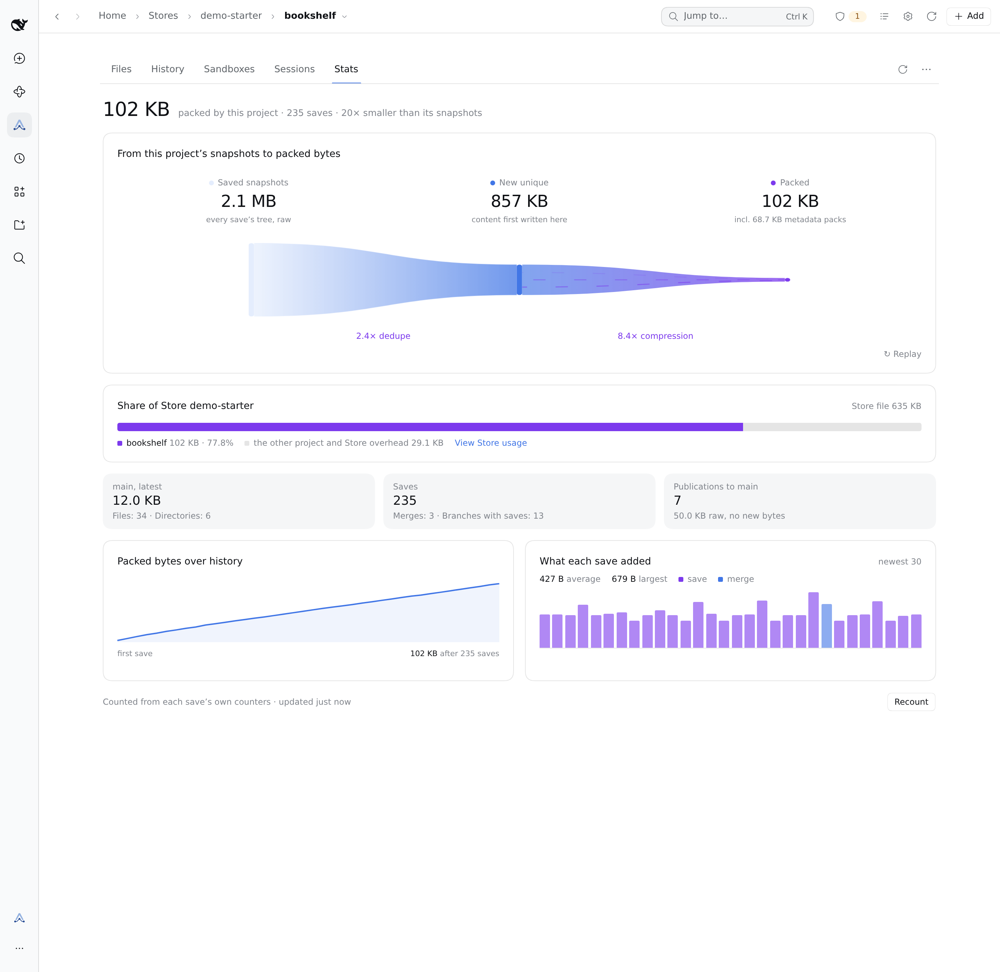

How many bytes this project takes in its Store, counted from each save's own counters.

| Component | What it shows | Interaction → result | LayerFS call | States |
|---|---|---|---|---|
| Headline | packed bytes, **packed by this project · `<n>` saves · `<r>`× smaller than its snapshots** | — | (from the counts below) | **packed so far · …** while counting |
| **From this project's snapshots to packed bytes** | **Saved snapshots** (every save's tree, raw) → **New unique** (content first written here) → **Packed** (incl. metadata packs), with the **dedupe** and **compression** ratios | **Replay** → plays the flow again | — | |
| **Share of Store `<store>`** | a bar: this project's packed bytes and %, the rest of the Store; **Store file `<size>`** | **View Store usage** → the Store page | `store get` with stats (read) | **The Store's totals are unavailable.** |
| Facts | **main, latest** (bytes, files, directories), **Saves** (merges, Branches with saves), **Publications to main** | — | `project stats` (read) | **main's tree could not be read** |
| **Packed bytes over history** | a line from the first save to now | — | — | **No saves on this project's branches yet.** |
| **What each save added** | the newest 30 saves as bars (save or merge), **average**, **largest** | hover a bar → its Branch, message, time and bytes | — | |
| Footer | **Counted from each save's own counters · updated `<ago>`** | **Recount** → counts every save again | `branch list`, `commit list` per Branch (read) | **Counting…** with a progress bar: **Branch `<b>` of `<n>` · `<s>` saves read** |

The first visit counts the whole history on the host and the page polls every 1.5 s,
drawing the totals so far. Later visits count only the saves added since, from the
host's kept ledger. A project with no saves yet shows **No saves yet**: what Init
imported belongs to the Store, not to a save.

## Variants

- **Files and History on a broken Store.** When the project's Store is broken (a
  PostgreSQL Store with no saved password, a Store blocked by a broken machine), those two
  tabs show the Store's word (for example **Broken · no password saved** or **Blocked ·
  `<machine>` broken**), LayerFS's sentence as its tip, and its one fix (see [Fix
  buttons](components.md#fix-buttons)) instead of failed reads. Sessions shows the same
  word and hides **New session** and **Open** until it is fixed.
- **SQLite or PostgreSQL, the host machine or another machine.** The page is the same; the reads go to
  wherever the Store lives, so a Store on a stopped machine fails its reads until the
  machine runs (see [Needs you notices](components.md#needs-you-notices)).
- **Session Branches.** A project with sessions has Branches named `dsh.<id>`; the views
  show them as **Session `<id>`** (and **Session `<id>` · restore `<n>`** after a
  restore). The plugin's identity and archive Branches are hidden everywhere.
- **The same views in a conversation.** A project session's
  [Files](conversation.md#files) and [History](conversation.md#history) tabs are these
  views, opened on the session's Branch.

## Modals opened here

The shell sets these dialogs' width and margin; only the content inside is ours. On a
coarse pointer every control is a 44 px target, a footer clears the home indicator, and a
long body scrolls between a fixed head and footer (see [Components ›
Dialogs](components.md#dialogs)).

| Modal | Opened by | What it does | LayerFS call | Undo |
|---|---|---|---|---|
| [Confirm dialog](components.md#confirm-dialog) **Delete `<project>`?** | **⋯ › Delete project…** | *The project and all its history are deleted from its Store. This cannot be undone.* Type the name, then **Delete**; the page closes and its Store opens | `project delete` | none |
| **Changes in `<id>`** | **View diff** in commit details | the commit's changed paths on the left, the selected path's diff on the right; **Open at this commit** opens the file in Files at that commit | `commit get`, `commit diff` (paths), `commit diff --path --with patch` (read) | — |
| **Compare versions** | **Compare** in the dock, or **Compare with…** then a point in the tree | **From** and **To** each a Branch picker at a saved id (`@ <id>`, **Show latest** to go back to its head); **Swap**; the files that differ (`<n> files changed`), the selected file's diff, **Open at this commit**. (**Only owner changes**, files whose unchanged lines changed owner, shows only when LayerFS reports line owners across a diff; 2.0 does not, so it is hidden) | `commit diff` under `/` (read; 100 a page, **Load more changes**), then `commit diff --path --with patch` per file (read) | — |
| Confirm dialog **Close Sandbox `<name>`?** | **Close** on a Sandbox card (Sandboxes tab) | unmounts its Workspaces and removes it; **Force close** also stops running commands | `sandbox remove` | none |

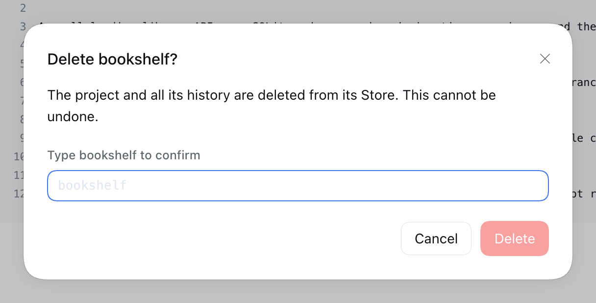

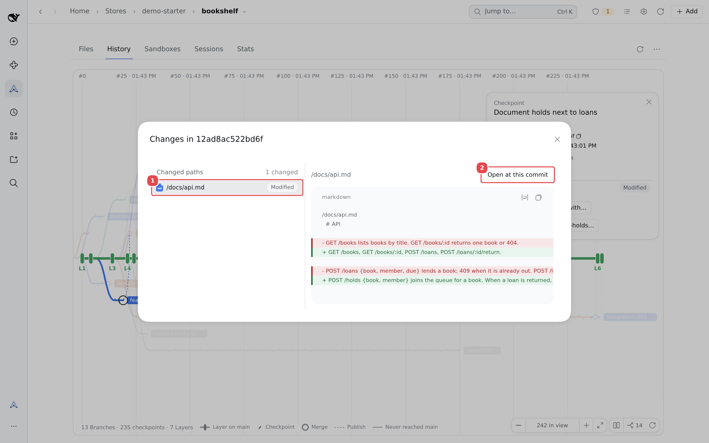

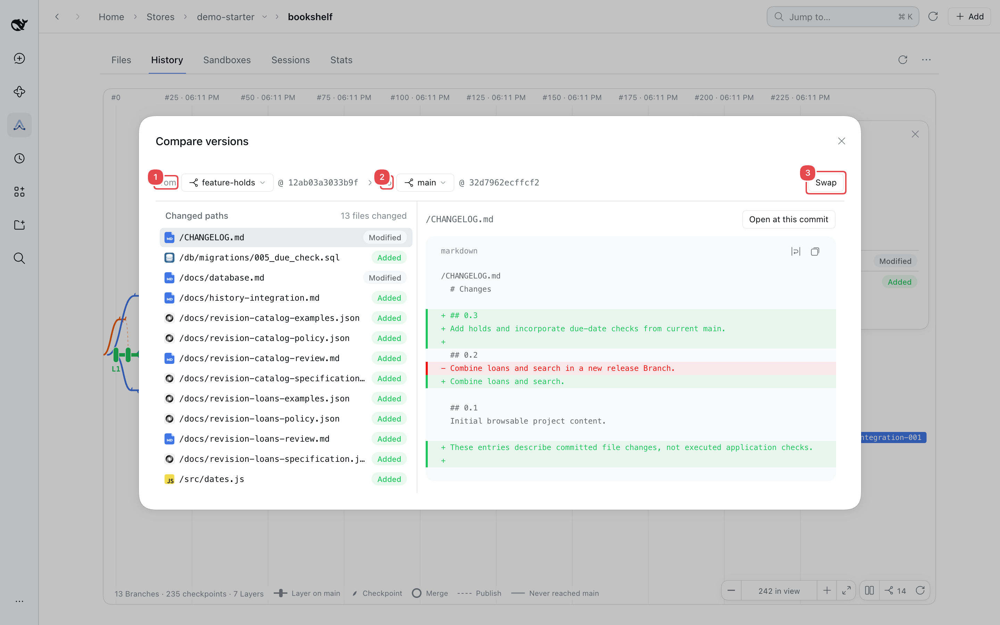

## States and signals

- **Saved `<id>` · Show latest**: you are reading an older saved version (opened from
  History); the tree and files are frozen there until you go back.
- A dimmed lane in History: not on the selected Branch's line. A grey lane: **Never
  reached main**. A short dashed stub before a Branch's first leaf: its earlier
  checkpoints are still loading (**Earlier checkpoints are still loading** in its tip).
- **Loading checkpoints…** with **Stop**: the background read of every Branch; Stop
  holds it, **Load all** resumes it.
- A red line with **Retry** at the top of History: a Branch could not be read; the rest
  of the tree stays.
- **Could not read `<what>`** with **Retry** (or a fix): a read was refused; its tip has
  LayerFS's words and code.
- Muted counts and links pass WCAG AA in both themes, and a Branch tag's label picks the
  light or dark ink that reads on its lane colour (see [Components › Text
  contrast](components.md#text-contrast)).

## Where next

- [Store](store.md): the project's Store (the **<store>** crumb, **View Store usage**).
- [Home › Projects](home.md#projects): every project of this home.
- [Sandbox](sandbox.md) and [Machine](machine.md): a Sandbox from the map.
- A session from **Sessions › Open** opens in DSH's conversation view.
- [Logs](logs.md): every call these reads made, tagged with their session.

## Source

- `src/client/storage/ProjectPage.tsx` (page, tabs, Sessions, Stats wrapper),
  `ProjectSandboxes.tsx`, `ProjectStorage.tsx`, `StoragePage.tsx` (where it is mounted),
  `ProjectTable.tsx` (the project rows that open it), `locale.ts`
- `src/client/files/ProjectFiles.tsx`, `BranchPicker.tsx`, `FileTree.tsx`,
  `FileViewer.tsx`, `WindowedText.tsx`, `FileBlame.tsx`, `FileHistory.tsx`,
  `ProjectHistory.tsx`, `HistoryGraph.tsx`, `CommitDiff.tsx`, `BranchCompare.tsx`,
  `api.ts`, `locale.ts`
- `src/client/views/SandboxView.tsx` (the Sandbox map)
- `src/host/routes/projects.ts` (`history`, `branches`, `listDir`, `file`, `fileQuery`,
  `projectStorage`, `sandboxes`, `closeSandbox`, `remove`), `project-storage.ts`,
  `src/host/sessions/index.ts` (`sessions.list`, `sessions.open`, `sessions.choose`),
  `src/host/logs/index.ts` (`logs.project`)
- Shots: `tools/guide/shots/project.mjs`
