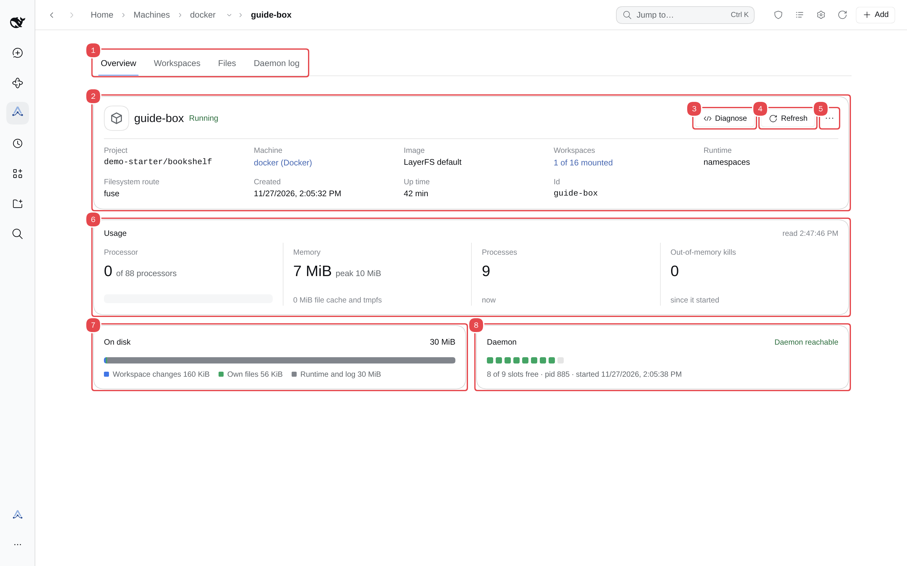
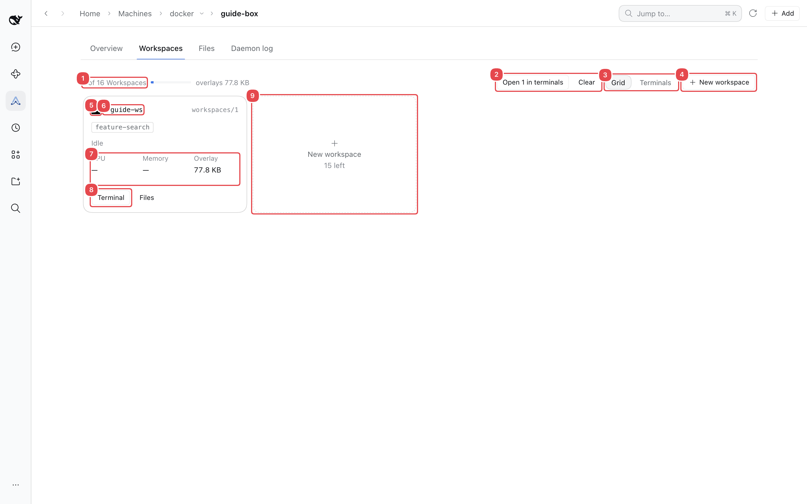
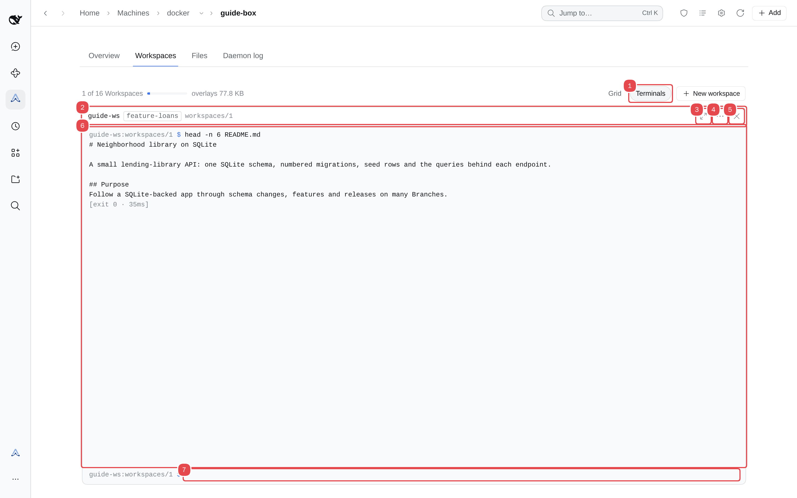
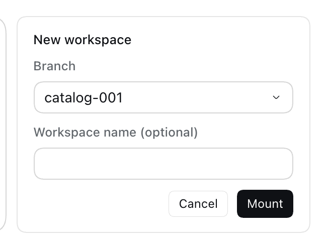
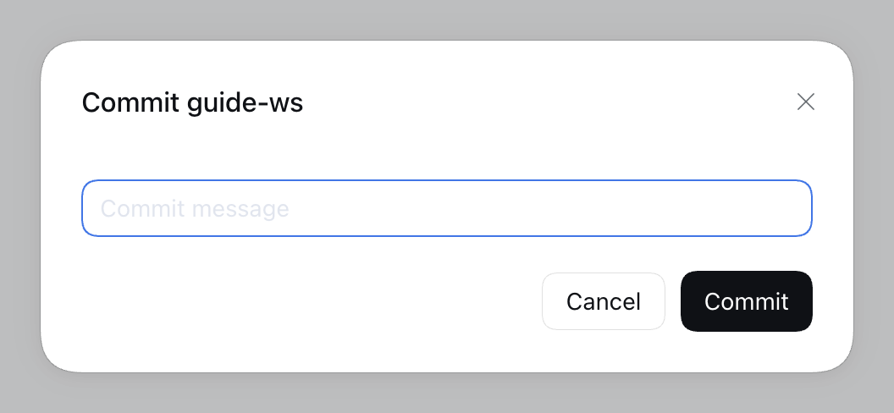
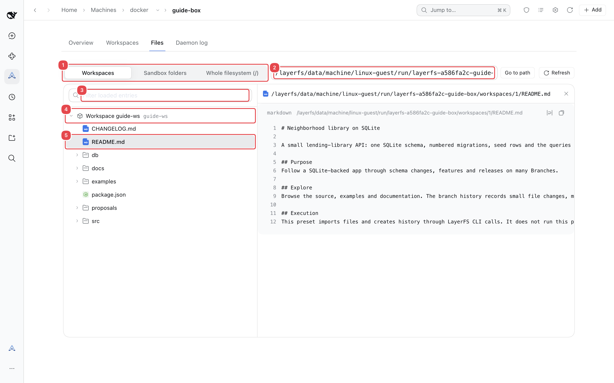
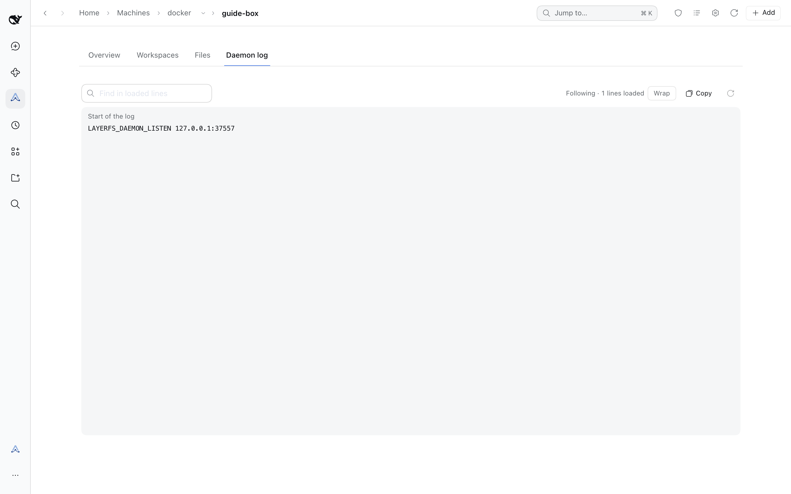
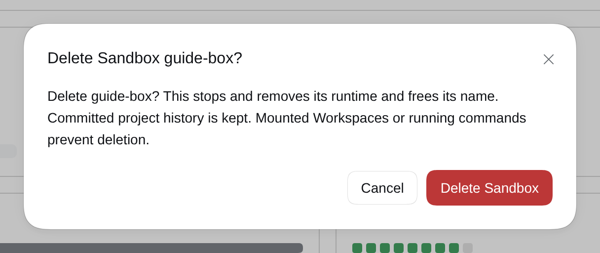
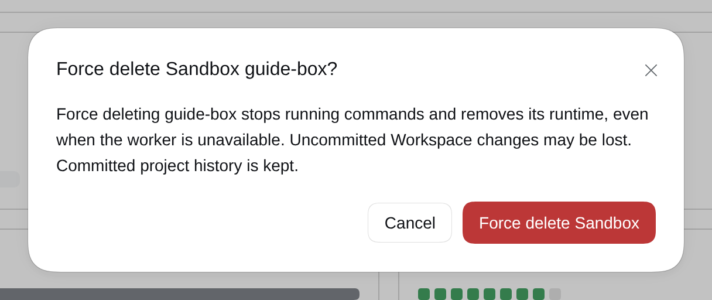
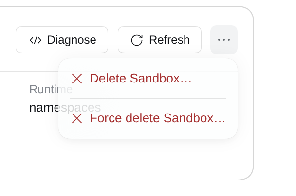

# Sandbox

> **Where:** `LayerFS › Home › Machines › <machine> › <sandbox>` · **Opens from:** a Sandbox card or row on a machine's Sandboxes tab, the Machines board, a project's Sandboxes tab, Jump to (**Sandboxes** group), the Disk space dialog's **Largest Sandboxes** · **Source:** see the end

A Sandbox is a running environment for one project on one machine: a daemon that mounts
Workspaces (a Branch of the project as a folder) and runs commands in them. Its page answers
"is it alive, what does it use, what is mounted", and is where you mount a Workspace, run
commands in it, commit what changed, and delete the Sandbox.

| # | Component | What it is |
|---|---|---|
| 1 | Tab bar | **Overview** · **Workspaces** · **Files** · **Daemon log** (the last two only when offered) |
| 2 | Details card | Name, state and the Sandbox's facts: project, machine, image, Workspaces mounted, runtime, route, created, up time, id |
| 3 | **Diagnose** | Runs the Sandbox's checks on the Doctor page |
| 4 | **Refresh** | Reads the Sandbox again |
| 5 | ⋯ | **Delete Sandbox…**, **Force delete Sandbox…** |
| 6 | Usage card | Processor, memory, processes and out-of-memory kills now |
| 7 | On disk | The Sandbox's run folder, split into Workspace changes, own files, runtime and log |
| 8 | Daemon | Reachable or not, its control slots, pid and start, retained failures |

Above the tabs is the [nav bar](components.md#nav-bar): `Home › Machines › docker › guide-box`.

## Layout

The tab bar comes first, as on the machine page; the name, icon and state head the Overview's
Details card. The head and tabs draw at once from the machine's Sandbox list, so the page never
waits on one slow read; the Workspaces tab waits for `sandbox get`. A red notice under the bar
says when the Workspaces cannot be read (**Workspaces unavailable:** *reason*, with **Open
daemon log**), a refusal, or a Sandbox in an unresolved state with the call that clears it.
The page remembers the tab per Sandbox.

## Overview

| Component | What it shows | Interaction → result | LayerFS call | States |
|---|---|---|---|---|
| Details card | **Project** (`demo-starter/bookshelf`), **Machine** (**docker (Docker)**), **Image** (its name as the machine's Sandbox card says it, **LayerFS default** for the bundle's image, else a short id), **Workspaces** (**1 of 16 mounted**), **Runtime**, **Filesystem route**, **Created**, **Up time**, **Id** | **Machine** → the machine page; **Workspaces** → the Workspaces tab | `sandbox list` (read, from the machines view), then `sandbox get` (read: every 15 s while it runs, every 5 s while a command runs, and after each command); the image's name from `machine images` (read) | State chip: **Running**, **Stopped**, **Daemon not running**, **Needs repair**, … |
| **Diagnose** | | Press → the Doctor page runs this Sandbox's checks | `sandbox doctor` (on the Doctor page) | |
| **Refresh** | | Reads the Sandbox now | `sandbox get` (read) | |
| ⋯ | **Delete Sandbox…** (**Read Sandbox** after an uncertain delete), **Force delete Sandbox…** | See [Modals](#modals-opened-here) | `sandbox remove` / `sandbox remove --force` | **Delete** off while an operation runs |
| Usage card | **Processor** (*n* **of** *m* **processors**, a bar), **Memory** (now, **peak**, file cache and tmpfs), **Processes** (**now**), **Out-of-memory kills** (**since it started**, red above 0), **read** *time* | — | — (the host's metrics sampler reads `machine stats` on the machine every 15 s) | A Sandbox with no cgroup of its own (the macOS host machine): **Not measured for this Sandbox:** *reason***. The whole machine is shown instead.**; an older worker: **This machine's worker is an older build: it sends no per-Sandbox values.** |
| Usage line | Without `machine stats`: **Usage** CPU time, memory now and peak, processes, from `sandbox get` | — | `sandbox get` (read) | Older CLIs |
| On disk | Total, a bar and **Workspace changes**, **Own files**, **Runtime and log** | — | `machine stats --with space` on its machine (read, kept a minute) | **Reading disk use…**; not read with why |
| Daemon | **Daemon reachable** / **Daemon not reached** / **Daemon not running** / **Daemon not reported**, one square per control slot, ***n* of *m* slots free · pid *n* · started *time***, ***n* retained failures** | **View** / **Hide** → a table of **Retained daemon failures** (slot, cause, age) | `sandbox get` (read) | |

## Workspaces

The Sandbox's Workspaces, as cards (**Grid**) or as terminals (**Terminals**). The choice of
view is remembered in this browser.

| # | Component | What it shows | Interaction → result | LayerFS call | States |
|---|---|---|---|---|---|
| 1 | Count | ***n* of 16 Workspaces** with a capacity bar, ***n* running** (and ***n* by another client**), **overlays** *size* | ***n* running** → the terminal of the next Workspace where a command runs | `sandbox get` (read) | |
| 2 | Chosen bar | **Open *n* in terminals** and **Clear** (grid), or **Showing *n* chosen** and **Show all** (terminals) | → the terminals of the ticked Workspaces only / all again | — (view state) | Only while a card is ticked |
| | Pager | **Previous page**, *page* / *pages*, **Next page** | Terminals that do not fit one screen page | — | Terminals view, more than fit |
| 3 | **Grid** / **Terminals** | | Switch views | — | |
| 4 | **New workspace** | | Opens the [New workspace form](#new-workspace-form) in the last tile | — | Off with **A Sandbox holds at most 16 Workspaces.** or **The Sandbox can’t be reached, so no Workspace can be mounted.**; hidden on a gone Sandbox |
| 5 | Tick | **Choose** *name* | Ticks the card for the terminals view | — | |
| 6 | Name | Activity dot and name, mount folder (`workspaces/1`), Branch, **Head moved** when its Branch moved since mount | Click → its terminal | — | |
| | Running line | The program running and for how long, **+*n* more**, or **Idle** | — | `sandbox get` (read) | |
| 7 | Figures | **CPU** (a rate with a sparkline), **Memory** (**peak**), **Overlay** (*size*, and the changes on it) | — | `sandbox get` (read) | A dash with why on hover (**Nothing runs here, so there is nothing to measure**) |
| 8 | **Terminal** / **Files** | | → its terminal / the Files tab | — | **Files** only with the Files tab |
| 9 | New workspace tile | **New workspace**, ***n* left** (**No Workspaces yet** when none) | As **New workspace** | — | |

### Terminals

As many terminals as the area holds (each at least 380 × 220, at most 4 × 3), a pager past
that, one maximized on request. Each is a [terminal pane](components.md#terminal-pane).

| # | Component | Interaction → result | LayerFS call |
|---|---|---|---|
| 1 | **Terminals** | This view | — |
| 2 | Pane head | Name, Branch, mount folder, the changes chip (overlay size on hover), a busy dot | `sandbox get` (read) |
| 3 | **Maximize** / **Restore** | One pane fills the area (Escape or Alt+Enter restores) | — |
| 4 | ⋯ **More for** *name* | **Commit…** → [Commit dialog](#commit-dialog); **Copy path** | `workspace commit` |
| 5 | × **Close** *name* | Unmounts at once, no confirmation: uncommitted changes are dropped and running commands cancelled | `workspace unmount --discard --force` |
| 6 | Transcript | The commands this app ran here, their output and **[exit *n* · *time*]** | — (the host's command log; read again while one runs) |
| 7 | Prompt | *name*:*folder* **$** — Enter runs the line; ↑/↓ history; Ctrl+C cancels a running command (or clears the line); Ctrl+L clears the view | `workspace exec`; Ctrl+C: `workspace cancel --exec` |

Keyboard across panes: Alt+1…9 focuses a pane, Alt+PageUp / Alt+PageDown changes page.

### New workspace form

Mounts a Branch of the Sandbox's own project. `main` is never offered (LayerFS mounts only
side Branches).

| Component | Interaction → result | LayerFS call | States |
|---|---|---|---|
| **Branch** | Pick one of the project's Branches, or **New branch from main…** | `branch list`, `branch get` (read) | **Branches could not be read.** |
| **New branch name** | Shows for a new Branch | — | **Use lowercase letters, digits, dots, underscores or hyphens, starting with a letter or digit.** |
| **Workspace name (optional)** | A name for the Workspace | — | A taken name is marked |
| **Mount** | Mounts it, then shows and focuses its terminal (named or not) | `workspace mount <sandbox> <branch> [--name]` (a new Branch: `sandbox get`, then `branch fork <project> <branch> main` first) | **Mounting…**; a refusal stays in the form |
| **Cancel** / Escape | Closes the form | — | |

### Commit dialog

**Commit *name***: an optional **Commit message**. **Commit** captures the Workspace's changes
as a new Commit on its Branch (`workspace commit [--message]`); the pane then says
**Committed *id*** or **Nothing to commit**. **Cancel** closes.

## Files

Only when the pinned CLI can list a Sandbox's files. Read-only.

| # | Component | What it shows | Interaction → result | LayerFS call | States |
|---|---|---|---|---|---|
| 1 | View | **Workspaces** (each mounted Workspace as a folder of its saved files), **Sandbox folders** (home, daemon log), **Whole filesystem (/)** when offered | Click → that view | **Workspaces**: `branch get`, `file list` (read, through the project at the Workspace's base Commit; on a fork with no Commit of its own, its base Layer); others: `sandbox files <sandbox>` (read) | **No Workspaces are mounted.** |
| 2 | Path | The path shown, editable | **Go to path** → opens it | `sandbox files <sandbox> <path>` (read) | |
| 3 | **Filter loaded entries** | | Filters what was read | — | |
| 4 | Workspace row | **Workspace** *name* with its Branch and changes | Click → its saved files at that base (here `guide-ws` on a fresh fork of main: main's files) | `file list --at` (read) | |
| 5 | A file | Its text, a window at a time | Click → opens it | `file read`, `file stat` (read; Sandbox folders: `sandbox files --byte-offset --byte-length`) | The daemon log offers **Read in the Daemon log tab** |

**Refresh** reads the open folders again; a long read shows its seconds and **Cancel**. The
tree is the same as the machine's [Files tab](machine.md#files).

## Daemon log

Only when the pinned CLI has `sandbox log`.

The Sandbox daemon's log, followed live: the [log pane](components.md#log-pane), reading
`sandbox log` (with `--cursor` / `--limit` for new and earlier lines). On a Sandbox that is
gone, a refused read stops polling (**Stopped reading**).

## Variants

- **A project conversation's Sandbox** (named `dsh-…`, on `macos-host` for `handbook`): its
  Workspace is the conversation's. **Delete Sandbox…** closes it the way the conversation
  does: a checkpoint is saved first (`workspace status`, `workspace commit`), then
  `sandbox remove --force`. It is session-owned today: its card on the project's
  Sandboxes tab carries a quiet **Session** tag (hover: *This Sandbox belongs to one
  conversation and is removed when it closes.*), and it is removed when the conversation
  closes. A project-owned Sandbox (one per project) was considered and is not planned.
- **macos-host** Sandboxes run as host processes (the host machine is a machine like any other): the
  Image fact reads **None · host
  processes**, and the Usage card shows the whole machine, muted, with why.
- **A gone Sandbox** (its daemon ended with the machine): no **New workspace**, the Daemon
  card says **Daemon not running**, and its card on the machine page offers **Close**.
- **Files** and **Daemon log** show only when the pinned CLI has `sandbox files` and
  `sandbox log`.

## Modals opened here

| Modal | Opened by | What it does | LayerFS call | Undo |
|---|---|---|---|---|
| **Delete Sandbox *name*?** | ⋯ › **Delete Sandbox…** | **This stops and removes its runtime and frees its name. Committed project history is kept. Mounted Workspaces or running commands prevent deletion.** → **Delete Sandbox** | `sandbox remove` | None: create a new Sandbox |
| **Force delete Sandbox *name*?** | ⋯ › **Force delete Sandbox…** | **…stops running commands and removes its runtime, even when the worker is unavailable. Uncommitted Workspace changes may be lost.** → **Force delete Sandbox** | `sandbox remove --force` | None |
| [Commit *name*](#commit-dialog) | Pane ⋯ › **Commit…** | Commits the Workspace | `workspace commit` | None: the Commit stays in the Branch's history |

A delete refused because Workspaces are mounted or a command runs stays under the form in the [confirm dialog](components.md#confirm-dialog); after an
uncertain answer the menu offers **Read Sandbox** instead of a second delete. After a delete
the page returns to the machine.

## States and signals

- **Daemon reachable** (green): commands run. **Daemon not reached**: the record says it runs
  but the daemon does not answer; open the Daemon log, or force delete.
- **The Sandbox can't be reached, so commands can't run.** in a pane: the prompt is off until
  the daemon answers.
- **Also running:** *program* · *age* · *who* in a pane: a command another client (a session,
  this app elsewhere, a tagged run) started. It can be cancelled only where it was started.
- **Head moved**: the Workspace's Branch got new Commits since it was mounted.
- **outcome unknown: this host stopped while it ran**: the host restarted during a command.

## Where next

- [Machine](machine.md): the machine it runs on.
- The project page's History, for Commits made here.
- [Components](components.md): [terminal pane](components.md#terminal-pane),
  [log pane](components.md#log-pane), [Sandbox card](components.md#sandbox-card).

## Source

`src/client/machines/`: `SandboxDetail.tsx`, `SandboxOverview.tsx`, `SandboxTerminals.tsx`,
`WorkspaceGrid.tsx`, `TerminalPane.tsx`, `terminal.ts`, `Sandboxes.tsx`, `InspectFiles.tsx`,
`LogPane.tsx`, `notices.ts`, `locale.ts`. Host: `src/host/routes/projects.ts` (`sandbox`,
`closeSandbox`, `mount`, `unmount`), `commands.ts`, the router's inline workspace commit and
unmount (`router.ts`), `machines.ts` (`sandboxLog`, `sandboxFiles`).
