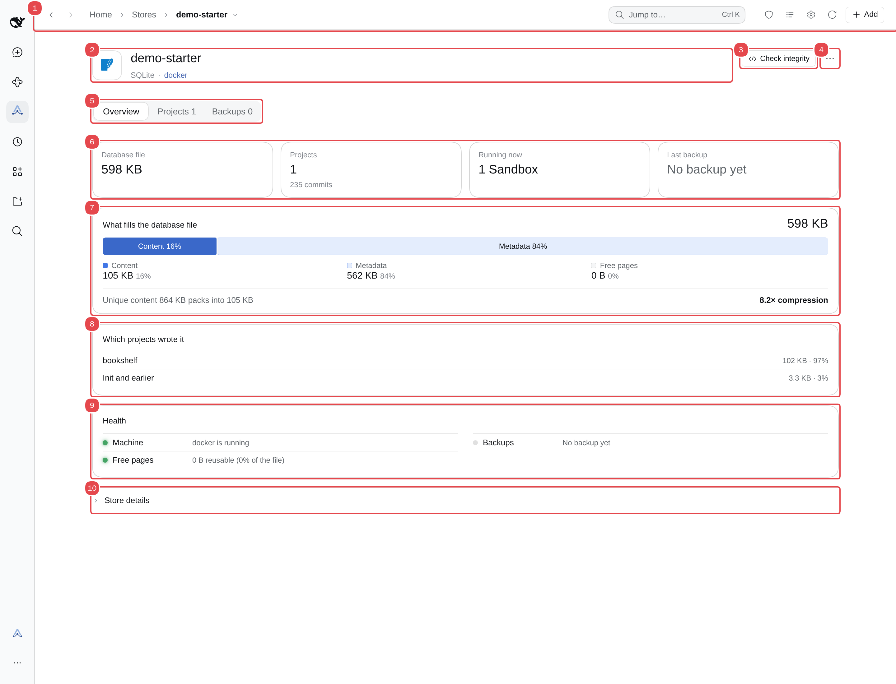
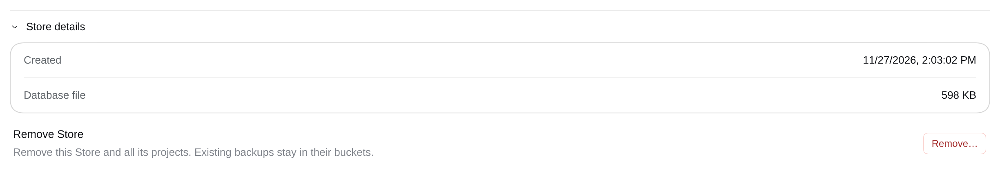
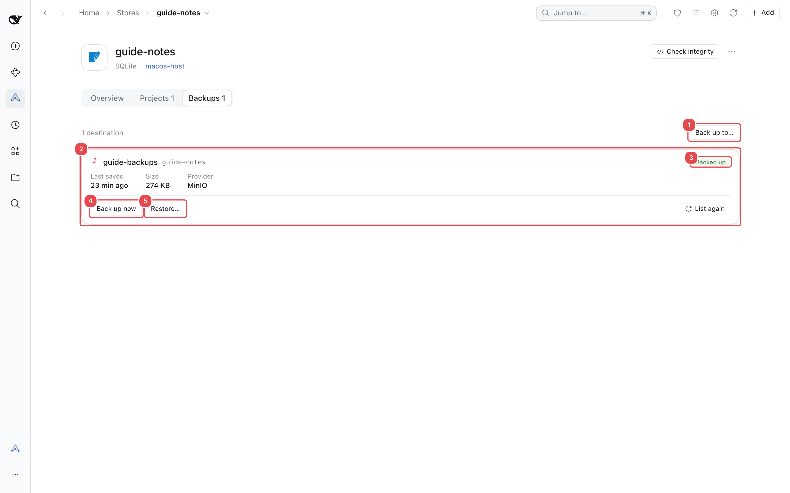
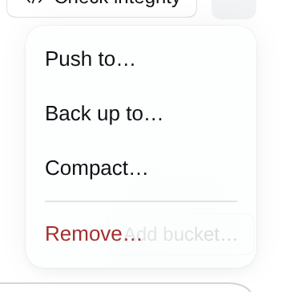
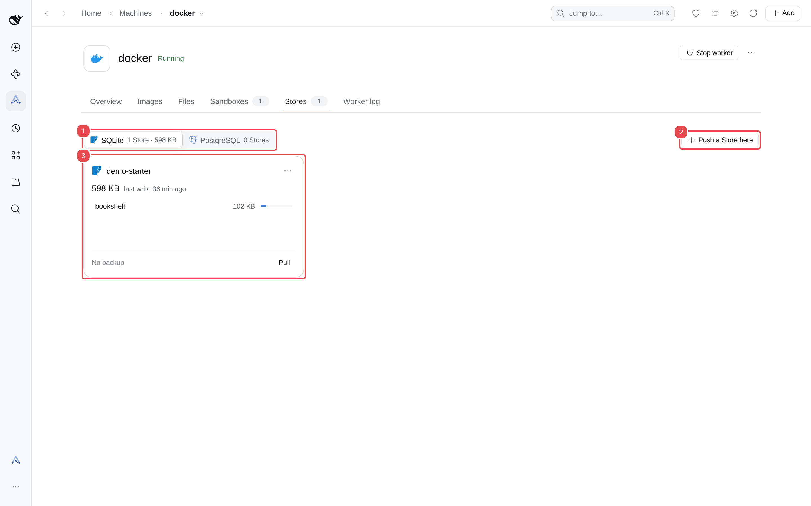

# Store

> **Where:** `LayerFS › Home › Stores › <store>` · **Opens from:** a Store card's name on Home › Stores or on a machine's Stores tab, the nav bar's crumb switcher, Jump to, a project page's Store link, a bucket's Linked Store · **Source:** see the end

A Store is the database that holds projects: a SQLite file on one machine, or a PostgreSQL
database on a server. Its page answers "how big is it, what is in it, who uses it, is it
backed up (or reachable)", and holds every Store-wide action: push, pull, move, back up,
compact, remove (SQLite) or check, edit connection, attach machines, disconnect (PostgreSQL).
A PostgreSQL Store has its own, simpler page: see [PostgreSQL Store page](#postgresql-store-page).

| # | Component | What it is |
|---|---|---|
| 1 | Nav bar | [Components › Nav bar](components.md#nav-bar): `Home › Stores › demo-starter`; the last crumb's switcher lists every Store |
| 2 | Head | The Store's glyph, name, a state chip when it is not ready, and its family and place (**docker** opens that machine) |
| 3 | **Check integrity** | Runs the Store's doctor and opens the Doctor page |
| 4 | ⋯ | The Store menu: [Components › Store menu](components.md#store-menu) |
| 5 | Tabs | **Overview** · **Projects** *n* · **Backups** *n* |
| 6 | Tiles | Database file, Projects with their commits, Running now, Last backup |
| 7 | What fills the database file | Content, metadata and free pages, and the compression ratio |
| 8 | Which projects wrote it | Each project's share of the packed bytes |
| 9 | Health | Machine, backups and free pages |
| 10 | Store details | Folded: created, file size, and **Remove…** |

## Layout

The head (name, family, place, **Check integrity**, ⋯) sits above two optional bands: a red
notice when the Store needs you, and a [job card](components.md#job-card) while a move,
backup, restore or compaction runs (or just ended). Under them, three tabs; the page
remembers the tab per Store.

The page reads the Storage view (`GET /api/storage`: `home get`, `project list`, `store list`,
and `store get` for each PostgreSQL Store) again on every `storage` event, after each action and every 15 s while visible.
The tabs' own reads (`store get --with stats`, the project ledgers) refresh on `storage`,
`storage-job` and Workspace events, coalesced to one read per 2 s.

## Head and notices

| Component | What it shows | Interaction → result | LayerFS call | States |
|---|---|---|---|---|
| Head | Glyph, name, chip (Busy, Blocked, Broken, Unknown; none when Ready), **SQLite** · place | The machine name → that machine's page | `store list` (read) | the chip pulses while Busy |
| **Check integrity** | The Store's doctor | Press → a doctor run starts and the Doctor page opens with its result | `store doctor` | off while the run is being handed over |
| ⋯ | [Store menu](components.md#store-menu) | See [Store menu](#store-menu) below | per row | rows disabled while the Store is not Ready |
| Needs-you notice | The state word and its reason: **Broken · …**, **Waiting on docker**, **docker is stopped.**, **Blocked · docker broken**; LayerFS's sentence on hover | The one action beside it: **Start docker** (a stopped machine), the Store's [fix button](components.md#fix-buttons), or **Repair docker** (opens the broken machine) | `machine start`, or the fix's own call | hidden while the Store is Ready and its machine runs |
| Job card | The running or just-ended job on this Store | [Components › Job card](components.md#job-card): **Retry** (or **Retry push** when a move's push failed), **Dismiss**, **Open** *Sandbox* | see Job card | shown until a minute after success, or until dismissed after a failure |
| Another client's operation | **Another client runs** *op* **on this Store** | — | `store list` (read: its `op`) | only while another process holds the Store |
| Tabs | **Overview**, **Projects** *n*, **Backups** *n* | Click → that tab | — (the tab is remembered in the browser) | |

## Overview

What the Store weighs, who wrote it and whether anything needs attention.

| Component | What it shows | Interaction → result | LayerFS call | States |
|---|---|---|---|---|
| **Database file** tile (SQLite) | The file's size, with **size seen** *when* if its machine did not answer | — | `store list` (read) | **Size unavailable** |
| **Projects** tile | The project count and **n commits** (or **n commits so far** while ledgers are counted) | Click → Projects tab | `project list`, `project stats`, `branch get` (read) | **Not read: …** when the Store refused |
| **Running now** tile | Sandboxes of this Store's projects whose daemon runs | — | `machine list`, `sandbox list` (read, `GET /api/machines`) | |
| **Last backup** tile (SQLite) | How long ago (from the newest dated copy) and its bucket; or the known backup state when no time was recorded | Click → Backups tab | `store list` (read: its links), `backup list` (read) | muted **No backup yet** when unlinked |
| What fills the database file | A bar of **Content**, **Metadata** (cool slate-blue, never amber), and **Free pages** labeled directly inside wide segments, with sizes and shares underneath; zero-byte parts are omitted from the bar; **Unique content** *x* **packs into** *y* and the **×** ratio | Hover → segment details and highlight | `store get --with stats` (read) | **Reading…**, **Not read: …**, **LayerFS did not report this Store's parts.** |
| How the Store grew | File, content and metadata over this host's past reads; gaps longer than the journal's are breaks | — | — (host journal of earlier `store get --with stats` reads) | only once a read was journaled; **The chart starts with this host's reads of the Store: one so far.** |
| Which projects wrote it | A vertical list of projects with packed bytes and shares; **Init and earlier** for bytes no Commit counted | — | `project stats` (read), `store get --with stats` (read) | **No project has committed content yet.** |
| Health | **Machine** (*docker* **is running** / stopped), **Backups** (green **up to date** only when every copy is verified current; neutral **changed since the last backup** using only the behind copy's time, **Bucket changed**, **Not checked**, **Not listed**, or **No backup yet**; red **Missing** / **Both changed**), **Free pages** (reusable share) | — | from the reads above | green, grey, red dots |
| Store details | **Created**, **Database file**; then **Remove Store** | **Remove…** → [typed-name confirm](#modals-opened-here) | `store remove` ↻ | folded by default |

## Projects

Every project in the Store, the same table as Home › Projects without the Store column.

| # | Component | What it shows | Interaction → result | LayerFS call | States |
|---|---|---|---|---|---|
| | Summary | **n commits · size · n running** | — | `project stats` (read) | |
| | Search | Filters rows by name | Type; Escape clears | — | only past four projects |
| 1 | **Add project** | | Press → [Add project](#modals-opened-here) | `project init` | off unless the Store is Ready |
| 2 | Project table | Per project: name with **n running**, its newest Commit line, **Sessions**, **Sandboxes**, **Last session**, **Last commit**, **Commits**, **Branches**, **Size** with a bar for its share of the Store | Headings sort (Last session is held still while sessions run); the chevron opens the row's sessions or Sandboxes; the name opens the project page; a Sandbox opens its page | `project list`, `project stats`, `branch get` (read); sessions from this DSH (no call); Sandboxes from `sandbox list` (read) | rows show without figures until their ledger is read; **No projects yet**, **No matching projects** |

## Backups (SQLite)

Where copies of this Store live, how current each is, and the buttons to refresh or restore one.
Opening the tab automatically lists any linked bucket that has not been listed yet (once, unless
its last list failed).

| # | Component | What it shows | Interaction → result | LayerFS call | States |
|---|---|---|---|---|---|
| | Count | **n destination(s)** | — | — | |
| 1 | **Back up to…** | | Press → [Back up](#modals-opened-here) (no bucket yet: **Add bucket…** → Add bucket, then Back up) | `backup create` | off unless Ready (explains why) |
| 2 | Destination card | Provider mark, clickable bucket name, clickable file name (once listed and present), **Last saved**, **Size**, **Provider** (**MinIO**, **Cloudflare R2**) | Click bucket → [Bucket page](bucket.md); click file → backup file page | `store list` (read: links), the bucket's last `backup list` | **No backup destinations configured.** |
| 3 | State pill | **Backed up**, **Store changed**, **Bucket changed**, **Both changed**, **Missing**, **Not checked**, dashed **Not listed**, or list failure (**Not listed · key refused**, …) — the same words as the bucket page; LayerFS's sentence on hover | — | `backup list` (read) | dashed **Not listed** before listing; red pill on list failure |
| 4 | Primary backup / recovery action | **Back up now** (current, Store changed, or unlisted), **Back up as new file…** (**Missing**, **Both changed**, **Bucket changed**), or **Connect again…** (key refused) | **Back up now** → starts a backup job at once; **Back up as new file…** → [Back up](#modals-opened-here) prefilled with a fresh file name; **Connect again…** → Connect bucket again | `backup create`, then `backup list` | off unless Ready (explains why) |
| 5 | **Restore…** | | Press → [Restore](#modals-opened-here) on that file | `backup restore`, then `backup list` | hidden on **Missing**; off with a reason while unlisted until the bucket is listed; off while Busy |
| | **List the bucket** / **List again** | | Press → lists that bucket now | `backup list` (read) | spinner while listing |

## PostgreSQL Store page

No PostgreSQL Store exists in the fixture, so this page is described from its code.

The head: name, **PostgreSQL · size · n projects**, **Check**, and ⋯ (**Copy address**,
**Disconnect…**, off while Sandboxes of the Store run). Then two columns: every project,
largest first, with **Show in Projects →** (the Projects tab filtered by this Store); beside
them **Connection** and **Runs on**. Under 760 px the columns stack.

| Component | What it shows | Interaction → result | LayerFS call | States |
|---|---|---|---|---|
| **Check** | | Press → checks from this computer, then every attached machine; each status updates in place | `store doctor`, then `store get` | **Checking** while it runs |
| Projects | Each project with its size, sessions, Sandboxes and last commit | Name → project page | `project list` (read) | **Projects could not be read** keeps the last list, marked **last read** *when* |
| **Connection** | **Address** (`host:port`, **Copy**), **Database** (its name and the Store id on hover), **User**, **Password** (**saved** / **not saved**, when it changed on hover), **Checked from this computer** (the host's status; when, and LayerFS's words, on hover) | **Edit…** → [Edit connection](#modals-opened-here) | `store get` (read: `url`, `user`, `password_saved`, `reach`) | the status uses the [shared labels](#status-labels) |
| **Runs on** | One row per attached machine: icon, name (`native` too, like any machine), provider (left out when it matches the name), **n Sandboxes**, status, **×** | **+ Attach machine** → [attach picker](#modals-opened-here); **×** detaches at once (reversible); a failure's action (**Edit connection…**, **Start**, **Update…**) | `store get` (read: `machines`), `store attach`, `store detach` | **×** stays in place but off, with **n Sandboxes … close them** on hover, while Sandboxes run there; a machine attached but not checked yet reads **not checked**; none yet reads **No machines yet. Attach one to run Sandboxes.** |

### Status labels

One label set for every check, from this computer or a machine: **reachable**, **checking**,
**not checked**, **cannot reach address**, **wrong password**, **database not found**, **not
this Store**, **machine stopped**, **machine needs update**, **check failed** (anything else).
LayerFS's own words are the tooltip, never the row. Each failure has one action: **Edit
connection…** (address, password, database), **Start** (stopped machine) or **Update…**
(machine needs update). A refused **password authentication** (SQLSTATE 28P01/28000) reads
**wrong password**.

Three terms stay apart. **Checked from this computer** is the host's own check (the dot
before a row's name, and the Store page's fact of that name). The machine `native` is named `native`
like any other machine. A **local address** (`localhost`, `127.0.0.1`, `::1`) can be reached
only by the machines LayerFS reports as sharing this computer's network (`loopback: shared`);
its note names them.

## Store menu

The ⋯ in the head (and on every Store card) holds every Store-wide action. Full component
reference: [Components › Store menu](components.md#store-menu).

| SQLite on a machine | SQLite on native |
|---|---|
|  |  |

| Row | Shown for | Interaction → result | LayerFS call | Disabled when |
|---|---|---|---|---|
| **Push to…** | SQLite on native | [Push](#modals-opened-here) → a job card | `store move <store> <machine>` | not Ready |
| **Pull to native** | SQLite on a machine | A pull job starts at once | `store get`, then `store move <store> native` | not Ready |
| **Move to another machine…** | SQLite on a machine | [Move](#modals-opened-here) → a job card | `store get`, then `store move` ×2 through native | not Ready |
| **Back up to…** | SQLite | [Back up](#modals-opened-here) (no bucket: Add bucket first) | `backup create`, then `backup list` | not Ready |
| **Back up now · *bucket*/*file*** | SQLite, one row per linked bucket | A backup job starts at once | `backup create`, then `backup list` | not Ready |
| **Compact…** | both, when the LayerFS runtime has `store compact` | [Confirm](#modals-opened-here) → a job card | `store get`, then `store compact` | not Ready (tip: **Start machine** *m* **first**, **Repair machine** *m* **first**, **The Store is not ready**); offered on a Broken Store whose fix is the compaction |
| **Upgrade…** | both, when the LayerFS runtime has `store upgrade` and the Store's format (`--with format`) is outdated | [Upgrade *store*?](#modals-opened-here) → an upgrade card (steps, elapsed time, **Cancel** until commit) | `store get`, then `store upgrade` (Cancel: SIGTERM to the CLI, its reply decides) | a job on the Store (tip: **Wait for the running operation to finish**) |
| **Remove…** | SQLite | [Typed-name confirm](#modals-opened-here) | `store remove` ↻ | never |
| **Check** | PostgreSQL | Checks from this computer and every attached machine | `store doctor`, then `store get` | |
| **Edit connection…** | PostgreSQL | [Edit connection](#modals-opened-here) | `store connect`, then `store doctor` | |
| **Attach a machine…** | PostgreSQL | The [attach picker](#modals-opened-here) | `store attach` | |
| **Disconnect…** | PostgreSQL | Confirm (no typed name) → the home forgets the Store; the database stays | `store disconnect` ↻ | while Sandboxes of the Store run |

## Machine › Stores tab

`LayerFS › Home › Machines › <machine> › Stores` is the Stores board for one machine; Home ›
Stores is the same board for every Store. The machine page itself is described in
[machine.md](machine.md).

| # | Component | What it shows | Interaction → result | LayerFS call | States |
|---|---|---|---|---|---|
| 1 | Kind switch | **SQLite** *n* **Stores · size** and **PostgreSQL** *n* **databases**; the note on hover (**The Store file lives on docker's disk. Pull brings it back to native.**) | Click or ←/→ → that kind | — (remembered per machine in the browser) | a kind the machine cannot hold says why on hover |
| 2 | **Push a Store here** (SQLite; **Add Store** on native) | | Press → [Add a Store to *machine*](#modals-opened-here) | `store move` (push, pull, or pull then push) | off with a reason (**This machine cannot hold SQLite Stores.**) via `ExplainedButton` when the machine holds no SQLite Stores |
| 2 | **+ Attach Store** (PostgreSQL) | | Press → the [attach picker](#modals-opened-here) listing PostgreSQL Stores not attached to this machine | `store attach` | |
| 3 | Store card | [Components › Store card](components.md#store-card) | Name → Store page; ⋯ → Store menu; **Pull** / **Push to…** | `store move` | |
| | Empty line | **No SQLite Store is on docker. Push one here to run its Sandboxes on it.** (**No SQLite Store is on native. Create one or pull one back from a machine.** on native) / **No PostgreSQL Store is attached to docker.** | — | — | |

The Home › Stores row (the same parts as a machine's Store card, plus **Stored on**; **Push to…** is in its ⋯):

See [Components › Store card](components.md#store-card) for each numbered part.

On the PostgreSQL side each Store attached to the machine is one row: its name, the address
(**Copy**), this machine's status in the [shared labels](#status-labels) with its one action,
and **Detach** (or **n Sandboxes** while they run there, which keeps it attached).

### Home › Stores rows

Home › Stores lists Stores as accordion rows, one kind at a time (**SQLite** *n* /
**PostgreSQL** *n*, remembered in the browser; **Buckets** stays beside them). A folded row
says enough to decide whether to open it; the open rows are remembered per viewer.

| Row | Folded | Unfolded |
|---|---|---|
| SQLite | Name, size, projects, the machine it lives on (by name, `native` included), last backup (**n failed** in red), a status dot (**ready**, **operation running**, **machine stopped** in amber with **Start**, **needs attention**) | **Projects** (largest first, 5 then **+n projects →**; **No commits since Init** for a project with only its Init), **Lives on** (the machine, **Move…** with the one-machine rule on hover), **Backups** (each bucket with its last backup, **Back up**, **Restore…** when it has a copy; **Not backed up to any bucket** when none) |
| PostgreSQL | The dot of **Checked from this computer** (status and when on hover), name, `user@host:port/database` with **Copy** beside it, projects, then the machines: one shows its glyph, status dot and name; several show glyphs, **+n** and **n machines**; none shows **no machines** and **Attach…**. Then one word: **n failed** (red), else **n stopped** (amber), else **local address** (grey; the machines sharing this computer's network on hover), else nothing. A failed host check shows **check failed** and **Edit connection…** instead of the machines | **Projects** (**last read** *when* while the list is stale), **Runs on** (each machine's status and action, **×**, **+ Attach machine**) |

The header's **Check all** checks every PostgreSQL Store and opens each row whose host check
failed. **Connect a database** and **New Store** start new ones.

## Variants

- **SQLite on native vs on another machine.** The place reads the machine's name, `native`
  included (a link). The menu offers **Push to…** on native, **Pull to native** and
  **Move to another machine…** on a machine; Health's Machine row follows the machine's state.
  A machine-held Store whose machine is stopped shows **docker is stopped.** with **Start
  docker**, and its size as **size seen** *when*.
- **PostgreSQL.** Its own page ([above](#postgresql-store-page)); the menu is Check / Edit
  connection… / Attach a machine… / Compact… / Disconnect…. A PostgreSQL Store is on no
  machine: its Sandboxes run only on an attached machine, and each session picks one of them.
- **Compact…** appears only when the selected LayerFS runtime has `store compact`.
- **Formats (LayerFS #804).** With a runtime whose `store list`/`store get` take `--with format`, a row
  shows **Outdated** (tip "Format 2 · latest 3") or **Newer format**, the page head the red dot and
  **Outdated** with **Upgrade…**, and Store details a **Format** row ("3 (latest)", "2 · latest 3",
  "4 · newer than this LayerFS"). An outdated Store's unread signal offers **Upgrade…** when its fix
  names `store upgrade`, else Remove… / Disconnect…. While an upgrade runs the Store is busy (no Mount,
  no Sandbox create); it ends **Upgraded** (green), **Cancelled** (neutral, nothing changed),
  **Failed** (red, the check in the tip) or outcome unknown / interrupted (amber, **Check** reads the
  format: Upgraded or Outdated). Without `store upgrade` none of this shows.

## Modals opened here

| Modal | Opened by | What it does | LayerFS call | Undo |
|---|---|---|---|---|
| [Push *store* to…](img/store-push.png) | ⋯ › **Push to…**; a card's **Push to…** | Pick a machine (with its free disk and the Store's size; refuses with a danger notice and disables **Push** when free disk is smaller than the Store, warns when headroom is under 1.15×; guarded **Start** *m* via `StartFirst` for a stopped machine); **Held now: LayerFS refuses to move the Store while these remain** lists the Sandboxes in the way and disables **Push** with a footer hint | `store move <s> <m>` (as a job) | **Pull to native** |
| [Move *store* to another machine](img/store-move.png) | ⋯ › **Move to another machine…** | **A pull to native, then a push to the machine: two operations. If the push fails, the Store stays on native.** Shares Push's disk refusal/warning, guarded **Start** *m*, and **Held now** block | `store get`, `store move <s> native`, `store move <s> <m>` | move back |
| [Back up *store* to…](img/store-backup.png) | ⋯ › **Back up to…**; Backups tab **Back up to…** or **Back up as new file…** | Buckets by provider, each saying what writing there does (**Already current**, **Updates the copy from…**, **New backup in this bucket**, **The copy is gone…**, **Both sides changed…**, **Bucket copy was rewritten elsewhere…**, **Not listed…**); **File** with **Change** (**Missing**, **Both changed** and **Bucket changed** require a fresh, valid file name); **Add a bucket** | `backup create <s> <b> [--file]`, then `backup list` | the old copy is replaced; no undo |
| [Backups of *store*](img/store-backups-dialog.png) | A card's backups badge | Every copy grouped by provider under a health bar; each row's action (**Update**, **Back up now**, **Restore…**, **Back up as new file…** + **Restore…** on **Both changed**, or **Connect again…** on key refusal); **Back up to another bucket**; disabled row and footer buttons explain why. Lists each linked bucket again on open | `backup list` per linked bucket (read); `backup create` | — |
| [Restore *bucket*/*file*](img/store-restore.png) | **Restore…** on Backups, a bucket page or the Backups dialog | **As a new Store** (with real-time name validation) or **Replace** *store* (refused with specific reasons unless the Store is on native, ready and idle, held by no running Sandbox, linked to that bucket, the bucket is listed without error, and the copy is present and verified unchanged since the last transfer; offers **List the bucket** inline when unlisted) | `backup restore <b> <file> <store>`, then `backup list` | remove the new Store |
| [Add project to *store*](img/store-add-project.png) | Projects tab **Add project** | Name, optional absolute **Source folder**; shows **Creating** *name* · *step* and counts | `project init` (host job, `GET /api/project-inits/:id` polls) | delete the project |
| [Compact *store*?](img/store-compact.png) | ⋯ › **Compact…** | Plain confirm; **Compact** starts a job | `store compact` | — |
| Upgrade *store*? | ⋯ › **Upgrade…**, the Outdated tip's **Upgrade…** | Plain confirm: "Format 2 → 3", in place in one transaction; **Upgrade** starts a job | `store upgrade` | — (Cancel before commit changes nothing) |
| [Remove *store*?](img/store-remove.png) | ⋯ › **Remove…**, Store details **Remove…** | [Typed-name confirm](components.md#confirm-dialog): **Type** *name* **to confirm** | `store remove` ↻ | none (backups stay in buckets) |
| Disconnect the PostgreSQL Store *store*? | ⋯ › **Disconnect…** (PostgreSQL) | Confirm; the database and its data stay | `store disconnect` ↻ | Connect a database again |
| [New Store](img/store-new.png) | Nav bar **Add › New Store**; Home › Stores **New Store**; native's **Add Store › New Store** | **SQLite** or **PostgreSQL** (that tile goes on to Connect a database); **Empty Store** or [**Restore from a backup**](img/store-new-restore.png) (auto-lists an unlisted bucket once, filters out missing files, shows list errors with **Connect again…**, offers **Add bucket…** directly when none exist, plus **List again**, file list and **New Store's name**); **Location** tiles, with **Start** *m* for a stopped one. Creates in the home, then moves | `store create` ↻ (or `backup restore`), then `store move` to another machine | Remove |
| [Connect a database](img/store-connect-new.png) | Nav bar **Add › Connect a database**; Home › Stores PostgreSQL **Connect a database** | **Name**, **Address** (the address alone, `postgres://host:5432/database`; a user or password in it is refused under the field; a local address's one-line hint names the machines sharing this computer's network, **Local address: only machines sharing this computer's network can attach (native).**), **User**, **Password**. **Connect** is off until all four are filled; it is the test: the Store is saved only when the check from this computer passes. A refusal is one line in the footer (**The server refused the login. Check the user, password and database name.**, **Nothing answered at this address.**, **The database doesn't exist on this server.**, **This database holds another Store.**, else **LayerFS could not connect. Hover for its words.**), LayerFS's words on hover, and the field it is about marked red | `store connect` (password on stdin) | **Disconnect…** |
| Edit *store*'s connection | **Edit connection…**, **Edit…**, a failure's **Edit connection…** | Titled **Edit connection** with the Store's name under it: Address, User and Password (**Saved · leave empty to keep**); only what changed is sent. **Save and check** checks this computer, then every attached machine; the hint says **Checks from this computer, then from** *machines*. A refusal reads as in Connect | `store connect`, then `store doctor` ↻ | edit again |
| Attach machines to *store* | **+ Attach machine**, ⋯ › **Attach a machine…**, a fix line | Titled **Attach machines**, the Store's name under it. Machines not attached yet, grouped by provider in alphabetical order (a lone machine named like its provider has no heading), with search from 6 choices; several at once. One that cannot attach is greyed with why and its action, in this order: **cannot run PostgreSQL Sandboxes**, **cannot reach this address** (**Edit connection…**; a local address and a machine LayerFS reports apart from this computer's network), **stopped** (**Start**). **Attach and check** attaches each in turn; a refusal names the machine and its label (a failed check from the machine keeps its status label, with **Edit connection…** when the connection can fix it; LayerFS's loopback refusal reads **cannot reach this address** with **Edit connection…**; any other refusal reads **not attached**; LayerFS's words on hover), the rest go on | `store attach --machine` per machine | **Detach** |
| Attach Stores to *machine* | machine › Stores › PostgreSQL **+ Attach Store** | The same picker the other way, titled **Attach Stores**: PostgreSQL Stores not attached to this machine. A stopped machine shows **{machine} is stopped. Start it to attach Stores.** with **Start** above its greyed list | `store attach --machine` per Store | **Detach** |
| [Add a Store to *machine*](img/store-to-machine.png) | machine › Stores **Push a Store here** / **Add Store** | **SQLite** (**Move one here**) or **PostgreSQL** (**Connect one, or run one here**); lists SQLite Stores on other machines with size and place (unavailable ones show why, e.g. **Start machine** *m* **first**); checks target free disk (refuses when smaller than the Store, warns under 1.15×), guarded **Start** *m*, **Held now** block, two-step note when moving between two non-Home machines; **Move here**; on native also **Or create an empty Store here: New Store** | `store get`, then `store move` (push, pull, or pull then push) | move it back |
| [Add bucket](img/store-bucket-add.png) | Nav bar **Add › Add bucket**; Back up's **Add a bucket**; Backups tab **Add bucket…** | **MinIO** or **Cloudflare R2**, **Name**, **Bucket**, **Endpoint** or **Account ID** + **Jurisdiction**, **Prefix**, **Access key**, **Secret key**; returns to Back up when opened from it | `backup connect` (secret on stdin) ↻ | Disconnect the bucket |
| Connect *bucket* again | **Connect again…** on a bucket whose key was refused | Same form, name locked and URL filled; the same URL replaces the key (**Key replaced; links kept**) and relists that bucket | `backup connect`, then `backup list` | — |

## States and signals

- **Busy** chip, menu rows greyed: a job (this host's, or another client's **Another client
  runs …**) holds the Store. Wait for its card to end.
- **Waiting on docker** / **docker is stopped.**: the Store's machine is stopped; **Start docker**
  starts it (a press guard ignores a click on a button that just appeared).
- **Blocked · docker broken** / **unreadable**: its machine is broken; the button is that
  machine's fix, else **Repair docker** opens the machine.
- **Broken · …**: the Store's own problem; the [fix button](components.md#fix-buttons) runs
  LayerFS's fix (**Compact** *store* for an unknown outcome, **Edit connection…** for a
  PostgreSQL Store with **no password saved** or a connection to change, **Attach** *machine*
  for a machine not attached, **Update** for an outdated record).
- **Inspect the Store before continuing: an operation's outcome is unknown.**: a job ended
  without an answer; its fix is a new compaction.
- Muted **No backup yet** / Health **changed since the last backup** (grey dot): back up, or
  ignore it (missing or older backups are not an error); only **Missing** and **Both changed**
  are red.
- **size seen** *when*: the machine did not answer; the size is the last one read.

## Where next

- [Project](project.md): a project's name in the Projects tab.
- [Machine](machine.md): the place link, and its Stores tab above.
- [Bucket](bucket.md): a bucket's Backups card, the Back up dialog.
- [Home](home.md): Home › Stores, where every Store card lives.
- The Doctor page: **Check integrity**.

## Source

`src/client/storage/StorePage.tsx`, `store-page.ts`, `StoreOverview.tsx`, `StoreProjects.tsx`,
`ProjectTable.tsx`, `StoreLinks.tsx`, `StoreCard.tsx`, `JobProgress.tsx`, `dialogs.tsx`,
`StoreRows.tsx`, `store-rows.ts`, `PgStorePage.tsx`, `PgDialogs.tsx`, `BackupDialogs.tsx`,
`pg-fields.tsx`, `MachineStores.tsx`, `machine-stores.ts`, `StoragePage.tsx` (`actionsFor`), `src/client/doctor/Doctor.tsx`
(`DoctorAction`); host: `src/host/routes/storage.ts`, `projects.ts`, `machines.ts`.
