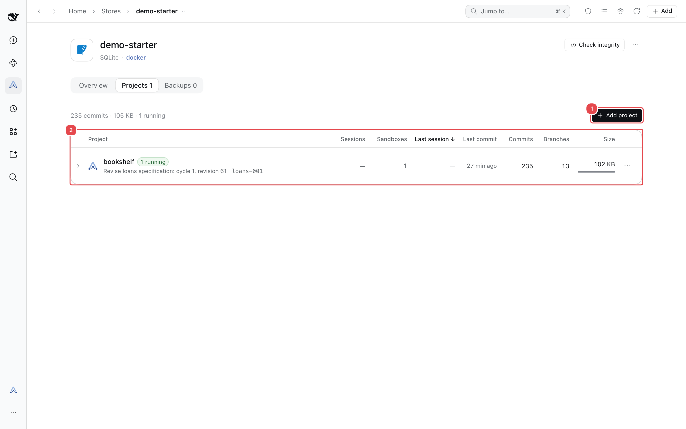
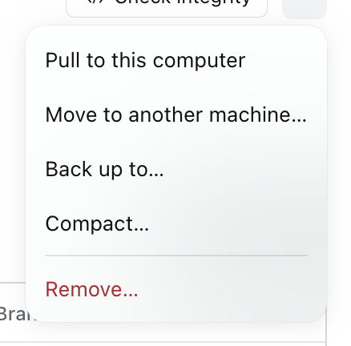
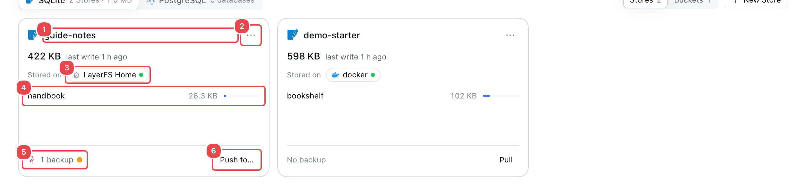
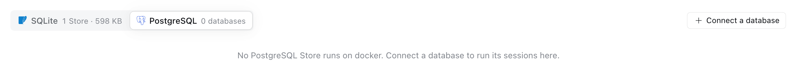

# Store

> **Where:** `LayerFS › Home › Stores › <store>` · **Opens from:** a Store card's name on Home › Stores or on a machine's Stores tab, the nav bar's crumb switcher, Jump to, a project page's Store link, a bucket's Linked Store · **Source:** see the end

A Store is the database that holds projects: a SQLite file on one machine, or a PostgreSQL
database on a server. Its page answers "how big is it, what is in it, who uses it, is it
backed up (or reachable)", and holds every Store-wide action: push, pull, move, back up,
compact, remove (SQLite) or check, change login, disconnect (PostgreSQL).

| # | Component | What it is |
|---|---|---|
| 1 | Nav bar | [Components › Nav bar](components.md#nav-bar): `Home › Stores › demo-starter`; the last crumb's switcher lists every Store |
| 2 | Head | The Store's glyph, name, a state chip when it is not ready, and its family and place (**docker** opens that machine) |
| 3 | **Check integrity** | Runs the Store's doctor and opens the Doctor page |
| 4 | ⋯ | The Store menu: [Components › Store menu](components.md#store-menu) |
| 5 | Tabs | **Overview** · **Projects** *n* · **Backups** *n* (SQLite) or **Connection** (PostgreSQL) |
| 6 | Tiles | Database file (or Server), Projects with their commits, Running now, Last backup (or Connected from) |
| 7 | What fills the database file | Content, metadata and free pages, and the compression ratio |
| 8 | Which projects wrote it | Each project's share of the packed bytes |
| 9 | Health | Machine, backups and free pages (PostgreSQL: server and backups) |
| 10 | Store details | Folded: created, file size or server, and **Remove…** / **Disconnect…** |

## Layout

The head (name, family, place, **Check integrity**, ⋯) sits above two optional bands: a red
notice when the Store needs you, and a [job card](components.md#job-card) while a move,
backup, restore or compaction runs (or just ended). Under them, three tabs; the page
remembers the tab per Store.

The page reads the Storage view (`GET /api/storage`: `home get`, `project list`, `store auths`,
`store list`) again on every `storage` event, after each action and every 15 s while visible.
The tabs' own reads (`store get --with stats`, the project ledgers) refresh on `storage`,
`storage-job` and Workspace events, coalesced to one read per 2 s.

## Head and notices

| Component | What it shows | Interaction → result | LayerFS call | States |
|---|---|---|---|---|
| Head | Glyph, name, chip (Busy, Blocked, Broken, Unknown; none when Ready), **SQLite** · place, or **PostgreSQL** · `host:port/db` | The machine name → that machine's page | `store list` (read) | the chip pulses while Busy |
| **Check integrity** | The Store's doctor | Press → a doctor run starts and the Doctor page opens with its result | `store doctor` | off while the run is being handed over |
| **Test connection** (PostgreSQL) | The same doctor, named for the connection | Press → as above | `store doctor` | |
| ⋯ | [Store menu](components.md#store-menu) | See [Store menu](#store-menu) below | per row | rows disabled while the Store is not Ready |
| Needs-you notice | The state word and its reason: **Broken · …**, **Waiting on docker**, **docker is stopped.**, **Blocked · docker broken**; LayerFS's sentence on hover | The one action beside it: **Start docker** (a stopped machine), the Store's [fix button](components.md#fix-buttons), or **Repair docker** (opens the broken machine) | `machine start`, or the fix's own call | hidden while the Store is Ready and its machine runs |
| Job card | The running or just-ended job on this Store | [Components › Job card](components.md#job-card): **Retry**, **Dismiss**, **Open** *Sandbox* | see Job card | shown until a minute after success, or until dismissed after a failure |
| Another client's operation | **Another client runs** *op* **on this Store** | — | `store list` (read: its `op`) | only while another process holds the Store |
| Tabs | **Overview**, **Projects** *n*, **Backups** *n* / **Connection** | Click → that tab | — (the tab is remembered in the browser) | |

## Overview

What the Store weighs, who wrote it and whether anything needs attention.

| Component | What it shows | Interaction → result | LayerFS call | States |
|---|---|---|---|---|
| **Database file** tile (SQLite) | The file's size, with **size seen** *when* if its machine did not answer | — | `store list` (read) | **Size unavailable** |
| **Server** tile (PostgreSQL) | **Reachable**, **Unreachable** (with the reason) or **Unknown**; the fix line on hover | — | `store list` (read) | red when broken |
| **Projects** tile | The project count and **n commits** (or **n commits so far** while ledgers are counted) | Click → Projects tab | `project list`, `project stats`, `branch get` (read) | **Not read: …** when the Store refused |
| **Running now** tile | Sandboxes of this Store's projects whose daemon runs | — | `machine list`, `sandbox list` (read, `GET /api/machines`) | |
| **Last backup** tile (SQLite) | How long ago, and the bucket | Click → Backups tab | `store list` (read: its links) | muted **No backup yet** |
| **Connected from** tile (PostgreSQL) | How many machines connect, and their names | Click → Connection tab | `store list` (read: `connections`) | |
| What fills the database file | A bar of **Content**, **Metadata**, **Free pages** with sizes and shares; **Unique content** *x* **packs into** *y* and the **×** ratio | — | `store get --with stats` (read) | **Reading…**, **Not read: …**, **LayerFS did not report this Store's parts.** |
| How the Store grew | File, content and metadata over this host's past reads; gaps longer than the journal's are breaks | — | — (host journal of earlier `store get --with stats` reads) | only once a read was journaled; **The chart starts with this host's reads of the Store: one so far.** |
| Which projects wrote it | One block per project sized by its packed bytes; **Init and earlier** for bytes no Commit counted | Hover → name and size | `project stats` (read), `store get --with stats` (read) | **No project has committed content yet.** |
| Health | **Machine** (*docker* **is running** / stopped), **Backups** (up to date, changed since the last backup, bucket changed, missing/conflict, none), **Free pages** (reusable share); PostgreSQL: **Server**, **Backups** **covered by the server's own backups, not LayerFS** | — | from the reads above | green, grey, red dots |
| Store details | **Created**, **Database file** or **Server**; then **Remove Store** / **Disconnect Store** | **Remove…** → [typed-name confirm](#modals-opened-here); **Disconnect…** → confirm | `store remove` ↻ / `store disconnect` ↻ | folded by default |

## Projects

Every project in the Store, the same table as Home › Projects without the Store column.

| # | Component | What it shows | Interaction → result | LayerFS call | States |
|---|---|---|---|---|---|
| | Summary | **n commits · size · n running** | — | `project stats` (read) | |
| | Search | Filters rows by name | Type; Escape clears | — | only past four projects |
| 1 | **Add project** | | Press → [Add project](#modals-opened-here) | `project init` | off unless the Store is Ready |
| 2 | Project table | Per project: name with **n running**, its newest Commit line, **Sessions**, **Sandboxes**, **Last session**, **Last commit**, **Commits**, **Branches**, **Size** with a bar for its share of the Store | Headings sort (Last session is held still while sessions run); the chevron opens the row's sessions or Sandboxes; the name opens the project page; a Sandbox opens its page | `project list`, `project stats`, `branch get` (read); sessions from this DSH (no call); Sandboxes from `sandbox list` (read) | rows show without figures until their ledger is read; **No projects yet**, **No matching projects** |

## Backups (SQLite)

Where copies of this Store live, how current each is, and the buttons to refresh or restore one.

| # | Component | What it shows | Interaction → result | LayerFS call | States |
|---|---|---|---|---|---|
| | Count | **n destination(s)** | — | — | |
| 1 | **Back up to…** | | Press → [Back up](#modals-opened-here) (no bucket yet: **Add bucket…** → Add bucket, then Back up) | `backup create` | off unless Ready |
| 2 | Destination card | The bucket, the file name, **Last saved**, **Size**, **Provider** (**MinIO**, **Cloudflare R2**) | — | `store list` (read: links), the bucket's last `backup list` | **No backup destinations configured.** |
| 3 | State pill | **Backed up**, **Store changed**, **Bucket changed**, **Both changed**, **Missing**, **Not checked** (the words the bucket page uses); LayerFS's sentence on hover | — | `backup list` (read) | no pill until the bucket was listed |
| 4 | **Back up now** | | Press → a backup job starts at once (no dialog) | `backup create`, then `backup list` | off unless Ready |
| 5 | **Restore…** | | Press → [Restore](#modals-opened-here) on that file | `backup restore`, then `backup list` | only when the bucket lists the file; off while Busy |

## Connection (PostgreSQL)

No PostgreSQL Store exists in the fixture, so this tab is described from its code.

Two cards. **Database**: the server and database (`host:port/db`), **Login** (the saved login
and its user, `auth (user)`, or **No saved login**), **Id** (the database id LayerFS knows it
by), **synchronous_commit** (or **Default (local)**), and a status line (dot, state — **Not
reached · last check failed** when the last check failed — **checked** *when*, `PG x.y` and
**Reachable · n ms**). **Machines**: one row per side that connects, **This computer** first,
each with **own address** (and its `host:port`) or **default address**, a **stopped** tag when
stopped, its last reach (with the failure message on hover) and when, its Sandboxes of the
Store, and buttons.

| Component | What it shows | Interaction → result | LayerFS call | States |
|---|---|---|---|---|
| Database card | Server, login (`auth (user)`), id, synchronous_commit, last check | — | `store list` (read), `store auths` (read) | red when broken, with the fix button; error dot and **Not reached · last check failed** when the last check failed |
| **Edit connection…** / **Save a login…** | | Press → [Edit connection](#modals-opened-here), or [Save a login](#modals-opened-here) when the Store names no saved login | `store update`, `store save-auth`, `store connect` | |
| **Check** (Database) | | Press → [Connect a database](#modals-opened-here) on its check screen, from this computer; nothing runs until its named **Check … from …** is pressed | `store doctor --machine`, then `store get` | |
| Machine row | Machine (with **stopped** tag if stopped), **own address** `host:port` / **default address**, reach dot (**Reachable · n ms**, **reached**, **check failed** with error on hover, **not checked**), when, **n Sandboxes** | — | `store list` (read: `connections`) | red dot when the machine is broken or its last check failed |
| **Check** (row) | | Press → the check screen, from that machine | `store doctor --machine` | |
| **Edit** (row) | | Press → that machine's own connection | `store connect --machine` (LayerFS checks from the machine first) | only for a machine with its own address |
| **Forget** (row) | | Press → confirm **Remove** *machine*’s **own address for** *store*? (for an own address) or plain confirm **Forget** *machine*’s **check record for** *store*? (when only a check was recorded) | `store disconnect --machine` ↻ | only for a machine with an own address or a recorded check |
| **Connect a machine** | | Press → the check screen from the first running machine not yet connected (else this computer) | `store doctor --machine` | |

## Store menu

The ⋯ in the head (and on every Store card) holds every Store-wide action. Full component
reference: [Components › Store menu](components.md#store-menu).

| SQLite on a machine | SQLite in the LayerFS Home |
|---|---|
|  |  |

| Row | Shown for | Interaction → result | LayerFS call | Disabled when |
|---|---|---|---|---|
| **Push to…** | SQLite in the LayerFS Home | [Push](#modals-opened-here) → a job card | `store move <store> <machine>` | not Ready |
| **Pull to home** | SQLite on a machine | A pull job starts at once | `store get`, then `store move <store> native` | not Ready |
| **Move to another machine…** | SQLite on a machine | [Move](#modals-opened-here) → a job card | `store get`, then `store move` ×2 through native | not Ready |
| **Back up to…** | SQLite | [Back up](#modals-opened-here) (no bucket: Add bucket first) | `backup create`, then `backup list` | not Ready |
| **Back up now · *bucket*/*file*** | SQLite, one row per linked bucket | A backup job starts at once | `backup create`, then `backup list` | not Ready |
| **Compact…** | both, when the LayerFS runtime has `store compact` | [Confirm](#modals-opened-here) → a job card | `store get`, then `store compact` | not Ready (tip: **Start machine** *m* **first**, **Repair machine** *m* **first**, **The Store is not ready**); offered on a Broken Store whose fix is the compaction |
| **Remove…** | SQLite | [Typed-name confirm](#modals-opened-here) | `store remove` ↻ | never |
| **Check** | PostgreSQL | The check screen from this computer (on a machine page: from that machine) | `store doctor --machine` | |
| **Edit connection…** / **Save a login…** | PostgreSQL | Edit connection, or Save a login when the Store names none | `store update` / `store save-auth` / `store connect` | |
| **Remove *machine*’s own address…** | PostgreSQL, one row per machine with its own address | Confirm → that machine dials the Store's default address again | `store disconnect --machine` ↻ | |
| **Disconnect…** | PostgreSQL | Confirm (no typed name) → the home forgets the Store; the database stays | `store disconnect` ↻ | never |

## Machine › Stores tab

`LayerFS › Home › Machines › <machine> › Stores` is the Stores board for one machine; Home ›
Stores is the same board for every Store. The machine page itself is described in
[machine.md](machine.md).

| # | Component | What it shows | Interaction → result | LayerFS call | States |
|---|---|---|---|---|---|
| 1 | Kind switch | **SQLite** *n* **Stores · size** and **PostgreSQL** *n* **databases**; the note on hover (**The Store file lives on docker's disk. Pull brings it back to the LayerFS Home.**) | Click or ←/→ → that kind | — (remembered per machine in the browser) | a kind the machine cannot hold says why on hover |
| 2 | **Push a Store here** (SQLite; **Add Store** on the LayerFS Home) | | Press → [Add a Store to *machine*](#modals-opened-here) | `store move` (push, pull, or pull then push) | off with a reason when the machine holds no SQLite Stores |
| 2 | **Connect a database** (PostgreSQL) | | Press → [Connect a database on *machine*](#modals-opened-here) | `store connect`, then `store doctor --machine` | |
| 3 | Store card | [Components › Store card](components.md#store-card) | Name → Store page; ⋯ → Store menu; **Pull** / **Push to…** | `store move` | |
| | Empty line | **No SQLite Store is on docker. Push one here to run its Sandboxes on it.** / **No PostgreSQL Store runs on docker. Connect a database to run its sessions here.** | — | — | |

A Store card on Home › Stores (the same card as on a machine's tab, plus **Stored on**):

See [Components › Store card](components.md#store-card) for each numbered part.

On the PostgreSQL side the cards sit under one header per saved login: the login, its user,
which Stores rotating its password affects (on a machine page, a pill flags off-machine Stores
sharing the login), its worst state (**Not reached** when a check failed), **Rotate password…**
and, in its ⋯, **Remove login** (off with **Used by** *stores* across the whole home while any
Store names it). On Home, unused saved logins stay listed even when no PostgreSQL Store is
connected; a machine page lists only the logins of Stores connected from it. Each Store card
shows `host:port/database`, and when every checked connection failed it shows the classified
failure inline with its repair action (**Change login…**, **Rotate password…**, or **Check**).

| Component | Interaction → result | LayerFS call |
|---|---|---|
| Login header **Rotate password…** | [New password](#modals-opened-here) → every Store using it is checked | `store save-auth`, then `store doctor` per Store, `store get` |
| Login header ⋯ › **Remove login** | Typed-name confirm **Remove login** *auth*? | `store remove-auth` ↻ |

## Variants

- **SQLite in the LayerFS Home vs on a machine.** The place reads **LayerFS Home** (no link)
  or the machine's name (a link). The menu offers **Push to…** at home, **Pull to home** and
  **Move to another machine…** on a machine; Health's Machine row follows the machine's state.
  A machine-held Store whose machine is stopped shows **docker is stopped.** with **Start
  docker**, and its size as **size seen** *when*.
- **PostgreSQL.** The place is the server (`host:port/db`); the head adds **Test connection**;
  the first tile is **Server**, the last **Connected from**; the third tab is **Connection**;
  Health says backups are the server's own; the menu is Check / Edit connection… (or Save a
  login…) / Remove *machine*’s own address… / Compact… / Disconnect…. A PostgreSQL Store is on
  no machine: each session picks the machine it runs on.
- **Compact…** appears only when the selected LayerFS runtime has `store compact`.

## Modals opened here

| Modal | Opened by | What it does | LayerFS call | Undo |
|---|---|---|---|---|
| [Push *store* to…](img/store-push.png) | ⋯ › **Push to…**; a card's **Push to…** | Pick a machine (with its free disk and the Store's size; **Start** *m* for a stopped one); **Held now: LayerFS refuses to move the Store while these remain** lists the Sandboxes in the way | `store move <s> <m>` (as a job) | **Pull to home** |
| [Move *store* to another machine](img/store-move.png) | ⋯ › **Move to another machine…** | **A pull to the home, then a push to the machine: two operations.** If the push fails the Store stays home | `store get`, `store move <s> native`, `store move <s> <m>` | move back |
| [Back up *store* to…](img/store-backup.png) | ⋯ › **Back up to…**; Backups tab **Back up to…** | Buckets by provider, each saying what writing there does (**Already current**, **Updates the copy from…**, **New backup in this bucket**, **The copy is gone…**); **File** with **Change**; **Add a bucket** | `backup create <s> <b> [--file]`, then `backup list` | the old copy is replaced; no undo |
| [Backups of *store*](img/store-backups-dialog.png) | A card's backups badge | Every copy grouped by provider under a health bar; each row's one action: **Update**, **Back up now**, **Restore…**, **Back up as new file…**; **Back up to another bucket**. Lists each linked bucket again on open | `backup list` per linked bucket (read); `backup create` | — |
| [Restore *bucket*/*file*](img/store-restore.png) | **Restore…** on Backups, a bucket page or the Backups dialog | **As a new Store** (a name) or **Replace** *store* (refused with words unless the Store is home, ready, linked to that bucket and unchanged since) | `backup restore <b> <file> <store>`, then `backup list` | remove the new Store |
| [Add project to *store*](img/store-add-project.png) | Projects tab **Add project** | Name, optional absolute **Source folder**; shows **Creating** *name* · *step* and counts | `project init` (host job, `GET /api/project-inits/:id` polls) | delete the project |
| [Compact *store*?](img/store-compact.png) | ⋯ › **Compact…** | Plain confirm; **Compact** starts a job | `store compact` | — |
| [Remove *store*?](img/store-remove.png) | ⋯ › **Remove…**, Store details **Remove…** | [Typed-name confirm](components.md#confirm-dialog): **Type** *name* **to confirm** | `store remove` ↻ | none (backups stay in buckets) |
| Disconnect the PostgreSQL Store *store*? | ⋯ › **Disconnect…** (PostgreSQL) | Confirm; the database and its data stay | `store disconnect` ↻ | Connect a database again |
| [New Store](img/store-new.png) | Nav bar **Add › New Store**; Home › Stores **New Store**; native's **Add Store › New Store** | **SQLite** or **PostgreSQL** (that tile goes on to Connect a database); **Empty Store** or [**Restore from a backup**](img/store-new-restore.png) (bucket, **List the bucket**, a file, **New Store's name**); **Location** tiles, with **Start** *m* for a stopped one. Creates in the home, then moves | `store create` ↻ (or `backup restore`), then `store move` to another machine | Remove |
| [Connect a database](img/store-connect-new.png) | Nav bar **Add › Connect a database**; Home › Stores PostgreSQL **Connect a database** | With no PostgreSQL Store it opens on the new-server form: **Database URL** (no user, password or passfile; a URL naming a login is refused with **LayerFS’s fix** + **Copy**; on Linux a `localhost` URL warns and offers **Use 127.0.0.1**), **Store name**, **Login** (**Type** User/Password, or **Saved login** — shows **Login name** when the default name is already taken), [**More options**](img/store-connect-options.png) (**synchronous_commit**). **Cancel** closes it; **Back** returns to the list when there is one. Then the check screen | `store save-auth` (new login), `store connect`, `store get`, then `store doctor --machine` | **Disconnect…** |
| Connect a database: pick | Same, when PostgreSQL Stores exist | Every connected Store under its server (showing `auth (user)` once when all Stores share one login, or per row when mixed; error dot when broken or last reach failed) with **Check** (or **Connect** from a machine page); **+ New database on this server** (host and healthy login reused); **+ New server** | as above | |
| Connect a database: check | **Check**, **Connect a machine**, a chip | **Check from** (a machine), the path machine → server (`host:port`, with **own address** when set; Linux docker does not rewrite loopback to `host.docker.internal`) → Store and five steps **Store record is up to date**, **Reaches the server**, **Signs in**, **Finds the Store**, **May write it**; runs on **Check** *store* **from** *machine*. On Linux, a passing check on `localhost` warns and offers **Use 127.0.0.1 on *machine*** / **Edit connection**. Failures name the step and offer its fix when LayerFS identifies the cause: [server unreachable](img/store-check-server.png) (**Give** *machine* **its own address** → **URL** *machine* **dials**, with unified login-in-URL refusal + `--machine` fix, Linux `localhost` warning, **Save and check** and **Cancel**; **Edit connection** on LayerFS Home), [wrong login](img/store-check-login.png) (**Change login…**, **Rotate password…**), [missing privilege](img/store-check-privilege.png) (names the missing privilege and offers **Change login…**), or [outdated record](img/store-check-record.png) (**Update** or **Save a login…**). When LayerFS gives no step-specific detail, steps and wires stay neutral and the raw refusal is shown without guessing a fix. **Check again** re-runs after a fix | `store doctor --machine` (read-and-record), `store connect --machine`, `store update` | Forget |
| [Connect a database on *machine*](img/store-connect-machine.png) | machine › Stores › PostgreSQL **Connect a database** | As Connect a database; checks run from that machine | as above | |
| Edit *store*'s connection | **Edit connection…** | **Database URL** (no user, password or passfile; unified **LayerFS’s fix** + **Copy** and Linux `localhost` warning), **Login** (keep saved login, type a new password — prefilling the saved user and noting shared rotation — or pick a saved login), **synchronous_commit** (`local (LayerFS default)` restores LayerFS's default); only what changed is sent | `store connect`, `store save-auth`, `store update` ↻ | edit again |
| *machine*'s own connection to *store* | Connection › **Edit** | **Database URL** (keeps the Store's saved login; unified login-in-URL refusal with `--machine` fix and Linux `localhost` warning); **Save and check** | `store connect --machine` (LayerFS checks first) | **Forget** |
| Save a login for *store* | **Save a login…** on a Store that names no saved login | **User**, **Password**, **Login name**, or a saved login | `store save-auth`, `store update --auth` ↻ | — |
| New password for *auth* | Login header **Rotate password…** | **User**, **Password**; then one result card per Store checking all its connection addresses (this computer, own-address machines, active Sandboxes), showing per-Store verdict (**Reached**, **Reached via** *machines*, or classified failure) and per-address status & error inline | `store save-auth`, `store doctor` per Store, `store get` ↻ | rotate again |
| [Add a Store to *machine*](img/store-to-machine.png) | machine › Stores **Push a Store here** / **Add Store** | **SQLite** (**Move one here**) or **PostgreSQL** (**Connect one, or run one here**); the SQLite Stores on other machines (busy ones disabled); **Move here**; on native also **New Store** | `store get`, then `store move` (push, pull, or pull then push) | move it back |
| [Add bucket](img/store-bucket-add.png) | Nav bar **Add › Add bucket**; Back up's **Add a bucket**; Backups tab **Add bucket…** | **MinIO** or **Cloudflare R2**, **Name**, **Bucket**, **Endpoint** or **Account ID** + **Jurisdiction**, **Prefix**, **Access key**, **Secret key**; returns to Back up when opened from it | `backup connect` (secret on stdin) ↻ | Disconnect the bucket |
| Connect *bucket* again | **Connect again…** on a bucket whose key was refused | Same form, name and URL filled; the same URL replaces the key (**Key replaced; links kept**) | `backup connect`, then `backup list` | — |

## States and signals

- **Busy** chip, menu rows greyed: a job (this host's, or another client's **Another client
  runs …**) holds the Store. Wait for its card to end.
- **Waiting on docker** / **docker is stopped.**: the Store's machine is stopped; **Start docker**
  starts it (a press guard ignores a click on a button that just appeared).
- **Blocked · docker broken** / **unreadable**: its machine is broken; the button is that
  machine's fix, else **Repair docker** opens the machine.
- **Broken · …**: the Store's own problem; the [fix button](components.md#fix-buttons) runs
  LayerFS's fix (**Compact** *store* for an unknown outcome, **Save a login…** for a
  PostgreSQL Store with **no saved login**, **Update** for an outdated record).
- **Inspect the Store before continuing: an operation's outcome is unknown.**: a job ended
  without an answer; its fix is a new compaction.
- Muted **No backup yet** / Health **changed since the last backup** (grey dot): back up, or
  ignore it (missing or older backups are not an error); only **Missing** and **Both changed**
  are red.
- **size seen** *when*: the machine did not answer; the size is the last one read.

## Where next

- [Project](project.md): a project's name in the Projects tab.
- [Machine](machine.md): the place link, and its Stores tab above.
- [Bucket](bucket.md): a bucket's Backups card, the Back up dialog.
- [Home](home.md): Home › Stores, where every Store card lives.
- The Doctor page: **Check integrity**, **Test connection**.

## Source

`src/client/storage/StorePage.tsx`, `store-page.ts`, `StoreOverview.tsx`, `StoreProjects.tsx`,
`ProjectTable.tsx`, `StoreLinks.tsx`, `StoreCard.tsx`, `JobProgress.tsx`, `dialogs.tsx`,
`ConnectDatabase.tsx`, `BackupDialogs.tsx`, `pg-fields.tsx`, `MachineStores.tsx`,
`machine-stores.ts`, `StoragePage.tsx` (`actionsFor`), `src/client/doctor/Doctor.tsx`
(`DoctorAction`); host: `src/host/routes/storage.ts`, `projects.ts`, `machines.ts`.
