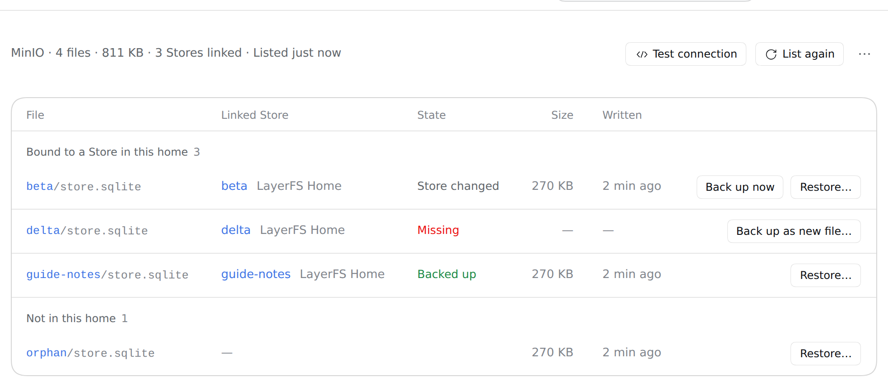
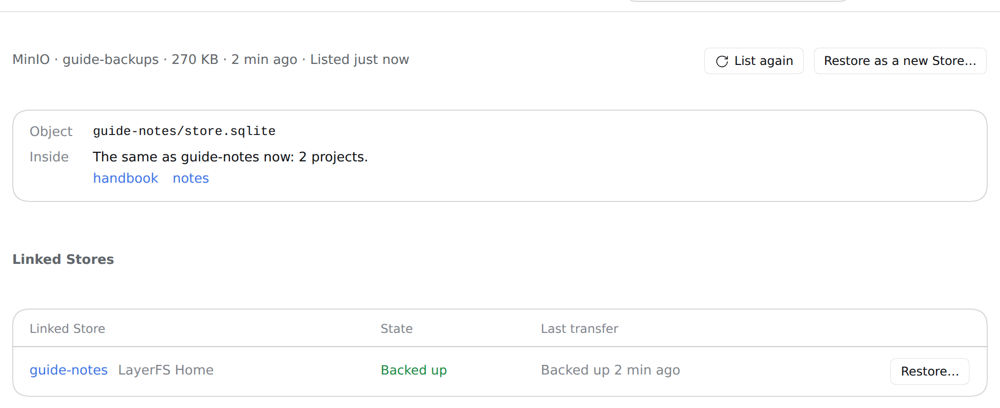
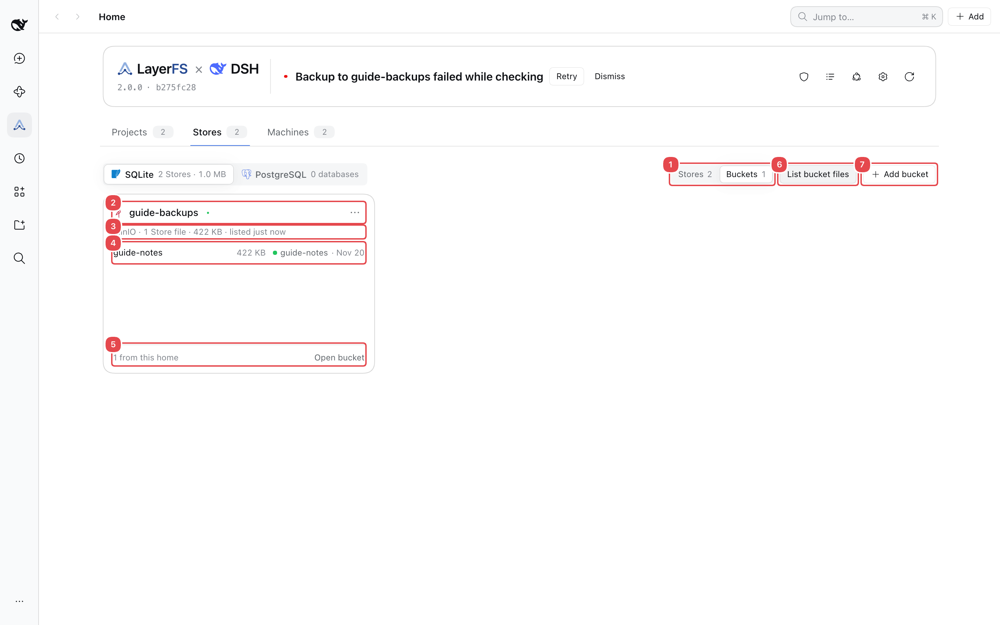
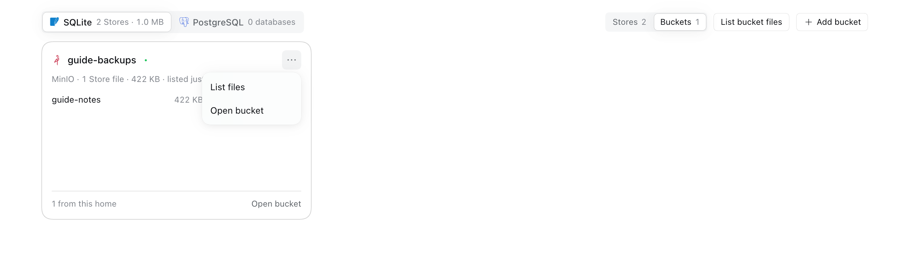

<!-- source: 6760ecf4074b -->
# 存储桶

> **位置：** `LayerFS › 主页 › 存储桶 › <bucket>`（单个备份文件是 `… › <bucket> › <file>`） · **打开方式：** 主页 › Store › SQLite › 存储桶上的存储桶卡片、跳转到、Store 的备份标签页 · **源码：** 见文末

存储桶是一个兼容 S3 的存储位置（MinIO 或 Cloudflare R2），SQLite Store 备份在这里，每个备份文件对应一个
`store.sqlite` 对象。存储桶页面列出其中的每个 Store 文件：它备份的是这个主目录里的哪个 Store、
是否是最新的，以及它需要的按钮。备份文件页面则告诉你对象在哪里、里面有什么。

| # | 组件 | 说明 |
|---|---|---|
| 1 | 导航栏 | [组件 › 导航栏](components.md#nav-bar)：`主页 › 存储桶 › guide-backups`；面包屑可以在存储桶之间切换 |
| 2 | 概况 | 提供方 · 文件数及大小 · 关联的 Store 数 · 列出时间 |
| 3 | **测试连接**（Test connection） | 运行存储桶的诊断并打开诊断页面 |
| 4 | **列出**（List）/ **重新列出**（List again） | 立即向存储桶请求文件列表 |
| 5 | ⋯ | **断开连接**（Disconnect） |
| 6 | 分组行 | **已绑定到此主目录的 Store**（Bound to a Store in this home）或 **不在此主目录中**（Not in this home），附数量 |
| 7 | 文件行 | 文件、关联的 Store、状态、大小、写入时间，以及它的按钮 |

## 布局

页面没有单独的标题（面包屑就是它的名字）：上面是一条概况和按钮栏；存储桶无法列出时有一行红色状态；
下面是一张 Store 文件表。页面打开时会列出一次存储桶（已经列出过或被拒绝过的除外）；之后只有在你按
**重新列出**（List again）、向它备份或从它恢复之后，或者 **重新连接…**（Connect again…）之后，才会再次列出。

## 主体

这里备份了哪些 Store，每份副本是不是最新的。

| 组件 | 显示内容 | 操作 → 结果 | LayerFS 调用 | 状态 |
|---|---|---|---|---|
| 概况 | **MinIO** / **Cloudflare R2** · **n 个文件 · 大小**（n files · size） · **关联 n 个 Store**（n Stores linked） · **列出于**（Listed）*多久前* | — | `home get` (读取)，以及最近一次 `backup list` | **未列出**（Not listed）、**正在列出…**（Listing…） |
| **测试连接**（Test connection） | | 按下 → 开始一次诊断运行，并打开诊断页面 | `backup doctor` | |
| **列出**（List）/ **重新列出**（List again） | | 按下 → 立即列出存储桶 | `backup list --bucket` (读取) | 列出期间显示转圈并禁用 |
| ⋯ › **断开连接**（Disconnect）（[菜单](../img/bucket-menu.png)） | | [确认](#modals-opened-here) → 存储桶以及所有 Store 与它的关联都会移除；文件保留 | `backup disconnect` ↻ | |
| 状态行 | **未列出 · 密钥被拒绝**（Not listed · key refused）、**· 未及时响应**（· no answer in time）、**· 正忙**（· busy）、**· 响应丢失**（· answer lost），或 **损坏**（Broken）；悬停可看 LayerFS 的原话 | **重新连接…**（Connect again…）（密钥被拒绝或记录中没有密钥时）→ [重新连接 *bucket*](#modals-opened-here) | `backup connect`，然后 `backup list` | 存储桶列出期间隐藏 |
| 分组行 | 先是 **已绑定到此主目录的 Store**（Bound to a Store in this home），再是 **不在此主目录中**（Not in this home） | — | — | 分组有行时才显示 |
| 文件 | `<file>/store.sqlite` | 文件名 → 它的[备份文件页面](#backup-file) | — | |
| 关联的 Store | Store 及其所在位置（**LayerFS Home**、某台机器、**PostgreSQL**） | Store 名称 → 它的 Store 页面 | — | **未关联**（Not linked）；不在此主目录中的文件显示 `—` |
| 状态 | **已备份**（Backed up）、**Store 已更改**（Store changed）、**存储桶已更改**（Bucket changed）、**双方都已更改**（Both changed）、**缺失**（Missing）、**未检查**（Not checked）、**未列出**（Not listed）；悬停可看 LayerFS 给出的原因 | — | `backup list` (读取：`behind`、`changed`、`missing`) | 列出之前是虚线标签 |
| 大小、写入时间 | 字节数，以及对象写入的时间 | 悬停 → 精确时间 | `backup list` (读取) | |
| **立即备份**（Back up now） | | 按下 → 立即开始一个覆盖该文件的备份任务；任务卡片显示在 Store 上 | `backup create <store> <bucket> --file`，然后 `backup list` | 仅用于 **Store 已更改**（Store changed）、**缺失**（Missing），或尚未列出的关联；当关联的 SQLite Store 停机、正忙、受阻或损坏时按钮置灰并附悬停原因 |
| **恢复…**（Restore…） | | 按下 → [恢复](#modals-opened-here) | `backup restore`，然后 `backup list` | **缺失**（Missing）或未列出的行没有 |
| 空 | **这里还没有 Store 文件**（No Store files here）/ **尚未列出**（Not listed yet） | — | — | |

## 备份文件

`LayerFS › 主页 › 存储桶 › <bucket> › <file>`：一个备份文件。一个文件装着一个完整的 SQLite Store；
LayerFS 只有恢复它才能读到其中的项目。

| # | 组件 | 显示内容 | 操作 → 结果 | LayerFS 调用 | 状态 |
|---|---|---|---|---|---|
| 1 | 概况 | 提供方 · 存储桶 · 大小 · 写入时间 · **列出于**（Listed）*多久前* | — | 最近一次 `backup list` | |
| 2 | **列出**（List）/ **重新列出**（List again） | | 按下 → 立即列出存储桶 | `backup list --bucket` (读取) | |
| 3 | **恢复为新 Store…**（Restore as a new Store…） | | 按下 → [恢复](#modals-opened-here)，只能恢复为新 Store | `backup restore`，然后 `backup list` | |
| 4 | **对象**（Object）· **内容**（Inside） | 对象路径；里面有什么：**与 *store* 当前一致：n 个项目。**（The same as *store* now: n projects.）、**… 在此备份后已有改动 …**（… has changed since this backup …）并列出该 Store 的项目（每个都能打开项目页面）、**另一个 Store 或 Home 重写了此文件 …**（Another Store or home rewrote this file …），或 **LayerFS 只能通过恢复来读取备份 …**（LayerFS reads a backup only by restoring it …） | 项目名称 → 它的项目页面 | — （来自 Store 的关联和存储桶的列表） | |
| 5 | 关联的 Store | 此主目录中每个关联到该文件的 Store 一行：Store 和位置、状态、**备份**（Backed up）/ **恢复**（Restored）于*多久前* 或 **此 Home 从未传输过**（Never moved by this home）、**立即备份**（Back up now）、**恢复…**（Restore…） | 与存储桶页面相同 | `backup create` / `backup restore` | **此 Home 中没有 Store 关联此文件。…**（No Store of this home links this file. …） |
| | 文件缺失 | ***bucket* 中没有文件 *file***（No file *file* in *bucket*），附 **打开存储桶**（Open bucket） | **打开存储桶**（Open bucket）→ 存储桶页面 | — | 某次列出中不再有它之后 |

## 主页 › Store 上的存储桶卡片

`LayerFS › 主页 › Store › SQLite › 存储桶`：SQLite 看板的第二个视图，每个存储桶一张卡片。
主页本身见 [home.md](home.md)；这里只介绍这些卡片。

| # | 组件 | 显示内容 | 操作 → 结果 | LayerFS 调用 | 状态 |
|---|---|---|---|---|---|
| 1 | 视图切换 | **Store**（Stores）*n* · **存储桶**（Buckets）*n* | 点击 → 切到该视图 | — （记在浏览器里） | 只在 SQLite 一侧 |
| 2 | 卡片头部 | 提供方标志、名称、一个圆点（就绪、尚未列出或无法读取）、⋯ | 名称 → 存储桶页面；⋯ → **列出文件**（List files）、**打开存储桶**（Open bucket） | 按 **列出文件**（List files）时 `backup list` (读取) | |
| 3 | 说明行 | 提供方 · **n 个 Store 文件 · 大小 · 列出于**（n Store files · size · listed）*多久前* | 悬停在失败上 → LayerFS 的原话 | 最近一次 `backup list` | **尚未列出**（not listed yet）；失败字样显示为红色 |
| 4 | 文件行 | 最多五行：文件、大小，然后是它备份的 Store（圆点、名称、日期或状态），不在此主目录中的文件则显示 **恢复…**（Restore…）；正在向该存储桶备份或从中恢复的任务排在最上面 | Store 名称 → Store 页面；**恢复…**（Restore…）→ 以新 Store [恢复](#modals-opened-here) | `backup restore` | **还没有 Store 文件**（No Store files yet）；**文件未知 · 重新连接…**（Files unknown · Connect again…）/ **重新列出**（List again）；**尚未列出 · 列出文件**（not listed yet · List files） |
| 5 | 底部 | **n 个来自此主目录**（n from this home）、**另有 n 个文件 · 打开存储桶**（+n files · Open bucket） | **打开存储桶**（Open bucket）→ 存储桶页面 | — | |
| 6 | **列出存储桶文件**（List bucket files） | | 按下 → 重新列出每个存储桶 | 每个存储桶一次 `backup list` (读取) | 列出期间禁用；有存储桶时才显示 |
| 7 | **添加存储桶**（Add bucket） | | 按下 → [添加存储桶](store.md#modals-opened-here) | `backup connect` ↻ | |
| | 提供方切换 | **全部**（All），以及每个提供方一个标签 | 点击 → 只显示该提供方的卡片 | — | 有两个及以上提供方时才显示 |
| | 空卡片 | **尚未连接 bucket。**（No bucket connected.）**连接一个 S3 兼容的存储桶来备份 SQLite Store。**（Connect an S3-compatible bucket to back up your SQLite Stores.） | **添加存储桶**（Add bucket） | `backup connect` ↻ | |

## 变体

- **MinIO 与 Cloudflare R2。**（MinIO vs Cloudflare R2.）只有标志和提供方名称不同；连接 R2 存储桶时填的是
  账户 ID 和管辖区，而不是端点。
- **是否已列出。**（Listed or not.）LayerFS 列出存储桶之前，行只来自各 Store 的关联（没有状态、没有大小）；
  列出之后才补全。
- **是否已绑定。**（Bound or not.）此主目录中没有任何 Store 关联的文件（由其他主目录写入，或断开连接之后留下的）
  归在 **不在此主目录中**（Not in this home）下，只有 **恢复…**（Restore…）。

## 在这里打开的对话框

| 对话框 | 打开方式 | 作用 | LayerFS 调用 | 撤销 |
|---|---|---|---|---|
| [断开存储桶 *bucket*？](../img/bucket-disconnect.png)（Disconnect the bucket *bucket*?） | ⋯ › **断开连接**（Disconnect） | [确认](components.md#confirm-dialog)（无需输入名称）：**所有 Store 与此存储桶的关联也会被移除。文件保留在存储桶中。**（Every Store's link to this bucket goes too. The files stay in the bucket.） | `backup disconnect` ↻ | 重新添加存储桶（关联不会恢复） |
| [恢复 *bucket*/*file*](../img/bucket-restore.png)（Restore *bucket*/*file*） | **恢复…**（Restore…）、**恢复为新 Store…**（Restore as a new Store…）、卡片上的 **恢复…**（Restore…） | 在主目录中新建一个 Store（**新 Store 的名称**（New Store's name））；从已关联的行打开时还可以 **替换** *store*（Replace），详见 [Store › 对话框](store.md#modals-opened-here) | `backup restore <bucket> <file> <store>`，然后 `backup list` | 移除新建的 Store |
| 重新连接 *bucket*（Connect *bucket* again） | **重新连接…**（Connect again…） | 添加存储桶表单，已填好名称和 URL；URL 不变时会替换密钥并保留关联（**密钥已替换；链接保留**（Key replaced; links kept）） | `backup connect`（密钥经 stdin 传入），然后 `backup list` | — |

## 状态与提示

- **Store 已更改**（Store changed，中性）：这份副本之后 Store 又有改动；**立即备份**（Back up now）会更新它。
- **存储桶已更改**（Bucket changed，中性）：有人重写了这份副本；**恢复…**（Restore…）可以把它取回来。
- **双方都已更改**（Both changed，红色）：两边都动了；恢复为新 Store，或者用新名称备份。
- **缺失**（Missing，红色）：对象没了；用新的文件名重新备份（LayerFS 不会复用原来的名称）。
- **未列出 · 密钥被拒绝**（Not listed · key refused）：保存的密钥已失效；用 **重新连接…**（Connect again…）。
- Store 页面的备份标签页对同样的状态用同样的说法。

## 下一步

- [Store](store.md)：关联的 Store，以及备份和备份列表对话框。
- [项目](project.md)：**内容**（Inside）下列出的项目。
- [主页](home.md)：主页 › Store › 存储桶。

## 源码

`src/client/storage/BucketPage.tsx`（`BucketPage`、`BackupFilePage`）、`BucketCards.tsx`、
`MachineStores.tsx`（视图切换）、`HomeOverview.tsx`（`storesAlt`）、`dialogs.tsx`
（`RestoreDialog`、`BucketDialog`、`ConfirmDialog`）、`model.ts`（`bucketFiles`、`backupChip`、
`listStatusWords`、`autoList`）、`StoragePage.tsx`；主机端：`src/host/routes/storage.ts`
（`listBucket`、`connectBucket`、`disconnectBucket`、`restore`、`backup`）。

