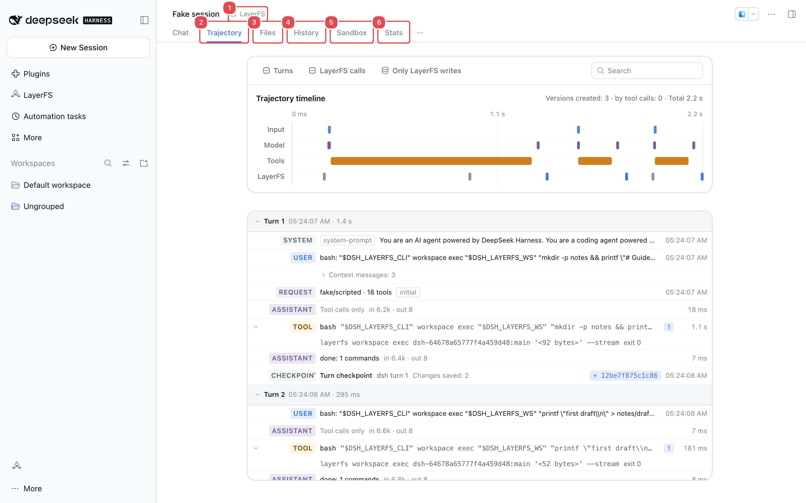
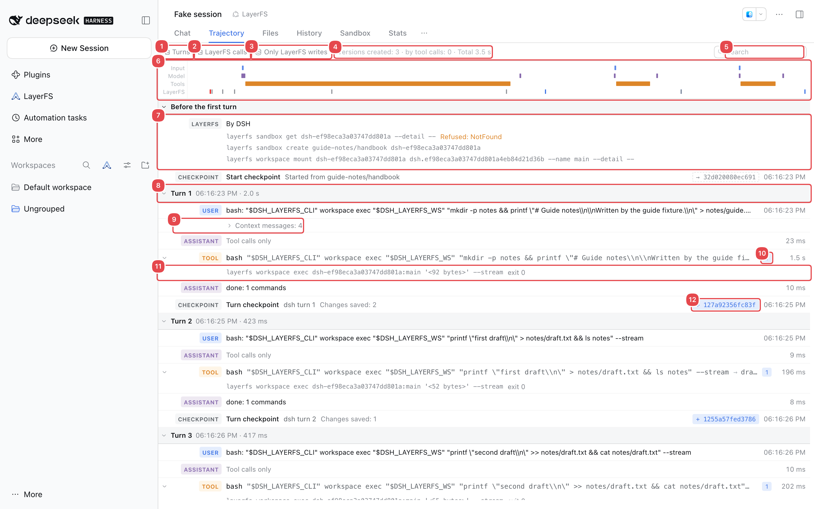
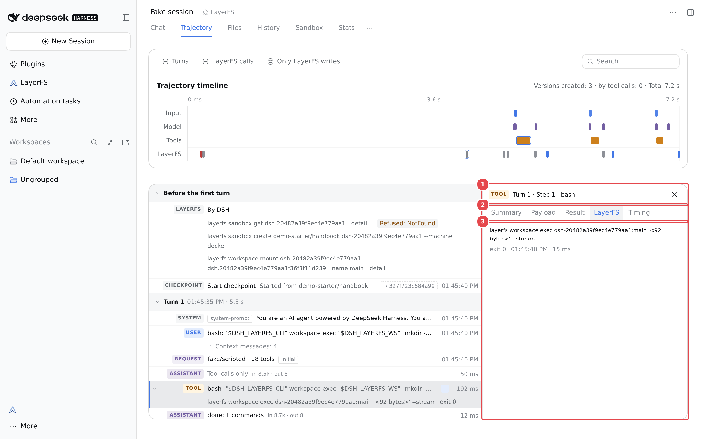
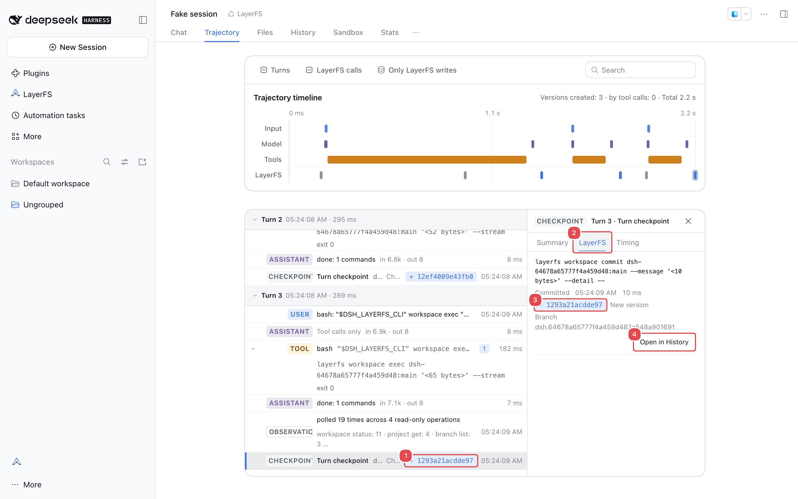
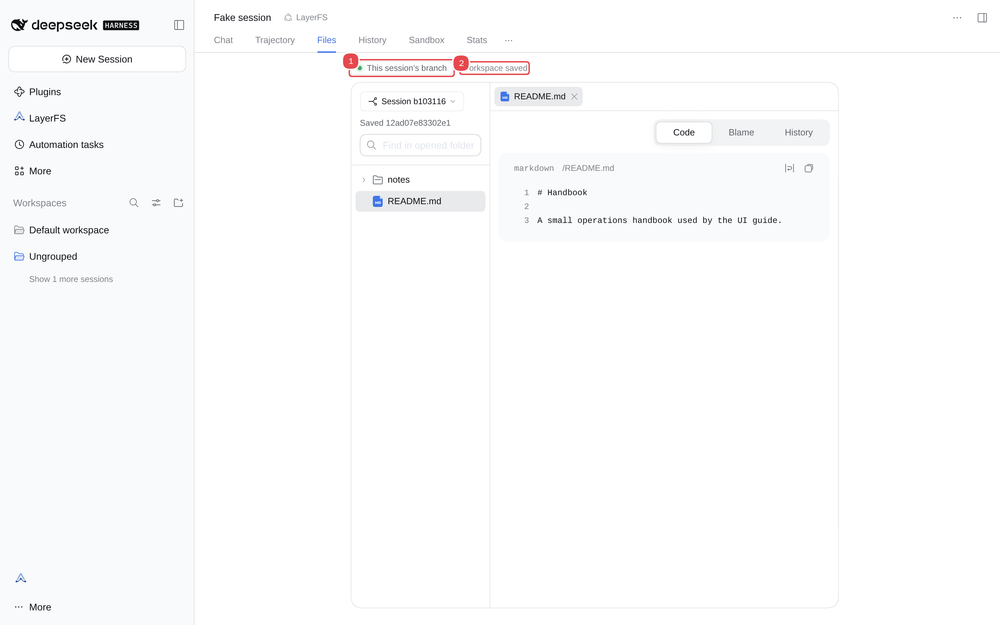
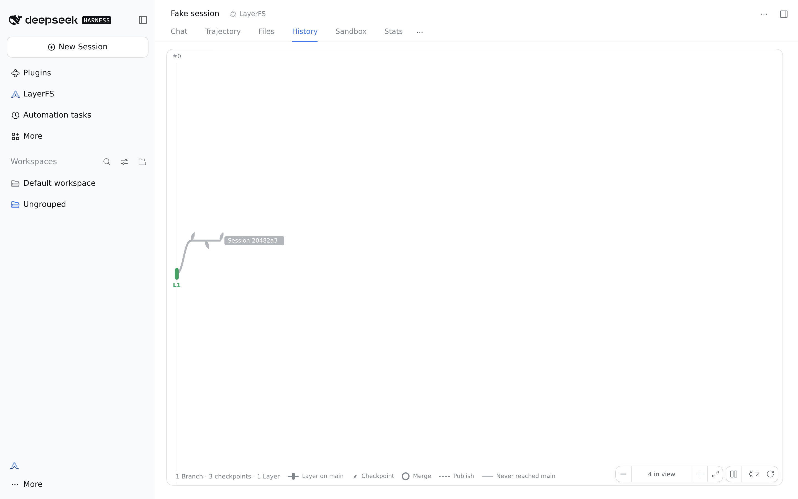
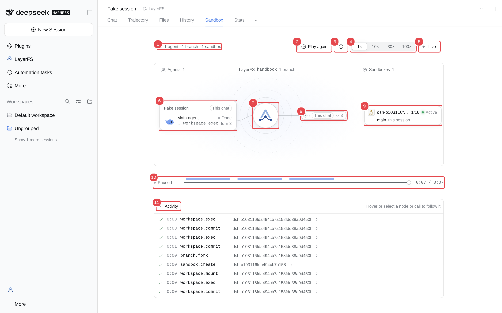
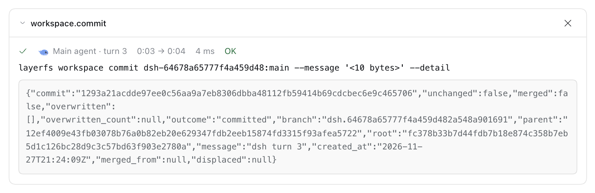
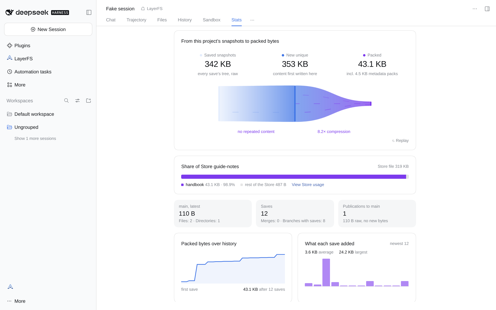
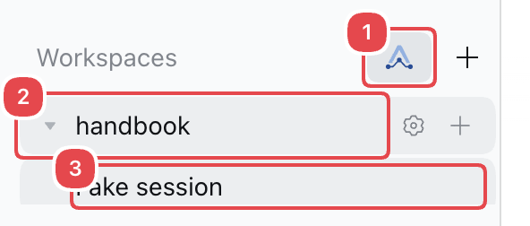

<!-- source: 72ce0c43b984 -->
# 对话

> **位置：** 项目会话的对话，例如 `handbook` 里的 **Fake session** · **打开方式：** 侧边栏的 LayerFS 项目列表（`Workspaces ›` LayerFS 视图 `› handbook › Fake session`）、主页的项目行、日志行里的会话名、调用上的 **打开会话**（Open session） · **源码：** 见文末

项目会话是一种 DSH 对话，它的文件放在一个 LayerFS 项目里。项目会话在屏幕上时，标签栏会多出
LayerFS 的几个标签：轨迹，显示每次工具调用在 LayerFS 里做了什么；会话分支上的项目文件和历史；
它所运行的 Sandbox 的实时示意图；还有项目的存储数据。想跟进或核查智能体对项目做了什么，就来这里。

| # | 组件 | 说明 |
|---|---|---|
| 1 | **LayerFS** 标签 | 会话的智能体预设（DSH 自己的标题栏标签）。提示文字：*LayerFS project sessions: everything through bash and the LayerFS CLI ($DSH_LAYERFS_CLI)…* |
| 2 | 轨迹 | 每一轮的消息和工具调用，每次调用发出的 LayerFS 调用以及它们保存的版本。取代 DSH 自带的轨迹标签 |
| 3 | 文件 | 这个会话分支上的项目文件（[文件视图](components.md#file-views)） |
| 4 | 历史 | 项目的分支和提交，打开时停在这个会话的分支上（[历史视图](components.md#history-views)） |
| 5 | Sandbox | 智能体、分支和 Sandbox 的示意图，回放每一次 LayerFS 调用 |
| 6 | 统计 | 项目的存储：从快照到打包字节、在 Store 中的占比、保存次数 |

**Chat** 仍是 DSH 自己的；标签栏末尾的 **⋯** 里是 DSH 的其他视图。

## 布局

最上面是对话标题栏（标题、**LayerFS** 预设标签，脚本会话还有 **查看脚本**（View script）），然后是标签栏，
再下面是标签内容。在项目会话的 LayerFS 标签上，消息框都会让开：轨迹、文件、历史、Sandbox 或统计显示时，
输入框是隐藏的，回到 **Chat** 时它会回来，草稿原样保留。审批和提问仍然会显示。

**标签什么时候出现。** 只有项目会话（或它的子智能体）在屏幕上时才会加上这些标签；切到 DSH 会话时
它们会被移除，DSH 会话恢复 DSH 的 Chat 和自带的轨迹。每个对话标题栏都会问主机：这个会话有没有
LayerFS 项目（`session.place`，没有 LayerFS 调用），标签稍后跟着出现，所以切换对话时轨迹标签不会闪。
分屏同时显示一个项目会话和一个 DSH 会话时，两边都有这些标签。DSH 那边的 LayerFS 标签显示
**不在 LayerFS 项目中**（Not in a LayerFS project），它的轨迹是 LayerFS 的审计视图（不显示 DSH 的
token 用量、prompt 差异和实时工具输出），而 DSH 那边的输入框一直保留。这五个标签和这条审计轨迹是
相对普通 DSH 会话的一个已知差异。关掉项目会话即可回到原生 DSH。

DSH 关闭 **显示代码工作视图**（Show coding view，即 Developer tools）设置时，轨迹标签会完全隐藏：
原生 DSH 和 LayerFS 都一样。Chat 和其余 LayerFS 标签还在，重新打开设置后轨迹就会回来。

## 轨迹

轨迹回答的是“每一步在 LayerFS 里做了什么”。它就是 DSH 的轨迹（轮次、记录、四条泳道的时间线、检查器），
再加上 LayerFS 的内容：每次工具调用下面列出它发出的 LayerFS 调用，用 CLI 的写法，附上结果和保存的版本。
这个标签读取的是对话自己的日志和其中的 LayerFS 注释，所以不发 LayerFS 调用；会话有 LayerFS 事件时
它会重新读取（最多每秒一次），会话运行期间每 3 秒读一次。

| 组件 | 显示内容 | 操作 → 结果 | LayerFS 调用 | 状态 |
|---|---|---|---|---|
| ⊟ **轮次**（Turns）（1） | 折叠所有轮次，或展开（⊞）。默认展开最后 3 轮 | 按下 → 所有轮次折叠 / 展开 | —（视图状态） | |
| ⊟ **LayerFS 调用**（LayerFS calls）（2） | 折叠每次工具调用下的 LayerFS 调用行（⊞ 展开） | 按下 → 对全部 **折叠 LayerFS 调用**（Collapse LayerFS calls）/ **展开 LayerFS 调用**（Expand LayerFS calls） | — | 只在项目会话里有 |
| **只看 LayerFS 写入**（Only LayerFS writes）（3） | 一个筛选开关 | 打开 → 只留下其 LayerFS 调用写过东西（或保存了版本）的工具调用 | — | 只在项目会话里有。一个都没有时显示 **没有符合筛选条件的记录**（Nothing matches the filter） |
| 计数（4） | **新版本：*n* · 来自工具调用：*m* · 总计 *时长***（Versions created: *n* · by tool calls: *m* · Total *duration*） | — | `session.trajectory`（没有 LayerFS 调用：读会话日志和它的注释） | 示例里所有版本都来自轮次检查点，所以 **来自工具调用：0**（by tool calls: 0） |
| **搜索**（Search）（5） | 按文字筛选记录 | 输入 → 显示匹配的记录，所在轮次自动展开，上下文消息就地显示 | — | |
| 时间线（6） | 四条泳道：**输入**（Input）、**模型**（Model）、**工具**（Tools）、**LayerFS**，横轴是对话的时间 | 点一个标记 → 选中那条记录，展开它的轮次，解除挡住它的筛选，表格滚动到它 | — | **无计时数据**（No timing data）；标记密集处显示 *标签* **（附近另有 *n* 项）**（(and *n* more nearby)） |
| **由 DSH 发起**（By DSH）（7） | 每轮一行 **LAYERFS**，列出 DSH 自己发出的调用（创建 Sandbox、挂载 Workspace、一次保存）。写入和被拒绝的调用逐条列出，读取只计数 | 点击 → 检查器列出它们 | — | **未显示的读取：*n***（Reads not shown: *n*）。这里出现拒绝是正常的（第一次创建之前的 `sandbox get … Refused: NotFound`） |
| 轮次标题（8） | **第 *n* 轮**（Turn *n*）· 开始时间 · 时长；之前的内容显示为 **第一轮之前**（Before the first turn） | 点击 → 折叠 / 展开这一轮 | — | |
| **上下文消息：*n***（Context messages: *n*）（9） | DSH 加进这一轮的消息（指令、提醒） | 点击 → 显示它们（**隐藏上下文消息**（Hide context messages）再折起来） | — | |
| 记录行 | 类型标签（**用户**（USER）、**助手**（ASSISTANT）、**工具**（TOOL）、**检查点**（CHECKPOINT）、**LAYERFS**）、文字、时间或时长。工具调用写作 `name summary → result`；只调用了工具的助手步骤写作 **仅工具调用**（Tool calls only），带 **已思考**（Thought）或 **已中断**（Interrupted）徽标 | 点击 → 在检查器里打开 | — | 工具运行时显示 **运行中…**（Running…） |
| LayerFS 调用数（10） | 这次工具调用发出的 LayerFS 调用个数，有写入时带颜色 | — | — | |
| LayerFS 调用行（11） | `layerfs workspace exec dsh-…:main '<92 bytes>' --stream` · **退出码 0**（exit 0），以及它的版本。带内容的参数只显示大小 | 行左侧的箭头 → 折叠 / 展开。点这一行 → 检查器的 LayerFS 标签 | — | 失败时显示红色的 **被拒绝：*code***（Refused: *code*）、**结果未知**（Outcome unknown）、**退出码 *n***（exit *n*） |
| 版本块（12） | `+ 127a92356fc83f`：**+** 新版本，**=** 保存但无更改，**→** 指向已有版本（虚线） | 点击 → **历史**（History）标签，停在它所在分支的那个提交 | —（打开历史，历史会读取） | 分支未知时不可用 |
| 检查点行 | **轮次检查点**（Turn checkpoint）/ **起点检查点**（Start checkpoint）/ **手动**（Manual）/ **恢复**（Restore）/ **关闭**（Close），它的消息（`dsh turn 1`），**已保存更改：*n***（Changes saved: *n*）或 **无更改**（Unchanged） | 点击 → 检查器 | — | 保存被拒绝时显示 **未保存：*code***（Not saved: *code*） |
| **显示更多行（隐藏 *n* 行）**（Show more rows (*n* hidden)） | 超过 400 行之后 | 按下 → 再显示 400 行 | — | |
| 孤立行 | **不在已加载日志中的调用**（Call outside the loaded log）和调用 id：工具调用不在已加载日志里的回执 | 点击 → 检查器 | — | |

在 Chat 里对工具调用点 DSH 的 **Inspect**，会在这个标签上打开那次调用（选中那一行，展开它的轮次，解除筛选）。
存在 LayerFS 里、但没在这里加载的会话，会显示 **对话日志未加载：只显示来自保存回执的 LayerFS 调用。**
（The conversation log is not loaded: only LayerFS calls from saved receipts are shown.）

### 检查器

| 组件 | 显示内容 | 操作 → 结果 | LayerFS 调用 | 状态 |
|---|---|---|---|---|
| 头部（1） | 类型标签，**第 *n* 轮 · 步骤 *n* · *工具***（Turn *n* · Step *n* · *tool*）；**×**（**关闭详情**（Close details）） | × → 关闭 | — | |
| 标签（2） | 工具调用：**摘要**（Summary）· **参数**（Payload）· **结果**（Result）· **LayerFS** · **计时**（Timing）。消息：**摘要**（Summary）· **计时**（Timing）。有保存的检查点：**摘要**（Summary）· **LayerFS** · **计时**（Timing） | 点击，或按 ←/→ | — | |
| 内容（3） | **摘要**（Summary）：**状态**（Status）、**调用 ID**（Call ID）、参数和结果的几行、**LayerFS 调用**（LayerFS calls，个数）、**版本**（Versions）。**参数**（Payload）：调用参数。**结果**（Result）：输出。**LayerFS**：每次调用的 CLI 写法、结果、时间、时长和版本。**计时**（Timing）：**开始**（Started）、**结束**（Ended）、**时长**（Duration） | — | 参数和结果用 `session.trajectory.record`（没有 LayerFS 调用：读会话日志） | **已截断至 64 KiB。**（Cut at 64 KiB.）、**无参数**（No arguments）、**无输出**（No output）、**此调用没有发出 LayerFS 调用。**（This call made no LayerFS calls.）、**无法读取此记录**（Could not read this record），附 **重试**（Retry） |
| **在日志中打开**（Open in Logs） | **LayerFS** 标签里被拒绝或失败的 LayerFS 调用：在 **被拒绝：*code***（Refused: *code*）或非零 **退出码 *n***（exit *n*）的结果旁边 | 按下 → [日志](logs.md)页，并筛选到这次调用 | —（打开日志，日志会读取） | 只在被拒绝或退出码非零时出现 |

检查点行（1）会在 **LayerFS** 标签（2）上打开它的保存：主机在这一轮结束时运行的 `workspace commit`、
**Committed**，以及版本（3）和它的分支。点 **在历史中打开**（Open in History）（4）或版本块，
会在历史标签里打开那个提交。

## 文件

和项目页一样的[文件视图](components.md#file-views)，打开时停在这个会话的分支上
（分支选择器显示 **会话 ef98eca**（Session ef98eca））。下面只列出不同的地方：

| 组件 | 显示内容 | 操作 → 结果 | LayerFS 调用 | 状态 |
|---|---|---|---|---|
| 分支块（1） | **本会话的分支**（This session’s branch），带一个圆点（会话的 Workspace 挂载时为绿色）；恢复过之后显示 **本会话的分支 · 第 *n* 次恢复**（This session’s branch · restore *n*）；从存档恢复并继续时显示 **本会话的分支 · 已恢复**（This session’s branch · resumed）；其他分支显示 **会话分支 *名称***（Session branch *name*） | — | `session.state` (读取)：挂载期间 `workspace status --detail`，另有 `project get`、`machine get`、`store get`，用来确认项目能运行 | |
| 未保存行（2） | **工作区已保存**（Workspace saved），或 **工作区有 *n* 项未保存**（*n* unsaved in the workspace）：Workspace 里还没被任何检查点保存的改动 | — | 同一次读取（Workspace 覆盖层的计数）；有会话事件时重新读取，可见时每 10 秒读一次 | Workspace 未挂载时隐藏 |
| 文件视图 | 分支上已保存的文件：Workspace 里未保存的改动要等下一个检查点之后才会显示 | 见[文件视图](components.md#file-views) | `file list`、`file read`、… (读取) | |

在历史里某个提交的文件列表中点一个改动过的文件，会在这里打开它在那个提交时的样子。

## 历史

和项目页一样的[历史视图](components.md#history-views)，打开时停在这个会话的分支上。不同之处：
在轨迹里点版本块，会打开这个标签并选中那个提交；在选中提交的文件列表里点一个改动过的文件，
会在 **文件**（Files）标签里打开它在那个提交时的样子。
LayerFS 调用就是历史视图的那些（`branch list`、`commit list`、`commit diff`，读取）。

## Sandbox

Sandbox 标签回答的是“谁调用了 LayerFS、在哪个分支和哪个 Sandbox 上、返回了什么”。左边是智能体，
中间是 LayerFS 枢纽和项目的分支，右边是 Sandbox 和它们的 Workspace。每次调用都沿着
智能体 → 枢纽 → 分支（→ Workspace）走一遍，落点处泛起涟漪，然后以绿色（**结果**（Result））
或红色（**被拒绝**（Refused））返回。这张图根据调用日志回放对话里的调用。

| 组件 | 显示内容 | 操作 → 结果 | LayerFS 调用 | 状态 |
|---|---|---|---|---|
| 概况（1） | ***n* 个智能体 · *n* 个分支 · *n* 个 Sandbox**（*n* agent · *n* branch · *n* sandbox） | — | — | 有分支被隐藏时显示 **播放点前 5 分钟活跃，共 *n* 个**（active in the 5 min before the playhead, of *n*） |
| **此对话**（This chat）筛选 | 只在有子智能体时出现：只保留这个对话自己的智能体 | 切换 | — | |
| **播放**（Play）/ **暂停**（Pause）/ **重新播放**（Play again）（2） | 按时间回放调用 | 按下 → 播放或暂停 | — | 没有调用时不可用 |
| 回放（3） | ↻ | 按下 → 回到开头并播放 | — | |
| 速度（4） | **1×** · **10×** · **30×** · **100×** | 选择 | — | |
| **实时**（Live）（5） | 新调用一发生就跟上 | 按下 → 跳到当前时刻并实时播放 | — | 实时状态下圆点闪动 |
| 智能体（6） | 每个智能体（一条鲸鱼，各有一种颜色），带它的状态（**空闲**（Idle）、**工作中**（Working）、**调用中**（Calling）、**完成**（Done）…）、最近一次调用和轮次；按所属对话分组，**此对话**（This chat）标出当前这个 | 悬停或点击 → 追踪它：其他节点变暗，活动里列出它的调用 | 每个智能体一次 `logs.list` (读取：`home log --tag dsh:<session>:`，每页 1000 行，更早的页在后台读) | **另有 *n* 个没有 LayerFS 调用的子智能体**（*n* more subagents without LayerFS calls） |
| LayerFS 枢纽（7） | **LayerFS**、项目和它的分支数 | 点击 → 所有调用 | — | 有调用在运行时显示忙碌圆环 |
| 分支标签（8） | 一个分支（`dsh.ef…`），会话自己的分支标为 **此对话**（This chat），以及它的保存次数 | 悬停或点击 → 追踪它 | — | 尚未创建时为虚线 |
| Sandbox 卡片（9） | 机器标记、名称、已用 Workspace 数（**1/16**）、状态（**运行中**（Active）、**已停止**（Stopped）…）、它的 Workspace；会话自己的 Workspace 显示为 ***名称* 本会话**（*name* this session） | 点击 → 追踪它。点一个智能体挂载的 Workspace → **工作区终端**（Workspace terminal）：在那里运行过什么，附输出 | 机器标记用 `GET /api/machines` (读取：`home get`、`machine list`、`machine get`、`sandbox list`、`store list`)；终端用 `session.trajectory`、`logs.output`（没有 LayerFS 调用） | **尚未创建**（Not created yet）、**未挂载**（Not mounted）、***名称* 已关闭 · 历史已保留**（*name* closed · History kept） |
| 播放条（10） | **实时**（Live）/ **播放中**（Playing）/ **已暂停**（Paused），每个智能体一条调用带、拖动条、`0:08 / 0:08` | 拖动 → 跳到那个时刻 | — | |
| **活动**（Activity）（11） | 最新的 50 次调用（方法、目标、智能体和轮次） | 点标题 → 折叠 / 展开（会记住）。点一次调用 → 它的详情（见下）。悬停 → 在图上高亮 | — | **悬停或选择节点、调用以追踪它**（Hover or select a node or call to follow it）、**正在追踪 *名称***（Following *name*）、**此对话还没有 LayerFS 调用**（No LayerFS calls from this conversation yet） |

调用详情显示智能体和轮次、回放时间里的开始 → 结束、时长、结果和 CLI 写法，然后是它的输出：
`logs.output`（没有 LayerFS 调用：DSH 为自己发起的调用保留的输出）。没有保留输出时显示
**此调用没有保留输出。**（No output was kept for this call.）；**×** 清除选择。

## 统计

项目的存储，和[项目页的统计标签](project.md#stats)是同一个面板，只是没有标题：
**从此项目的快照到打包字节**（From this project’s snapshots to packed bytes，已保存快照 → 新增唯一 → 打包，
附去重率和压缩率，以及 **重播**（Replay）），**在 Store *store* 中的占比**（Share of Store *store*，带
**查看 Store 用量**（View Store usage），会打开 Store 页），**main 最新**（main, latest），
**保存**（Saves），**发布到 main**（Publications to main），**打包字节随历史增长**（Packed bytes over history）
和 **每次保存新增**（What each save added）。会话保存检查点时它会重新读取。

| 组件 | 显示内容 | 操作 → 结果 | LayerFS 调用 | 状态 |
|---|---|---|---|---|
| 存储面板 | 见[项目 › 统计](project.md#stats) | **查看 Store 用量**（View Store usage）→ Store 页 | `GET /api/projects/:id/storage` (读取：`project get`、`project stats`、`store get`) | |

## 变体

- **DSH 会话**没有这些标签：DSH 自带的轨迹回来了，输入框也一直在。
- 项目会话的**子智能体**显示根会话的项目、分支和 Sandbox；它的轨迹是它自己的。
- **存在 LayerFS 里但没加载的会话**（按 id 打开或导入的）没有实时日志：轨迹列出来自保存回执的
  LayerFS 调用，并显示上面那条说明。
- **脚本会话**（用 `/simulation` 启动的）在脚本跑完后，标题栏会出现 **查看脚本**（View script）；
  脚本还在跑时不显示额外内容。
- **项目会话标记。** 在 DSH 的 Workspaces 列表里，项目会话那一行会被拿掉（插件把它标为项目所有，
  `session.place`，没有 LayerFS 调用）；这个会话改为列在侧边栏 LayerFS 项目视图里它所属的项目下面：

  

  1 视图切换（**显示 LayerFS 项目**（Show LayerFS projects）/ **显示 DSH 工作区**（Show DSH workspaces）），2 项目
  （**展开或收起 handbook 中的对话**（Toggle conversations in handbook）），3 会话。

## 在这里打开的对话框

| 对话框 | 打开方式 | 作用 | LayerFS 调用 | 撤销 |
|---|---|---|---|---|
| ***脚本名称***（查看脚本） | 标题栏 › **查看脚本**（View script）（脚本会话，脚本结束后） | 显示 **此会话模型使用的指令。**（The instructions used by this session’s model.）、**内容哈希**（Content hash）和脚本源文件，每次按下都会重新读取。**关闭**（Close） | `simulation.script`（没有 LayerFS 调用：这次运行保存的脚本）；脚本运行期间 `simulation.status` 每 4 秒轮询一次 | 无需撤销：只读 |

示例里没有脚本会话，所以这个对话框没有截图。源文件读不出来时，按钮旁边会用红字显示
**脚本源文件不可用。仍可阅读此会话。**（The script source is unavailable. The conversation can still be read.）

## 状态与提示

- **不在 LayerFS 项目中**（Not in a LayerFS project）· *此对话在本地文件夹中工作…*：这个标签显示在一个
  DSH 会话上（分屏时）。不用处理。
- **无法读取此会话的项目**（Could not read this session’s project），附 **重试**（Retry）：`session.state` 失败了
  （主机或 LayerFS 没有应答）。
- **工作区有 *n* 项未保存**（*n* unsaved in the workspace，琥珀色）：智能体改了文件，下一个检查点会保存它们；
  文件和历史里暂时还看不到。
- LayerFS 调用行上的 **被拒绝：*code***（Refused: *code*）：LayerFS 拒绝了这次调用；这一行的箭头和检查器的
  LayerFS 标签会显示调用内容。检查器里的 **在日志中打开**（Open in Logs）会打开[日志](logs.md)页并筛选到这次调用；
  退出码非零（**退出码 *n***（exit *n*））的失败调用也有同样的按钮。
- 检查点上的 **未保存：*code***（Not saved: *code*）：保存被拒绝；文件还留在 Workspace 里。

## 下一步

- [日志](logs.md)：这个会话发出的每一次调用，标有轮次和检查点（点日志行里的会话名会打开这个对话）。
- [项目](project.md)：对话之外的同一份文件、历史和存储。
- [Sandbox](sandbox.md)：会话所用 `dsh-…` Sandbox 的 Sandbox 页。
- [组件](components.md)：[文件视图](components.md#file-views)、
  [历史视图](components.md#history-views)。

## 源码

`src/client/views/`：`index.tsx`（标签何时显示、隐藏输入框）、`TrajectoryView.tsx`、
`TrajectoryInspector.tsx`、`TrajectoryParts.tsx`、`TrajectoryTimeline.tsx`、
`trajectory-model.ts`、`stock-trajectory.ts`、`FileViews.tsx`（文件、历史、会话分支那一行）、
`SandboxView.tsx`、`WorkspaceTerminal.tsx`、`model.ts`、`StatsView.tsx`、`hooks.ts`、
`locale.ts`。`src/client/simulation/index.tsx`（查看脚本），`src/client/session/index.tsx`
（行标记）。主机：`src/host/sessions/index.ts`（`session.place`、`session.state`、
`session.trajectory`、`session.trajectory.record`、`session.annotations`），
`src/host/sessions/service.ts`（`view`），`src/host/logs/index.ts`（`logs.list`、
`logs.output`），`src/host/simulations/index.ts`（`simulation.script`、`simulation.status`）。
