<!-- source: 62e435ba292f -->
# 主页

> 标有「隔离测试数据」的截图来自当前版本的实际组件，使用独立浏览器和示例数据。其余截图来自早期演示环境。

> **位置：** `LayerFS › 主页` · **打开方式：** 侧边栏的 **LayerFS** 行、任意 Center 页面的第一个面包屑、跳转到的“页面”分组 · **源码：** 见文末

主页是 Center 的第一页：这个 LayerFS 主目录里的一切，一眼看全。来这里看看有什么需要你处理，
找一个项目、Store 或机器，或者新建一个。

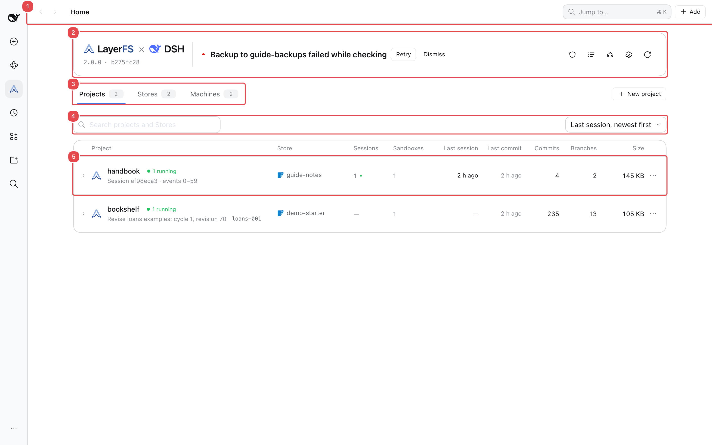

*隔离测试数据。*

| # | 组件 | 说明 |
|---|---|---|
| 1 | 导航栏 | [组件 › 导航栏](components.md#nav-bar)：后退、前进、面包屑（这里只有 **主页**，Home）、**跳转到…**（Jump to…）、**添加**（Add） |
| 2 | 概览头部 | [组件 › 概览头部](components.md#overview-head)：标题、固定使用的运行时、需要你关注的事项，以及预设和刷新按钮 |
| 3 | 标签页 | **项目**（Projects）*n* · **Store**（Stores）*n* · **机器**（Machines）*n*，每个都带计数；里面的计数需要你处理时会变琥珀色或红色 |
| 4 | 搜索和排序 | 筛选项目列表，并决定它的顺序 |
| 5 | 项目行 | 一个项目：它的 Store、会话、Sandbox、最近会话和最近提交、大小。手机上它是卡片，不是表格行 |

## 布局

[导航栏](components.md#nav-bar)横在每个 Center 页面的最上方。导航栏下面，
[概览头部](components.md#overview-head)告诉你有没有需要处理的事，然后是三个标签页：
项目、Store 和机器。每个标签页的操作（**新建项目**，New project；**新建 Store**，New Store；
**连接数据库**，Connect a database；**新建机器**，New machine；**诊断这台主机**，Diagnose this host）
放在标签栏的右端。主页在两次访问之间什么都不记，只记住 Store 标签页选中的种类和视图，以及哪些行是展开的。

手机上，概览头部的状态行会单独占一条：文字按需要换行，操作按钮挪到下一行，不压住上面的标题和按钮。
标签条可以左右滑动，选中的标签会被完整滚进视野。

主页打开时会读取存储视图（`GET /api/storage`：`home get`、`project list`、`store list`、
每个 PostgreSQL Store 的 `store get`）和项目目录（`GET /api/projects`：`project list`）；页面可见时每 15 秒再读一次，
数据变更后也会重新读取。500 毫秒内的存储和项目通知会合并处理。项目有变更时，项目目录和存储视图都会刷新。操作失败时，
概览头部下方会出现一条红色提示条，带 **关闭**（Dismiss）。

## 概览头部与提示

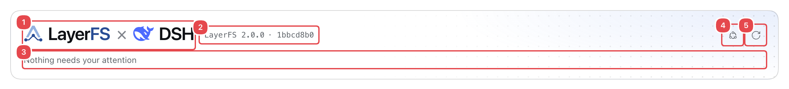

*隔离测试数据。*

概览头部是一个共用组件；完整的表格见
[组件 › 概览头部](components.md#overview-head)，它列出的提示见
[组件 › 待处理提示](components.md#needs-you-notices)。

| 组件 | 显示内容 | 操作 → 结果 | LayerFS 调用 | 状态 |
|---|---|---|---|---|
| 1 概览 | 页面的标题 | — | —（静态） | — |
| 2 运行时 | `LayerFS 2.0.0 · 12345678`，固定使用的构建和它的提交号 | 按下 → 打开[设置 LayerFS](entry-points.md#set-up-layerfs) | `--version --json` (读取，运行时发现) | **LayerFS 不可用**（LayerFS unavailable）、**正在读取 LayerFS…**（Reading LayerFS…） |
| 3 状态行 | 最紧急的那件事和它的修复，或者 **没有需要处理的事项**（Nothing needs your attention） | 每件事各自的按钮（见[待处理提示](components.md#needs-you-notices)） | 按钮自己的调用 | 事项前有圆点（故障红、警告琥珀）；按 **还有 {n} 个**（+{n} more）可展开或收起其余待处理事项及其操作按钮 |
| 4 试用预设 | 智能体预设图标 | 按下 → 预设对话框（[预设](presets.md)） | —（打开对话框） | — |
| 5 刷新 | 一个环形箭头；它的提示写着上次检查的时间 | 按下 → 重新读取 Store、项目和机器，并重新运行主目录检查 | `home get`、`project list`、`store list`、`project list` (读取)，然后 `home doctor` | 检查运行期间显示进行中圆点 |

手机上，标题下方的宿主状态行会单独占一条：状态词换行，它的唯一操作按钮按拇指大小挪到下一行，
不会压在上面那一行上。

Docker 无法运行时，标题旁会出现 **Docker 无法运行**（Docker unavailable）胶囊；按它可以查看原因和它
点名的 docker 机器。诊断发现的问题只计在导航栏的诊断按钮上，从未备份过的 Store 也不算待处理事项。

## 导航栏

当前主页导航栏，标号 1–3 分别是诊断、日志和设置。

手机上导航栏只有一行：后退和前进、当前的面包屑、只剩图标的跳转到、**+ 添加**，以及一个 **⋯ 更多**
（More）菜单——诊断、日志、设置、正在进行的传输都收在里面，有刷新的页面还会多一项刷新。面包屑列表可以左右滑动，
你所在的页面永远不会是被截掉的那一级。

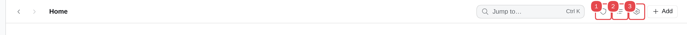

*隔离测试数据。*

以下早期多 Store 示例显示面包屑切换器。

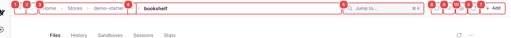

这里展示的是 `主页 › Store › demo-starter › bookshelf` 上的导航栏，各部分都齐全。完整
表格见：[组件 › 导航栏](components.md#nav-bar)。

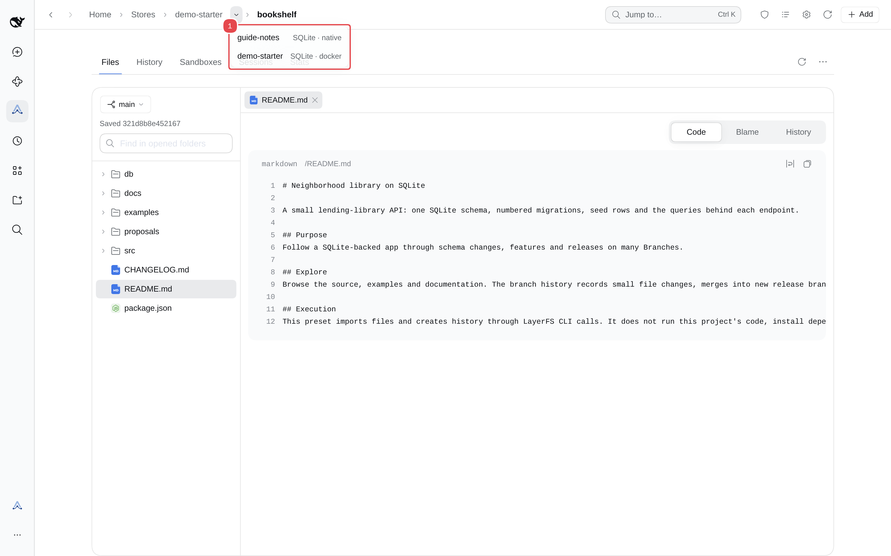
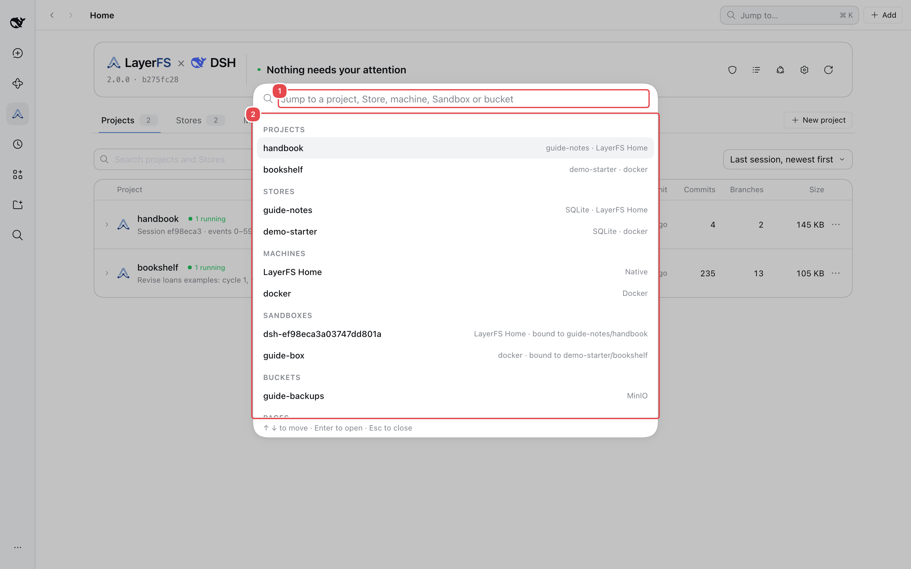

*隔离测试数据。*

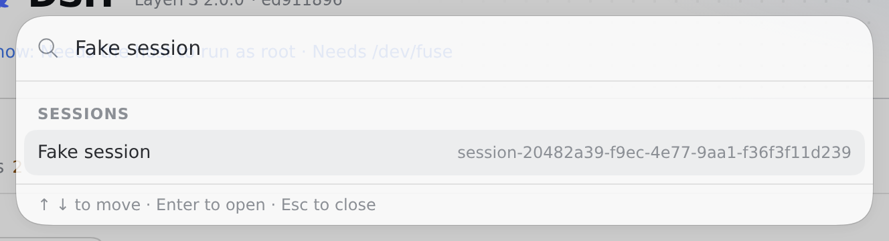

*隔离测试数据。*
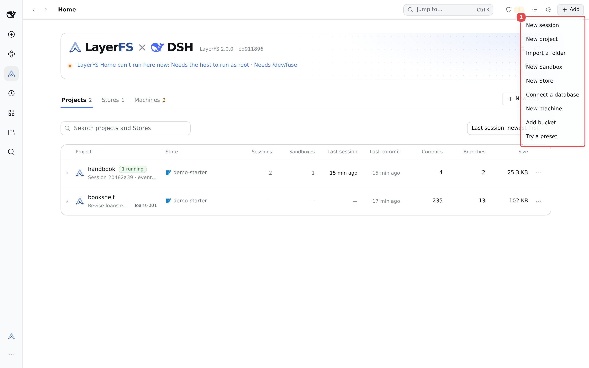

*隔离测试数据。*

| 组件 | 显示内容 | 操作 → 结果 | LayerFS 调用 | 状态 |
|---|---|---|---|---|
| 1 后退 · 2 前进 | 箭头 | 按下 → 上一个或下一个 Center 页面（最多保留 50 个） | —（本地历史） | 到头时不可用 |
| 3 面包屑 | `主页 › Store › demo-starter › bookshelf` | 按一个面包屑 → 去那一页 | —（页面跳转） | 最后一个面包屑就是你所在的页面；手机上每个面包屑都是 44 px 的点击目标，当前这一级保留完整宽度，上级面包屑滚到一边，列表始终滚到它 |
| 4 面包屑切换 | 上级面包屑后面的一个箭头，或当前面包屑上的一个小三角，在它有同级项时出现 | 按下 → 列出它的同级项（每个 Store、该 Store 里的每个项目……）→ 打开其中一个 | —（来自已经读到的存储视图） | 只有同级项多于一个时才出现 |
| — 传输 | **{n} 个传输**（{n} transfers），带与 Store 页及卡片一致的单调百分比与进度条，在迁移、备份或恢复进行时出现 | 按下 → 那个 Store 的页面（只有一个时），或一个列出它们的菜单（有多个时） | —（已读到的存储视图里的任务） | 没有任务运行时隐藏 |
| 5 跳转到… | 一个带 **⌘K** 的搜索框；手机上是一个 44 px 的图标 | 按下或按 **⌘K** → 跳转到对话框：输入文字，**↑ ↓** 移动，**Enter** 打开，**Esc** 关闭 | —（在主页已读到的内容中搜索） | **没有与“{q}”匹配的项**（Nothing matches “{q}”）；有其他对话框打开时不可用 |
| 6 刷新 | 一个环形箭头，除主页外每个页面都有 | 按下 → 页面重新读取 | 页面自己的读取 | 读取时显示一个圆点 |
| 7 添加 | **+ 添加**（+ Add） | 按下 → **新建会话**（New session）、**新建项目**（New project）、**导入文件夹**（Import a folder）、**新建 Sandbox**（New Sandbox）、**新建 Store**（New Store）、**连接数据库**（Connect a database）、**新建机器**（New machine）、**添加存储桶**（Add bucket）、**试用预设**（Try a preset） | 各项对应的对话框（见[在此打开的对话框](#modals-opened-here)） | **新建机器**和**新建 Sandbox** 不可用时仍会显示，并说明原因 |
| 诊断 | 盾牌图标，主目录检查有发现时显示数量；手机上在 **更多** 里 | 按下 → `LayerFS › 诊断`（[诊断](health.md)） | `GET /api/doctor/results`（读取主机内存） | 有错误时计数为红色，有警告时为橙色 |
| 日志 | 列表图标；手机上在 **更多** 里 | 按下 → `LayerFS › 日志`（[日志](logs.md)） | —（导航） | — |
| 设置 | 齿轮图标；手机上在 **更多** 里 | 按下 → [设置 LayerFS](entry-points.md#set-up-layerfs) | `home get`（通过 `setup.status` 读取） | — |
| 更多 | **⋯ 更多**（More），手机上唯一的工具菜单 | 按下 → **诊断** 及其计数、**日志**、**设置**、**刷新**，以及正在进行的传输 | 各项自己的调用 | 只在手机上有；诊断有发现时显示圆点，有错误为红色 |

## 项目

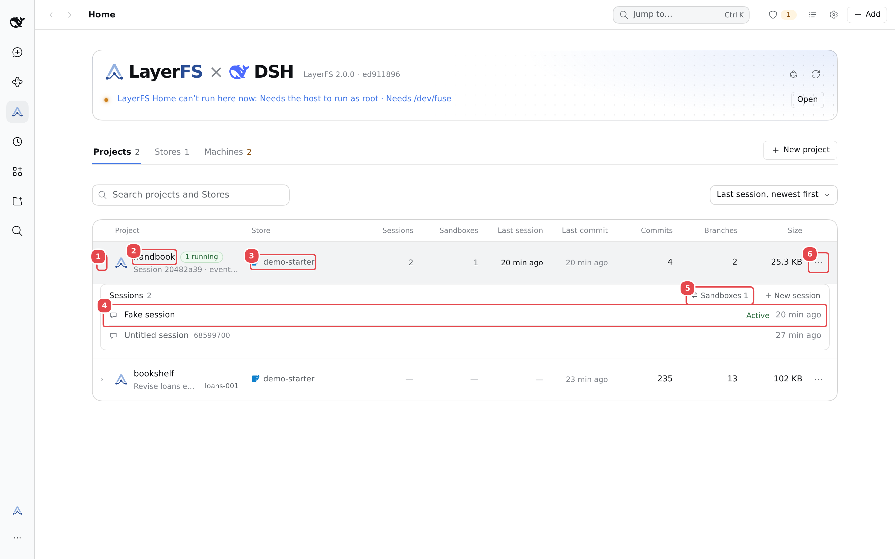

这个主目录里每个 Store 中的每个项目。回答的是“它在哪儿、谁在用、有多大、
最近什么时候改过”。

手机上列表是卡片，不是表格。每张卡片带项目名和绿色的运行中标签、**最近会话**（Last session）
及其时间、最新提交那一行，以及 ⋯；Store、会话数、Sandbox 数、提交数、分支数和大小这些数字都离开卡片。
箭头仍然打开项目的会话或 Sandbox 列表，列表里的切换和操作都还在。

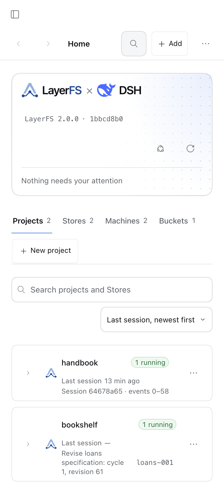

*隔离的示例数据。*

| 组件 | 显示内容 | 操作 → 结果 | LayerFS 调用 | 状态 |
|---|---|---|---|---|
| 搜索 | **搜索项目和 Store**（Search projects and Stores） | 输入 → 只留下项目名或 Store 名匹配的行；**/** 聚焦，**Esc** 清空；标签页计数显示为 **{n} / {total}**（{n} of {total}） | —（筛选已读到的行） | **没有匹配“{query}”的项目**（No project matches “{query}”），带 **清除搜索**（Clear search） |
| 排序 | **最近会话，从新到旧**（Last session, newest first） | 可选 **默认顺序**（Default order）、**大小，从大到小**（Size, largest first）或 **名称，A 到 Z**（Name, A to Z） | —（本地排序） | — |
| 1 行展开 | 一个箭头；手机上就是卡片自己的箭头 | 按下 → 这一行展开，显示它的会话（或 Sandbox） | 会话：`sessions.list`（只在本地，不调用 LayerFS）；Sandbox：`sandbox list` (读取，在 `GET /api/machines` 中) | 展开的行保持展开 |
| 2 项目名 | **handbook**、绿色的 **{n} 个运行中**（{n} running）标签，以及最新提交那一行（`Session ef98eca3 · events 0–59`，或者一条提交说明和分支） | 按下 → [项目](project.md)页 | `project list` (读取)；提交那一行用 `branch get`、`project stats` (读取，`GET /api/stores/:id/projects`) | — |
| 3 Store | Store 的图标和名称 | 按下 → [Store](store.md) 页 | —（页面跳转） | 手机卡片上没有 |
| 会话 · Sandbox | 只有计数（绿色的 **{n} 个运行中**（{n} running）标签在项目名旁边）；会话数只在有活动会话时才有悬停提示，Sandbox 数的悬停提示列出每个 Sandbox 的名称和位置（有运行中的还会注明运行数量） | 按一个计数 → 这一行展开到那个列表 | 同行展开 | 没有时显示 `—`；手机卡片上没有（用箭头打开列表） |
| 最近会话 · 最近提交 | 相对时间 | — | `branch get` (读取) | 没有时显示 `—`。手机上 **最近会话** 及其时间单独占名称下面一行，再下面是提交行 |
| 提交 · 分支 · 大小 | 数字 | — | `project stats` (读取)；大小用 `GET /api/projects/:key/size`：`project get`、`project stats`、`store get` (读取) | —；手机卡片上没有 |
| 4 会话行 | **Fake session**、它的状态词——**活动中**（Active）、**已中断**（Interrupted）或 **在 Store 中**（In Store），空闲的会话不显示状态词——以及时间 | 按下 → 在 DSH 中打开这个对话 | `sessions.open`：日志在本地时不调用；否则 `branch list`、`project export`（从 Store 导入） | — |
| | 列表头部的 **+ 新会话**（+ New session） | 按下 → 新建一个项目对话（见[入口 › 在项目中新建会话](entry-points.md#new-session-in-a-project)） | `sessions.choose`：`project get`（第一次还有 `branch list`、`branch fork`） | — |
| 5 列表切换 | **Sandbox {n}**（Sandboxes {n}） / **会话 {n}**（Sessions {n}） | 按下 → 切到另一个列表 | 同行展开 | — |
| | 一条 Sandbox 行，**运行中**（Running） / **已停止**（Stopped） | 按下 → [Sandbox](sandbox.md) 页 | —（页面跳转） | — |
| 6 ⋯ | **{name} 的操作**（{name} actions） | 按下 → **打开**（Open）、**新会话**（New session）、**删除项目…**（Delete project…） | 见下表 | — |

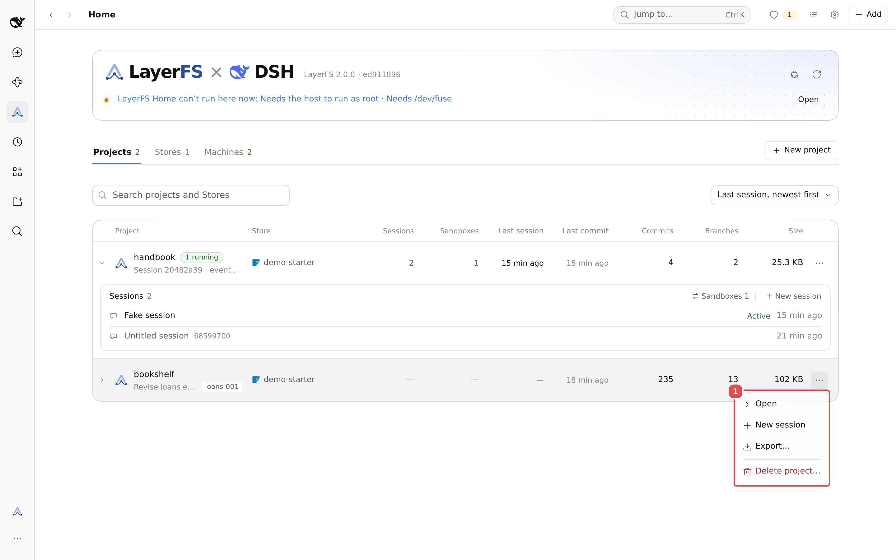

| 菜单项 | 结果 | LayerFS 调用 |
|---|---|---|
| **打开**（Open） | 项目页 | — |
| **新会话**（New session） | 一个新的项目对话 | `sessions.choose`：`project get` |
| **删除项目…**（Delete project…） | [确认对话框](components.md#confirm-dialog) **删除 {name}？**（Delete {name}?）：“项目及其全部历史都会从它的 Store 中删除，且无法撤销。”输入项目名后 **删除**（Delete）才可用。 | `project delete` |

没有项目时：**还没有项目**（No projects yet）——“项目是保存在 LayerFS Store 中的一个文件夹。”，带
**新建项目**（New project）和 **试用预设**（Try a preset）。

## Store

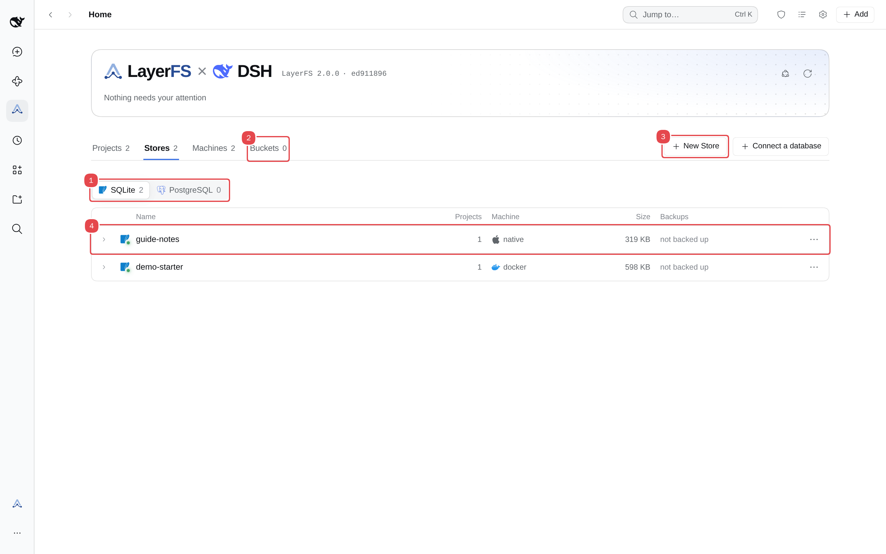

这个主目录里的 Store，按种类分开。回答的是“每个 Store 放在哪儿、里面有什么、
有没有备份”。

| 组件 | 显示内容 | 操作 → 结果 | LayerFS 调用 | 状态 |
|---|---|---|---|---|
| 1 种类 | 两个磁贴：**SQLite** *{n}* 和 **PostgreSQL** *{n}* | 按下 → 该种类的行；会被记住 | —（本地视图状态） | — |
| 2 存储桶 | **存储桶 {n}**（Buckets {n}），主目录自己的标签页，和 Store、机器并列 | 按下 → 存储桶卡片 | —（页面跳转） | 每种类型下都显示 |
| 3 新建 Store | **新建 Store**（New Store，SQLite），或 **全部检查**（Check all）和 **连接数据库**（Connect a database，PostgreSQL），在标签栏右端 | 按下 → 新建 Store / 连接数据库对话框；**全部检查** 会检查每个 PostgreSQL Store 并展开检查失败的行 | `store create` / `store connect` / `store doctor` | — |
| 4 Store 行 | 折叠时：名称、所在机器、大小、项目数、上次备份、状态圆点。展开后：**项目**（5 个，之后为 **另有 n 个项目 →**）、**位于** 附 **迁移…**、**备份** 附 **备份** / **恢复…** | 按下该行 → 展开（按查看者记住）；名称 → Store 页面；⋯ 里是 [Store 菜单](components.md#store-menu) | `GET /api/storage` (读取)；项目 `GET /api/stores/:id/projects` (读取，展开时)；**迁移…** 用 `store move` | 迁移或备份进行时显示任务行；**机器已停止** 附 **启动** |

没有 Store 时：**还没有 SQLite Store。**（No SQLite Store yet.） / **还没有连接 PostgreSQL 数据库。**（No PostgreSQL database connected yet.）整个主页既没有 Store 也没有存储桶时，标签页显示 **还没有 Store**（No Stores yet）——“在 Home 中新建 Store、从备份恢复，或连接 PostgreSQL 数据库。”——并给出 **新建 Store**（New Store）和 **连接数据库**（Connect a database）。

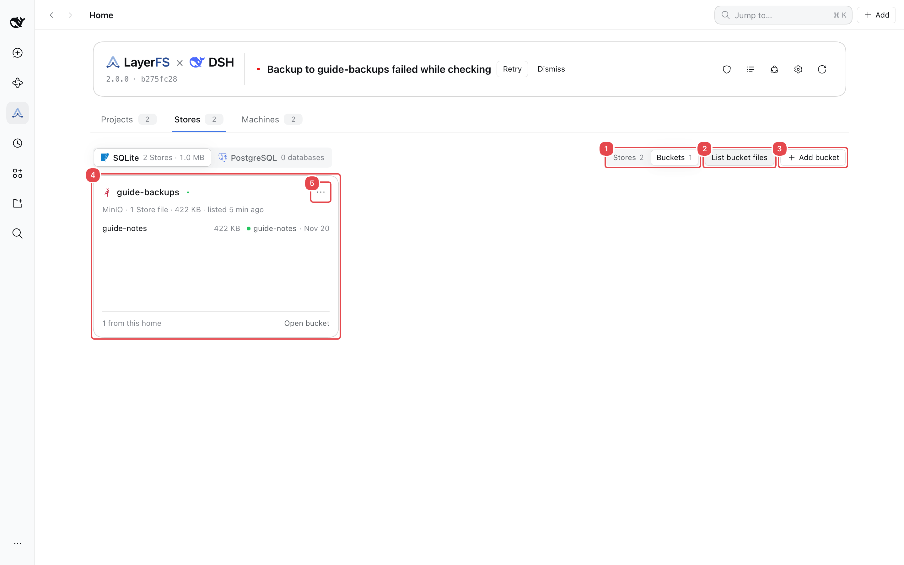

| 组件 | 显示内容 | 操作 → 结果 | LayerFS 调用 | 状态 |
|---|---|---|---|---|
| 1 存储桶 | 主目录的 **存储桶**（Buckets）标签页，已选中 | — | — | — |
| 2 列出存储桶文件 | **列出存储桶文件**（List bucket files），在标签栏右端 | 按下 → 重新列出每个存储桶 | `backup list`（每个存储桶一次），然后读取存储视图 | 列出时显示一个圆点 |
| 3 添加存储桶 | **添加存储桶**（Add bucket），就在旁边 | 按下 → 添加存储桶对话框（[存储桶](bucket.md)） | `backup connect`（密钥通过 stdin 传入） | — |
| 4 存储桶卡片 | 提供方、名称、`MinIO · 1 个 Store 文件 · 385 KB · 列出于 {ago}`、其中的文件及其 Store 和日期、**{n} 个来自此主目录** | 按名称或 **打开存储桶**（Open bucket） → [存储桶](bucket.md)页；按文件名 → [备份文件](bucket.md#backup-file)页；对不属于这个主目录的文件按 **恢复…**（Restore…） → 恢复对话框 | `backup list` (读取)；**恢复…** 用 `backup restore` | **文件未知**（Files unknown），带 **重新连接…**（Connect again…） / **重新列出**（List again）；**未列出**（Not listed），带 **列出文件**（List files）；列出期间显示 **正在列出…**（Listing…） |
| 5 ⋯ | **{bucket} 的更多操作**（More actions for {bucket}） | **列出文件**（List files）/ **重新列出**（List again）、**打开存储桶**（Open bucket） | `backup list` | 列出期间禁用 |

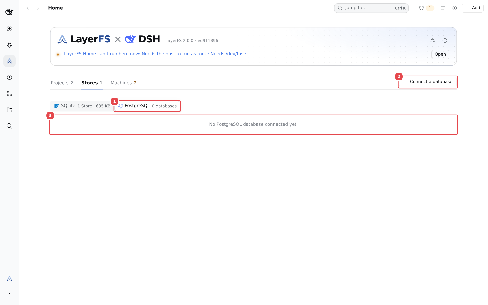

| 组件 | 显示内容 | 操作 → 结果 | LayerFS 调用 | 状态 |
|---|---|---|---|---|
| 1 PostgreSQL | 被选中的磁贴 | — | — | — |
| 2 连接数据库 | 该种类的添加按钮，在标签栏右端，**全部检查** 旁边 | 按下 → 连接数据库 | `store connect`（密码经标准输入） | — |
| 3 行 | 每个数据库一行。折叠时：**从这台电脑检查** 的圆点、名称、`user@host:port/database` 与 **复制**、项目数、机器（一台时显示名称与状态圆点，多台时显示 **+n** 与 **n 台机器**，没有时显示 **没有机器** 与 **挂接…**），以及一个词：**n 台未通过**、**n 台已停止** 或 **本地地址**。展开后：**项目**、**运行于**（每台机器的状态及其操作、**×**、**+ 挂接机器**） | 按下该行 → 展开；名称 → Store 页面 | `GET /api/storage` (读取：每个 Store 的 `store get`)；项目 `GET /api/stores/:id/projects` (读取)；**×** 用 `store detach`；**+ 挂接机器** 用 `store attach` | **还没有连接 PostgreSQL 数据库。**（示例数据里没有）；挂接后尚未检查的机器显示 **未检查** |

## 机器

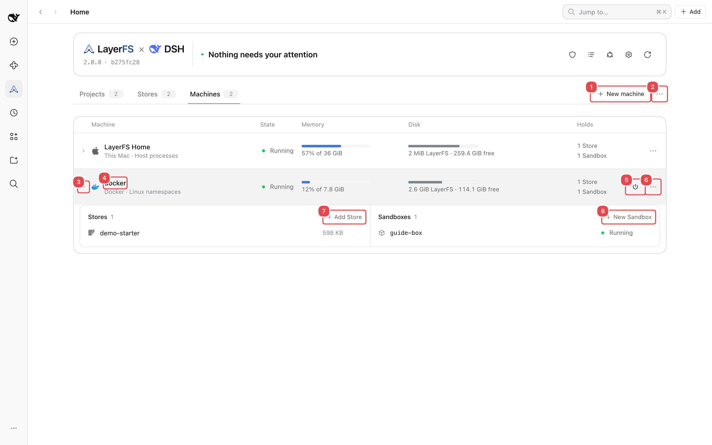

这个主目录的所有机器，放在一张表里。回答的是“它在运行吗、用了多少、上面
有什么”。

| 组件 | 显示内容 | 操作 → 结果 | LayerFS 调用 | 状态 |
|---|---|---|---|---|
| 1 新建机器 | **+ 新建机器**（+ New machine），在标签栏右端 | 按下 → 新建机器对话框（[机器](machine.md)） | `home get`、`machine create` | 按钮一直在；没有能创建机器的平台时它不可用，原因在悬停提示里 |
| 2 诊断这台主机 | 旁边的 **</>** 按钮（Diagnose this host） | 按下 → 运行主目录检查，并在[诊断](health.md)页打开结果 | `home doctor` | — |
| 3 行展开 | 一个箭头 | 按下 → 它上面有什么；会被记住 | — | 需要你处理、正在启动或只有这一台机器时默认展开 |
| 4 名称 | **docker**、`Docker · Linux namespaces`（native 为 `原生 · 主机进程`） | 按下 → [机器](machine.md)页 | `home get`、`machine get`、`machine list`、`sandbox list`、`store list` (读取) | — |
| 状态 | 一个标签：**运行中**（Running）、**已停止**（Stopped）、**启动中**（Starting）…… | — | 同上 | **受阻**（Blocked）的行会说明原因，并给出修复 |
| 内存 · 磁盘 | 进度条 | — | 内存：`GET /api/metrics` (读取，主机内存)；磁盘：`machine stats` (读取) | 停止时显示 `—` |
| 包含 | **1 个 Store**（1 Store）、**1 个 Sandbox**（1 Sandbox） | — | 同上 | — |
| 5 电源 | **停止**（Stop） / **启动**（Start）（This Mac 上没有） | **启动** → 机器启动。**停止** 需要再按一次：按钮会在几秒内变成 **确认：停止**（Confirm: Stop；docker 上是 **确认：停止 worker**，Confirm: Stop worker） | `machine stop` / `machine start` | 状态切换期间不可用 |
| 6 ⋯ | **{name} 的更多操作**（More for {name}） | [组件 › 机器菜单](components.md#machine-menu) | 见该处 | — |
| 7 添加 Store | **添加 Store**（Add Store） | 按下 → 将 SQLite Store 移动到这台机器的对话框（含大小、目标剩余磁盘、**当前被占用** 与 **启动** *m* 检查；在 native 上附 **或者直接在此新建：新建 Store**） | `store move`（一个任务） | — |
| 8 新建 Sandbox | **新建 Sandbox**（New Sandbox） | 按下 → 新建 Sandbox 对话框（[Sandbox](sandbox.md)） | `sandbox create` | — |

## 变体

- **SQLite 与 PostgreSQL。** Store 标签页的种类磁贴在两者之间切换。存储桶在主目录里有自己的标签页（备份就是一份 SQLite Store 文件的拷贝）。PostgreSQL 行列出挂接到它的机器。
- **还没设置。** LayerFS 设置好之前，主页显示[设置卡片](entry-points.md#set-up-card)，
  而不是这些标签页。
- **还没有存储视图。** 加载时显示 **正在读取 Store…**（Reading the Stores…）；读取失败时显示 **无法读取存储**（Could not read the storage），
  带 **重试**（Retry）。
- **导航栏里的刷新按钮** 在除主页外的每个 Center 页面上都有；在主页上，概览头部的刷新按钮做同样的事，还会重新运行检查。

## 在此打开的对话框

| 对话框 | 打开方式 | 作用 | LayerFS 调用 | 撤销 |
|---|---|---|---|---|
| 新建项目 | **新建项目**（New project，标签页、添加菜单、空状态） | [入口 › 项目对话框](entry-points.md#project-dialog) | `store create`、`project init`、`store move` | 删除这个项目 |
| 新建会话 | 添加 › **新建会话**（New session） | 为对话选择项目 | —（打开选择器） | 取消 |
| 导入文件夹 | 添加 › **导入文件夹**（Import a folder） | 打开项目对话框并带入源文件夹 | 确认后调用 `project init` | 创建前可取消 |
| 新建 Sandbox | 添加 › **新建 Sandbox**（New Sandbox） | 选择符合条件的机器，再配置 Sandbox | 确认后调用 `sandbox create` | 创建前可取消 |
| 新建 Store | **新建 Store**（New Store）、添加 › **新建 Store** | 在一台机器上新建一个 SQLite Store | `store create` | Store 上的 **移除…**（Remove…） |
| 连接数据库 | **连接数据库**（Connect a database） | 用地址、用户和密码连接一个 PostgreSQL 数据库，并从这台电脑检查 | `store connect` | **断开连接…** |
| 新建机器 | **新建机器**（New machine） | 创建一台 Docker、Lima 或 Apple Container 机器 | `machine create` | 机器菜单里的 **移除**（Remove） |
| 添加存储桶 | **添加存储桶**（Add bucket） | 连接一个用于备份的 S3 存储桶 | `backup connect` | 存储桶上的 **断开连接**（Disconnect） |
| 预设 | **试用预设**（Try a preset）、添加 › **试用预设** | [预设](presets.md) | 预设自己的脚本 | — |
| 设置 LayerFS | 运行时、**设置**（Settings） | [入口 › 设置 LayerFS](entry-points.md#set-up-layerfs) | `home get` | — |
| 跳转到 | **跳转到…**（Jump to…）、**⌘K** | 打开项目、Store、机器、Sandbox、存储桶、Center 页面或可用的 DSH 会话 | — | Esc |
| 删除 {name}？ | 项目 ⋯ › **删除项目…**（Delete project…） | [确认对话框](components.md#confirm-dialog) | `project delete` | 无 |

## 状态与信号

- **标签页计数。** 标签页的计数颜色取它里面最糟的那一项：任务失败或 Store 损坏为红色，
  存放着 Store 的机器已停止为琥珀色。标签页本身没有圆点。
- 没有圆点的 **没有需要处理的事项**（Nothing needs your attention）表示没有任务失败，也没有机器或
  Store 损坏；圆点只出现在待处理事项旁（故障红、警告琥珀）。诊断发现的问题只计在诊断按钮上，
  从没备份过的 Store 也不算待处理事项。
- **电源按钮不可用** 表示刚按过、正在切换状态；等它的状态变化就好。
- 项目上的 **{n} 个运行中**（{n} running）是此刻为它运行的 Sandbox 数。

## 接下来

[项目](project.md) · [Store](store.md) · [存储桶](bucket.md) · [机器](machine.md) ·
[Sandbox](sandbox.md) · [诊断](health.md) · [日志](logs.md) · [预设](presets.md) ·
[入口](entry-points.md)

## 源码

`src/client/storage/StoragePage.tsx`（Center、路由、跳转项、添加菜单、轮询） ·
`src/client/storage/Nav.tsx` · `src/client/storage/HomeOverview.tsx`、`HomeHero.tsx`（概览
头部、待处理事项） · `src/client/storage/ProjectTable.tsx`、`ProjectFinder.tsx` ·
`src/client/storage/MachineStores.tsx`、`BucketCards.tsx` · `src/client/machines/Board.tsx` ·
`src/client/doctor/use-doctor-count.ts` · 截图：`tools/guide/shots/home.mjs`
