<!-- source: 7a023f137cb2 -->
# 机器

> **位置：** `LayerFS › 主页 › 机器 › <machine>` · **打开方式：** 主页 › 机器 中的机器名、导航栏的面包屑切换器、跳转到（**机器**（Machines）分组）、Store 的位置链接、Sandbox 的 **机器**（Machine）一项 · **源码：** 见文末

机器是 Sandbox 运行、SQLite Store 存放的地方：**LayerFS Home**（这台电脑，即 `native` 机器）、内置的 **docker** 机器（运行在 Docker 容器里的 LayerFS worker），或者你创建的虚拟机（Lima、Apple Container）。机器页回答“它在运行吗，满了多少，上面有什么”，所有机器操作也都在这里：启动、停止、重启 worker、强制停止、设置和移除。

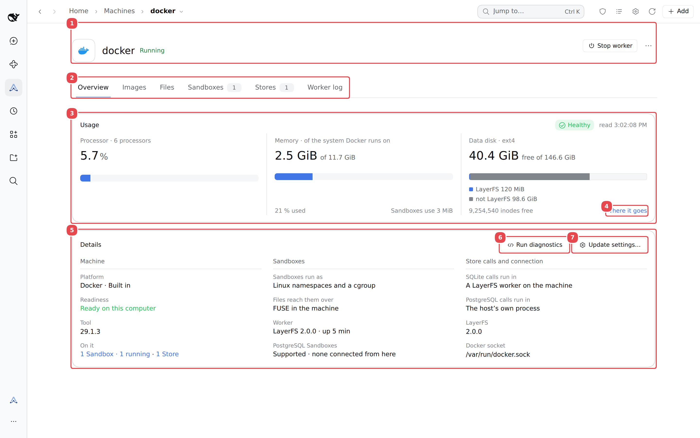

| # | 组件 | 说明 |
|---|---|---|
| 1 | 头部 | 机器的图标、名称（`native` 显示为 **LayerFS Home**）、状态标签、类型行（**Docker · Linux 命名空间**（Docker · Linux namespaces）），以及它的电源按钮和 ⋯ 菜单。在每个标签页上方，每种机器的布局都一样 |
| 2 | 标签栏 | **概览**（Overview）· **镜像**（Images）· **文件**（Files）· **Sandbox** *n* · **Store** *n* · **Worker 日志**（Worker log）。镜像、文件和 Worker 日志只在提供时出现（见[变体](#variants)） |
| 3 | 用量卡片 | 当前的处理器、内存和数据盘，附 **运行良好**（Healthy）和读取时间 |
| 4 | **空间去向**（Where it goes） | 打开[磁盘空间对话框](#disk-space-dialog) |
| 5 | 详情卡片 | 机器的信息，分三组：机器、Sandbox、Store 调用与连接 |
| 6 | **运行诊断**（Run diagnostics） | 在诊断页上运行这台机器的检查 |
| 7 | **更新设置…**（Update settings…） | 仅 docker：[设置对话框](#settings-dialog) |

头部上方是[导航栏](components.md#nav-bar)：`主页 › 机器 › docker`，最后一段面包屑可以切换到另一台机器。

## 布局

头部在最前面，然后是标签栏。头部在每个标签页上都在，所以你翻看这台机器的 Sandbox、Store、镜像或日志时，它的状态、电源按钮和 ⋯ 菜单始终在手边。关于这台机器的提示（正在启动、平台没就绪、操作被拒绝、为什么停机）在每个标签页的标签栏下方都会显示。页面会按机器记住标签页；别处的链接（Sandbox 卡片的 **终端**（Terminals）、**打开 Worker 日志**（Open worker log））可以切换它。

### 提示（所有标签页）

| 组件 | 显示内容 | 操作 → 结果 | LayerFS 调用 | 状态 |
|---|---|---|---|---|
| 启动进度 | **正在启动 worker**（Starting worker）/ **正在启动机器**（Starting machine）/ **正在创建机器**（Creating machine）、当前阶段、已用时间，以及完成的 **n 步**（n steps，可展开） | **n 步** → 已完成的阶段及其耗时 | —（正在运行的 `machine start` / `machine create` 发出的 `machine-progress` 事件） | **启动完成**（Startup completed）、**启动需要处理**（Startup needs attention，附 LayerFS 的拒绝信息和 **打开 Worker 日志**（Open worker log））、**结果需要检查**（Outcome needs inspection） |
| 此处未就绪 | **docker 现在无法在此运行：*原因***（docker can’t run here now: *reason*），只有引擎没开时还有 **启动会先打开 Docker，等待其引擎就绪后再启动 worker。**（Start opens Docker and waits for its Engine before starting the worker.） | 修复步骤及可 **复制**（Copy）的命令、**在设置中修复**（Fix in setup，缺少 Linux 套件时）、**选择另一个套接字…**（Choose another socket…，docker 的套接字没有响应时）、**重新检查**（Check again） | **重新检查**：`home get`、`machine list`、`machine get`、`sandbox list`、`store list`(读取，平台信息重新读取) | 电源按钮变成 **启动 Docker 和 worker**（Start Docker and worker），或被隐藏 |
| 停机提示 | 状态文字（悬停显示 LayerFS 的消息），不在概览标签页时还有修复按钮 | 修复 → 同电源按钮 | 同电源按钮 | 记录无法读取时显示 **LayerFS 无法读取此机器的记录。运行诊断以查看问题所在。**（LayerFS can’t read this machine’s record. Run diagnostics to see what is wrong.） |
| 使用中 | LayerFS 拒绝停止后，显示 **请先关闭它的 Sandbox**（Close its Sandbox first）/ **请先关闭它的 *n* 个 Sandbox**（Close its *n* Sandboxes first）及它们的名称 | **打开 Sandbox**（Open Sandboxes）→ Sandbox 标签页 | — | 这些 Sandbox 没了以后消失 |
| 拒绝 | LayerFS 对上一次操作给出的代码和说明 | — | — | |
| **打开 Worker 日志**（Open worker log） | 出现在启动失败、或停机且页面没有可运行修复的机器下方 | → Worker 日志标签页 | — | 仅当有 Worker 日志标签页时 |

## 概览

这台机器现在用了多少，以及它是什么。

| 组件 | 显示内容 | 操作 → 结果 | LayerFS 调用 | 状态 |
|---|---|---|---|---|
| 头部 | 图标、名称、状态标签、类型 · 运行方式（在标签栏上方） | — | `home get`、`machine list`、`machine get --with live`、`sandbox list`、`store list`(读取：机器视图，页面显示期间轮询) | **运行中**（Running）、**已停止**（Stopped）、**正在启动…**（Starting…）、**正在启动 worker…**（Starting worker…）、**正在停止… *n* 秒**（Stopping… *n*s）、**需要修复**（Needs repair）、**Docker 未运行**（Docker not running）、**不可用**（Unavailable） |
| 电源按钮 | 见要点表 (1) | **停止 worker**（Stop worker）/ **停止**（Stop）→ 停止它 | `machine stop` | 另一个电源操作运行时不可用；按钮刚变化时立即按下不起作用 |
| | | **启动 worker**（Start worker）/ **启动**（Start）→ 启动它，并显示启动进度 | `machine start` | |
| | | **启动 Docker 和 worker**（Start Docker and worker）→ 打开 Docker Desktop，等待其引擎就绪，然后启动 | `machine start`（主机先启动 Docker Desktop） | macOS 上 docker 的引擎未运行时 |
| | | **重启 worker**（Restart worker，worker 版本过旧时的修复） | `machine get`，然后 `machine stop`，再 `machine start` | 上面有 Sandbox 时被拒绝（InUse）：不可用，并提示 **复制修复命令以强制停止**（copy the fix to stop it anyway） |
| | | **检查**（Check，状态未知或未确定时）→ 重新读取机器 | `machine list`、`machine get`(读取) | |
| ⋯ | [机器菜单](components.md#machine-menu) | | | |
| 待处理提示 | 磁盘快满了（附 **空间去向**（Where it goes））、**n 个已消失的 Sandbox 在关闭前仍占用这台机器磁盘上的 *大小*。**（n gone Sandboxes still hold *size* on this machine's disk until they are closed.）、**1 个 Sandbox 需要你处理。**（1 Sandbox needs you.） | **查看 Sandbox**（Show Sandboxes）→ Sandbox 标签页；**空间去向**（Where it goes）→ 磁盘空间对话框 | —（来自下面的读取） | 只在有事需要你处理时显示 |
| 用量卡片 | **处理器**（Processor）· *n* **个处理器**（processors，占用百分比）、**内存**（Memory）· *谁的*（已用/总量、**% used**、**Sandbox 占用** *大小*（Sandboxes use *size*））、**数据盘**（Data disk）· *文件系统*（可用 **，共** 总量（free **free of** total）、一根分成 **LayerFS** 和 **非 LayerFS**（not LayerFS）两段的条、**可用 inode**（inodes free）） | **空间去向**（Where it goes）→ 磁盘空间对话框 | —（主机的指标采样器：每 15 秒对每台机器读一次 `machine stats`；页面向采样器的内存要数据），磁盘分段用 `machine stats --with space`(读取，缓存 1 分钟) | 没有需要处理的事时显示 **运行良好**（Healthy）；LayerFS 没读到的值显示 **未读取**（Not read）及原因；处理器一开始显示 **需要第二个样本**（Needs a second sample）；macOS 上没有处理器一栏（LayerFS 读不到） |
| 信息行 | 没有 `machine stats` 时：**可用磁盘**（Free disk）、创建记录时的 **CPU 与内存**（CPU and memory，**已分配**（allocated））、工具版本和 worker | — | 机器视图(读取) | 仅较旧的 CLI |
| 详情卡片 · 机器 | **平台**（Platform，**Docker · 内置**（Docker · Built in））、**就绪情况**（Readiness，**在这台电脑上就绪**（Ready on this computer）、缺少的组件、**其虚拟机已不在这台电脑上**（Its VM is gone from this computer））、**工具**（Tool，Docker 的版本）、**上面有**（On it，**1 个 Sandbox · 1 个运行中 · 1 个 Store**（1 Sandbox · 1 running · 1 Store））、**不可用原因**（Down because）、**操作**（Operation）、**修复**（Fix，一行可复制的命令） | **上面有** 里的链接 → Sandbox 或 Store 标签页 | 机器视图(读取) | |
| 详情卡片 · Sandbox | **Sandbox 运行方式**（Sandboxes run as）、**文件访问方式**（Files reach them over，FUSE、loopback NFS）、**Worker**（**LayerFS 2.0.0 · up 20 min**）、**PostgreSQL Sandbox**（PostgreSQL Sandboxes） | — | 机器视图；worker 一行来自采样器 | |
| 详情卡片 · Store 调用与连接 | **SQLite 调用运行于**（SQLite calls run in）、**PostgreSQL 调用运行于**（PostgreSQL calls run in）、**LayerFS** 版本、**Docker 套接字**（Docker socket，docker）或 WSL 发行版 | — | 机器视图(读取) | |
| **运行诊断**（Run diagnostics） | | 按下 → 诊断页运行这台机器的检查 | `machine doctor`（在诊断页上） | 启动期间不可用 |
| **更新设置…**（Update settings…） | 仅 docker | 按下 → [设置对话框](#settings-dialog) | — | |
| 危险操作 | 仅限创建的虚拟机：**移除 *名称*…**（Remove *name*…） | 按下 → [移除对话框](#remove-dialog) | — | 上面还有 Store 或 Sandbox、或记录无法读取时不可用，并说明原因 |

### 磁盘空间对话框

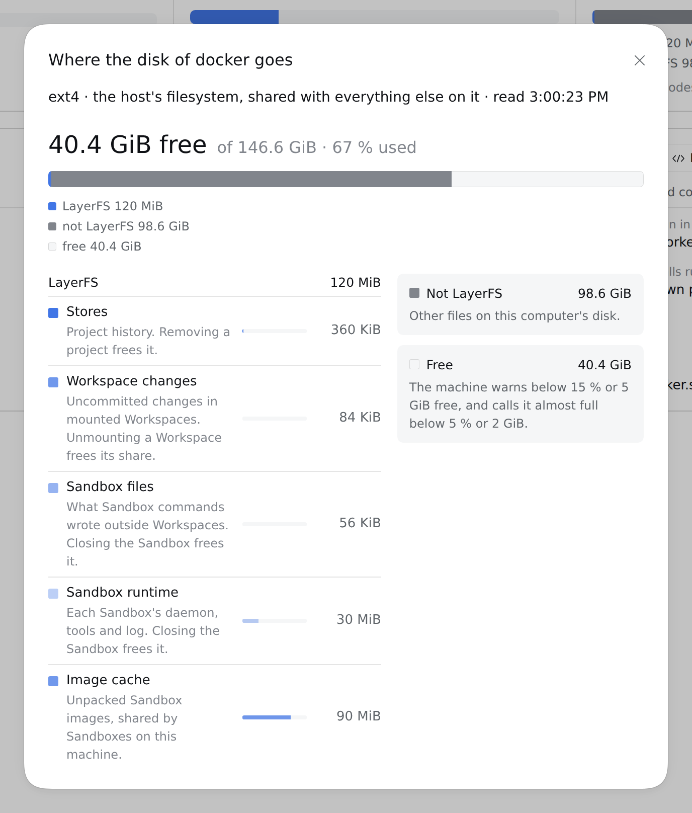

**docker 的磁盘空间去向**（Where the disk of *machine* goes）：可用空间与总量，一根按部分分段的条；LayerFS 的各部分（**Store**（Stores）、**Workspace 改动**（Workspace changes）、**Sandbox 文件**（Sandbox files）、**Sandbox 运行时**（Sandbox runtime）、**镜像缓存**（Image cache）、**日志和记录**（Logs and records）），每一项都写明怎样释放；**非 LayerFS**（Not LayerFS）及查看它的命令（`docker system df`，附 **复制**（Copy））；**剩余**（Free）及何时开始提醒（**可用空间低于 15% 或 5 GiB 时提醒，低于 5% 或 2 GiB 时提示即将写满。**（The machine warns below 15 % or 5 GiB free, and calls it almost full below 5 % or 2 GiB.））；然后是 **最大的 Store**（Largest Stores）和 **最大的 Sandbox**（Largest Sandboxes），链接到对应的标签页（已消失的 Sandbox 的文件夹会被标出）。这里不会删除任何东西。

| 组件 | 操作 → 结果 | LayerFS 调用 |
|---|---|---|
| 对话框 | 打开 → 读取磁盘空间去向；打开期间每分钟再读一次 | `machine stats --with space`(读取，主机缓存结果 1 分钟) |
| **刷新**（Refresh） | 立即读取，不等主机的一分钟缓存 | `machine stats --with space`(读取，`?fresh=1`) |
| **Store 标签页**（Stores tab）/ **Sandbox 标签页**（Sandboxes tab） | 关闭对话框并切到那个标签页 | — |
| 一行 Sandbox | 打开那个 Sandbox 的页面 | — |

已停止的机器不会被询问（**未读取：机器未运行。**（Not read: the machine is not running.））；读取被拒绝时会保留上一次的结果，并显示其时间和 LayerFS 的代码。

## Sandbox

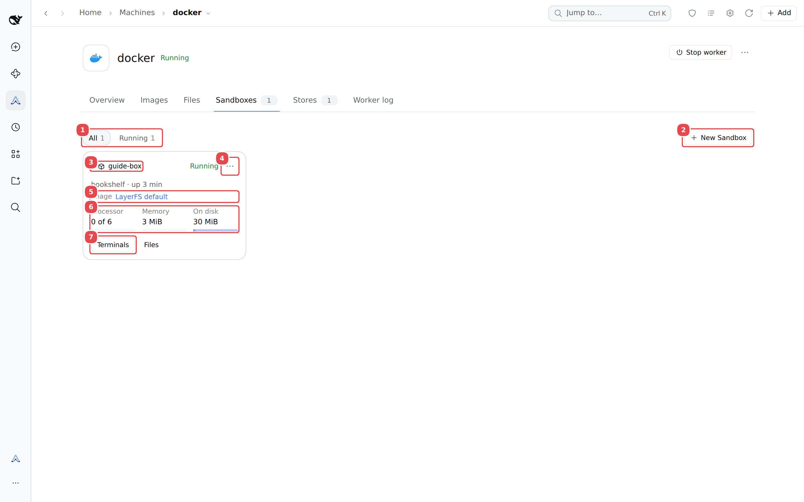

机器上的每个 Sandbox 都是一张卡片，显示它现在用了多少处理器、内存和磁盘。

| # | 组件 | 显示内容 | 操作 → 结果 | LayerFS 调用 | 状态 |
|---|---|---|---|---|---|
| 1 | 筛选标签 | **全部**（All）*n*、**运行中**（Running）*n*、**需要处理**（Needs you）*n*、**已关闭**（Closed）*n*（采样器一小时内关闭的） | 点击 → 只显示这些 | —（视图状态） | 数量为 0 的标签会隐藏，**全部** 除外 |
| | **排序**（Order） | **默认顺序**（As listed）、**名称**（Name）、**磁盘占用最多**（Most disk）、**内存最多**（Most memory） | 选择 → 重新排序；需要你处理的始终排在前面 | — | 有两张或更多卡片时显示 |
| 2 | **新建 Sandbox**（New Sandbox） | | 按下 → [新建 Sandbox 对话框](#new-sandbox-dialog) | — | 不可用时提示 **请等待机器启动或停止完成**（Wait until the machine finishes starting or stopping） |
| 3–7 | Sandbox 卡片 | [组件 › Sandbox 卡片](components.md#sandbox-card)：名称、状态、⋯、项目和运行时长、**镜像**（Image）、处理器 / 内存 / 磁盘占用、**终端**（Terminals）和 **文件**（Files） | | `sandbox list`(读取)、采样器、`machine stats --with space` | |
| | 创建中的行 | 正在创建的 Sandbox：用文字说明当前阶段，复制镜像时显示进度条 | 失败时：**重试**（Retry）、**释放空间**（Free space，空间不足时）、LayerFS 的修复，或关闭 | **重试**：`sandbox create`；关闭：—（仅主机） | |
| | 空状态 | 机器上 **没有 Sandbox**（No Sandboxes），或 **没有符合此筛选的 Sandbox。**（No Sandbox here matches this filter.） | | | |

### 新建 Sandbox 对话框

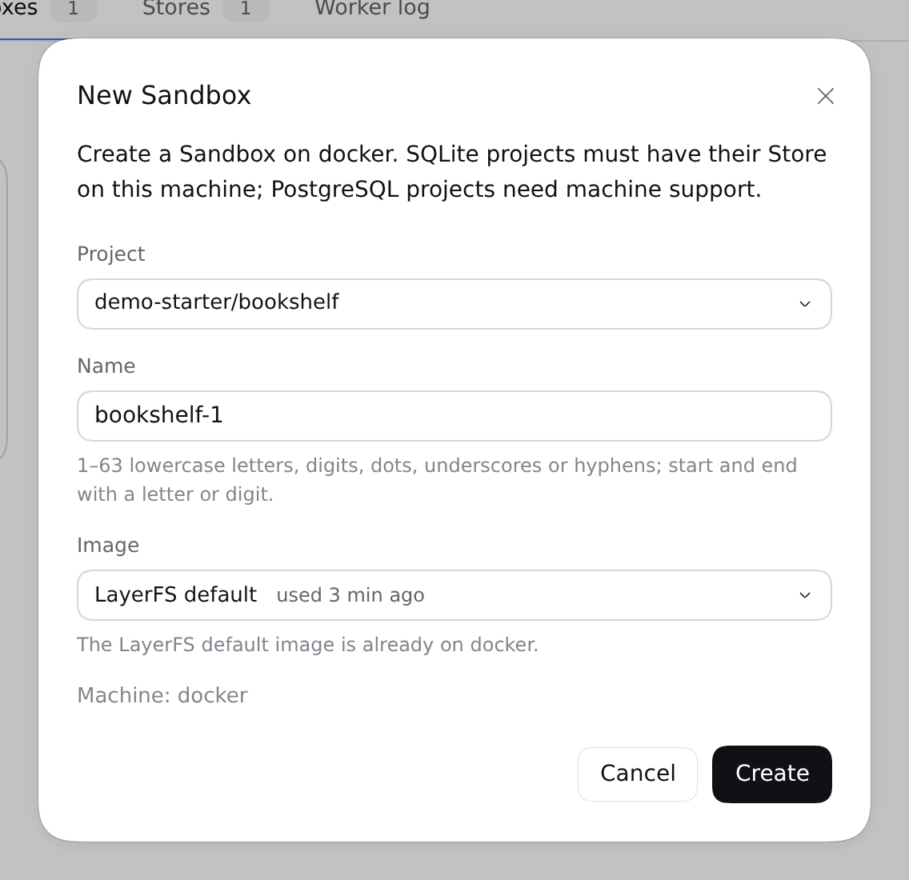

**在 *机器* 上创建 Sandbox。**（Create a Sandbox on *machine*.）只列出能在这里运行的项目：Store 在这台机器上的 SQLite 项目，以及机器支持时的 PostgreSQL 项目。

| 组件 | 操作 → 结果 | LayerFS 调用 | 状态 |
|---|---|---|---|
| **项目**（Project） | 选择 → 建议一个可用的名称（*项目*-1） | `project list`(读取) | **没有符合条件的项目……**（No eligible projects…），附 **打开存储**（Open Storage） |
| **名称**（Name） | 1–63 个小写字母、数字、点、下划线或连字符 | — | 已占用的名称会被拒绝 |
| **镜像**（Image） | Sandbox 在这里可以直接启动的镜像，以及 LayerFS 能从这台电脑的 Docker 复制的镜像（**来自本机 Docker**（From Docker on this Mac））；灰色的行会说明原因 | `machine get`、`machine images --with docker`、`sandbox list`(读取) | 在 macOS 的 LayerFS Home（主机进程，`backend: native`）上改为显示 **此 Mac 上的 Sandbox 使用它自己的系统。**（Sandboxes on this Mac use its own system.）；Linux 上的 LayerFS Home 使用镜像 |
| **创建**（Create）/ **启动并创建**（Start and create）/ **释放空间**（Free space） | 在后台创建：对话框关闭，卡片区显示一行创建中 | `sandbox create`（**启动并创建** 会先 `machine start`） | 所选 Docker 镜像放不下时显示 **释放空间**：在对话框上方打开[释放空间](#free-space-dialog) |
| **读取 Sandbox**（Read Sandbox） | 创建结果不确定时：先读取这个 Sandbox，再决定是否创建另一个 | `sandbox get`(读取) | |
| **取消**（Cancel） | 关闭 | — | |

## Store

只针对这一台机器的 Store 面板：它的 SQLite Store，以及从它连接的 PostgreSQL 数据库，附 **推送 Store 到这里**（Push a Store here）/ **连接数据库**（Connect a database）。它和 主页 › Store 是同一个面板，说明见
[Store › 机器 › Store 标签页](store.md#machine--stores-tab)（截图
`store-machine-board.png`）。

## 镜像

只出现在用自己保存的镜像副本启动 Sandbox 的机器上：docker、创建的虚拟机，以及在 Linux 命名空间里运行 Sandbox 的 LayerFS Home。macOS 上的 LayerFS Home 没有 **镜像**（Images）标签页，因为它的 Sandbox 使用 Mac 自己的系统。

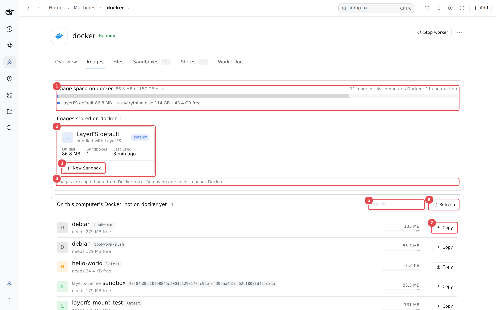

| # | 组件 | 显示内容 | 操作 → 结果 | LayerFS 调用 | 状态 |
|---|---|---|---|---|---|
| 1 | 镜像空间 | ***机器* 上的镜像空间**（Image space on *machine*）：镜像占磁盘多少，每个镜像一段条、**其他**（everything else）、可用空间，以及这台 Mac 的 Docker 里还有多少镜像 | — | `machine stats`（采样器）以及下面的镜像读取 | |
| 2 | 镜像卡片 | 徽标、名称和标签、来源（**LayerFS 自带**（bundled with LayerFS）、**从 Docker 复制**（copied from Docker）、**此机器内置**（built into this machine））、**默认**（default）、**磁盘占用**（On disk）、**Sandbox**（Sandboxes）、**上次使用**（Last used） | — | `machine get`、`machine images --with docker`、`sandbox list`(读取；创建、启动、复制之后以及窗口获得焦点时会再读) | **正在复制**（Copying）/ **Partly copied**，悬停显示 LayerFS 的修复 |
| 3 | **新建 Sandbox**（New Sandbox） | 在可用的镜像上 | 按下 → 新建 Sandbox，并选好这个镜像 | — | |
| | **移除**（Remove） | 在没有 Sandbox 使用的已复制镜像上 | 按下 → 从机器上移除它（Docker 保留自己的副本） | `machine prune <machine> <image>` | 被拒绝的镜像显示 **未移除**（Not removed）；有 Sandbox 占用时附 **打开 Sandbox**（Open Sandboxes） |
| | **释放空间…**（Free space…） | 有可移除的镜像时显示 | 按下 → [释放空间对话框](#free-space-dialog) | — | |
| 4 | 说明 | **镜像从 Docker 复制到这里一次。在这里移除不会影响 Docker。**（Images are copied here from Docker once. Removing one never touches Docker.）或 **启动 *机器* 后才能移除镜像。**（Start *machine* to remove images.） | — | — | |
| | **重启 worker**（Restart worker） | **docker 的 worker 来自较旧的 LayerFS 构建。重启它后才能使用镜像。**（docker’s worker is from an older LayerFS build. Restart it to use images.） | 按下 → 停止并启动机器，然后重新读取镜像 | `machine stop`，然后 `machine start` | |
| 5 | 搜索 | **搜索 Docker 镜像**（Search Docker images，超过六个时） | 输入 → 筛选列表 | — | |
| 6 | **刷新**（Refresh） | | 重新读取镜像 | `machine images --with docker`(读取) | |
| 7 | **复制**（Copy） | 每个 Docker 镜像：它的大小和 **需要 *大小* 可用空间**（needs *size* free；空间不够时琥珀色显示 **空间不足**（not enough）） | 按下 → 在后台把它复制到机器上：显示进度条和百分比 | `machine load-image` | 复制失败时显示原因和 **关闭**（Dismiss，仅主机）；机器停止时显示 **启动 *机器* 后才能向它复制镜像。**（Start *machine* to copy images to it.）；不能在这里运行的镜像变暗并说明原因 |
| | 构建提示 | **用 `docker build -t my-image .` 构建自己的镜像，然后点“刷新”……**（Build your own with `docker build -t my-image .` then press Refresh…） | **复制命令**（Copy command） | — | |

### 释放空间对话框

**释放 *机器* 的空间**（Free space on *machine*）：**移除没有 Sandbox 使用的镜像。Docker 中的副本会保留。**（Remove images no Sandbox uses. Docker keeps its copies.）每个可移除的镜像一个复选框，没人用的默认勾选，正在使用的不可选（***n* 个正在使用**（In use by *n*）），并显示所选内容能释放多少空间（从创建流程打开时，会与创建所需的空间对比）。

| 组件 | 操作 → 结果 | LayerFS 调用 |
|---|---|---|
| 镜像复选框 | 勾选或取消勾选 | — |
| **移除 1 个镜像**（Remove 1 image）/ **移除 *n* 个镜像**（Remove *n* images） | 移除勾选的镜像；被拒绝的保留，并显示 **未移除**（Not removed） | 每个镜像一次 `machine prune <machine> <image>` |
| **取消**（Cancel） | 关闭 | — |

## 文件

只在固定版本的 CLI 能列出机器文件时出现。只读：这里不会改动任何文件。

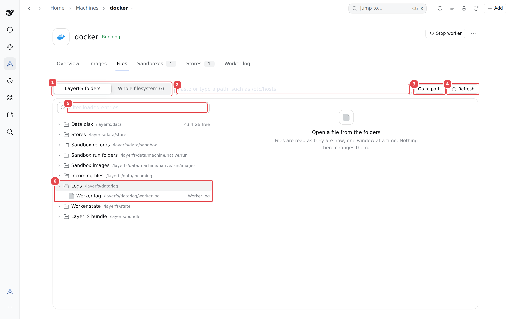

| # | 组件 | 显示内容 | 操作 → 结果 | LayerFS 调用 | 状态 |
|---|---|---|---|---|---|
| 1 | 视图 | **LayerFS 文件夹**（LayerFS folders，按用途列出 LayerFS 自己的文件夹：**数据盘**（Data disk）及可用空间、**Store**（Stores）、**Sandbox 记录**（Sandbox records）、**Sandbox 运行文件夹**（Sandbox run folders）、**Sandbox 镜像**（Sandbox images）、**日志**（Logs）、**Worker 状态**（Worker state）、**LayerFS bundle**），以及提供时的 **整个文件系统 (/)**（Whole filesystem (/)） | 点击 → 切到那个视图；每个视图记住自己的位置 | `machine files <machine>`(读取：它的根目录) | |
| 2 | 路径 | 当前显示的路径，可以编辑（**粘贴或输入路径，例如 /etc/hosts**（Paste or type a path, such as /etc/hosts）） | 输入路径 | — | **这里的路径以 / 开头。**（A path here starts with /.）；打不开的路径会回到根目录：**无法打开 *路径*（……）。改为显示 *根目录*。**（*path* could not be opened (…). Showing *root* instead.） |
| 3 | **转到路径**（Go to path） | | 把那个文件夹作为树的顶层打开（面包屑可以返回），或打开那个文件 | `machine files <machine> <path>`(读取) | |
| 4 | **刷新**（Refresh） | | 重新读取已打开的文件夹；不会自动轮询 | `machine files`(读取) | |
| 5 | **筛选已加载的条目**（Filter loaded entries） | | 输入 → 筛选已经读到的内容 | — | |
| 6 | 文件夹行 | 一个文件夹，及其大小或可用空间 | 点击 → 打开它，一次一页（**更多条目**（More entries）） | `machine files <machine> <path> --depth --limit --cursor`(读取) | 读取超过 1 秒时显示秒数和 **取消**（Cancel，仅主机）；受限、不可读、系统、挂载点和链接行不能打开；Workspace 挂载点会列出，但不会进入 |
| | 文件视图 | 文件的文本，一次一段 | 滚动 → 下一段 | `machine files <machine> <path> --byte-offset --byte-length`(读取) | 二进制文件和空文件会注明；日志文件提供 **Read in the Worker log tab** |

## Worker 日志

只在固定版本的 CLI 有这个调用、且 LayerFS 表示这台机器有 worker 日志时出现（docker 和创建的虚拟机；LayerFS Home 没有）。

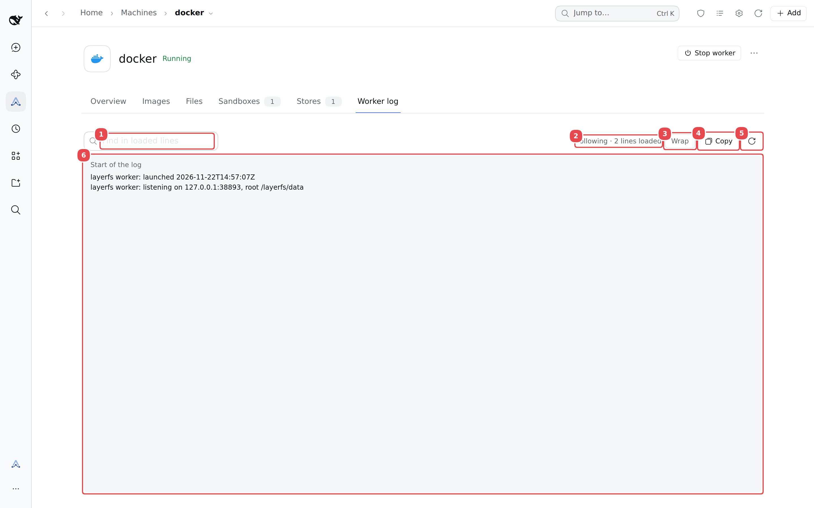

worker 的日志，实时跟随。每个部分都是[日志窗格](components.md#log-pane)。

| # | 组件 | 操作 → 结果 | LayerFS 调用 |
|---|---|---|---|
| 1 | **在已加载的行中查找**（Find in loaded lines） | 输入 → 高亮匹配项，显示 **n of m**，用 ↑/↓ 或 Enter/Shift+Enter 切换 | — |
| 2 | 状态 | **正在跟随 · 已加载 *n* 行**（Following · *n* lines loaded）、**未在读取**（Not reading，机器已停止）、**已停止读取**（Stopped reading） | — |
| 3 | **换行**（Wrap） | 切换自动换行（会记住） | — |
| 4 | **复制**（Copy） | 复制选中的内容，或全部已加载的行 | — |
| 5 | **重新读取**（Read again） | 立即读取 | `machine log`(读取) |
| 6 | 日志行 | 停在底部时自动跟随；否则显示 **↓ *n* 行新内容**（↓ *n* new lines）；顶部有 **更早的行**（Earlier lines） | `machine log --cursor --limit`(读取，标签页显示期间每 2–10 秒一次) |

已停止的机器会显示 **不可用 · 机器已停止，无法读取其 Worker 日志。之前读取的行保留在下方。**（Unavailable · The machine is stopped, so its worker log cannot be
read. Lines read earlier stay below.），并附启动按钮。

## 机器菜单

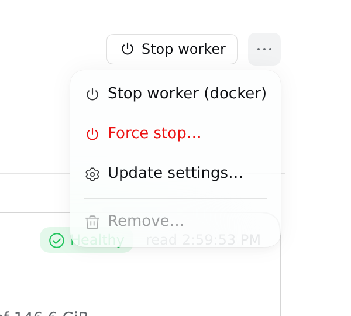

见[组件 › 机器菜单](components.md#machine-menu)。在这个页面上，菜单里没有 **打开**（Open）。

### 强制停止对话框

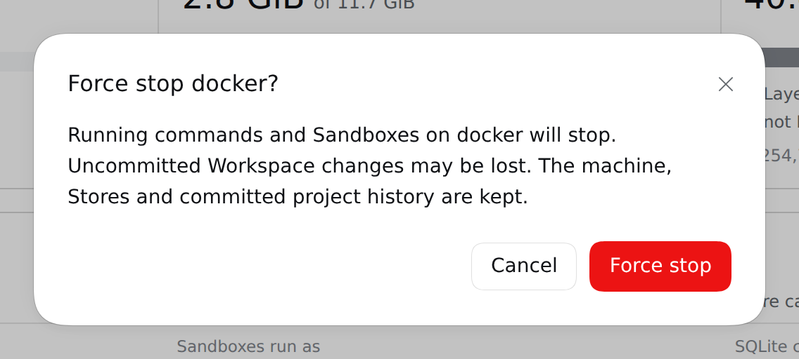

**强制停止 *机器*？**（Force stop *machine*?）***机器* 上正在运行的命令和 Sandbox 将停止。未提交的 Workspace 更改可能丢失。机器、Store 和已提交的项目历史会保留。**（Running commands and Sandboxes on *machine* will stop. Uncommitted
Workspace changes may be lost. The machine, Stores and committed project history are kept.）
（LayerFS Home 上是：**停止这台电脑上由 LayerFS 管理的 Sandbox 和正在运行的命令。电脑本身不会停止……**（Stop LayerFS-managed Sandboxes and running commands on this computer. The
computer itself stays running…））。**强制停止**（Force stop）运行 `machine stop --force`；**取消**（Cancel）关闭对话框。

### 设置对话框

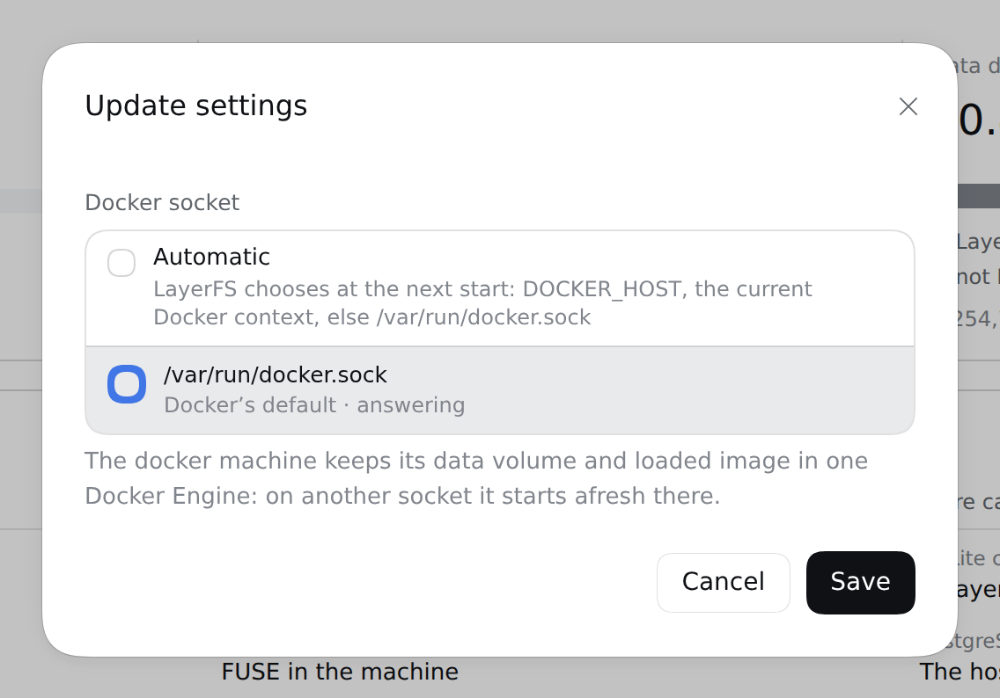

docker 的 **更新设置**（Update settings）：LayerFS 使用的 **Docker 套接字**（Docker socket）。可以选 **自动**（Automatic，LayerFS 在下次启动时选择：`DOCKER_HOST`、当前 Docker context，否则
`/var/run/docker.sock`），或 LayerFS 找到的某个套接字，每个都标出来源和是否有响应；当前用户无权打开的套接字会给出可复制的 docker 用户组修复命令。一条说明提醒你：换套接字后 docker 机器会重新开始。**保存**（Save）运行 `machine update docker
--docker <socket>`（留空则清除设置，恢复为自动）；WSL 发行版字段只在 Windows 主机上显示。

### 移除对话框

用于创建的虚拟机（或 LayerFS 表示应移除其记录的内置机器）。
**移除 *名称* 及其磁盘？**（Remove *name* and its disk?）如果机器上还有 Sandbox 或 Store，对话框会列出它们（**要关闭的 Sandbox（*n*）**（Sandboxes to close (*n*)）、**要删除的 Store（*n*）**（Stores to delete (*n*)）），要求 **输入 *名称* 以确认**（Type *name* to
confirm），然后 **全部移除**（Remove everything）依次运行：每个 Sandbox 一次 `sandbox remove --force`，每个 Store 一次 `store remove`，最后 `machine remove`。失败时显示 **停在：** *步骤*（Stopped at: *step*）。
否则 **移除**（Remove）只运行 `machine remove`。此操作无法撤销。

## 机器面板

`LayerFS › 主页 › 机器`：所有机器列在一张表里，需要你处理的排在前面。展开一行（▸）可以看到这台机器上有什么；点名称打开机器页。

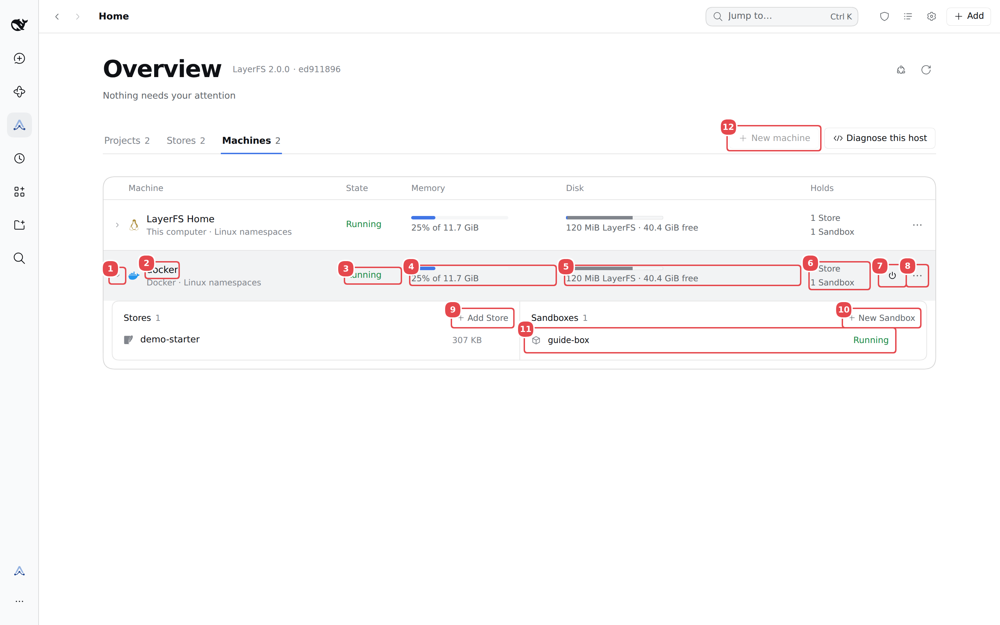

| # | 组件 | 显示内容 | 操作 → 结果 | LayerFS 调用 | 状态 |
|---|---|---|---|---|---|
| 1 | ▸ / ▾ | | 点击（或点击这一行）→ 显示或隐藏它包含的内容；在这个浏览器里会记住 | — | 机器需要你处理、正在启动或是唯一一台时，默认展开 |
| 2 | 名称 | 图标、名称（`native` 显示为 **LayerFS Home**）和 **类型 · 运行方式**（**这台 Mac · 主机进程**（This Mac · Host processes）） | 点击 → 机器页 | `home get`、`machine list`、`machine get --with live`、`sandbox list`、`store list`(读取) | |
| 3 | **状态**（State） | 状态标签 | — | 同上 | **运行中**（Running）、**已停止**（Stopped）、**需要修复**（Needs repair）、**Docker 未运行**（Docker not running）、**不可用**（Unavailable）…… |
| 4 | **内存**（Memory） | 一根条和 **% of total**（悬停显示已用/总量） | — | —（采样器的 `machine stats`） | 超过 75% 显示琥珀色，超过 90% 显示红色；没读到时以浅色显示已分配的内存 |
| 5 | **磁盘**（Disk） | 一根条和 **LayerFS *大小* · 可用 *大小***（LayerFS *size* · *size* free） | — | `machine stats --with space`(读取，缓存 1 分钟) | 被阻塞的机器在这里改为显示原因 |
| 6 | **包含**（Holds） | ***n* 个 Store**（*n* Stores）/ ***n* 个 Sandbox**（*n* Sandboxes）（正在创建的也计入） | — | — | **没有 Store**（No Stores）、**没有 Sandbox**（No Sandboxes） |
| 7 | 电源 | 一个图标按钮：**停止 worker**（Stop worker）/ **启动 worker**（Start worker）/ **启动**（Start）/ **停止**（Stop） | 按下 → 和机器页上一样 | `machine stop` / `machine start` | LayerFS Home 上没有 |
| 8 | ⋯ | [机器菜单](components.md#machine-menu)，第一项是 **打开**（Open） | | | |
| 9 | **添加 Store**（Add Store） | 在展开行的 Store 一栏里 | 按下 → 存储的 **向 *机器* 添加 Store**（Add a Store to *machine*） | 见 [store.md](store.md#machine--stores-tab) | 被阻塞的机器上隐藏 |
| 10 | **新建 Sandbox**（New Sandbox） | 在 Sandbox 一栏里 | 按下 → [新建 Sandbox 对话框](#new-sandbox-dialog) | — | 启动或停止进行中时不可用 |
| 11 | Sandbox 行 | 名称、**n/16 个 Workspace**（n/16 Workspaces）、状态 | 点击 → Sandbox 页；它的 ⋯ → **打开**（Open）、**删除 Sandbox…**（Delete Sandbox…）、**强制删除 Sandbox…**（Force delete Sandbox…） | `sandbox remove`（`--force`） | 需要你处理的排在前面，显示为红色 |
| | Store 行 | 名称、大小或 **PostgreSQL** | 点击 → Store 页；它的 ⋯ → [Store 菜单](components.md#store-menu) | | |
| 12 | **新建机器**（New machine） | 一直在标签栏上；没有能创建机器的平台时不可用，原因在悬停提示里 | 按下 → [添加机器对话框](#add-machine-dialog) | — | |
| | **诊断此主机**（Diagnose this host） | 标签栏右端、**新建机器** 旁边的 **</>** 按钮 | → 诊断页运行主机的检查 | `home doctor`（在诊断页上） | |

展开的行还会显示：机器为什么被阻塞（附修复步骤）、为什么停机（附 **运行诊断**（Run diagnostics））、被拒绝的操作，以及正在进行的启动。

### 添加机器对话框

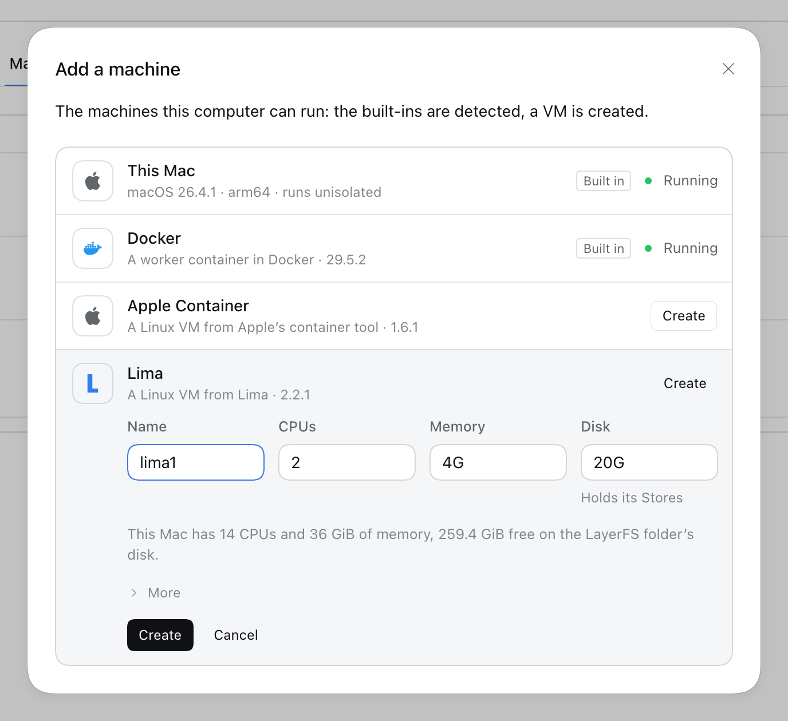

**添加机器**（Add a machine）—— **这台电脑可以运行的机器：内置机器会被自动检测，虚拟机则需要创建。**（The machines this computer can run: the built-ins are detected, a VM is
created.）每个平台一行，显示它当前的就绪程度。

| 组件 | 显示内容 | 操作 → 结果 | LayerFS 调用 | 状态 |
|---|---|---|---|---|
| 内置机器行 | **这台 Mac**（This Mac，操作系统、架构、**无隔离运行**（runs unisolated））、**Docker**（版本）：**内置**（Built in）和机器的状态 | — | `home get --with platforms`(读取，随机器视图一起) | |
| 虚拟机行 | **Apple Container**、**Lima**，附简介和版本 | **创建**（Create）→ 在该行中打开它的表单 | — | |
| 未就绪行 | 一个标签（**需要安装**（Needs install）、**需要设置**（Needs setup）、**未运行**（Not running）、**需要运行时**（Needs runtime））和一个按钮（**安装**（Install）、**设置**（Set up）、**启动**（Start）、**在设置中修复**（Fix in setup）） | 按钮 → 该做什么、可复制的命令、**重新检查**（Check again）（或打开设置 LayerFS 对话框） | **重新检查**：带最新平台信息的机器视图读取 | |
| **此电脑不可用（*n*）**（Not available on this computer (*n*)） | 这台电脑永远无法运行的平台，及原因 | 点击 → 展开 | — | |
| 虚拟机表单 | **名称**（Name，建议一个可用的）、**CPU 数**（CPUs）、**内存**（Memory）、**磁盘**（Disk，**存放其 Store**（Holds its Stores）），默认值来自 LayerFS；一行显示这台电脑的余量和其他虚拟机的用量（要求超出时给出警告，但不会拒绝） | **更多**（More）› **使用原版镜像**（Use stock image） | 余量一行来自采样器的 `machine stats native` | |
| **创建**（Create） | | 创建虚拟机并显示启动进度；对话框保持打开（**创建机器期间请保持此对话框打开。**（Keep this dialog open while the machine is being created.）），完成后打开新机器的页面 | `home get`（它声明的选项），然后 `machine create <name> <platform> --cpus --memory --disk [--os-image stock]` | 失败时提供 **检查当前状态**（Inspect current state，`machine get`）和 **查看机器与移除选项**（View machine and removal options） |
| **取消**（Cancel） | | 关闭表单 | — | 创建期间不可用 |

## 变体

- **LayerFS Home（`native`）**（[截图](../img/machine-native.png)）：没有电源按钮（它就是这台电脑），macOS 上没有处理器一栏，没有 **Worker 日志**（Worker log，没有 worker），没有 **更新设置…**（Update settings…），**移除…**（Remove…）不可用并显示 **内置 · 无法移除**（Built in · can’t be removed）。**镜像**（Images）标签页取决于它的 Sandbox 怎么运行：macOS 上的 LayerFS Home 让 Sandbox 使用 Mac 自己的系统，没有这一页；Linux 上在命名空间里运行，有这一页。上面有 Sandbox 时会显示 **强制停止…**（Force stop…），使用 native 版的说明文字。
- **docker**：电源按钮的文字提到 worker（**启动 worker**（Start worker）、**停止 worker**（Stop worker）、**重启 worker**（Restart worker））；**更新设置…**（Update settings…）用来设置套接字；macOS 上 Docker 引擎没运行时，状态是 **Docker 未运行**（Docker not running），启动按钮变成 **启动 Docker 和 worker**（Start Docker and worker）。除非 LayerFS 自己的修复要求移除它的记录，否则移除不可用。
- **创建的虚拟机**（Lima、Apple Container）：**启动**（Start）/ **停止**（Stop）（worker 没有响应时为 **停止（关闭虚拟机）**（Stop (shut down the VM)）），有危险操作区和 **移除 *名称*…**（Remove *name*…），菜单里有 **移除…**（Remove…），没有设置。
- **只在部分情况下出现的标签页**：**镜像**（Images）需要支持 Sandbox 镜像副本的 CLI（镜像阶段 1）以及从镜像启动 Sandbox 的机器（不是 macOS 上的 LayerFS Home，它让 Sandbox 使用 Mac 自己的系统）；**文件**（Files）需要 CLI 的 `machine files`；**Worker 日志**（Worker log）需要 CLI 的 `machine log`，以及 LayerFS 表示有 worker 日志的机器（`supports: log`）。这些都不按平台名称判断。
- **较旧的 CLI**（没有 `machine stats`）：用量卡片变成一行记录的大小；没有 `machine stats --with space` 时，就没有磁盘分段、**空间去向**（Where it goes）和 **磁盘占用**（On disk）。

## 从这里打开的对话框

| 对话框 | 打开方式 | 作用 | LayerFS 调用 | 撤销 |
|---|---|---|---|---|
| [磁盘空间](#disk-space-dialog) | **空间去向**（Where it goes） | 显示数据盘的空间去向 | `machine stats --with space`(读取) | — |
| [新建 Sandbox](#new-sandbox-dialog) | **新建 Sandbox**（New Sandbox，标签页、面板、镜像卡片） | 创建一个 Sandbox | `sandbox create`（先 `machine start`） | 删除这个 Sandbox |
| [释放空间](#free-space-dialog) | **释放空间…**（Free space…）、新建 Sandbox、空间不足的创建 | 移除没人用的镜像副本 | `machine prune` | 重新复制镜像 |
| [强制停止](#force-stop-dialog) | ⋯ › **强制停止…**（Force stop…） | 停止机器及其上的一切 | `machine stop --force` | 重新启动；未提交的更改会丢失 |
| [设置](#settings-dialog) | ⋯ / 详情 › **更新设置…**（Update settings…） | 更改 docker 的套接字 | `machine update` | 保存原来的值 |
| [移除](#remove-dialog) | ⋯ › **移除…**（Remove…）、危险操作区 | 删除虚拟机（以及它包含的内容） | `sandbox remove --force`、`store remove`、`machine remove` | 无 |
| [添加机器](#add-machine-dialog) | 主页 › 机器 › **新建机器**（New machine）、**添加**（Add）› **新建机器** | 创建虚拟机 | `machine create` | 移除它 |

## 状态与信号

- 用量卡片里的 **运行良好**（Healthy）：这台机器上没有需要你处理的事。磁盘快满时卡片会变成琥珀色或红色，并多出一条提示；**空间去向**（Where it goes）告诉你该释放什么。
- **未读取**（Not read）附原因：LayerFS 没有读取这个值（机器已停止、worker 较旧、macOS 不报告这个值）。它绝不会显示成 0。
- **请先关闭它的 *n* 个 Sandbox**（Close its *n* Sandboxes first）：有 Sandbox 在运行时，LayerFS 拒绝了停止。关掉它们（或 **强制停止…**（Force stop…））后再试。
- 电源按钮刚变化后短时间内按了没反应，这是按压保护：如果按钮刚好在指针下方变了，这一下会被忽略。
- **Docker 未运行**（Docker not running，虚线标签）：Docker Desktop 已关闭；启动会先打开它。
- **不可用**（Unavailable）附原因：这个平台在这台电脑上还没就绪；按修复步骤操作，然后点 **重新检查**（Check again）。

## 下一步

- [Sandbox](sandbox.md)：这台机器上的一个 Sandbox。
- [Store](store.md)：这台机器上的一个 Store，以及它的 [Store 标签页](store.md#machine--stores-tab)。
- [组件](components.md)：[机器菜单](components.md#machine-menu)、
  [Sandbox 卡片](components.md#sandbox-card)、[日志窗格](components.md#log-pane)。

## 源码

`src/client/machines/`：`MachineDetail.tsx`、`MachineTabs.tsx`、`machine-tabs.ts`、
`Overview.tsx`、`Spec.tsx`、`Readiness.tsx`、`needs.ts`、`MachineStats.tsx`、
`MetricsViews.tsx`、`SpaceDialog.tsx`、`SpaceViews.tsx`、`SandboxCards.tsx`、`Sandboxes.tsx`、
`MachineImages.tsx`、`ImageMenu.tsx`、`images.ts`、`InspectFiles.tsx`、`inspect-files.ts`、
`LogPane.tsx`、`log-model.ts`、`parts.tsx`、`Board.tsx`、`Inventory.tsx`、
`AddMachineDialog.tsx`、`controller.ts`、`locale.ts`。主机：`src/host/routes/machines.ts`、
`metrics.ts`、`image-loads.ts`、`projects.ts`（`createSandbox`）。
