<!-- source: 57fa4e64b321 -->
# 项目

> **位置：** `LayerFS › 主页 › Store › <store> › <project>` · **打开方式：** 主页 › 项目或某个 Store 的项目标签页中的项目名、跳转到、Store 卡片 · **源码：** 见文末

一个 LayerFS 项目：它在每个分支上保存的文件、把所有分支的历史画成的一棵树、正在操作它的
Sandbox 和调用、属于它的 DSH 会话，以及它在 Store 里占了多少字节。想看项目里有什么、追踪它
怎么变过来的，或者在里面开一个会话，就来这里。

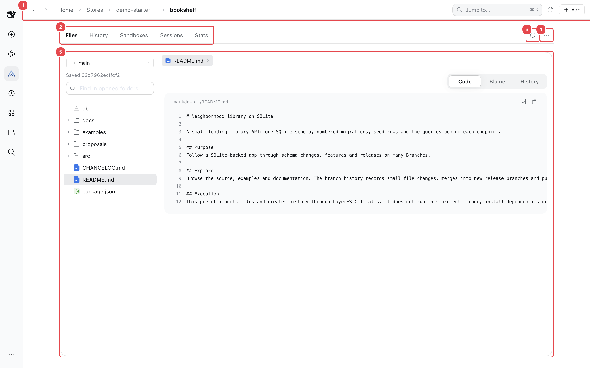

| # | 组件 | 说明 |
|---|---|---|
| 1 | 导航栏 | [组件 › 导航栏](components.md#nav-bar)：路径 `主页 › Store › <store> › <project>`、**跳转到**（Jump to）、**刷新**（Refresh）、**添加**（Add） |
| 2 | 标签栏 | **文件**（Files）· **历史**（History）· **Sandbox**（Sandboxes）· **会话**（Sessions）· **统计**（Stats）；页面默认打开文件 |
| 3 | **刷新项目**（Refresh project） | 在后台重新读取当前标签页，屏幕上的内容保持不变 |
| 4 | **⋯**（`<project> actions`） | 项目菜单：**删除项目…**（Delete project…）（[菜单](../img/project-menu.png)） |
| 5 | 标签页内容 | 当前选中的标签页；文件和历史会占满整页 |

## 布局

页面没有头部卡片：项目名就是导航栏的最后一级。下面是一条标签栏，左边是五个标签，右边是
页面的两个操作（**刷新项目**（Refresh project）、**⋯**）；在手机上，标签可以左右滑动，操作
挪到下一行。下方是选中的标签页。文件和历史是共用的文件视图，和项目会话里的对话标签页是同一套
（见[组件 › 文件视图](components.md#file-views)和[历史视图](components.md#history-views)）；
这一页会把它们讲完整。

页面不记住上次的标签：再次打开总是从文件开始。只要 DSH 还开着，历史标签页会按项目记住缩放、
选中项和上次读取的结果，所以回到这里时会立刻画出上次的树，再在后台重新读取。

## 文件

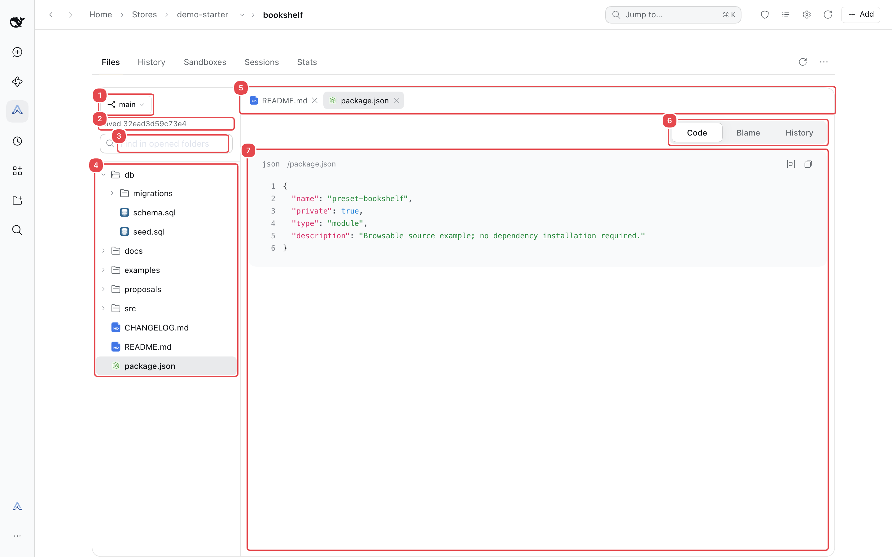

项目保存下来的文件，只读，显示某个分支最新一次保存时的状态（或者你从历史里打开的某个已保存
版本）。文件从 LayerFS 读取，从不从 Sandbox 读取：智能体还没提交的内容不会出现在这里。

| # | 组件 | 显示内容 | 操作 → 结果 | LayerFS 调用 | 状态 |
|---|---|---|---|---|---|
| 1 | 分支选择器（[展开](../img/project-branch-picker.png)） | 当前显示的分支；`main` 在 **已发布**（Published）下，其余在 **分支**（Branches）下，每个都带分支头的短 id | 选一个分支 → 文件树从该分支的头重新开始，已打开的文件停止原来的读取，在新位置重新打开 | `branch list`、`branch get main` (读取；分支列表在主机上缓存几秒) | 会话分支显示为 **会话 `<id>`**（Session `<id>`）；插件自己记账用的分支（`dsh.project.*`、`dsh.session.*`）永远不列出 |
| | | | **加载更多分支**（Load more branches）（超过 100 个分支时出现在选择器下方）→ 下一页加入选择器 | `branch list` (读取) | |
| 2 | 已保存行 | **已保存 `<id>`**（Saved `<id>`）：文件树和文件读取时所用的确切已保存版本 | **查看最新版本**（Show latest）（在 **在此提交中打开**（Open at this commit）之后出现）→ 回到分支头 | —（视图状态） | |
| 3 | **在已展开的文件夹中查找**（Find in opened folders） | 对已经读到的条目做筛选 | 输入 → 只留下匹配的行；**Escape** 清空 | —（只筛选屏幕上已有的内容，不会为此读取文件夹） | **已展开的文件夹中没有匹配的文件。**（No file in the opened folders matches.） |
| 4 | 文件夹树 | 先文件夹后文件，按名称排序；文件夹在你展开时才读取 | 点文件夹 → 展开（读取一次后缓存）；点文件 → 以标签页打开 | 在该已保存版本上 `file list` (读取；每页 1000 条) | **读取中…**（Reading…）、**空文件夹**（Empty folder）、**无法读取此文件夹**（This folder could not be read）；**显示更多条目**（Show more entries）读取下一页。键盘：方向键、Home/End、输入跳转、Enter |
| 5 | 已打开的文件 | 每个打开的文件一个标签；第一次访问时会自动打开 README | 点标签 → 显示该文件；**×**（`Close <path>`）→ 关闭 | — | 一个都没打开时显示 **只读文件**（Read-only files） |
| 6 | **代码 · 逐行追溯 · 历史**（Code · Blame · History） | 文件的查看方式；切换文件时保持不变 | 切换 → 用该方式查看同一个文件（见下文） | 见各视图 | |
| 7 | 代码 | 带行号和语法高亮的文件（DSH 的代码块：**自动换行**（Wrap lines）、**复制**（Copy）） | **显示更多行**（Show more lines）→ 接下来的 1000 行 | `file stat`、`file read` (读取；每个窗口 1000 行) | **显示第 1–N 行。**（Showing lines 1–N.）、**二进制文件 · `<size>`**（Binary file · `<size>`）、**所选的已保存版本中不存在此路径。**（This path is absent at the selected saved version.）、**一行过长，已被截断。**（A long line was clipped.） |

**逐行追溯**（Blame）显示每一行最后是谁写的：

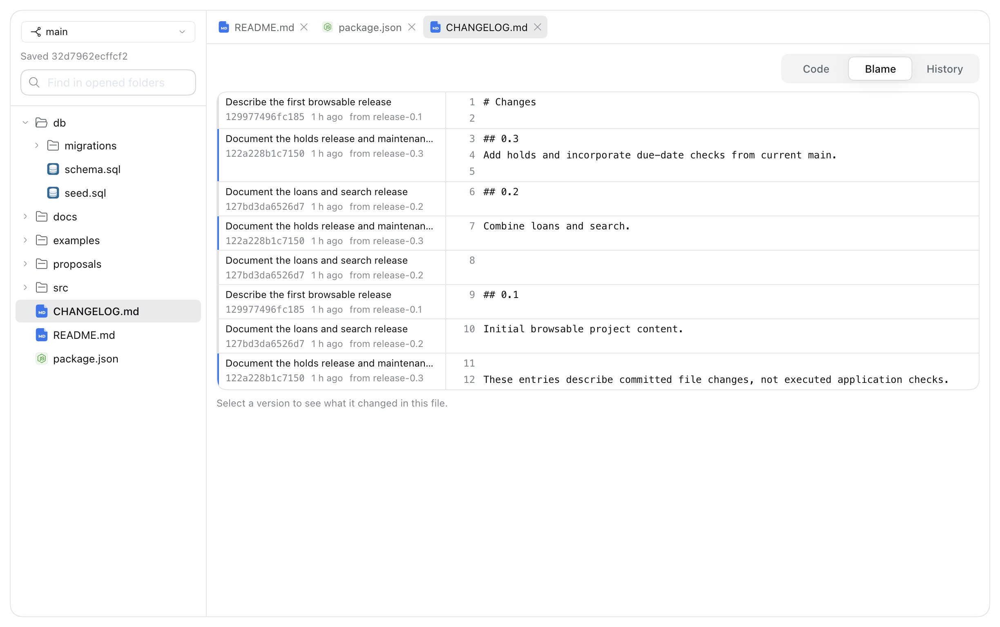

由同一个已保存版本写下的行归为一组，组上只标一次该版本的说明、短 id 和时间；屏幕上最新的版本
带一条彩色边，在其他分支上保存的版本会标 **来自 `<branch>`**（from `<branch>`）。选中一组会切换到
**历史**（History），并选中那个版本（`See what <id> changed in this file`）。
**显示更多行**（Show more lines）读取接下来的 1000 行。LayerFS 只能算出一部分的追溯结果会标
**部分结果为近似值**（Part of this answer is approximate）。调用：对同一个窗口执行 `file read` 和
`file blame`，用 `file history` 取各版本的时间，再对每个写入者执行一次 `commit get`，查出它保存在哪个分支上（不是当前分支时显示 **来自** *分支*）（全部为读取）。

**历史**（History，指文件的历史）列出改动过这个文件的已保存版本：

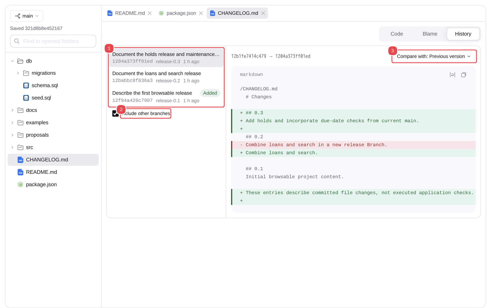

| # | 组件 | 显示内容 | 操作 → 结果 | LayerFS 调用 | 状态 |
|---|---|---|---|---|---|
| 1 | 版本列表 | 最新的在前：说明、短 id、保存该版本的分支（不是当前分支时）、时间；**新增**（Added）/ **删除**（Removed）标签 | 点击 → 右侧显示它的改动：删除的行 `-`，新增的行 `+`，未改动的行原样显示 | `file history` (读取；每页 50 个)，打开 **包含其他分支**（Include other branches）时为 `file history --traversal branch`，并对每个在别处保存的版本执行一次 `commit get` 查出其分支 (读取) | **加载更早的版本**（Load earlier versions）；**查询提前结束，可能缺少更早的版本。**（The search stopped early, so earlier versions may be missing.） |
| 2 | **包含其他分支**（Include other branches） | 打开后：也列出分叉之前的版本，以及从其他分支合并进来的版本 | 切换 → 重新读取列表 | 带或不带来源信息的 `file history` (读取) | **此文件没有已保存的版本**（No saved versions of this file） |
| 3 | **对比：…**（Compare with: …） | 差异的左侧，默认是 **上一版本**（Previous version） | 选列表里的另一个版本 → 显示这两个版本之间的差异 | `commit diff --path --with patch` (读取) | **此版本添加了该文件。**（This version added the file.）、**内容没有变化**（No content changes）、**仅元数据有变化**（Only metadata changed）、**二进制比较 · …**（Binary comparison · …） |

## 历史

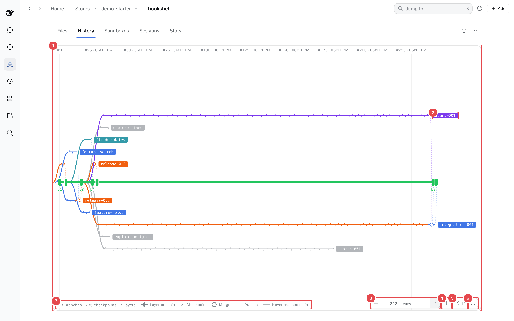

项目全部的保存历史，画成一棵树：main 的 Layer 在中间一字排开，其他每个分支各占上方或下方的
一条泳道，每个检查点按保存顺序是一片叶子。它回答的是：“这个项目上发生了什么，在哪个分支上，
哪些进了 main”。

| # | 组件 | 显示内容 | 操作 → 结果 | LayerFS 调用 | 状态 |
|---|---|---|---|---|---|
| 1 | 历史树 | 时间轴（`#n · time`）、main 的 Layer（`L1`、`L3`…）、分支泳道（同一族一种颜色）、叶子（检查点）、圆环（合并）、虚线（发布到 main）、灰色泳道（从未进入 main） | 悬停 → 提示（分支、`#n`、时间、id、说明）；点叶子或 Layer → 选中并打开详情；拖动 → 平移；滚动 → 缩放；方向键沿选中的分支移动，**+** **−** **0** 缩放 | `branch list`，然后每个分支 `commit list` (读取，见下文) | 选中的分支及其祖先保持高亮，其余变暗 |
| 2 | 分支名标签 | 分支名，位于该分支最新一次保存处 | 点击 → 打开该分支：选中最新一次保存（空分支则经由其分叉点）；如果 **与…对比**（Compare with…）正在等待，则以该分支最新保存完成选择 | 尚未读取时 `commit list` (读取) | |
| 3 | 缩放控件 | **缩小**（Zoom out）、`<n> in view`、**放大**（Zoom in）、**完整历史**（Whole run） | 只缩放时间轴（泳道高度不变）；**完整历史**（Whole run）把全部内容放进视图 | —（视图状态） | |
| 4 | **对比**（Compare） | 对比两个版本 | → [对比版本](#modals-opened-here)，左侧为 main，右侧为选中的版本（或另一个分支） | `commit diff` (读取) | 没有分支时禁用 |
| 5 | 分支（`<n> Branches, main included`） | 分支数量 | → 分支查找器（见下文） | — | 还有未读的页时显示 `<n>+` |
| 6 | **刷新**（Refresh） | | 重新读取分支列表，以及每个分支头有变化的分支 | `branch list`、`commit list` (读取) | 读取进行时显示转圈 |
| 7 | 图例 | **`<b>` 个分支 · `<c>` 个检查点 · `<l>` 个 Layer**（`<b>` Branches · `<c>` checkpoints · `<l>` Layers，只有一个时用单数），然后是 **main 上的 Layer**（Layer on main）、**检查点**（Checkpoint）、**合并**（Merge）、**发布**（Publish）、**未进入 main**（Never reached main） | — | — | 加载时：**正在加载检查点…已加载 `<n>` 个**（Loading checkpoints… `<n>` so far）或 **`<n>` / `<total>`**（`<n>` of `<total>`） |

**加载方式。** 树是渐进画出来的，最有用的先画，刷新时也不会清空：

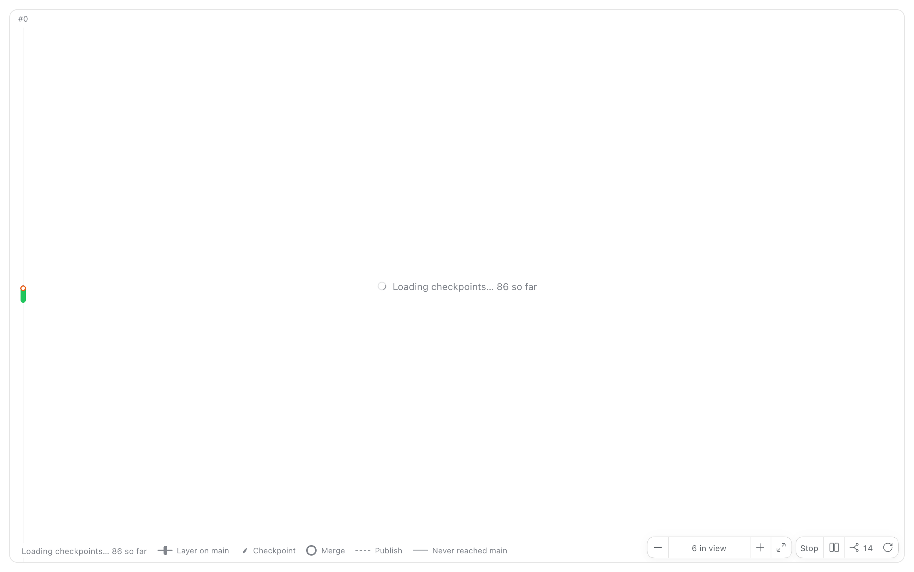

1. 读取分支列表时显示 **正在读取历史…**（Reading history…）（`branch list`，每页 100 个）。
2. 泳道直接由分支列表画出；先读 main 和当前打开分支的第一页提交，其他分支每次四个
   （`commit list`，每页 20 个）。分支头没变的分支保留已经读到的页。
3. 随后在后台把每个分支一直读到它的分叉点，一次一个分支，而且只在页面可见时进行
   （`commit list`，大页）。树会等这一步完成（最多 8 秒），然后从左到右整体展开；期间计数显示
   **正在加载检查点…已加载 `<n>` 个**（Loading checkpoints… `<n>` so far），**停止**（Stop）
   会让读取停在当前位置。
4. 超过 20,000 个检查点后，后台读取会自己停下；**全部加载**（Load all）（提示：
   *检查点在后台加载，最新的在前。“全部加载”会读取每个分支的其余检查点。*）读取剩下的部分。
   读取暂停时，会读取每个旁支的总数，这样图例能显示 **已加载 `<n>` / `<total>` 个检查点**
   （`<n>` of `<total>` checkpoints loaded）。

主机会缓存在某个具名提交上读到的每一页（这些页永远不会变），以及每个分支在每个分支头下的计数，
所以刷新只读取新增的部分。

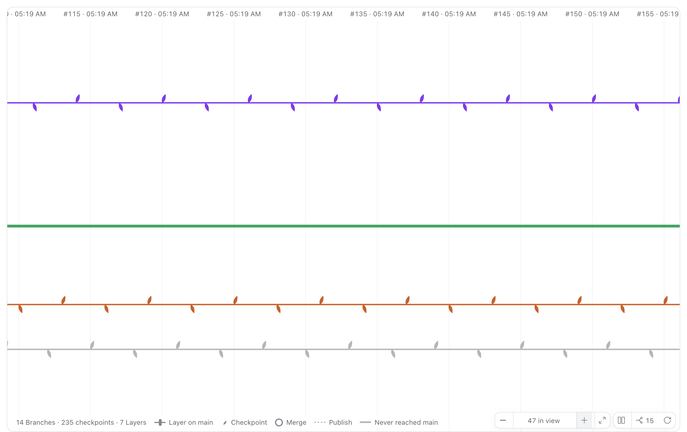

放大后，每个检查点都是它所在分支线上的一片叶子；时间轴给每一步都标上了序号。

**提交详情。** 选中叶子、Layer 或分支标签，会打开一张浮动卡片：

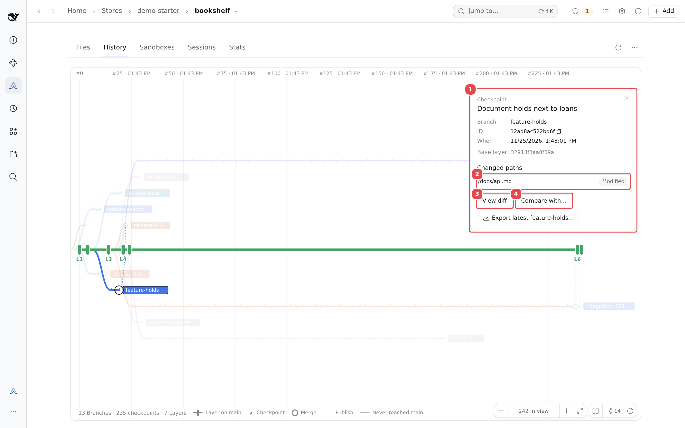

| # | 组件 | 显示内容 | 操作 → 结果 | LayerFS 调用 | 状态 |
|---|---|---|---|---|---|
| 1 | 详情卡片 | **检查点**（Checkpoint）、**main 上的 Layer**（Layer on main）、**合并**（Merge）或 **分支头**（Branch head）；说明；**分支**（Branch）、**ID**（可复制）、**时间**（When）；适用时还有 **基底 Layer**（Base layer）、**来源分支**（Source branch）、**来源提交**（Source commit）、**合并父提交**（Merge parent）；**未进入 main**（Never reached main） | **×**（**关闭提交详情**（Close commit details））→ 关闭 | `commit get` (读取) | **未加载更早的父提交：`<id>`**（Earlier parent is not loaded: `<id>`） |
| 2 | **更改的路径**（Changed paths） | 每个路径及其 **新增**（Added）、**删除**（Removed）或 **修改**（Modified） | 点路径 → 文件标签页在这个提交上打开该文件 | 与父提交做 `commit diff`，只取路径 (读取；每页 100 个) | **正在读取更改的路径…**（Reading changed paths…）、**这个提交没有更改任何路径。**（This commit changed no paths.）、**初始导入。**（Initial import.）、**加载更多更改**（Load more changes） |
| 3 | **查看差异**（View diff） | | → [`<id>` 中的更改](#modals-opened-here) | 每个路径 `commit diff --path --with patch` (读取) | |
| 4 | **与…对比**（Compare with…） | | 一条提示栏显示 **在图中选择另一个版本或分支，与 `<id>` 对比。**（Select another version or a Branch in the graph to compare with `<id>`.）；在树里点一片叶子或一个 Layer，或点一个分支名标签（取其最新保存）→ [对比版本](#modals-opened-here)；**取消**（Cancel）结束选择 | 选好第二个版本之前为 — | |

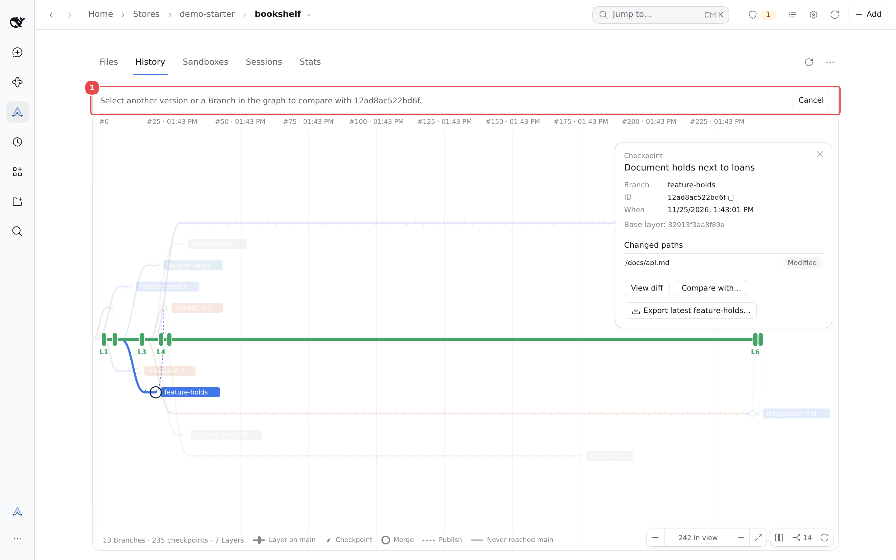

**分支查找器。** 点分支按钮会打开一个可以搜索所有分支的面板：

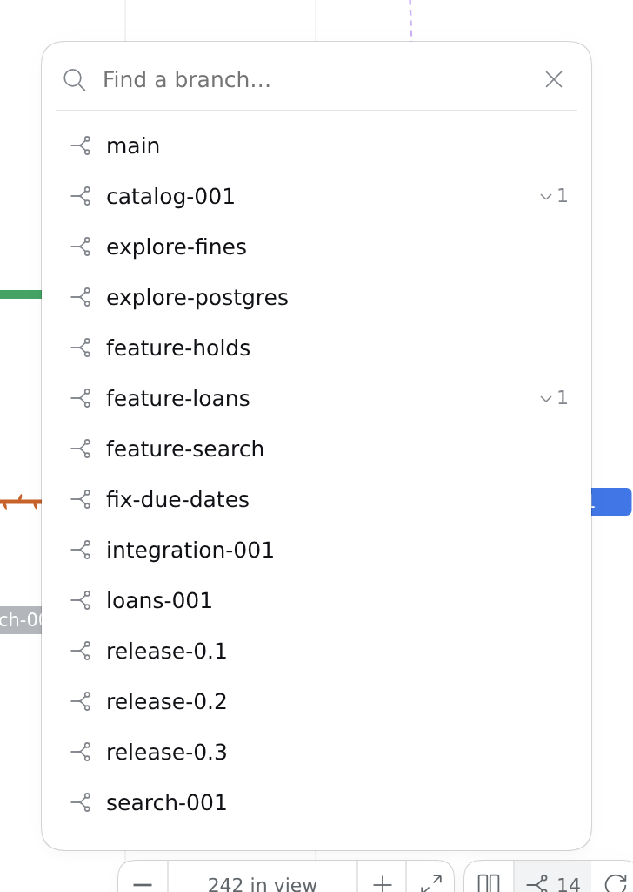

在 **查找分支…**（Find a branch…）里输入文字来筛选；点一个分支即可在树里打开它（选中其最新一次
保存）。有其他分支从它分叉出去的分支会显示一个箭头和子分支数量：点它可以折叠这个
**Branch family**（分支族，它的后代从树里移除，选中分支自己那条线除外），再点一次展开。
**加载更多分支**（Load more branches）读取下一批 100 个。折叠只是视图状态（没有调用）；打开一个
还没读过的分支会读取它的第一页（`commit list`）。

## Sandbox

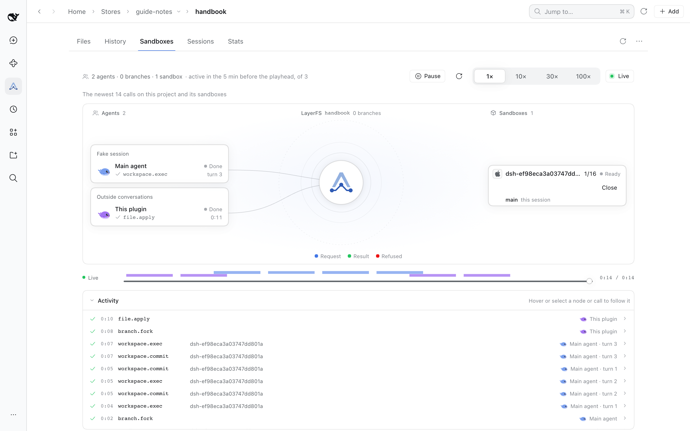

此刻谁在操作这个项目，在哪里操作。这是把对话的 Sandbox 图扩展到整个项目：每个对这个项目或其
Sandbox 调用过 LayerFS 的对话（及其子智能体），以及在对话之外发起的调用（**本插件**（This plugin）
指本主机自己的调用，**其他客户端**（Other clients）），都经由 LayerFS 中枢连到它们碰过的分支和右侧
的 Sandbox。属于一个对话的 Sandbox 会带一个安静的小 **会话**（Session）标签（悬停：*这个 Sandbox
属于一个对话，对话关闭时会被移除。*）。播放条可以回放这些调用（**暂停**（Pause）/**播放**（Play）、**1×**…**100×**、
**实时**（Live）），**活动**（Activity）把它们列出来。它和机器页共用的部分见
[组件 › Sandbox 卡片](components.md#sandbox-card)和[终端
面板](components.md#terminal-pane)。

| 组件 | 显示内容 | 操作 → 结果 | LayerFS 调用 | 状态 |
|---|---|---|---|---|
| 说明行 | **此项目及其 Sandbox 最近的 `<n>` 次调用**（The newest `<n>` calls on this project and its sandboxes）（有更早的调用时：**…；更早的调用见日志页**（…; older ones are on the Logs page）） | — | —（插件的调用日志，仅在主机上） | 旧版主机上显示 **重启 DeepSeek Harness 后即可在这里查看此项目的调用。**（Restart DeepSeek Harness to see this project's calls here.） |
| 智能体 | 每个对话一张卡片（标题、**主智能体**（Main agent）、子智能体），以及 **会话之外**（Outside conversations） | 悬停或选中 → 在图上跟随它的调用 | —（调用日志） | **完成**（Done）、工作中、**turn `<n>`** |
| Sandbox 卡片 | 项目每个打开着的 Sandbox：名称、`<n>/<max>` 个 workspace、状态词、它的 Workspace 及其分支 | **关闭**（Close）→ [确认对话框](components.md#confirm-dialog) **关闭 Sandbox `<name>`？**（Close Sandbox `<name>`?）（带 **强制关闭**（Force close））→ 已关闭，列表重新读取 | 列表：`sandbox list` (读取)，每个 Sandbox 的 Workspace：`sandbox get` (读取，由主机缓存)；关闭：`sandbox remove` | 正在关闭或已不存在时 **关闭**（Close）禁用；**没有挂载的工作区**（No workspaces mounted） |
| 活动 | 调用，最新的在前：时间、调用、Sandbox 或 Workspace、发起者 | 选中 → 在图上高亮 | —（调用日志） | **此项目还没有 LayerFS 调用**（No LayerFS calls on this project yet） |

列表会在 **刷新项目**（Refresh project）时、关闭 Sandbox 之后，以及有新调用创建、删除、挂载或卸载
东西时重新读取。有新日志行到来且页面可见时，调用最多每 3 秒重新读取一次。

## 会话

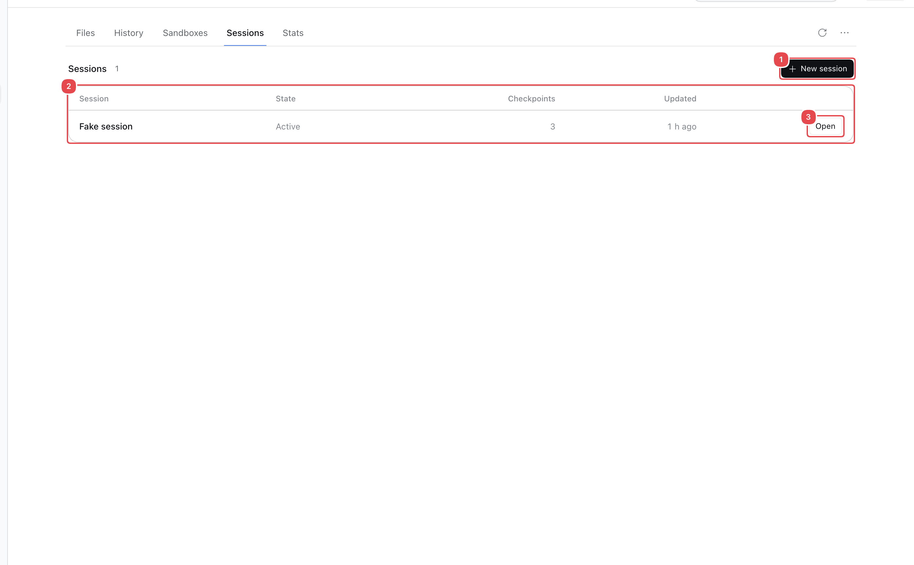

属于这个项目的 DSH 会话：文件保存在这个项目分支里的对话。会话属于它启动时所在的项目，不和某个
Sandbox 绑定。

| # | 组件 | 显示内容 | 操作 → 结果 | LayerFS 调用 | 状态 |
|---|---|---|---|---|---|
| 1 | **新建会话**（New session） | | 在这个项目里启动一个 DSH 会话（放在选中的本地文件夹里，否则放在托管的 Scratch 文件夹里）并打开；它的 Workspace 在第一步时挂载 | 按下时 `project get` (读取)；会话存储在后台同步 | 另一次按下还在进行时禁用；Store 损坏时不显示 |
| 2 | 会话表 | **会话**（Session，标题或 **未命名会话**（Untitled session））、**状态**（State：**未开始**（Not started）、**活动中**（Active），或 LayerFS 给出的词，例如 `stored`）、**检查点**（Checkpoints，每个改动了文件的轮次一个）、**更新时间**（Updated） | — | 已存储会话分支的 `branch list`，以及对分支头有变化的归档执行 `project export` (读取) | **此项目还没有会话**（No sessions on this project yet），附 **新建会话**（New session）；**无法读取会话**（Could not read the sessions），附 **重试**（Retry） |
| 3 | **打开**（Open） | | 打开对话；只存在于 LayerFS 里的会话（另一台机器的，或重置之后的）会先导入 | 本地会话无调用；导入时对其归档执行 `project export` (读取) | 打开过程中显示转圈 |

这张表以本地为先：它列出这个 DSH 里的会话，再加上在项目会话存储里找到的会话。在 DSH 里归档的
会话会从列表里消失，取消归档后才会回来。

## 统计

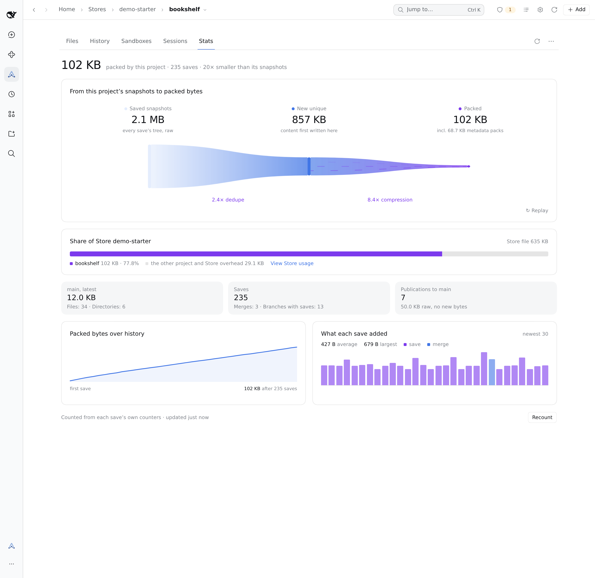

这个项目在它的 Store 里占了多少字节，按每次保存自身的计数统计。

| 组件 | 显示内容 | 操作 → 结果 | LayerFS 调用 | 状态 |
|---|---|---|---|---|
| 标题数字 | 打包后的字节数，**由此项目打包 · `<n>` 次保存 · 比其快照小 `<r>`×**（packed by this project · `<n>` saves · `<r>`× smaller than its snapshots） | — | （由下面的计数得出） | 统计中显示 **目前已打包 · …**（packed so far · …） |
| **从此项目的快照到打包字节**（From this project's snapshots to packed bytes） | **已保存快照**（Saved snapshots，每次保存的完整树，未处理）→ **新增唯一内容**（New unique，首次在这里写入的内容）→ **打包后**（Packed，含元数据包），以及 **去重**（dedupe）和 **压缩**（compression）比例 | **回放**（Replay）→ 重新播放这个流程 | — | |
| **在 Store `<store>` 中的占比**（Share of Store `<store>`） | 一条横条：这个项目打包后的字节数和百分比，以及 Store 的其余部分；**Store 文件 `<size>`**（Store file `<size>`） | **查看 Store 用量**（View Store usage）→ Store 页 | 带统计的 `store get` (读取) | **无法获取该 Store 的总量。**（The Store's totals are unavailable.） |
| 事实 | **main 最新**（main, latest，字节、文件、目录）、**保存**（Saves，合并次数、有保存的分支数）、**发布到 main**（Publications to main） | — | `project stats` (读取) | **无法读取 main 的文件树**（main's tree could not be read） |
| **打包字节随历史增长**（Packed bytes over history） | 一条从第一次保存到现在的折线 | — | — | **此项目的分支上还没有保存。**（No saves on this project's branches yet.） |
| **每次保存新增**（What each save added） | 最近 30 次保存的柱状图（保存或合并），**平均**（average）、**最大**（largest） | 悬停在柱上 → 它的分支、说明、时间和字节数 | — | |
| 页脚 | **按每次保存自身的计数统计 · 更新于 `<ago>`**（Counted from each save's own counters · updated `<ago>`） | **重新统计**（Recount）→ 重新统计每一次保存 | `branch list`、每个分支 `commit list` (读取) | **统计中…**（Counting…），带进度条：**分支 `<b>`/`<n>` · 已读取 `<s>` 次保存**（Branch `<b>` of `<n>` · `<s>` saves read） |

第一次访问时，主机会统计整个历史，页面每 1.5 秒轮询一次，边统计边画出当前的总数。之后的访问
只统计新增的保存，用的是主机缓存的账本。还没有任何保存的项目显示 **还没有保存**（No saves yet）：
Init 导入的内容属于 Store，不属于某次保存。

## 变体

- **Store 损坏时的文件和历史。** 当项目所在的 Store 损坏时（没有已保存登录的 PostgreSQL Store、
  被损坏的机器阻塞的 Store），这两个标签页不显示读取失败，而是显示 Store 的状态词（例如
  **已损坏 · 没有已保存的登录**（Broken · no saved login）或 **已阻塞 · `<machine>` 已损坏**
  （Blocked · `<machine>` broken））、作为提示的 LayerFS 原句，以及它唯一的修复（见[修复
  按钮](components.md#fix-buttons)）。会话标签页显示同样的状态词，并在修好之前隐藏
  **新建会话**（New session）和 **打开**（Open）。
- **SQLite 或 PostgreSQL，本机或某台机器。** 页面都一样；读取会发到 Store 所在的地方，所以位于
  已停止机器上的 Store 在机器运行之前读取都会失败（见[待处理提示](components.md#needs-you-notices)）。
- **会话分支。** 有会话的项目会有名为 `dsh.<id>` 的分支；视图把它们显示为 **会话 `<id>`**
  （Session `<id>`）（恢复后为 **会话 `<id>` · 第 `<n>` 次恢复**（Session `<id>` · restore `<n>`））。
  插件的身份分支和归档分支在所有地方都隐藏。
- **对话里的同一套视图。** 项目会话的[文件](conversation.md#files)和[历史](conversation.md#history)
  标签页就是这些视图，打开在会话自己的分支上。

## 此处打开的对话框

| 对话框 | 打开方式 | 作用 | LayerFS 调用 | 撤销 |
|---|---|---|---|---|
| [确认对话框](components.md#confirm-dialog) **删除 `<project>`？**（Delete `<project>`?） | **⋯ › 删除项目…**（Delete project…） | *项目及其全部历史将从其 Store 中删除，且无法撤销。* 输入项目名，再点 **删除**（Delete）；页面关闭，打开它所在的 Store | `project delete` | 无 |
| **`<id>` 中的更改**（Changes in `<id>`） | 提交详情里的 **查看差异**（View diff） | 左侧是这个提交更改的路径，右侧是选中路径的差异；**在此提交中打开**（Open at this commit）在文件标签页里打开该提交上的这个文件 | `commit get`、`commit diff`（路径）、`commit diff --path --with patch` (读取) | — |
| **对比版本**（Compare versions） | 停靠栏里的 **对比**（Compare），或 **与…对比**（Compare with…）后在树上点一个位置 | **起点**（From）和 **终点**（To）各是一个停在某个已保存版本上的分支选择器（`@ <id>`，**查看最新版本**（Show latest）回到分支头）；**交换**（Swap）；有差异的文件（`<n> files changed`）、选中文件的差异、**在此提交中打开**（Open at this commit）。（**仅看归属变化**（Only owner changes），即内容没变、但行的写入者变了的文件，只有在 LayerFS 能报告跨差异的行归属时才显示；2.0 不支持，所以隐藏） | `/` 下的 `commit diff` (读取；每页 100 个，**加载更多更改**（Load more changes）)，然后每个文件 `commit diff --path --with patch` (读取) | — |
| 确认对话框 **关闭 Sandbox `<name>`？**（Close Sandbox `<name>`?） | Sandbox 卡片上的 **关闭**（Close）（Sandbox 标签页） | 卸载它的 Workspace 并删除它；**强制关闭**（Force close）还会停止正在运行的命令 | `sandbox remove` | 无 |

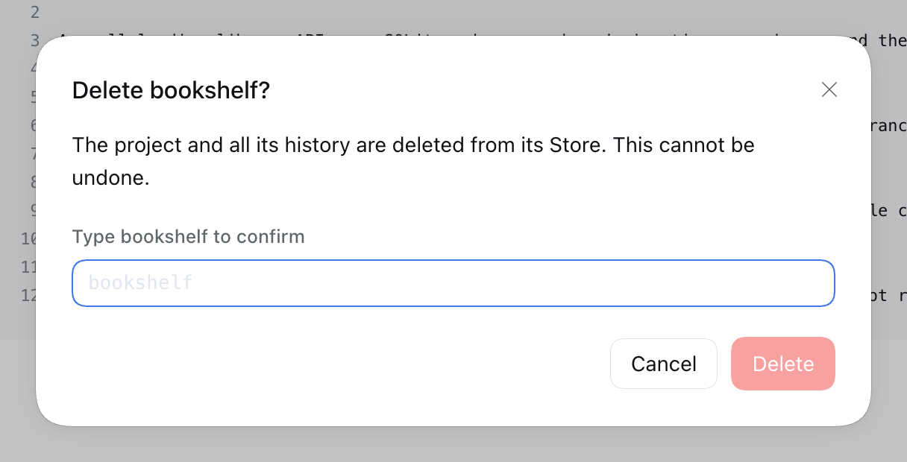

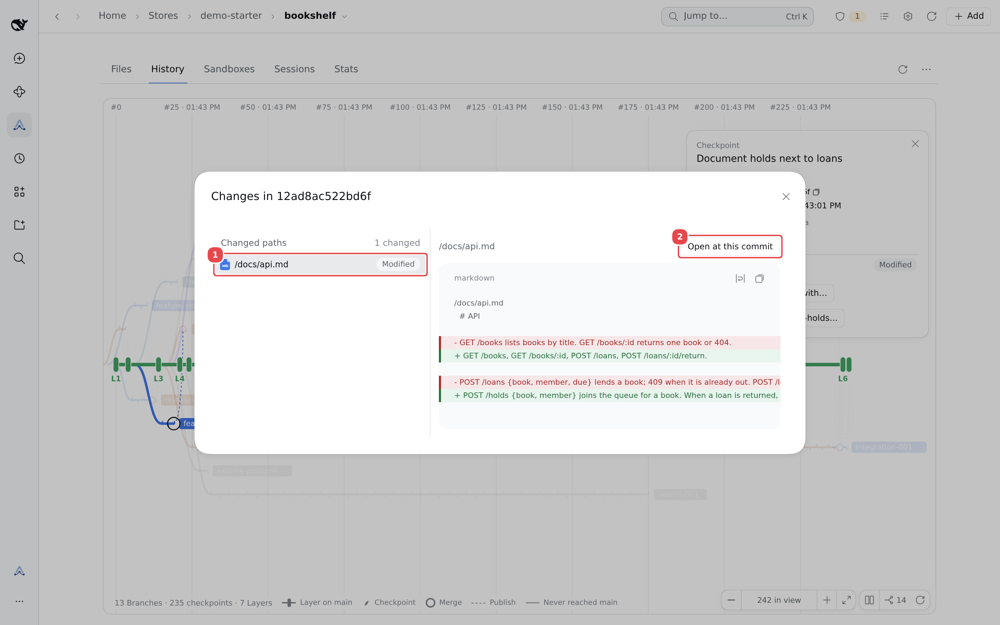

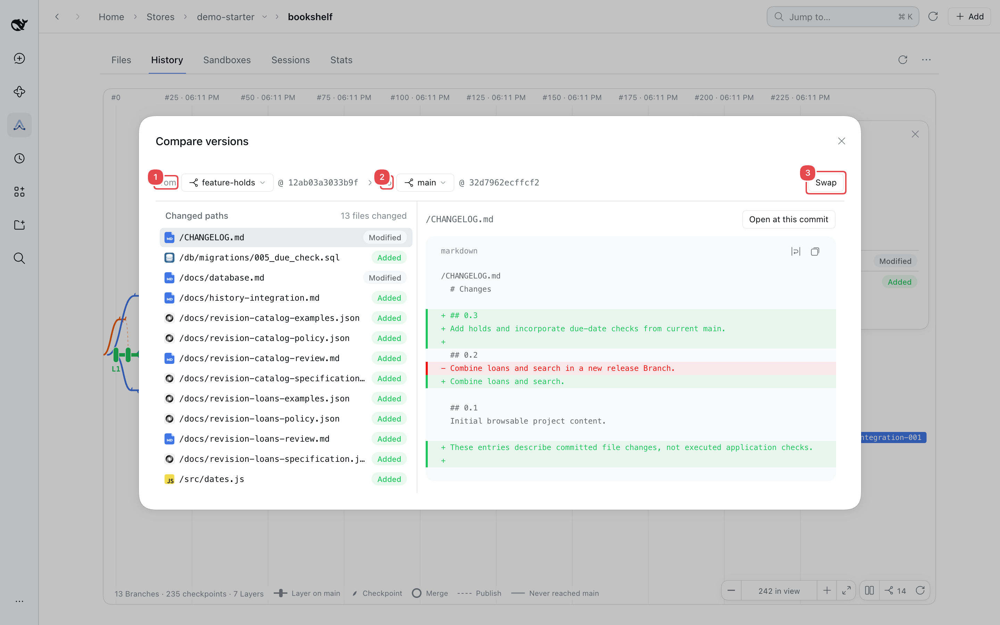

## 状态与信号

- **已保存 `<id>` · 查看最新版本**（Saved `<id>` · Show latest）：你正在看一个较早的已保存版本
  （从历史里打开的）；文件树和文件会停在那里，直到你回到最新。
- 历史里变暗的泳道：不在选中分支的那条线上。灰色泳道：**未进入 main**（Never reached main）。
  分支第一片叶子前的一小段虚线：它更早的检查点还在加载（提示里写着 **更早的检查点仍在加载**
  （Earlier checkpoints are still loading））。
- **正在加载检查点…**（Loading checkpoints…）带 **停止**（Stop）：正在后台读取每个分支；停止会暂停，
  **全部加载**（Load all）会继续。
- 历史顶部带 **重试**（Retry）的红色行：有一个分支读不出来；树的其余部分保留。
- **无法读取 `<what>`**（Could not read `<what>`）带 **重试**（Retry）（或一个修复）：某次读取被拒绝；
  提示里有 LayerFS 的原话和代码。

## 下一步

- [Store](store.md)：项目所在的 Store（导航栏里的 **<store>** 一级、**查看 Store 用量**（View Store usage））。
- [主页 › 项目](home.md#projects)：这个主目录下的所有项目。
- [Sandbox](sandbox.md) 和[机器](machine.md)：图上的某个 Sandbox。
- 从 **会话 › 打开**（Sessions › Open）打开的会话会在 DSH 的对话视图里打开。
- [日志](logs.md)：这些读取执行过的每一次调用，都标有所属会话。

## 源码

- `src/client/storage/ProjectPage.tsx`（页面、标签页、会话、统计外壳）、
  `ProjectSandboxes.tsx`、`ProjectStorage.tsx`、`StoragePage.tsx`（挂载位置）、
  `ProjectTable.tsx`（打开它的项目行）、`locale.ts`
- `src/client/files/ProjectFiles.tsx`、`BranchPicker.tsx`、`FileTree.tsx`、
  `FileViewer.tsx`、`WindowedText.tsx`、`FileBlame.tsx`、`FileHistory.tsx`、
  `ProjectHistory.tsx`、`HistoryGraph.tsx`、`CommitDiff.tsx`、`BranchCompare.tsx`、
  `api.ts`、`locale.ts`
- `src/client/views/SandboxView.tsx`（Sandbox 图）
- `src/host/routes/projects.ts`（`history`、`branches`、`listDir`、`file`、`fileQuery`、
  `projectStorage`、`sandboxes`、`closeSandbox`、`remove`）、`project-storage.ts`、
  `src/host/sessions/index.ts`（`sessions.list`、`sessions.open`、`sessions.choose`）、
  `src/host/logs/index.ts`（`logs.project`）
- 截图：`tools/guide/shots/project.mjs`
