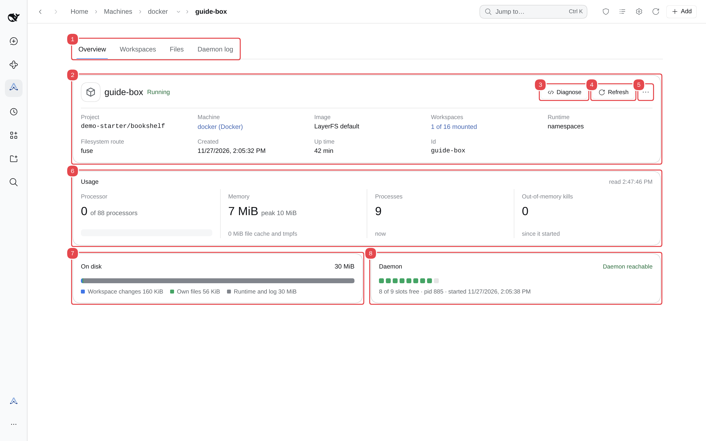
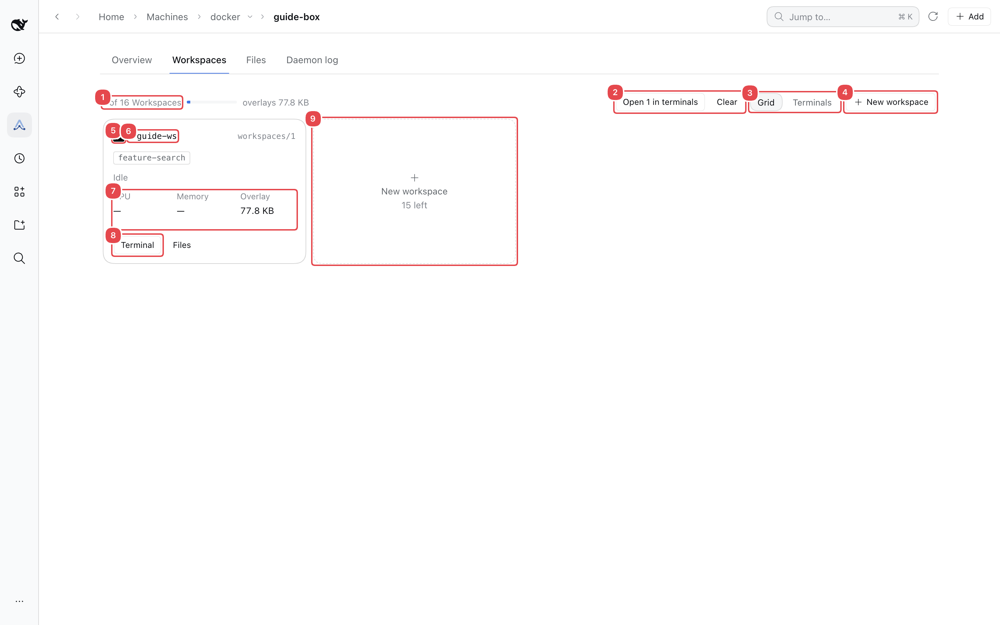
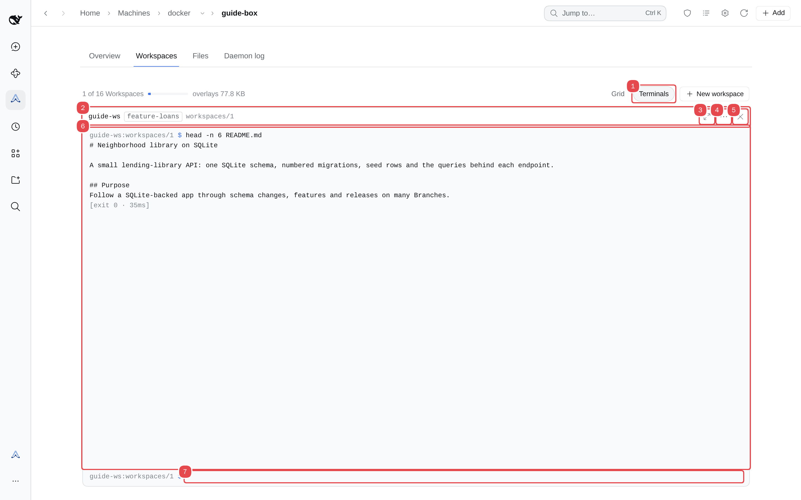
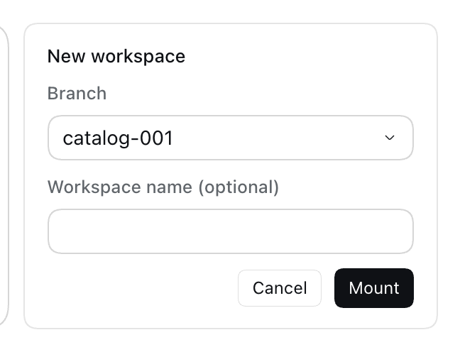
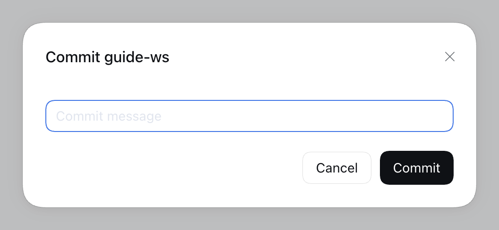
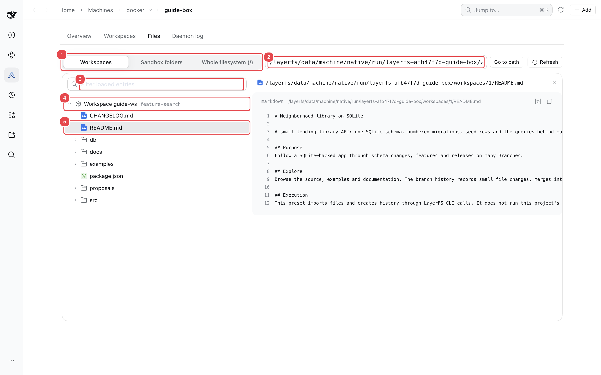
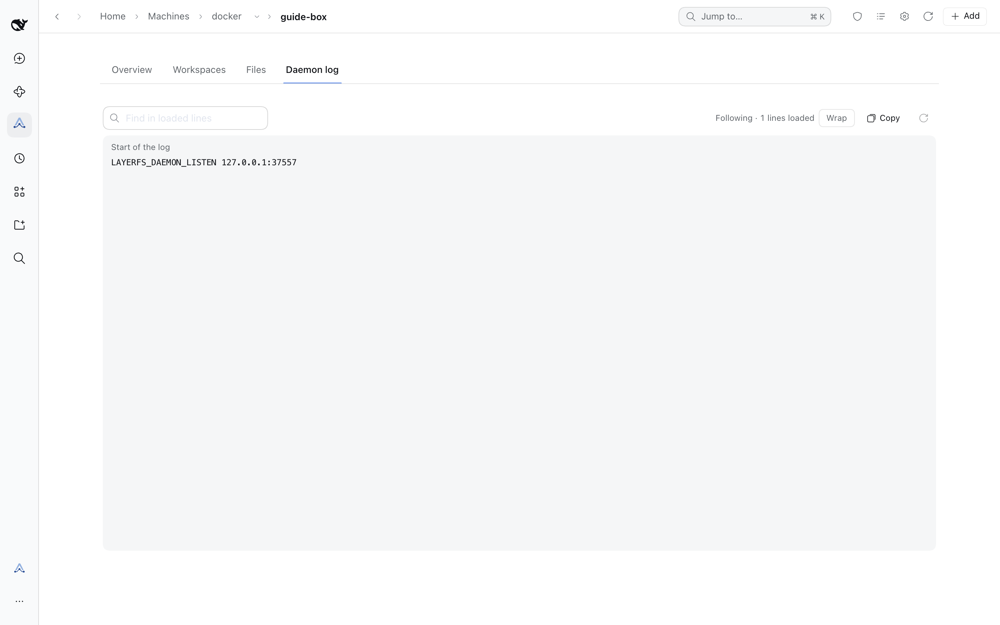
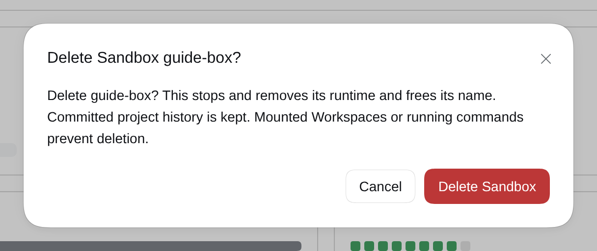
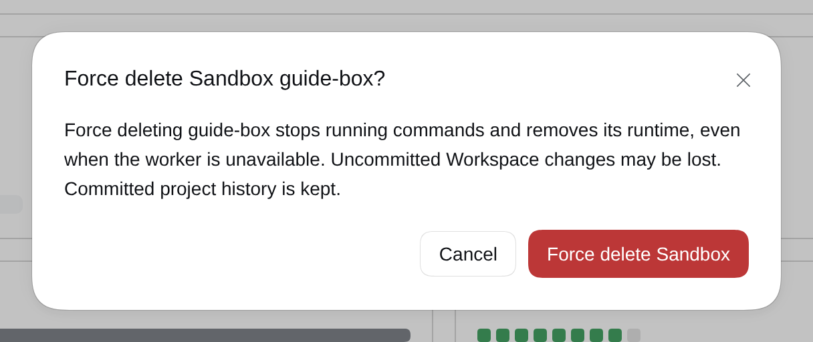
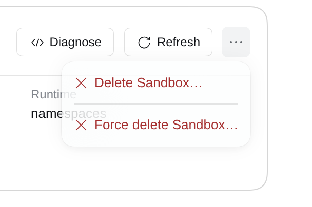

<!-- source: 1bc87dc0162b -->
# Sandbox

> **位置：** `LayerFS › 主页 › 机器 › <machine> › <sandbox>` · **打开方式：** 机器 Sandbox 标签页上的 Sandbox 卡片或行、机器看板、项目的 Sandbox 标签页、跳转到（**Sandbox**（Sandboxes）分组）、磁盘空间对话框里的 **最大的 Sandbox**（Largest Sandboxes） · **源码：** 见文末

Sandbox 是一台机器上为一个项目运行的环境：一个 daemon 负责挂载 Workspace（把项目的一个分支作为文件夹）
并在其中运行命令。它的页面回答“它是否活着、用了多少资源、挂载了什么”；你也在这里挂载 Workspace、
在里面运行命令、提交改动，以及删除 Sandbox。

| # | 组件 | 说明 |
|---|---|---|
| 1 | 标签栏 | **概览**（Overview）· **Workspace**（Workspaces）· **文件**（Files）· **Daemon 日志**（Daemon log）（后两个只在提供时出现） |
| 2 | 详情卡片 | 名称、状态以及 Sandbox 的基本信息：项目、机器、镜像、已挂载的 Workspace、运行时、路由、创建时间、运行时间、ID |
| 3 | **诊断**（Diagnose） | 在诊断页面上运行这个 Sandbox 的检查 |
| 4 | **刷新**（Refresh） | 重新读取 Sandbox |
| 5 | ⋯ | **删除 Sandbox…**（Delete Sandbox…）、**强制删除 Sandbox…**（Force delete Sandbox…） |
| 6 | 用量卡片 | 当前的处理器、内存、进程和内存不足终止次数 |
| 7 | 磁盘占用 | Sandbox 的运行文件夹，拆分为 Workspace 改动、自身文件、运行时和日志 |
| 8 | 守护进程 | 是否可连接、控制槽位、pid 和启动时间、保留的失败记录 |

标签上方是[导航栏](components.md#nav-bar)：`主页 › 机器 › docker › guide-box`。

## 布局

和机器页面一样，最上面是标签栏；名称、图标和状态放在概览的详情卡片顶部。头部和标签直接用机器的
Sandbox 列表绘制，所以页面不会等某一次慢读取；只有 Workspace 标签页要等 `sandbox get`。标签栏下方的
红色提示会告诉你：Workspace 无法读取（**Workspace 不可用：**（Workspaces unavailable:）*原因*，附
**打开 Daemon 日志**（Open daemon log））、某次拒绝，或者 Sandbox 处于未决状态以及能解决它的调用。
页面会按 Sandbox 记住你上次所在的标签。

## 概览

| 组件 | 显示内容 | 操作 → 结果 | LayerFS 调用 | 状态 |
|---|---|---|---|---|
| 详情卡片 | **项目**（Project）（`demo-starter/bookshelf`）、**机器**（Machine）（**docker (Docker)**）、**镜像**（Image）（名称与机器上 Sandbox 卡片的写法一致；bundle 自带的镜像显示 **LayerFS 默认**（LayerFS default），否则显示短 ID）、**Workspace**（Workspaces）（**已挂载 1 / 16 个**（1 of 16 mounted））、**运行时**（Runtime）、**文件系统路由**（Filesystem route）、**创建时间**（Created）、**运行时间**（Up time）、**ID**（Id） | **机器**（Machine）→ 机器页面；**Workspace**（Workspaces）→ Workspace 标签页 | `sandbox list` (读取，来自机器视图)，然后 `sandbox get` (读取：运行中每 15 秒一次，有命令在运行时每 5 秒一次，每条命令结束后再读一次)；镜像名称来自 `machine images` (读取) | 状态标签：**运行中**（Running）、**已停止**（Stopped）、**守护进程未运行**（Daemon not running）、**需要修复**（Needs repair）、… |
| **诊断**（Diagnose） | | 按下 → 诊断页面运行这个 Sandbox 的检查 | `sandbox doctor`（在诊断页面上） | |
| **刷新**（Refresh） | | 立即读取 Sandbox | `sandbox get` (读取) | |
| ⋯ | **删除 Sandbox…**（Delete Sandbox…）（删除结果不确定后变为 **读取 Sandbox**（Read Sandbox））、**强制删除 Sandbox…**（Force delete Sandbox…） | 见[对话框](#modals-opened-here) | `sandbox remove` / `sandbox remove --force` | 有操作在运行时 **删除**（Delete）不可用 |
| 用量卡片 | **处理器**（Processor）（*n* **/ *m* 个处理器**（of *m* processors），一条进度条）、**内存**（Memory）（当前、**峰值**（peak）、文件缓存和 tmpfs）、**进程**（Processes）（**当前**（now））、**内存不足终止**（Out-of-memory kills）（**自启动以来**（since it started），大于 0 时显示红色）、**读取于**（read）*时间* | — | — （主机的指标采样器每 15 秒在机器上读取一次 `machine stats`） | 没有独立 cgroup 的 Sandbox（LayerFS Home）：**未单独测量此 Sandbox：*原因*。下面显示的是整台机器。**（Not measured for this Sandbox: *reason*. The whole machine is shown instead.）；较旧的 worker：**这台机器的 worker 是较旧的构建：它不发送每个 Sandbox 的数值。**（This machine's worker is an older build: it sends no per-Sandbox values.） |
| 用量行 | 没有 `machine stats` 时：**用量**（Usage）CPU 时间、当前和峰值内存、进程，来自 `sandbox get` | — | `sandbox get` (读取) | 较旧的 CLI |
| 磁盘占用 | 总量、一条进度条，以及 **Workspace 改动**（Workspace changes）、**自身文件**（Own files）、**运行时和日志**（Runtime and log） | — | 在其所在机器上 `machine stats --with space` (读取，缓存 1 分钟) | **正在读取磁盘占用…**（Reading disk use…）；未读取时说明原因 |
| 守护进程 | **守护进程可连接**（Daemon reachable）/ **无法连接守护进程**（Daemon not reached）/ **守护进程未运行**（Daemon not running）/ **守护进程未报告**（Daemon not reported），每个控制槽位一个方块，**_m_ 个槽位中 _n_ 个空闲 · pid _n_ · 启动于 _时间_**（*n* of *m* slots free · pid *n* · started *time*），**保留 _n_ 次失败**（*n* retained failures） | **查看**（View）/ **收起**（Hide）→ 一张 **保留的守护进程失败**（Retained daemon failures）表（槽位、原因、时长） | `sandbox get` (读取) | |

## Workspace

Sandbox 的 Workspace，可以显示为卡片（**网格**（Grid））或终端（**终端**（Terminals））。选择哪种视图会记在
这个浏览器里。

| # | 组件 | 显示内容 | 操作 → 结果 | LayerFS 调用 | 状态 |
|---|---|---|---|---|---|
| 1 | 计数 | **_n_ / 16 个 Workspace**（*n* of 16 Workspaces）及容量条、**_n_ 条运行中**（*n* running）（以及 **_n_ 条来自其他客户端**（*n* by another client））、**overlay 共**（overlays）*大小* | **_n_ 条运行中**（*n* running）→ 下一个有命令在运行的 Workspace 的终端 | `sandbox get` (读取) | |
| 2 | 已选栏 | **在终端中打开 _n_ 个**（Open *n* in terminals）和 **清除**（Clear）（网格），或 **显示已选的 _n_ 个**（Showing *n* chosen）和 **显示全部**（Show all）（终端） | → 只看勾选的 Workspace 的终端 / 重新显示全部 | — （视图状态） | 只在勾选了卡片时 |
| | 翻页 | **上一页**（Previous page）、*页码* / *总页数*、**下一页**（Next page） | 一屏放不下的终端 | — | 终端视图，且超出一屏时 |
| 3 | **网格**（Grid）/ **终端**（Terminals） | | 切换视图 | — | |
| 4 | **新建 Workspace**（New workspace） | | 在最后一格打开[新建 Workspace 表单](#new-workspace-form) | — | 不可用时提示 **一个 Sandbox 最多容纳 16 个 Workspace。**（A Sandbox holds at most 16 Workspaces.）或 **无法连接此 Sandbox，无法挂载 Workspace。**（The Sandbox can’t be reached, so no Workspace can be mounted.）；Sandbox 已消失时隐藏 |
| 5 | 勾选框 | **选择** *name*（Choose *name*） | 勾选卡片，用于终端视图 | — | |
| 6 | 名称 | 活动圆点和名称、挂载文件夹（`workspaces/1`）、分支，挂载后分支有移动时显示 **分支头已移动**（Head moved） | 点击 → 它的终端 | — | |
| | 运行行 | 正在运行的程序及运行时长、**另有 _n_ 条**（+*n* more），或 **空闲**（Idle） | — | `sandbox get` (读取) | |
| 7 | 数值 | **CPU**（速率及迷你走势图）、**内存**（Memory）（**峰值**（peak））、**Overlay**（*大小*，以及其上的改动） | — | `sandbox get` (读取) | 显示短横线，悬停说明原因（**这里没有运行的命令，无可测量**（Nothing runs here, so there is nothing to measure）） |
| 8 | **终端**（Terminal）/ **文件**（Files） | | → 它的终端 / 文件标签页 | — | 有文件标签页时才有 **文件**（Files） |
| 9 | 新建 Workspace 格 | **新建 Workspace**（New workspace）、**剩余 _n_ 个**（*n* left）（一个都没有时显示 **还没有 Workspace**（No Workspaces yet）） | 同 **新建 Workspace**（New workspace） | — | |

### 终端

区域里能放多少终端就放多少（每个至少 380 × 220，最多 4 × 3），放不下就翻页，也可以把其中一个最大化。
每个都是一个[终端窗格](components.md#terminal-pane)。

| # | 组件 | 操作 → 结果 | LayerFS 调用 |
|---|---|---|---|
| 1 | **终端**（Terminals） | 当前视图 | — |
| 2 | 窗格头部 | 名称、分支、挂载文件夹、改动标签（悬停显示 overlay 大小）、忙碌圆点 | `sandbox get` (读取) |
| 3 | **最大化**（Maximize）/ **还原**（Restore） | 一个窗格占满区域（按 Escape 或 Alt+Enter 还原） | — |
| 4 | ⋯ **_name_ 的更多操作**（More for *name*） | **提交…**（Commit…）→ [提交对话框](#commit-dialog)；**复制路径**（Copy path） | `workspace commit` |
| 5 | × **关闭**（Close）*name* | 立即卸载，不再确认：未提交的改动会丢弃，正在运行的命令会取消 | `workspace unmount --discard --force` |
| 6 | 命令记录 | 本应用在这里运行过的命令、它们的输出和 **[退出码 _n_ · _时间_]**（[exit *n* · *time*]） | — （主机的命令日志；有命令运行时会反复读取） |
| 7 | 提示符 | *name*:*folder* **$** —— Enter 运行这一行；↑/↓ 翻历史；Ctrl+C 取消正在运行的命令（或清空当前行）；Ctrl+L 清屏 | `workspace exec`；Ctrl+C：`workspace cancel --exec` |

跨窗格的快捷键：Alt+1…9 聚焦某个窗格，Alt+PageUp / Alt+PageDown 翻页。

### 新建 Workspace 表单

挂载 Sandbox 自己项目的一个分支。表单从不提供 `main`（LayerFS 只挂载旁支分支）。

| 组件 | 操作 → 结果 | LayerFS 调用 | 状态 |
|---|---|---|---|
| **分支**（Branch） | 选择项目的一个分支，或 **从 main 新建分支…**（New branch from main…） | `branch list`, `branch get` (读取) | **无法读取分支。**（Branches could not be read.） |
| **新分支名称**（New branch name） | 新建分支时出现 | — | **请使用小写字母、数字、点、下划线或短横线，并以字母或数字开头。**（Use lowercase letters, digits, dots, underscores or hyphens, starting with a letter or digit.） |
| **Workspace 名称（可选）**（Workspace name (optional)） | 给 Workspace 起个名字 | — | 名称已被占用时会标出 |
| **挂载**（Mount） | 挂载它，然后显示并聚焦它的终端（无论是否起了名字） | `workspace mount <sandbox> <branch> [--name]`（新分支：先 `sandbox get`，再 `branch fork <project> <branch> main`） | **正在挂载…**（Mounting…）；被拒绝时错误留在表单里 |
| **取消**（Cancel）/ Escape | 关闭表单 | — | |

### 提交对话框

**提交 _name_**（Commit *name*）：一个可选的 **提交说明**（Commit message）。**提交**（Commit）会把 Workspace 的改动
记录为其分支上的一个新提交（`workspace commit [--message]`）；随后窗格显示 **已提交 _id_**（Committed *id*）
或 **没有可提交的更改**（Nothing to commit）。**取消**（Cancel）关闭对话框。

## 文件

只有固定版本的 CLI 能列出 Sandbox 文件时才有。只读。

| # | 组件 | 显示内容 | 操作 → 结果 | LayerFS 调用 | 状态 |
|---|---|---|---|---|---|
| 1 | 视图 | **Workspace**（Workspaces）（每个已挂载的 Workspace 作为一个文件夹，内容是其已保存的文件）、**Sandbox 文件夹**（Sandbox folders）（home、daemon 日志），以及提供时的 **整个文件系统 (/)**（Whole filesystem (/)） | 点击 → 切到该视图 | **Workspace**：`branch get`, `file list` (读取，通过项目在 Workspace 的基准提交处读取)；其他视图：`sandbox files <sandbox>` (读取) | **没有挂载的 Workspace。**（No Workspaces are mounted.） |
| 2 | 路径 | 当前显示的路径，可编辑 | **转到路径**（Go to path）→ 打开它 | `sandbox files <sandbox> <path>` (读取) | |
| 3 | **筛选已加载的条目**（Filter loaded entries） | | 筛选已经读到的内容 | — | |
| 4 | Workspace 行 | **Workspace** *name*，附其分支和改动 | 点击 → 它的文件 | `file list` (读取) | |
| 5 | 文件 | 文件文本，每次显示一段 | 点击 → 打开它 | `file read`, `file stat` (读取；Sandbox 文件夹：`sandbox files --byte-offset --byte-length`) | daemon 日志会提示 **在“Daemon 日志”标签页中读取**（Read in the Daemon log tab） |

**刷新**（Refresh）重新读取已展开的文件夹；读取较久时会显示秒数和 **取消**（Cancel）。
这棵树和机器的[文件标签页](machine.md#files)一样。

## Daemon 日志

只有固定版本的 CLI 有 `sandbox log` 时才有。

Sandbox daemon 的日志，实时跟随：一个[日志窗格](components.md#log-pane)，读取
`sandbox log`（用 `--cursor` / `--limit` 读新行和更早的行）。Sandbox 已消失时，读取被拒绝后就停止轮询
（**已停止读取**（Stopped reading））。

## 变体

- **项目对话的 Sandbox**（A project conversation's Sandbox）（名为 `dsh-…`，`handbook` 的在 LayerFS Home 上）：
  它的 Workspace 就是对话的 Workspace。**删除 Sandbox…**（Delete Sandbox…）按对话关闭它的方式来关闭：先保存
  一个检查点（`workspace status`、`workspace commit`），再 `sandbox remove --force`。
- **LayerFS Home** 上的 Sandbox 以主机进程运行：镜像一项显示 **无 · 主机进程**（None · host processes），
  用量卡片显示整台机器，以灰色显示并说明原因。
- **已消失的 Sandbox**（A gone Sandbox）（其 daemon 随机器一起结束了）：没有 **新建 Workspace**（New workspace），
  守护进程卡片显示 **守护进程未运行**（Daemon not running），机器页面上它的卡片提供 **关闭**（Close）。
- **文件**（Files）和 **Daemon 日志**（Daemon log）只在固定版本的 CLI 有 `sandbox files` 和 `sandbox log` 时才显示。

## 在这里打开的对话框

| 对话框 | 打开方式 | 作用 | LayerFS 调用 | 撤销 |
|---|---|---|---|---|
| **删除 Sandbox _name_？**（Delete Sandbox *name*?） | ⋯ › **删除 Sandbox…**（Delete Sandbox…） | **这会停止并移除其运行时并释放其名称。已提交的项目历史会保留。已挂载的 Workspace 或正在运行的命令会阻止删除。**（This stops and removes its runtime and frees its name. Committed project history is kept. Mounted Workspaces or running commands prevent deletion.）→ **删除 Sandbox**（Delete Sandbox） | `sandbox remove` | 无：新建一个 Sandbox |
| **强制删除 Sandbox _name_？**（Force delete Sandbox *name*?） | ⋯ › **强制删除 Sandbox…**（Force delete Sandbox…） | **…即使 worker 不可用，也会停止正在运行的命令并移除其运行时。未提交的 Workspace 改动可能丢失。**（…stops running commands and removes its runtime, even when the worker is unavailable. Uncommitted Workspace changes may be lost.）→ **强制删除 Sandbox**（Force delete Sandbox） | `sandbox remove --force` | 无 |
| [提交 *name*](#commit-dialog)（Commit *name*） | 窗格 ⋯ › **提交…**（Commit…） | 提交 Workspace | `workspace commit` | 无：提交会留在分支历史里 |

如果因为有 Workspace 挂载着或有命令在运行而被拒绝，删除操作会留在页面上；如果返回的结果不确定，菜单会提供
**读取 Sandbox**（Read Sandbox），而不是让你再删一次。删除成功后页面回到机器。

## 状态与提示

- **守护进程可连接**（Daemon reachable，绿色）：命令可以运行。**无法连接守护进程**（Daemon not reached）：记录显示它在运行，
  但 daemon 没有响应；打开 Daemon 日志，或者强制删除。
- 窗格里出现 **无法连接此 Sandbox，命令无法运行。**（The Sandbox can't be reached, so commands can't run.）：在 daemon 响应之前
  提示符不可用。
- 窗格里出现 **另有命令在运行：**（Also running:）*程序* · *时长* · *发起者*：这是其他客户端（某个会话、别处的本应用、带标签的运行）
  启动的命令，只能在启动它的地方取消。
- **分支头已移动**（Head moved）：Workspace 挂载之后，它的分支上又有了新提交。
- **结果未知：命令运行期间此主机已停止**（outcome unknown: this host stopped while it ran）：命令运行时主机重启了。

## 下一步

- [机器](machine.md)：它所在的机器。
- 项目页面的历史，用来查看在这里做的提交。
- [组件](components.md)：[终端窗格](components.md#terminal-pane)、
  [日志窗格](components.md#log-pane)、[Sandbox 卡片](components.md#sandbox-card)。

## 源码

`src/client/machines/`：`SandboxDetail.tsx`、`SandboxOverview.tsx`、`SandboxTerminals.tsx`、
`WorkspaceGrid.tsx`、`TerminalPane.tsx`、`terminal.ts`、`Sandboxes.tsx`、`InspectFiles.tsx`、
`LogPane.tsx`、`notices.ts`、`locale.ts`。主机端：`src/host/routes/projects.ts`（`sandbox`、
`closeSandbox`、`mount`、`unmount`）、`commands.ts`、路由器中内联的 workspace 提交和卸载（`router.ts`）、
`machines.ts`（`sandboxLog`、`sandboxFiles`）。
