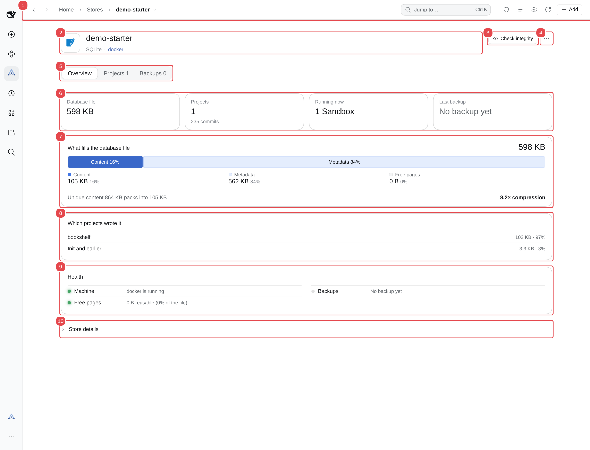
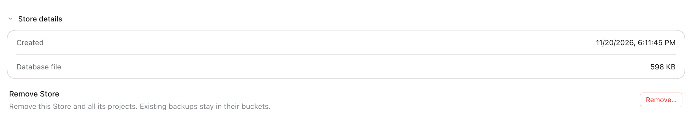
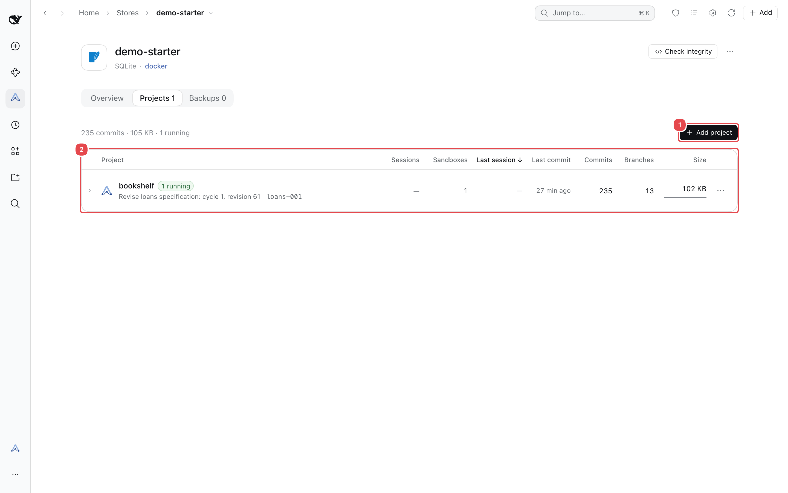
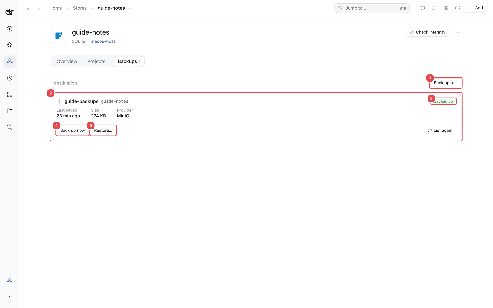
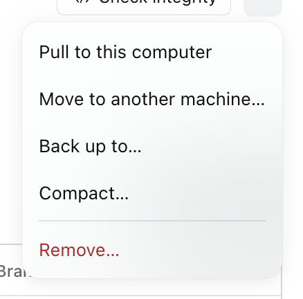
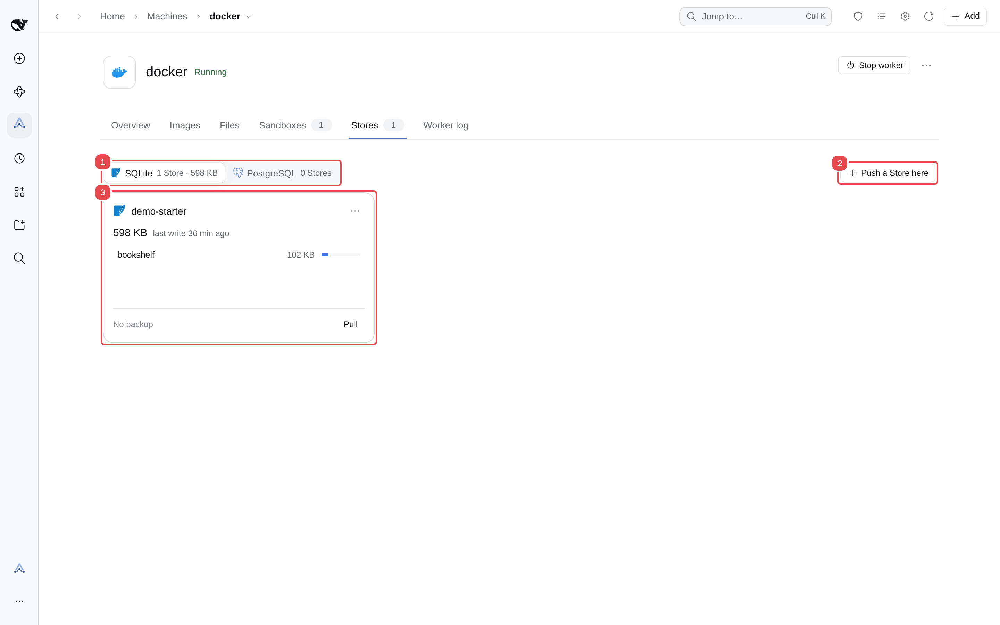
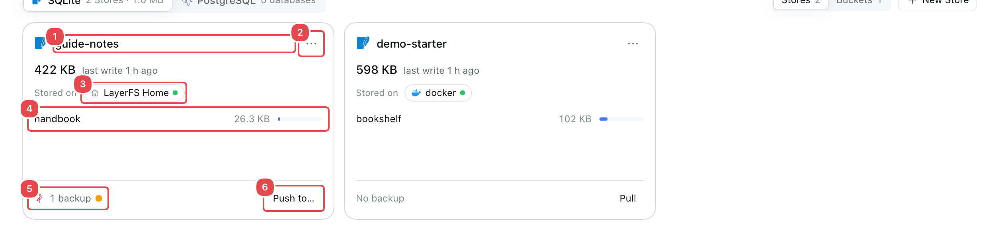
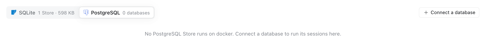

<!-- source: b466ee26e5a8 -->
# Store

> **位置：** `LayerFS › 主页 › Store › <store>` · **打开方式：** 主页 › Store 或某台机器的 Store 标签页上 Store 卡片的名称、导航栏的层级切换器、跳转到、项目页上的 Store 链接、存储桶的关联 Store · **源码：** 见文末

Store 是存放项目的数据库：某台机器上的一个 SQLite 文件，或者某台服务器上的一个 PostgreSQL
数据库。这一页回答“它有多大、里面有什么、谁在用、有没有备份（或者能不能连上）”，并且汇集了
所有针对整个 Store 的操作：推送、拉回、迁移、备份、压缩、移除（SQLite），或者检查、编辑连接、
挂接机器、断开连接（PostgreSQL）。PostgreSQL Store 有自己更简洁的页面：见 [PostgreSQL Store 页面](#postgresql-store-page)。

| # | 组件 | 说明 |
|---|---|---|
| 1 | 导航栏 | [组件 › 导航栏](components.md#nav-bar)：`主页 › Store › demo-starter`；最后一级的切换器列出所有 Store |
| 2 | 头部 | Store 的图标、名称、未就绪时的状态标签，以及它的类型和所在位置（点 **docker** 打开那台机器） |
| 3 | **检查完整性**（Check integrity） | 对 Store 运行诊断，并打开诊断页 |
| 4 | ⋯ | Store 菜单：[组件 › Store 菜单](components.md#store-menu) |
| 5 | 标签页 | **概览**（Overview）· **项目**（Projects）*n* · **备份**（Backups）*n* |
| 6 | 磁贴 | 数据库文件、项目及其提交数、正在运行、上次备份 |
| 7 | 数据库文件的构成 | 内容、元数据和空闲页，以及压缩比 |
| 8 | 由哪些项目写入 | 每个项目在打包字节中的占比 |
| 9 | 健康状况 | 机器、备份和空闲页 |
| 10 | Store 详情 | 默认折叠：创建时间、文件大小，以及 **移除…**（Remove…） |

## 布局

头部（名称、类型、位置、**检查完整性**（Check integrity）、⋯）下面有两条按需出现的横栏：Store
需要你处理时的红色提示，以及迁移、备份、恢复或压缩正在进行（或刚结束）时的
[任务卡片](components.md#job-card)。再往下是三个标签页；页面会按 Store 记住你上次选的标签。

页面会在每次 `storage` 事件、每次操作之后，以及页面可见时每 15 秒，重新读取存储视图
（`GET /api/storage`：`home get`、`project list`、`store list`，以及每个 PostgreSQL Store 的 `store get`）。各标签页自己的读取
（`store get --with stats`、项目账本）会在 `storage`、`storage-job` 和 Workspace 事件时刷新，合并为
每 2 秒最多一次。

## 头部与提示

| 组件 | 显示内容 | 操作 → 结果 | LayerFS 调用 | 状态 |
|---|---|---|---|---|
| 头部 | 图标、名称、状态标签（**忙碌**（Busy）、**受阻**（Blocked）、**损坏**（Broken）、**未知**（Unknown）；就绪时不显示）、**SQLite** · 位置 | 点机器名 → 那台机器的页面 | `store list` (读取) | 忙碌时标签会闪烁 |
| **检查完整性**（Check integrity） | Store 的诊断 | 按下 → 开始一次诊断，并打开显示结果的诊断页 | `store doctor` | 正在交接这次运行时不可用 |
| ⋯ | [Store 菜单](components.md#store-menu) | 见下文 [Store 菜单](#store-menu) | 各行不同 | Store 未就绪时各行禁用 |
| 待处理提示 | 状态词及原因：**已损坏 · …**（Broken · …）、**等待 docker**（Waiting on docker）、**docker 已停止。**（docker is stopped.）、**已阻塞 · docker 已损坏**（Blocked · docker broken）；悬停显示 LayerFS 的原句 | 旁边唯一的操作：**启动 docker**（Start docker）（机器已停止时）、Store 的[修复按钮](components.md#fix-buttons)，或 **修复 docker**（Repair docker）（打开损坏的机器） | `machine start`，或修复本身的调用 | Store 就绪且机器在运行时隐藏 |
| 任务卡片 | 这个 Store 上正在运行或刚结束的任务 | [组件 › 任务卡片](components.md#job-card)：**重试**（Retry，迁移的推送半程失败时为 **重试推送**，Retry push）、**关闭**（Dismiss）、**打开**（Open）*Sandbox* | 见任务卡片 | 成功后保留一分钟，失败后保留到你关闭为止 |
| 其他客户端的操作 | **另一个客户端正在此 Store 上运行** *op*（Another client runs *op* on this Store） | — | `store list` (读取：其 `op`) | 只在另一个进程占用这个 Store 时出现 |
| 标签页 | **概览**（Overview）、**项目**（Projects）*n*、**备份**（Backups）*n* | 点击 → 该标签页 | —（标签页记在浏览器里） | |

## 概览

Store 有多大、是谁写的、有没有需要你留意的地方。

| 组件 | 显示内容 | 操作 → 结果 | LayerFS 调用 | 状态 |
|---|---|---|---|---|
| **数据库文件**（Database file）磁贴（SQLite） | 文件大小；机器没有响应时显示 **大小读取于** *时间*（size seen *when*） | — | `store list` (读取) | **大小未知**（Size unavailable） |
| **项目**（Projects）磁贴 | 项目数和 **n 次提交**（n commits）（账本统计中时为 **已统计 n 次提交**（n commits so far）） | 点击 → 项目标签页 | `project list`、`project stats`、`branch get` (读取) | Store 拒绝时显示 **未读取：…**（Not read: …） |
| **正在运行**（Running now）磁贴 | 这个 Store 的项目中 daemon 正在运行的 Sandbox | — | `machine list`、`sandbox list` (读取，`GET /api/machines`) | |
| **上次备份**（Last backup）磁贴（SQLite） | 最近一次有时间记录的副本距今多久及其对应存储桶；若无时间戳则显示已知状态 | 点击 → 备份标签页 | `store list` (读取：其链接)、`backup list` (读取) | 未关联备份时显示灰色 **尚未备份**（No backup yet） |
| 数据库文件的构成 | 一条堆叠构成条，展示 **内容**（Content）、**元数据**（Metadata，采用中性蓝灰，不用警告橙）和 **空闲页**（Free pages），宽分段直接在条内标出名称与占比、下方列出详细大小，0 字节分段不在条内占位；**唯一内容** *x* **打包为** *y*（Unique content *x* packs into *y*）以及 **×** 比例 | 悬停 → 分段详情与联动高亮 | `store get --with stats` (读取) | **读取中…**（Reading…）、**未读取：…**（Not read: …）、**LayerFS 未报告此 Store 的构成。**（LayerFS did not report this Store's parts.） |
| Store 的增长 | 文件、内容和元数据在本机过去各次读取中的变化；间隔超过日志记录间隔的地方显示为断开 | — | —（本机对早先 `store get --with stats` 读取的记录） | 至少记录过一次读取后才显示；**图表从本机对此 Store 的读取开始：目前只有一次。**（The chart starts with this host's reads of the Store: one so far.） |
| 由哪些项目写入 | 纵向列表，展示每个项目的打包字节与占比；没有被任何提交计入的字节归为 **初始化及更早**（Init and earlier） | — | `project stats` (读取)、`store get --with stats` (读取) | **还没有项目提交内容。**（No project has committed content yet.） |
| 健康状况 | **机器**（Machine）（*docker* **正在运行**（is running）/ 已停止）、**备份**（Backups）（仅全部副本核验最新时亮绿点 **已是最新**；落后副本只用自身时间并标明桶名显示灰色 **自上次备份后已更改**、**桶已更改**、**未检查**、**未列出** 或 **尚未备份**；仅 **缺失** / **两侧均已更改** 标红）、**空闲页**（Free pages）（可重用的比例） | — | 来自上面的读取 | 绿、灰、红色圆点 |
| Store 详情 | **创建时间**（Created）、**数据库文件**（Database file）；然后是 **移除 Store**（Remove Store） | **移除…**（Remove…）→ [输入名称确认](#modals-opened-here) | `store remove` ↻ | 默认折叠 |

## 项目

Store 里的所有项目，和主页 › 项目里的表格一样，只是少了 Store 这一列。

| # | 组件 | 显示内容 | 操作 → 结果 | LayerFS 调用 | 状态 |
|---|---|---|---|---|---|
| | 摘要 | **n 次提交 · 大小 · n 个运行中**（n commits · size · n running） | — | `project stats` (读取) | |
| | 搜索 | 按名称筛选行 | 输入；Escape 清空 | — | 项目超过四个时才出现 |
| 1 | **添加项目**（Add project） | | 按下 → [添加项目](#modals-opened-here) | `project init` | Store 未就绪时不可用 |
| 2 | 项目表 | 每个项目：名称及 **n 个运行中**（n running）、最新一条提交、**会话**（Sessions）、**Sandbox**（Sandboxes）、**最近会话**（Last session）、**最近提交**（Last commit）、**提交**（Commits）、**分支**（Branches）、**大小**（Size），附一条表示其在 Store 中占比的横条 | 点列标题排序（有会话运行时，最近会话一列保持不动）；箭头展开该行的会话或 Sandbox；点名称打开项目页；点 Sandbox 打开它的页面 | `project list`、`project stats`、`branch get` (读取)；会话来自这个 DSH（无调用）；Sandbox 来自 `sandbox list` (读取) | 账本读完之前，行里先不显示数字；**还没有项目**（No projects yet）、**没有匹配的项目**（No matching projects） |

## 备份（SQLite）

这个 Store 的副本存在哪里、每份有多新，以及刷新或恢复某一份的按钮。打开此标签页时，会自动对尚未列出且未报错的关联存储桶执行一次列出。

| # | 组件 | 显示内容 | 操作 → 结果 | LayerFS 调用 | 状态 |
|---|---|---|---|---|---|
| | 数量 | **n 个备份目标**（n destination(s)） | — | — | |
| 1 | **备份到…**（Back up to…） | | 按下 → [备份](#modals-opened-here)（还没有存储桶时：**添加存储桶…**（Add bucket…）→ 添加存储桶，然后备份） | `backup create` | 未就绪时不可用（悬停说明原因） |
| 2 | 备份目标卡片 | 服务商图标、可点击的存储桶名、可点击的文件名（已列出且未缺失时）、**上次保存**（Last saved）、**大小**（Size）、**服务商**（Provider）（**MinIO**、**Cloudflare R2**） | 点击存储桶 → [存储桶页](bucket.md)；点击文件 → 备份文件页 | `store list` (读取：链接)，以及该存储桶最近一次 `backup list` | **尚未配置备份目标。**（No backup destinations configured.） |
| 3 | 状态标签 | **已备份**（Backed up）、**Store 已更改**（Store changed）、**存储桶已更改**（Bucket changed）、**双方都已更改**（Both changed）、**缺失**（Missing）、**未检查**（Not checked）、虚线 **未列出**（Not listed），或列表失败（**未列出 · 密钥被拒绝**等）——与存储桶页用词完全相同；悬停显示 LayerFS 的原句 | — | `backup list` (读取) | 列出前显示虚线 **未列出**；列表失败时显示红色标签 |
| 4 | 主备份 / 恢复动作 | **立即备份**（Back up now，最新、Store 已更改或未列出时）、**另存为新文件…**（Back up as new file…，**缺失**、**双方都已更改**、**存储桶已更改** 时），或 **重新连接…**（Connect again…，密钥被拒时） | **立即备份** → 立即开始一个备份任务；**另存为新文件…** → 打开[备份](#modals-opened-here)并预填新文件名；**重新连接…** → 重新连接存储桶 | `backup create`，然后 `backup list` | 未就绪时不可用（悬停说明原因） |
| 5 | **恢复…**（Restore…） | | 按下 → 针对这个文件打开[恢复](#modals-opened-here) | `backup restore`，然后 `backup list` | **缺失** 时隐藏；存储桶未列出时禁用并说明需先列出；忙碌时不可用 |
| | **列出存储桶** / **重新列出**（List the bucket / List again） | | 按下 → 立即列出该存储桶 | `backup list` (读取) | 列出时显示加载圆点 |

## PostgreSQL Store 页面

示例数据里没有 PostgreSQL Store，所以这个页面是根据代码描述的。

头部：名称、**PostgreSQL · 大小 · n 个项目**、**检查**（Check），以及 ⋯（**复制地址**（Copy address）、
**断开连接…**（Disconnect…），此 Store 有 Sandbox 运行时不可用）。下面分两栏：所有项目（从大到小），附
**在“项目”中查看 →**（Show in Projects →，按此 Store 筛选的项目标签页）；旁边是 **连接**（Connection）和
**运行于**（Runs on）。窄于 760 px 时两栏上下排列。

| 组件 | 显示内容 | 操作 → 结果 | LayerFS 调用 | 状态 |
|---|---|---|---|---|
| **检查**（Check） | | 按下 → 先从这台电脑检查，再检查每台挂接的机器；各状态原地更新 | `store doctor`，然后 `store get` | 运行时显示 **检查中** |
| 项目 | 每个项目的大小、会话、Sandbox 和最近一次提交 | 名称 → 项目页 | `project list` (读取) | **无法读取项目** 时保留上次的列表，并标出 **读取于** *时间* |
| **连接**（Connection） | **地址**（`host:port`，**复制**）、**数据库**（悬停显示数据库名与 Store ID）、**用户**、**密码**（**已保存** / **未保存**，悬停显示修改时间）、**从这台电脑检查**（Checked from this computer）（这台电脑的状态；悬停显示时间与 LayerFS 的原话） | **编辑…**（Edit…）→ [编辑连接](#modals-opened-here) | `store get` (读取：`url`、`user`、`password_saved`、`reach`) | 状态使用[统一的标签](#status-labels) |
| **运行于**（Runs on） | 每台挂接的机器一行：图标、名称（`native` 也和其他机器一样显示名称）、服务商（与名称相同时省略）、**n 个 Sandbox**、状态、**×** | **+ 挂接机器**（+ Attach machine）→ [挂接选择器](#modals-opened-here)；**×** 立即解除挂接（可撤销）；失败时的那一个操作（**编辑连接…**、**启动**、**更新…**） | `store get` (读取：`machines`)、`store attach`、`store detach` | 有 Sandbox 在那台机器上运行时 **×** 留在原位但不可用，悬停显示 **此 Store 有 n 个 Sandbox 在 … 上运行：关闭后才能解除挂接**；挂接后尚未检查的机器显示 **未检查**；一台都没有时显示 **还没有机器，挂接一台即可运行 Sandbox。** |

### 状态标签

无论从这台电脑还是从某台机器检查，都用同一套标签：**可访问**、**检查中**、**未检查**、**无法访问地址**、
**密码错误**、**找不到数据库**、**不是此 Store**、**机器已停止**、**机器需要更新**、**检查失败**（其他情况）。
LayerFS 的原话只作为悬停提示，不出现在行上。每种失败只有一个操作：**编辑连接…**（地址、密码、数据库）、
**启动**（机器已停止）或 **更新…**（机器需要更新）。被拒的 **password authentication**（SQLSTATE 28P01/28000）显示为
**密码错误**。

三个说法互不混用。**从这台电脑检查**（Checked from this computer）是主机自己的检查（行名称前的圆点，以及
Store 页面上同名的那一项）。机器 `native` 和其他机器一样显示为 `native`。**本地地址**（local address；
`localhost`、`127.0.0.1`、`::1`）只有 LayerFS 报告为与这台电脑共享网络（`loopback: shared`）的机器才能访问，
其提示会列出这些机器。

## Store 菜单

头部（以及每张 Store 卡片）上的 ⋯ 汇集了所有针对整个 Store 的操作。完整的组件说明见
[组件 › Store 菜单](components.md#store-menu)。

| 机器上的 SQLite | native 上的 SQLite |
|---|---|
|  |  |

| 菜单行 | 显示于 | 操作 → 结果 | LayerFS 调用 | 禁用条件 |
|---|---|---|---|---|
| **推送到…**（Push to…） | native 上的 SQLite | [推送](#modals-opened-here) → 任务卡片 | `store move <store> <machine>` | 未就绪 |
| **拉回 native**（Pull to native） | 机器上的 SQLite | 立即开始一个拉回任务 | `store get`，然后 `store move <store> native` | 未就绪 |
| **迁移到其他机器…**（Move to another machine…） | 机器上的 SQLite | [迁移](#modals-opened-here) → 任务卡片 | `store get`，然后经由 native 执行 `store move` ×2 | 未就绪 |
| **备份到…**（Back up to…） | SQLite | [备份](#modals-opened-here)（没有存储桶时先添加存储桶） | `backup create`，然后 `backup list` | 未就绪 |
| **立即备份 · *存储桶*/*文件***（Back up now · *bucket*/*file*） | SQLite，每个关联的存储桶一行 | 立即开始一个备份任务 | `backup create`，然后 `backup list` | 未就绪 |
| **压缩…**（Compact…） | 两种都有，前提是 LayerFS 运行时支持 `store compact` | [确认](#modals-opened-here) → 任务卡片 | `store get`，然后 `store compact` | 未就绪（提示：**请先启动机器** *m*（Start machine *m* first）、**请先修复机器** *m*（Repair machine *m* first）、**Store 当前未就绪**（The Store is not ready））；Store 损坏且修复方式就是压缩时仍然提供 |
| **升级…**（Upgrade…） | 两种都有，前提是 LayerFS 运行时支持 `store upgrade`，且 Store 的格式（`--with format`）已过旧 | [升级 *store*？](#modals-opened-here) → 升级卡片（步骤、已用时间，提交前可 **取消**（Cancel）） | `store get`，然后 `store upgrade`（取消：向 CLI 发送 SIGTERM，以它的回复为准） | Store 上有任务在运行（提示：**Wait for the running operation to finish**） |
| **移除…**（Remove…） | SQLite | [输入名称确认](#modals-opened-here) | `store remove` ↻ | 从不 |
| **检查**（Check） | PostgreSQL | 从这台电脑和每台挂接的机器检查 | `store doctor`，然后 `store get` | |
| **编辑连接…**（Edit connection…） | PostgreSQL | [编辑连接](#modals-opened-here) | `store connect`，然后 `store doctor` | |
| **挂接机器…**（Attach a machine…） | PostgreSQL | [挂接选择器](#modals-opened-here) | `store attach` | |
| **断开连接…**（Disconnect…） | PostgreSQL | 确认（无需输入名称）→ 主目录忘掉这个 Store；数据库本身保留 | `store disconnect` ↻ | 此 Store 有 Sandbox 运行时 |

## 机器 › Store 标签页

`LayerFS › 主页 › 机器 › <machine> › Store` 是单台机器的 Store 面板；主页 › Store 是所有 Store 的
同一个面板。机器页本身见 [machine.md](machine.md)。

| # | 组件 | 显示内容 | 操作 → 结果 | LayerFS 调用 | 状态 |
|---|---|---|---|---|---|
| 1 | 类型切换 | **SQLite** *n* **个 Store · 大小**（Stores · size）和 **PostgreSQL** *n* **个数据库**（databases）；悬停显示说明（**Store 文件位于 docker 的磁盘上。拉回可将其带回 native。**（The Store file lives on docker's disk. Pull brings it back to native.）） | 点击或 ←/→ → 切换到该类型 | —（按机器记在浏览器里） | 机器不能存放的类型会在悬停时说明原因 |
| 2 | **推送 Store 到这里**（Push a Store here）（SQLite；在 native 上为 **添加 Store**（Add Store）） | | 按下 → [向 *机器* 添加 Store](#modals-opened-here) | `store move`（推送、拉回，或先拉回再推送） | 机器不能存放 SQLite Store 时通过 `ExplainedButton` 禁用并说明原因（**此机器无法存放 SQLite Store。**，This machine cannot hold SQLite Stores.） |
| 2 | **+ 挂接 Store**（+ Attach Store）（PostgreSQL） | | 按下 → [挂接选择器](#modals-opened-here)，列出尚未挂接到这台机器的 PostgreSQL Store | `store attach` | |
| 3 | Store 卡片 | [组件 › Store 卡片](components.md#store-card) | 名称 → Store 页；⋯ → Store 菜单；**拉回**（Pull）/ **推送到…**（Push to…） | `store move` | |
| | 空状态行 | **docker 上没有 SQLite Store。推送一个到这里，即可在此运行其 Sandbox。**（No SQLite Store is on docker. Push one here to run its Sandboxes on it.；native 上为 **native 上没有 SQLite Store。可新建一个，或从其他机器拉回。**，No SQLite Store is on native. Create one or pull one back from a machine.）/ **docker 未挂接任何 PostgreSQL Store。**（No PostgreSQL Store is attached to docker.） | — | — | |

主页 › Store 的行（和机器上的 Store 卡片部分相同，多了 **存放于**（Stored on）；**推送到…**（Push to…）在它的 ⋯ 里）：

各编号部分见[组件 › Store 卡片](components.md#store-card)。

在 PostgreSQL 一侧，每个挂接到这台机器的 Store 一行：名称、地址（**复制**）、这台机器的状态（使用[统一的标签](#status-labels)）及其操作，
以及 **解除挂接**（Detach）（有 Sandbox 在此运行时改为显示 **n 个 Sandbox**，保持挂接）。

### 主页 › Store 行

主页 › Store 以折叠行列出 Store，一次一种（**SQLite** *n* / **PostgreSQL** *n*，记在浏览器里；
**存储桶**（Buckets）仍在旁边）。折叠的行足以判断要不要展开；展开的行按查看者记住。

| 行 | 折叠时 | 展开后 |
|---|---|---|
| SQLite | 名称、大小、项目数、所在机器（显示机器名，`native` 也一样）、上次备份（**n 个失败** 为红色）、状态圆点（**就绪**、**操作进行中**、琥珀色的 **机器已停止** 附 **启动**、**需要处理**） | **项目**（从大到小，5 个之后为 **另有 n 个项目 →**；只有初始化的项目显示 **初始化后尚无提交**）、**位于**（那台机器，**迁移…**，悬停显示“只位于一台机器”的规则）、**备份**（每个存储桶及其上次备份，**备份**，有副本时 **恢复…**；一个都没有时显示 **尚未备份到任何存储桶**） |
| PostgreSQL | **从这台电脑检查** 的圆点（悬停显示状态与时间）、名称、`user@host:port/database` 及旁边的 **复制**、项目数，然后是机器：一台时显示图标、状态圆点与名称；多台时显示图标、**+n** 与 **n 台机器**；没有时显示 **没有机器** 与 **挂接…**。最后一个词：**n 台未通过**（红色），否则 **n 台已停止**（琥珀色），否则 **本地地址**（灰色；悬停列出与这台电脑共享网络的机器），否则不显示。这台电脑检查失败时，用 **检查失败** 与 **编辑连接…** 代替机器 | **项目**（列表过时时显示 **读取于** *时间*）、**运行于**（每台机器的状态与操作、**×**、**+ 挂接机器**） |

标题栏的 **全部检查**（Check all）会检查每个 PostgreSQL Store，并展开这台电脑检查失败的行。**连接数据库**
（Connect a database）和 **新建 Store**（New Store）用于新建。

## 变体

- **native 上的 SQLite 与机器上的 SQLite。** 位置显示为机器名，`native` 也一样
  （链接）。菜单在 native 上提供 **推送到…**（Push to…），在机器上提供 **拉回 native**（Pull to native）和
  **迁移到其他机器…**（Move to another machine…）；健康状况里的机器一行跟随机器的状态。机器已停止时，
  存放在机器上的 Store 会显示 **docker 已停止。**（docker is stopped.）和 **启动 docker**（Start docker），
  大小显示为 **大小读取于** *时间*（size seen *when*）。
- **PostgreSQL。** 有自己的页面（[见上文](#postgresql-store-page)）；菜单是 检查 / 编辑连接… / 挂接机器… / 压缩… / 断开连接…。
  PostgreSQL Store 不属于任何机器：它的 Sandbox 只在挂接的机器上运行，每个会话从中选择一台。
- **压缩…**（Compact…）只在所选的 LayerFS 运行时支持 `store compact` 时出现。
- **格式（LayerFS #804）。** 运行时的 `store list`/`store get` 支持 `--with format` 时，行上显示 **格式过旧**（Outdated，提示“格式 2 · 最新为 3”）或
  **格式较新**（Newer format），页面头部显示红点和 **格式过旧** 加 **升级…**（Upgrade…），Store 详情里有一行 **格式**（Format）（“3（最新）”、
  “2 · 最新为 3”、“4 · 比此 LayerFS 更新”）。格式过旧的 Store 出现无法读取的提示时，如果修复指向 `store upgrade`，就提供 **升级…**，
  否则提供 移除… / 断开连接…。升级进行时 Store 处于忙碌状态（不能挂载，也不能创建 Sandbox）；结束时显示 **已升级**（Upgraded，绿色）、
  **已取消**（Cancelled，中性色，没有任何改变）、**失败**（Failed，红色，检查结果在提示里），或结果未知 / 已中断（琥珀色，**检查**（Check）
  会读取格式：已升级或格式过旧）。运行时没有 `store upgrade` 时这些都不会出现。

## 此处打开的对话框

| 对话框 | 打开方式 | 作用 | LayerFS 调用 | 撤销 |
|---|---|---|---|---|
| [将 *store* 推送到…](../img/store-push.png)（Push *store* to…） | ⋯ › **推送到…**（Push to…）；卡片上的 **推送到…**（Push to…） | 选一台机器（显示它的剩余磁盘和 Store 的大小；剩余空间小于 Store 时红色提示并禁用 **推送**（Push），余量不足 1.15× 时黄色警告；已停止的机器通过带按键保护的 `StartFirst` 提供 **启动** *m*（Start *m*））；**当前被占用：以下项仍存在时 LayerFS 会拒绝移动该 Store**（Held now: LayerFS refuses to move the Store while these remain）列出挡路的 Sandbox，禁用 **推送** 并在页脚提示原因 | `store move <s> <m>`（作为任务） | **拉回 native**（Pull to native） |
| [将 *store* 迁移到其他机器](../img/store-move.png)（Move *store* to another machine） | ⋯ › **迁移到其他机器…**（Move to another machine…） | **先拉回 native，再推送到目标机器：两个操作。如果推送失败，Store 会留在 native。**（A pull to native, then a push to the machine: two operations. If the push fails, the Store stays on native.）与推送共用磁盘拒绝/警告、带按键保护的 **启动** *m* 与 **当前被占用** 阻止 | `store get`、`store move <s> native`、`store move <s> <m>` | 迁移回去 |
| [将 *store* 备份到…](../img/store-backup.png)（Back up *store* to…） | ⋯ › **备份到…**（Back up to…）；备份标签页的 **备份到…** 或 **另存为新文件…** | 按服务商列出存储桶，每个都说明写到那里会发生什么（**已是最新**（Already current）、**更新 … 的副本**（Updates the copy from…）、**在此存储桶新建备份**（New backup in this bucket）、**副本已丢失…**（The copy is gone…）、**两侧均已更改…**（Both sides changed…）、**存储桶副本已被其他位置改写…**（Bucket copy was rewritten elsewhere…）、**未列出…**（Not listed…））；**文件**（File）附 **更改**（Change）（**缺失**、**双方都已更改**、**存储桶已更改** 三态均强制要求合法的新文件名）；**添加存储桶**（Add a bucket） | `backup create <s> <b> [--file]`，然后 `backup list` | 旧副本被替换；无法撤销 |
| [*store* 的备份](../img/store-backups-dialog.png)（Backups of *store*） | 卡片上的备份徽标 | 所有副本按服务商分组，放在一条健康状况条下面；每行提供对应操作（**更新**（Update）、**立即备份**（Back up now）、**恢复…**（Restore…）、**双方都已更改** 时提供 **另存为新文件…** + **恢复…**，或密钥被拒时提供 **重新连接…**）；底部 **备份到另一个存储桶**（Back up to another bucket）；所有禁用的行内与底部按钮均说明原因。打开时会重新列出每个关联的存储桶 | 每个关联存储桶 `backup list` (读取)；`backup create` | — |
| [恢复 *bucket*/*file*](../img/store-restore.png)（Restore *bucket*/*file*） | 备份标签页、存储桶页或备份对话框里的 **恢复…**（Restore…） | **作为新 Store**（As a new Store，实时校验名称合法性）或 **替换** *store*（Replace *store*）（除非 Store 位于 native、已就绪且空闲、无运行中 Sandbox 占用、已关联该存储桶、该存储桶已成功列出且副本存在并确认自上次传输后本地未改，否则会被拒绝并写清具体原因；桶尚未列出时弹窗内提供一键 **列出存储桶** 按钮） | `backup restore <b> <file> <store>`，然后 `backup list` | 移除新 Store |
| [向 *store* 添加项目](../img/store-add-project.png)（Add project to *store*） | 项目标签页的 **添加项目**（Add project） | 名称，可选的绝对路径 **源文件夹**（Source folder）；显示 **正在创建** *名称* · *步骤*（Creating *name* · *step*）及计数 | `project init`（主机任务，轮询 `GET /api/project-inits/:id`） | 删除这个项目 |
| [压缩 *store*？](../img/store-compact.png)（Compact *store*?） | ⋯ › **压缩…**（Compact…） | 普通确认；**压缩**（Compact）开始一个任务 | `store compact` | — |
| 升级 *store*？（Upgrade *store*?） | ⋯ › **升级…**（Upgrade…），以及“格式过旧”提示里的 **升级…** | 普通确认：“格式 2 → 3”，在原处以单个事务完成；**升级**（Upgrade）开始一个任务 | `store upgrade` | —（提交前取消不会改变任何东西） |
| [移除 *store*？](../img/store-remove.png)（Remove *store*?） | ⋯ › **移除…**（Remove…）、Store 详情里的 **移除…**（Remove…） | [输入名称确认](components.md#confirm-dialog)：**输入** *名称* **以确认**（Type *name* to confirm） | `store remove` ↻ | 无（备份仍留在存储桶里） |
| 断开 PostgreSQL Store *store*？（Disconnect the PostgreSQL Store *store*?） | ⋯ › **断开连接…**（Disconnect…）（PostgreSQL） | 确认；数据库及其数据保留 | `store disconnect` ↻ | 重新连接数据库 |
| [新建 Store](../img/store-new.png)（New Store） | 导航栏 **添加 › 新建 Store**（Add › New Store）；主页 › Store 的 **新建 Store**（New Store）；native 的 **添加 Store › 新建 Store**（Add Store › New Store） | **SQLite** 或 **PostgreSQL**（后者转到连接数据库）；**空 Store**（Empty Store）或 [**从备份恢复**](../img/store-new-restore.png)（Restore from a backup）（对未列出桶自动列出一次、过滤已丢失文件、展示桶列出错误并支持 **重新连接…**、无存储桶时直接提供 **添加存储桶…**，以及 **重新列出**、文件列表与 **新 Store 的名称**（New Store's name））；**位置**（Location）磁贴，已停止的机器旁有 **启动** *m*（Start *m*）。先在 native 上创建，再迁移过去 | `store create` ↻（或 `backup restore`），然后用 `store move` 迁移到其他机器 | 移除 |
| [连接数据库](../img/store-connect-new.png)（Connect a database） | 导航栏 **添加 › 连接数据库**（Add › Connect a database）；主页 › Store 的 PostgreSQL 一侧 **连接数据库** | **名称**、**地址**（只填地址，`postgres://host:5432/database`；地址里含用户或密码时在字段下方拒绝；本地地址的一行提示会列出与这台电脑共享网络的机器，**本地地址：只有与这台电脑共享网络的机器可以挂接（native）。**）、**用户**、**密码**。四项都填好前 **连接**（Connect）不可用；它就是测试：只有从这台电脑检查通过才保存 Store。被拒时在底部显示一行（**服务器拒绝了登录，请检查用户、密码和数据库名。**、**此地址没有响应。**、**此服务器上没有这个数据库。**、**此数据库属于另一个 Store。**，其他情况为 **LayerFS 无法连接，悬停可查看原话。**），悬停显示 LayerFS 的原话，相关字段标红 | `store connect`（密码经标准输入） | **断开连接…** |
| 编辑 *store* 的连接（Edit *store*'s connection） | **编辑连接…**、**编辑…**、失败时的 **编辑连接…** | 标题为 **编辑连接**，下方是 Store 名称：地址、用户与密码（**已保存 · 留空则不变**）；只发送改动过的部分。**保存并检查**（Save and check）先检查这台电脑，再检查每台挂接的机器；提示写着 **先从这台电脑检查，再从** *机器* **检查。** 被拒时与连接数据库相同 | `store connect`，然后 `store doctor` ↻ | 再编辑一次 |
| 为 *store* 挂接机器（Attach machines to *store*） | **+ 挂接机器**、⋯ › **挂接机器…**、修复行 | 标题为 **挂接机器**，下方是 Store 名称。尚未挂接的机器，按服务商字母顺序分组（只有一台且名称与服务商相同时不显示组标题），选项达到 6 个时可搜索，可多选。不能挂接的机器变灰并说明原因及其操作，顺序为：**不能运行 PostgreSQL Sandbox**、**无法访问此地址**（**编辑连接…**；本地地址，且 LayerFS 报告该机器不与这台电脑共享网络）、**已停止**（**启动**）。**挂接并检查**（Attach and check）逐台挂接；被拒时列出机器及其标签（从该机器检查失败时沿用状态标签，连接可修复时附 **编辑连接…**；LayerFS 的回环拒绝显示 **无法访问此地址** 并附 **编辑连接…**；其他拒绝显示 **未挂接**；悬停显示 LayerFS 的原话），其余继续 | 每台机器 `store attach --machine` | **解除挂接** |
| 为 *机器* 挂接 Store（Attach Stores to *machine*） | 机器 › Store › PostgreSQL 的 **+ 挂接 Store** | 反方向的同一个选择器，标题为 **挂接 Store**：尚未挂接到这台机器的 PostgreSQL Store。机器已停止时，变灰的列表上方显示 **{machine} 已停止，启动后才能挂接 Store。** 与 **启动** | 每个 Store `store attach --machine` | **解除挂接** |
| [向 *机器* 添加 Store](../img/store-to-machine.png)（Add a Store to *machine*） | 机器 › Store 的 **推送 Store 到这里**（Push a Store here）/ **添加 Store**（Add Store） | **SQLite**（**移动一个到这里**（Move one here））或 **PostgreSQL**（**连接一个，或让已有的在此运行**（Connect one, or run one here））；列出其他机器上的 SQLite Store（含大小与来源，不可移动项显示真实原因如 **请先启动机器** *m*（Start machine *m* first））；检查目标剩余磁盘（小于 Store 红框拒绝、不足 1.15× 黄框警告）、带按键保护的 **启动** *m*、**当前被占用** 阻止，跨非 Home 机器迁移附两步操作说明；**移动到这里**（Move here）；在 native 上附 **或者直接在此新建：新建 Store**（Or create an empty Store here: New Store） | `store get`，然后 `store move`（推送、拉回，或先拉回再推送） | 移回去 |
| [添加存储桶](../img/store-bucket-add.png)（Add bucket） | 导航栏 **添加 › 添加存储桶**（Add › Add bucket）；备份对话框里的 **添加存储桶**（Add a bucket）；备份标签页的 **添加存储桶…**（Add bucket…） | **MinIO** 或 **Cloudflare R2**、**名称**（Name）、**存储桶**（Bucket）、**端点**（Endpoint）或 **账户 ID**（Account ID）+ **辖区**（Jurisdiction）、**前缀**（Prefix）、**访问密钥**（Access key）、**私密密钥**（Secret key）；从备份对话框打开时，完成后回到备份对话框 | `backup connect`（密钥经 stdin 传入）↻ | 断开存储桶 |
| 重新连接 *bucket*（Connect *bucket* again） | 密钥被拒绝的存储桶上的 **重新连接…**（Connect again…） | 同一个表单，名称锁定、URL 已填好；同一个 URL 会替换密钥（**密钥已替换；Store 关联保留**（Key replaced; links kept））并仅重列该存储桶 | `backup connect`，然后 `backup list` | — |

## 状态与信号

- **忙碌**（Busy）标签、菜单行变灰：有任务（本机的，或其他客户端的 **另一个客户端正在运行 …**
  （Another client runs …））占用着这个 Store。等它的卡片结束。
- **等待 docker**（Waiting on docker）/ **docker 已停止。**（docker is stopped.）：Store 所在的机器停了；
  **启动 docker**（Start docker）会启动它（按键保护会忽略对刚出现的按钮的点击）。
- **已阻塞 · docker 已损坏**（Blocked · docker broken）/ **已阻塞 · docker 记录无法读取**（Blocked · docker unreadable）：它的机器坏了；按钮是那台机器的
  修复，没有的话 **修复 docker**（Repair docker）会打开那台机器。
- **已损坏 · …**（Broken · …）：Store 自身的问题；[修复按钮](components.md#fix-buttons)会运行 LayerFS 的
  修复（结果未知时为 **压缩** *store*（Compact *store*），PostgreSQL Store **未保存密码**（no password
  saved）或连接需要修改时为 **编辑连接…**（Edit connection…），机器未挂接时为 **挂接** *机器*（Attach *machine*），记录过时为 **更新**（Update））。
- **继续之前请检查此 Store：某个操作的结果未知。**（Inspect the Store before continuing: an operation's
  outcome is unknown.）：某个任务没有返回结果就结束了；修复方式是再压缩一次。
- 灰色 **尚未备份**（No backup yet）/ 健康状况 **自上次备份后已更改**（changed since the last backup，灰色圆点）：
  备份一下，或者忽略它（没有备份或备份较旧都不算错误）；只有 **缺失**（Missing）和 **双方都已更改**（Both changed）显示为红色。
- **大小读取于** *时间*（size seen *when*）：机器没有响应；显示的是上次读到的大小。

## 下一步

- [项目](project.md)：项目标签页里的项目名。
- [机器](machine.md)：位置链接，以及上文的 Store 标签页。
- [存储桶](bucket.md)：存储桶的备份卡片、备份对话框。
- [主页](home.md)：主页 › Store，所有 Store 卡片都在这里。
- 诊断页：**检查完整性**（Check integrity）。

## 源码

`src/client/storage/StorePage.tsx`、`store-page.ts`、`StoreOverview.tsx`、`StoreProjects.tsx`、
`ProjectTable.tsx`、`StoreLinks.tsx`、`StoreCard.tsx`、`JobProgress.tsx`、`dialogs.tsx`、
`StoreRows.tsx`、`store-rows.ts`、`PgStorePage.tsx`、`PgDialogs.tsx`、`BackupDialogs.tsx`、
`pg-fields.tsx`、`MachineStores.tsx`、`machine-stores.ts`、`StoragePage.tsx`（`actionsFor`）、`src/client/doctor/Doctor.tsx`
（`DoctorAction`）；主机：`src/host/routes/storage.ts`、`projects.ts`、`machines.ts`。
